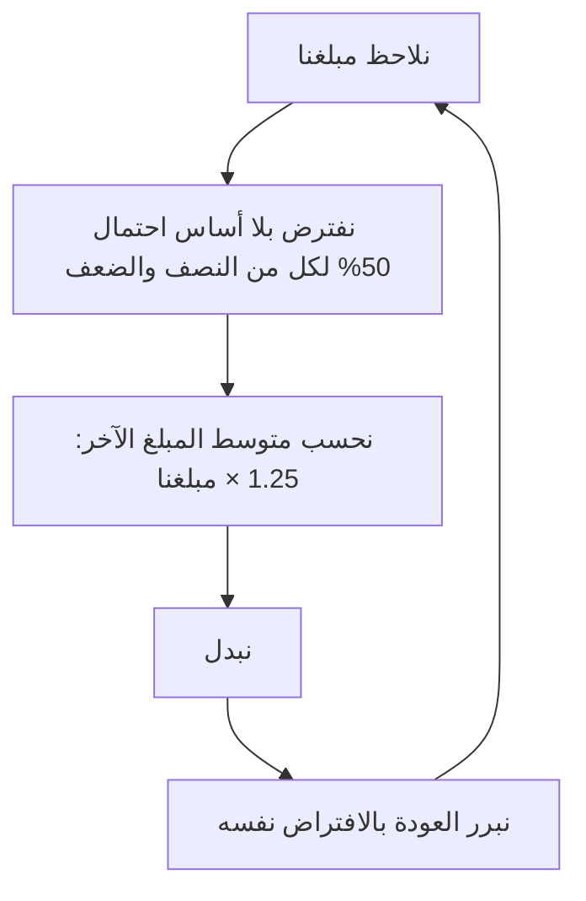
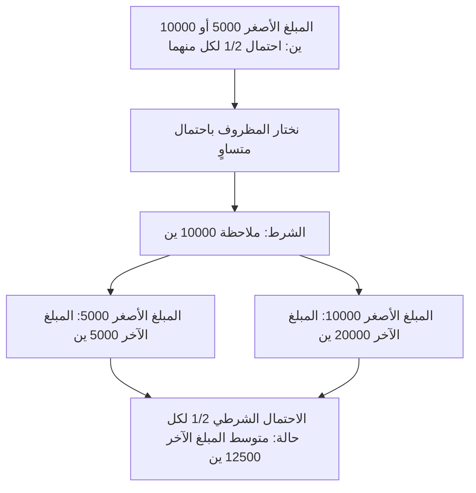

## 1. تحديد كيفية اختيار المظروف أولاً

يحتوي مظروفان متشابهان في المظهر على مال، وفي أحدهما ضعف المبلغ الموجود في الآخر. بعد اختيار أحدهما يمكنك تبديله. هل يفيد التبديل قبل الفتح أو بعد رؤية المبلغ؟

ليكن $S$ المبلغ الأصغر، وهو متغير عشوائي قيمه موجبة ومنتهية. يحتوي المظروفان على $S$ و$2S$. نختار أحدهما برمي قطعة نقدية عادلة، وتكون نتيجة الرمي مستقلة عن المحتويات. نرمز إلى المبلغ المختار بـ $X$ وإلى الآخر بـ $Y$. عند تثبيت المبلغ الأصغر عند $S=s$ تكون لكل من النتيجتين التاليتين احتمالية $1/2$.

$$
(X,Y)=(s,2s)\quad\text{or}\quad(X,Y)=(2s,s).
$$

الاختيار المتساوي الاحتمال قبل رؤية المبلغ لا يحدد الاحتمالات بعد ملاحظة مبلغ معين. لحسابها نحتاج أيضاً إلى **توزيع مسبق** يصف كيفية توليد المبلغ الأصغر. كون المبلغ منتهياً يخص كل قيمة متحققة، ولا يعني أن قيمته المتوقعة أو حداً أعلى للمبالغ يجب أن يكونا منتهيين.

## 2. الحساب المغري: «ربح 25% في كل تبديل»

افترض أنك لاحظت $X=x$. قد يغريك القول إن «المظروف الآخر يحتوي على النصف أو الضعف، باحتمال $1/2$ لكل منهما»، ثم تحسب:

$$
\frac12\cdot\frac{x}{2}+\frac12\cdot2x=\frac54x.
$$

الحساب العددي صحيح، لكن **افتراض تساوي الاحتمالين بعد ملاحظة المبلغ غير مبرر**. تكرار الحجة بعد التبديل يوحي بأن الذهاب والإياب يزيدان المال باستمرار. يوضح المخطط هذا الاستدلال الخاطئ، ولا يمثل استراتيجية صحيحة.

من المضلل أيضاً إرجاع الخطأ إلى أن المتغير العشوائي يأخذ قيماً مختلفة في حالات مختلفة؛ فهذه خاصية طبيعية للمتغيرات العشوائية. المشكلة هي تغيير ما يُعامل على أنه ثابت والاحتمالات التي تُستخدم أثناء الاستدلال.

## 3. التناظر قبل الفتح والقيمة المتوقعة المنتهية

عند تثبيت المبلغ الأصغر تتساوى القيمتان المتوقعتان قبل التبديل وبعده.

$$
\mathbb E[X\mid S=s]=\mathbb E[Y\mid S=s]=\frac{3s}{2}.
$$

حتى عندما يكون المبلغ الأصغر عشوائياً، يكون للمبلغ المختار والآخر التوزيع نفسه. وبخاصة، إذا كانت القيمة المتوقعة للمبلغ الأصغر منتهية،

$$
\mathbb E[X]=\mathbb E[Y]=\frac32\mathbb E[S]<\infty.
$$

إذن لا يزيد التبديل من القيمة المتوقعة للمال من دون ملاحظة أي مبلغ. لا ينفي ذلك وجود أفضلية شرطية عند ملاحظة مبلغ معين. وإذا كانت القيمة المتوقعة لانهائية، يبقى التناظر بين التوزيعين، لكن طرح لانهاية من لانهاية لا يحدد متوسط الربح.

## 4. بعد الفتح نحسب من التوزيع المسبق

لنبدأ بمبلغ أصغر ذي توزيع متقطع، ونكتب $p(s)=\Pr(S=s)$، مع كتلة احتمالية صفر خارج القيم الممكنة. لكل مبلغ $x$ يمكن ملاحظته باحتمال موجب، ليكن $q(x)$ هو الاحتمال الشرطي لاحتواء المظروف الآخر على الضعف. تعطينا [مبرهنة بايز](https://kenji.blog/ar/p/bayes-theorem/):

$$
q(x)=\Pr(Y=2x\mid X=x)=\frac{p(x)}{p(x)+p(x/2)}.
$$

يمثل البسط حالة تساوي المبلغ الأصغر مع المبلغ الملحوظ واختيار المظروف ذي المال الأقل. ويمثل الحد الآخر حالة كون المبلغ الأصغر نصف الملحوظ واختيار المظروف ذي المال الأكثر. تختزل عوامل احتمال الاختيار المشتركة، ويجب أن يكون المقام موجباً.

$$
\begin{aligned}\mathbb E[Y\mid X=x]&=2xq(x)+\frac{x}{2}(1-q(x)),\\ g(x)&=\mathbb E[Y\mid X=x]-x=\frac{x}{2}(3q(x)-1).\end{aligned}
$$

يزيد التبديل القيمة المتوقعة الشرطية للمبلغ عندما $q(x)>1/3$. لا يضمن ذلك ربحاً فعلياً. تستخدم هذه الصيغ كتلاً احتمالية متقطعة، ولا يمكن نقلها إلى كثافات مستمرة بمجرد الاستبدال.

## 5. متى تعطي ملاحظة 10,000 ين قيمة متوقعة قدرها 12,500؟

افترض أن المبلغ الأصغر هو 5,000 أو 10,000 ين، باحتمال 1/2 لكل منهما. نختار مظروفاً باحتمال متساوٍ ونلاحظ 10,000 ين. بشرط هذه الملاحظة، يكون المبلغ الآخر 5,000 أو 20,000 ين، باحتمال شرطي 1/2 لكل منهما. في هذا النموذج يكون الحساب السابق مبرراً.

$$
\mathbb E[Y\mid X=10000]=\frac12\cdot5000+\frac12\cdot20000=12500.
$$

يعرض المخطط الجزء المشروط بملاحظة 10,000 ين فقط. عند شمول جميع الملاحظات يكون مبلغك 5,000 أو 10,000 أو 20,000 ين، باحتمالات 1/4 و1/2 و1/4 على الترتيب. ويكون التغير الشرطي المتوقع عند التبديل 5,000 و2,500 و−10,000 ين على الترتيب، ومتوسطه صفر.

$$
\frac14\cdot5000+\frac12\cdot2500-\frac14\cdot10000=0.
$$

تضع الميزانية المحدودة حداً أعلى للمبالغ. إذا كان في النموذج أكبر مبلغ ممكن الملاحظة، فلا يمكن أن يحتوي المظروف الآخر على ضعفه. لكن هذا لا يعني أن احتمال الضعف ينخفض دائماً مع زيادة المبلغ الملحوظ. إذا كانت للمبالغ الأصغر 1 و2 و4 احتمالات 49/100 و1/100 و1/2، فإن $q(2)=1/50$، بينما $q(4)=50/51$. شكل التوزيع المسبق مهم.

## 6. مع قيمة متوقعة منتهية لا يمكن أن تكون الزيادة موجبة عند كل ملاحظة

إذا كانت القيمة المتوقعة للمبلغ الأصغر منتهية، فإن المتغير العشوائي $g(X)$ قابل للتكامل. وبحسب [قانون التوقع الكلي](https://ocw.mit.edu/courses/6-436j-fundamentals-of-probability-fall-2018/c1ab69cb198badcebee42d5880784439_MIT6_436JF18_rec3.pdf)،

$$
\mathbb E[g(X)]=\mathbb E[Y]-\mathbb E[X]=0.
$$

لذلك يستحيل أن يكون التغير الشرطي المتوقع موجباً باحتمال 1، أي بالتأكيد تقريباً. وفي النموذج المتقطع يستحيل أن يعطي التبديل تغيراً شرطياً متوقعاً موجباً عند كل ملاحظة ذات احتمال موجب. الفرض الأساسي هو **القيمة المتوقعة المنتهية**، وليس مجرد أن مجموع الاحتمالات يساوي واحداً.

## 7. توزيع مطبّع بقيمة متوقعة لانهائية يعطي مثالاً مضاداً

لننظر إلى التوزيع الذي تناقشه [مقالة بروم](https://users.ox.ac.uk/~sfop0060/pdf/Two%20envelope%20paradox.pdf):

$$
\Pr(S=2^n)=\frac13\left(\frac23\right)^n,\qquad n=0,1,2,\ldots.
$$

$$
\sum_{n=0}^{\infty}\frac13\left(\frac23\right)^n=1,\qquad \mathbb E[S]=\frac13\sum_{n=0}^{\infty}\left(\frac43\right)^n=\infty.
$$

هذا **توزيع احتمالي مطبّع مجموع احتمالاته 1**، وليس توزيعاً مسبقاً منتظماً يستحيل تطبيعه. عند ملاحظة $x=2^n$ مع $n\ge1$ نحصل على:

$$
q(x)=\frac25,\qquad \mathbb E[Y\mid X=x]=\frac25(2x)+\frac35\frac{x}{2}=\frac{11}{10}x>x.
$$

عند أصغر مبلغ ملحوظ، وهو 1، يكون المبلغ الآخر 2 بالتأكيد. وهكذا تتجاوز القيمة المتوقعة الشرطية للمبلغ الآخر مبلغك عند كل ملاحظة ذات احتمال موجب. لا نتناول هنا قيماً متوقعة شرطية عند ملاحظات خارج مجموعة المبالغ الممكنة.

مع ذلك لا نستنتج أن متوسط الربح غير الشرطي موجب. لنضع $D=Y-X$، مع الجزء الموجب $D^+=\max(D,0)$ والجزء السالب $D^-=\max(-D,0)$، وكلاهما غير سالب:

$$
\mathbb E[D^+]=\mathbb E[D^-]=\frac12\mathbb E[S]=\infty.
$$

القيمة المتوقعة لكل من الجزأين لانهائية، ولذلك فإن توقع الفرق الذي يمكن أن يأخذ الإشارتين [غير معرّف](https://www.stat.berkeley.edu/~wfithian/courses/stat210a/measure-theory-basics.html). أما قانون التوقع الكلي فيظل صحيحاً للمبلغ غير السالب:

$$
\mathbb E[\mathbb E[Y\mid X]]=\mathbb E[Y]=\infty.
$$

لا تُبطل اللانهاية القانون. ما لا يجوز هو تطبيق الطرح أو الخطية من حالة التوقعات المنتهية على فرق غير قابل للتكامل قد يحمل أياً من الإشارتين، من دون فحص الفروض. يجب فصل الحسابات المنتهية المشروطة بكل ملاحظة ممكنة عن التوقع غير الشرطي للفرق. إذا قطعنا التوزيع المسبق عند عدد منتهٍ من الحدود وأعدنا تطبيعه، تبقى خسارة عند أكبر ملاحظة ويعود متوسط التغير بالتبديل إلى صفر.

## 8. الكثافات المستمرة تحتاج أيضاً إلى تغيير المتغير

إذا كانت للمبلغ الأصغر كثافة مستمرة $f$، فإن فرع اختيار المبلغ الأصغر يساهم بـ $f(x)/2$ في كثافة المبلغ الملحوظ، بينما يساهم فرع المبلغ الأكبر بـ $f(x/2)/4$. يشمل الإسهام الثاني عامل الاختيار المتساوي الاحتمال وعامل تغيير المتغير $x=2s$ معاً.

$$
q(x)=\frac{f(x)}{f(x)+\tfrac12f(x/2)}.
$$

تُستخدم هذه الصيغة الشرطية حيث تكون كثافة المبلغ الملحوظ موجبة. لمتغير عشوائي ذي كثافة، احتمال الحدث الذي يأخذ فيه قيمة محددة واحدة يساوي صفراً؛ لسنا نقسم احتمالات أحداث متقطعة. ويقدم بروم أيضاً الكثافة المطبّعة التالية:

$$
f(s)=\frac{1}{(1+s)^2},\qquad s>0.
$$

تكاملها واحد، لكن القيمة المتوقعة للمبلغ الأصغر لانهائية. لكل مبلغ ملحوظ موجب،

$$
\frac{f(x/2)}{f(x)}=\frac{4(1+x)^2}{(2+x)^2}<4
\quad\Longrightarrow\quad q(x)>\frac13.
$$

إذن تتجاوز النسخة المستمرة من القيمة المتوقعة الشرطية التي تحددها هذه الكثافات مبلغك عند كل مبلغ ملحوظ موجب. وهذا مثال مضاد آخر لادعاء أن التطبيع وحده يفرض عدم أفضلية التبديل عند بعض المبالغ.

## 9. نسب التبديل والقرارات واللانهاية

للنسبة قبل الفتح $R=Y/X$، يعطي الاختيار المتساوي الاحتمال نسبة 2 أو 1/2 باحتمال 1/2 لكل حالة. قيمتها المتوقعة بالفعل 5/4، وكذلك القيمة المتوقعة لمقلوبها. في تبديلين متتاليين تكون كل نسبة مقلوب الأخرى، ولا تكون النسبتان مستقلتين.

$$
\mathbb E[R]=\mathbb E[1/R]=\frac54,\qquad \mathbb E[R(1/R)]=1\ne\frac{25}{16}=\mathbb E[R]\mathbb E[1/R].
$$

العودة إلى المظروف الأصلي تعيد المبلغ الأصلي. لا يجوز بلا تبرير ضرب مبلغك في المتوسط غير الشرطي للنسبة، أو ضرب متوسطي نسبتي التبديل أحدهما في الآخر. كما أن رؤية المبلغين تغير المعلومات: يزول عدم اليقين بين النصف والضعف.

ترتبط المسألة بـ[مفارقة سانت بطرسبرغ](https://kenji.blog/ar/p/st-petersburg-paradox/)، التي تتناول أيضاً رهانات بقيمة متوقعة لانهائية. قد تغير حدود الميزانية الواقعية وطريقة توليد المبالغ والمنفعة والموقف من المخاطر القرار. المقارنة هنا بين مبالغ متوقعة، وليست قاعدة قرار عامة أو ربحاً مضموناً.

تحتاج الاحتمالات الشرطية إلى نموذج لتوليد المبالغ، والتطبيع ليس هو امتلاك قيمة متوقعة منتهية. مع التوقع المنتهي يعطي التناظر وقانون التوقع الكلي متوسط تغير بالتبديل يساوي صفراً. ومع التوقع اللانهائي تقدم توزيعات مطبّعة أمثلة مضادة: يجب التمييز بين التوقع اللانهائي لمتغير غير سالب والتوقع غير المعرّف لفرق قد يكون موجباً أو سالباً.
