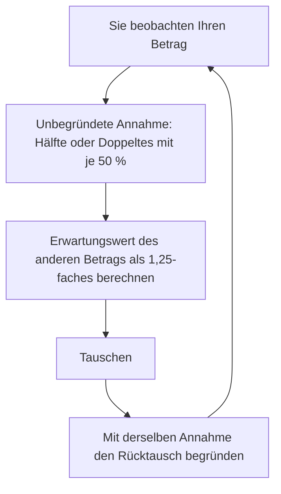
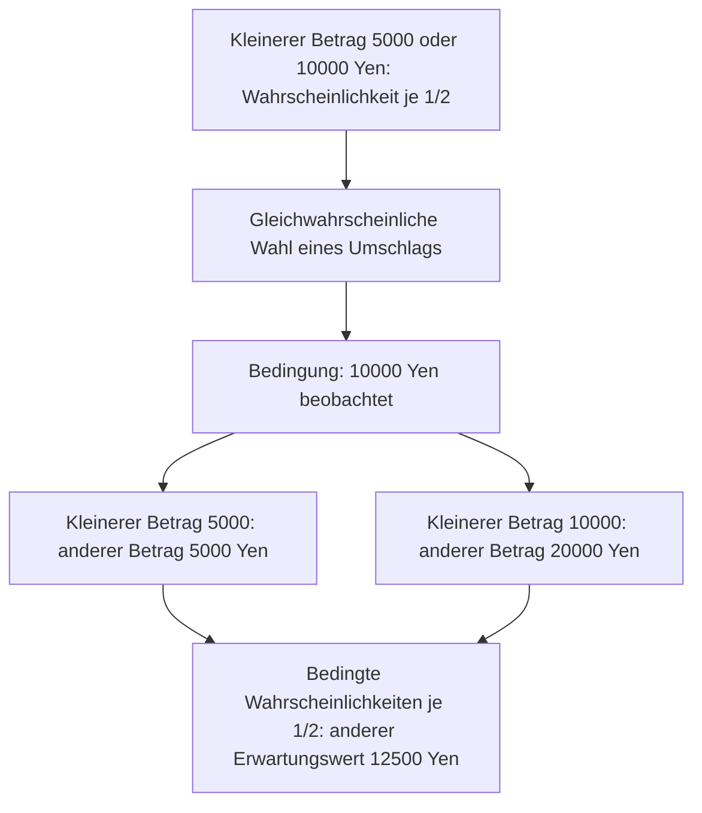

## 1. Zuerst festlegen, wie der Umschlag gewählt wird

Zwei gleich aussehende Umschläge enthalten Geld. In einem liegt doppelt so viel wie im anderen. Nach der Wahl dürfen Sie tauschen. Ist das vor dem Öffnen oder nach dem Ablesen des Betrags vorteilhaft?

Sei $S$ der kleinere Betrag, eine strikt positive, endliche Zufallsvariable. Die Umschläge enthalten $S$ und $2S$. Wir wählen einen durch einen fairen Münzwurf, dessen Ergebnis von den Inhalten unabhängig ist. $X$ bezeichnet den gewählten Betrag, $Y$ den anderen. Unter der Bedingung eines festen kleineren Betrags $S=s$ treten die folgenden beiden Ergebnisse jeweils mit Wahrscheinlichkeit $1/2$ auf.

$$
(X,Y)=(s,2s)\quad\text{or}\quad(X,Y)=(2s,s).
$$

Die gleichwahrscheinliche Wahl vor dem Ablesen bestimmt nicht die Wahrscheinlichkeiten nach Beobachtung eines bestimmten Betrags. Dafür benötigt man auch eine **A-priori-Verteilung**, die beschreibt, wie der kleinere Betrag erzeugt wird. „Endlicher Betrag“ bezieht sich auf jede Realisierung, nicht auf einen endlichen Erwartungswert oder eine endliche obere Schranke der Beträge.

## 2. Die verlockende Rechnung mit „25 % Gewinn bei jedem Tausch“

Angenommen, Sie beobachten $X=x$. Dann liegt die Überlegung nahe: „Der andere Umschlag enthält die Hälfte oder das Doppelte, jeweils mit Wahrscheinlichkeit $1/2$.“ Das führt zur Rechnung:

$$
\frac12\cdot\frac{x}{2}+\frac12\cdot2x=\frac54x.
$$

Die Arithmetik stimmt, aber **die Gleichwahrscheinlichkeit nach Beobachtung des Betrags ist nicht begründet**. Wiederholt man die Überlegung nach dem Tausch, scheint jedes Hin- und Hertauschen das Geld zu vermehren. Das Diagramm zeigt diesen Fehlschluss, keine gültige Strategie.

Auch die Erklärung, der Fehler liege darin, dass eine Zufallsvariable in verschiedenen Fällen verschiedene Werte annimmt, ist irreführend. Genau das ist eine normale Eigenschaft von Zufallsvariablen. Problematisch ist, unterwegs zu ändern, was als fest vorausgesetzt wird und welche Wahrscheinlichkeiten gelten.

## 3. Symmetrie vor dem Öffnen und endliche Erwartungswerte

Bei festem kleinerem Betrag stimmen die Erwartungswerte vor und nach dem Tausch überein.

$$
\mathbb E[X\mid S=s]=\mathbb E[Y\mid S=s]=\frac{3s}{2}.
$$

Auch wenn der kleinere Betrag zufällig ist, haben der gewählte und der andere Betrag dieselbe Verteilung. Insbesondere gilt bei endlichem Erwartungswert des kleineren Betrags:

$$
\mathbb E[X]=\mathbb E[Y]=\frac32\mathbb E[S]<\infty.
$$

Ohne Beobachtung eines Betrags erhöht ein Tausch den erwarteten Geldbetrag also nicht. Das schließt einen bedingten Vorteil bei einer bestimmten Beobachtung nicht aus. Bei unendlichem Erwartungswert bleibt die Verteilungssymmetrie erhalten; durch Subtraktion zweier Unendlichkeiten lässt sich jedoch kein mittlerer Gewinn bestimmen.

## 4. Nach dem Öffnen aus der A-priori-Verteilung rechnen

Betrachten wir zunächst einen diskreten kleineren Betrag mit $p(s)=\Pr(S=s)$ und Wahrscheinlichkeitsmasse null außerhalb seines Trägers. Für einen mit positiver Wahrscheinlichkeit beobachtbaren Betrag $x$ bezeichne $q(x)$ die bedingte Wahrscheinlichkeit, dass der andere Umschlag das Doppelte enthält. Der [Satz von Bayes](https://kenji.blog/de/p/bayes-theorem/) liefert:

$$
q(x)=\Pr(Y=2x\mid X=x)=\frac{p(x)}{p(x)+p(x/2)}.
$$

Der Zähler entspricht dem Fall, dass der kleinere Betrag dem beobachteten entspricht und der Umschlag mit weniger Geld gewählt wurde. Der andere Term entspricht dem Fall, dass der kleinere Betrag die Hälfte des beobachteten ist und der Umschlag mit mehr Geld gewählt wurde. Die gemeinsamen Auswahlfaktoren kürzen sich. Der Nenner muss positiv sein.

$$
\begin{aligned}\mathbb E[Y\mid X=x]&=2xq(x)+\frac{x}{2}(1-q(x)),\\ g(x)&=\mathbb E[Y\mid X=x]-x=\frac{x}{2}(3q(x)-1).\end{aligned}
$$

Ein Tausch erhöht den bedingten Erwartungswert des Geldbetrags genau dann, wenn $q(x)>1/3$. Das garantiert keinen tatsächlichen Gewinn. Diese Formeln verwenden diskrete Wahrscheinlichkeitsmassen; sie lassen sich nicht durch bloßes Ersetzen auf stetige Dichten übertragen.

## 5. Wann 10.000 beobachtete Yen einen Erwartungswert von 12.500 ergeben

Der kleinere Betrag sei mit Wahrscheinlichkeit 1/2 jeweils 5.000 oder 10.000 Yen. Wir wählen einen Umschlag gleichwahrscheinlich und beobachten 10.000 Yen. Bedingt auf diese Beobachtung enthält der andere Umschlag 5.000 oder 20.000 Yen, jeweils mit Wahrscheinlichkeit 1/2. In diesem Modell ist die frühere Rechnung begründet.

$$
\mathbb E[Y\mid X=10000]=\frac12\cdot5000+\frac12\cdot20000=12500.
$$

Das Diagramm zeigt nur den auf 10.000 beobachtete Yen bedingten Ausschnitt. Über alle Beobachtungen hinweg beträgt Ihr Betrag 5.000, 10.000 oder 20.000 Yen mit den Wahrscheinlichkeiten 1/4, 1/2 und 1/4. Die jeweiligen bedingten erwarteten Tauschgewinne sind 5.000, 2.500 und −10.000 Yen; ihr Mittel ist null.

$$
\frac14\cdot5000+\frac12\cdot2500-\frac14\cdot10000=0.
$$

Ein endliches Budget beschränkt die Beträge. Hat das Modell einen größten beobachtbaren Betrag, kann diesem kein doppelt so hoher Betrag gegenüberstehen. Das bedeutet aber nicht, dass die Wahrscheinlichkeit einer Verdopplung mit dem beobachteten Betrag stets abnimmt. Haben die kleineren Beträge 1, 2 und 4 die Wahrscheinlichkeiten 49/100, 1/100 und 1/2, dann gilt $q(2)=1/50$, aber $q(4)=50/51$. Entscheidend ist die Form der A-priori-Verteilung.

## 6. Bei endlichem Erwartungswert kein Vorteil bei jeder Beobachtung

Hat der kleinere Betrag einen endlichen Erwartungswert, ist $g(X)$ integrierbar. Mit dem [Satz vom totalen Erwartungswert](https://ocw.mit.edu/courses/6-436j-fundamentals-of-probability-fall-2018/c1ab69cb198badcebee42d5880784439_MIT6_436JF18_rec3.pdf) folgt:

$$
\mathbb E[g(X)]=\mathbb E[Y]-\mathbb E[X]=0.
$$

Der bedingte erwartete Gewinn kann daher nicht fast sicher strikt positiv sein. Im diskreten Modell kann ein Tausch nicht bei jeder Beobachtung positiver Wahrscheinlichkeit strikt vorteilhaft sein. Die entscheidende Voraussetzung ist ein **endlicher Erwartungswert**, nicht nur die Normierung der Wahrscheinlichkeiten auf eins.

## 7. Eine normierte A-priori-Verteilung mit unendlichem Erwartungswert als Gegenbeispiel

Betrachten wir die in [Broomes Aufsatz](https://users.ox.ac.uk/~sfop0060/pdf/Two%20envelope%20paradox.pdf) behandelte Verteilung:

$$
\Pr(S=2^n)=\frac13\left(\frac23\right)^n,\qquad n=0,1,2,\ldots.
$$

$$
\sum_{n=0}^{\infty}\frac13\left(\frac23\right)^n=1,\qquad \mathbb E[S]=\frac13\sum_{n=0}^{\infty}\left(\frac43\right)^n=\infty.
$$

Das ist eine **eigentliche, normierte Wahrscheinlichkeitsverteilung**, keine uneigentliche gleichförmige A-priori-Verteilung. Bei einer Beobachtung $x=2^n$ mit $n\ge1$ gilt:

$$
q(x)=\frac25,\qquad \mathbb E[Y\mid X=x]=\frac25(2x)+\frac35\frac{x}{2}=\frac{11}{10}x>x.
$$

Beim kleinsten beobachtbaren Betrag 1 ist der andere Betrag sicher 2. Somit übersteigt der bedingte Erwartungswert des anderen Betrags bei jeder Beobachtung positiver Wahrscheinlichkeit Ihren Betrag. Das ist keine Aussage über Bedingungen außerhalb des Trägers.

Ein positiver unbedingter mittlerer Gewinn folgt daraus dennoch nicht. Setzen wir $D=Y-X$ mit positivem Teil $D^+=\max(D,0)$ und negativem Teil $D^-=\max(-D,0)$, so gilt:

$$
\mathbb E[D^+]=\mathbb E[D^-]=\frac12\mathbb E[S]=\infty.
$$

Beide Teile haben unendlichen Erwartungswert. Der Erwartungswert der vorzeichenbehafteten Differenz ist deshalb [nicht definiert](https://www.stat.berkeley.edu/~wfithian/courses/stat210a/measure-theory-basics.html). Der Satz vom totalen Erwartungswert gilt dagegen weiterhin für den nichtnegativen Geldbetrag:

$$
\mathbb E[\mathbb E[Y\mid X]]=\mathbb E[Y]=\infty.
$$

Unendlichkeit setzt den Satz nicht außer Kraft. Unzulässig ist, die Subtraktion oder Linearität aus dem Fall endlicher Erwartungswerte ohne Prüfung der Voraussetzungen auf eine nicht integrierbare vorzeichenbehaftete Differenz anzuwenden. Die endlichen Rechnungen unter jeder möglichen Beobachtung sind vom unbedingten Erwartungswert der Differenz zu unterscheiden. Schneidet man die A-priori-Verteilung nach endlich vielen Werten ab und normiert sie neu, bleibt bei der größten Beobachtung ein Verlust; der mittlere Tauschgewinn ist wieder null.

## 8. Stetige Dichten erfordern eine Variablentransformation

Hat der kleinere Betrag die stetige Dichte $f$, trägt der Zweig mit Wahl des kleineren Betrags die Dichte $f(x)/2$ bei, der Zweig mit Wahl des größeren Betrags dagegen $f(x/2)/4$. Der zweite Beitrag enthält sowohl den Faktor der gleichwahrscheinlichen Auswahl als auch den der Variablentransformation $x=2s$.

$$
q(x)=\frac{f(x)}{f(x)+\tfrac12f(x/2)}.
$$

Diese bedingte Dichteformel wird dort verwendet, wo die Dichte des beobachteten Betrags positiv ist. Für eine Zufallsvariable mit Dichte hat das Ereignis, einen bestimmten Einzelwert anzunehmen, Wahrscheinlichkeit null. Es handelt sich nicht um einen Quotienten diskreter Ereigniswahrscheinlichkeiten. Broome nennt auch die normierte Dichte:

$$
f(s)=\frac{1}{(1+s)^2},\qquad s>0.
$$

Ihr Integral ist eins, der Erwartungswert des kleineren Betrags aber unendlich. Für einen positiven beobachteten Betrag gilt:

$$
\frac{f(x/2)}{f(x)}=\frac{4(1+x)^2}{(2+x)^2}<4
\quad\Longrightarrow\quad q(x)>\frac13.
$$

Die durch diese Dichten bestimmte stetige Version des bedingten Erwartungswerts liegt daher bei jedem positiven beobachteten Betrag über Ihrem Betrag. Auch das widerlegt die Behauptung, allein die Normierung müsse einen Tausch bei manchen Beträgen ungünstig machen.

## 9. Tauschverhältnisse, Entscheidungen und Unendlichkeit

Für das Verhältnis vor dem Öffnen $R=Y/X$ ergibt die gleichwahrscheinliche Wahl die Werte 2 oder 1/2 mit Wahrscheinlichkeit 1/2 je Fall. Sein Erwartungswert ist tatsächlich 5/4, ebenso der des Kehrwerts. Die Verhältnisse zweier aufeinanderfolgender Tausche sind jedoch Kehrwerte voneinander und nicht unabhängig.

$$
\mathbb E[R]=\mathbb E[1/R]=\frac54,\qquad \mathbb E[R(1/R)]=1\ne\frac{25}{16}=\mathbb E[R]\mathbb E[1/R].
$$

Beim Zurücktauschen erhalten Sie wieder den ursprünglichen Betrag. Sie dürfen Ihren Betrag nicht ohne Begründung mit dem unbedingten mittleren Verhältnis multiplizieren oder die mittleren Verhältnisse zweier Tausche miteinander multiplizieren. Wenn Sie beide Beträge gesehen haben, hat sich zudem die Information geändert: Die Unsicherheit zwischen Hälfte und Doppeltem ist verschwunden.

Das Problem hängt mit dem [Sankt-Petersburg-Paradoxon](https://kenji.blog/de/p/st-petersburg-paradox/) zusammen, das ebenfalls Glücksspiele mit unendlichem Erwartungswert behandelt. Reale Budgetgrenzen, die Erzeugung der Beträge, Nutzen und Risikoeinstellung können die Entscheidung verändern. Hier werden erwartete Geldbeträge verglichen, keine universelle Entscheidungsregel oder ein sicherer Gewinn versprochen.

Bedingte Wahrscheinlichkeiten benötigen ein Modell für die Beträge, und Normierung ist nicht dasselbe wie ein endlicher Erwartungswert. Bei endlichem Erwartungswert ergeben Symmetrie und der Satz vom totalen Erwartungswert einen mittleren Tauschgewinn von null. Bei unendlichem Erwartungswert liefern normierte Verteilungen Gegenbeispiele: Der unendliche Erwartungswert einer nichtnegativen Variablen ist sorgfältig vom undefinierten Erwartungswert einer vorzeichenbehafteten Differenz zu unterscheiden.
