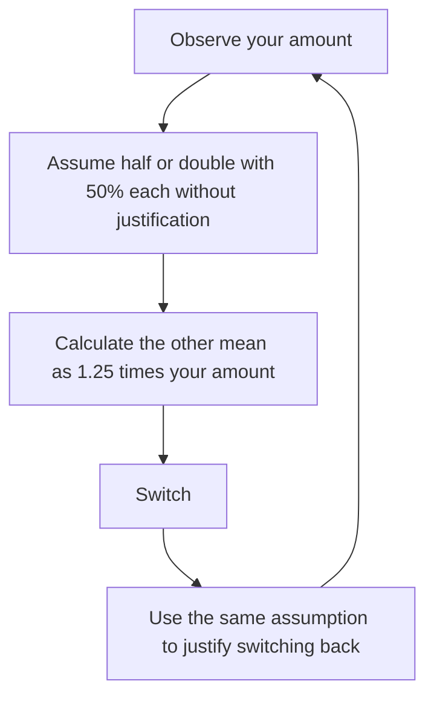
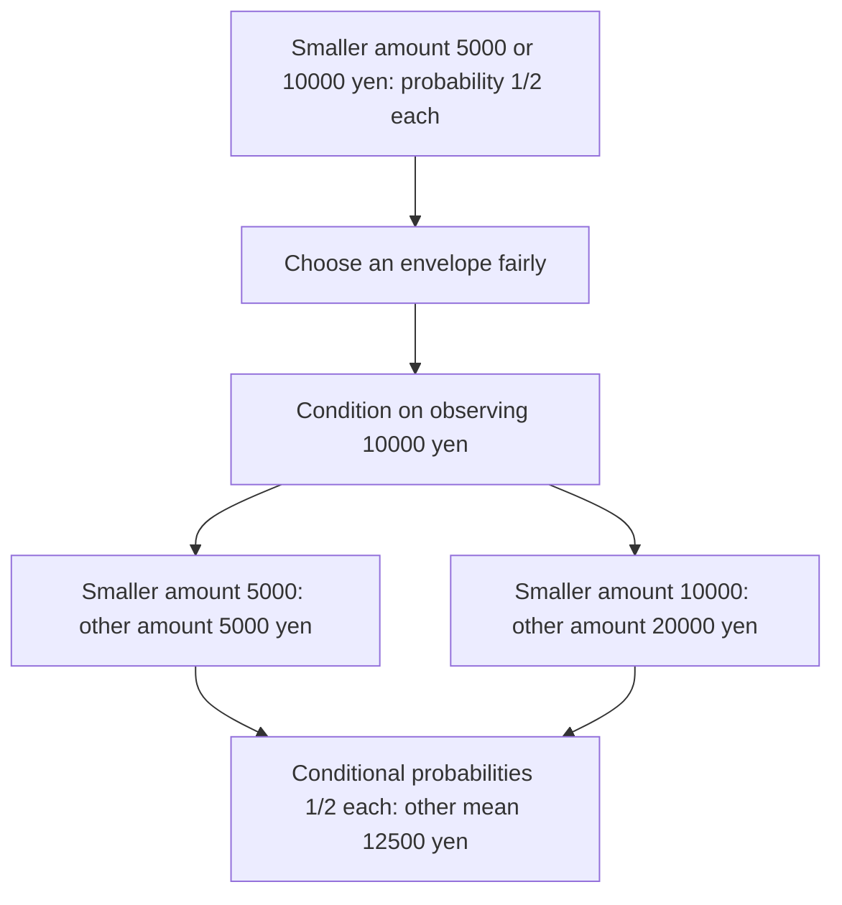

## 1. Specify how the envelope is chosen

Two identical-looking envelopes contain money, one holding twice as much as the other. After choosing one, you may switch. Should you switch before opening it, or after seeing the amount?

Let the smaller amount be a positive, finite random variable $S$, so that the envelopes contain $S$ and $2S$. Choose an envelope by a fair coin toss independent of their contents. Write $X$ for the selected amount and $Y$ for the other amount. Conditional on a fixed smaller amount $S=s$, the following two outcomes each have probability $1/2$.

$$
(X,Y)=(s,2s)\quad\text{or}\quad(X,Y)=(2s,s).
$$

A fair choice before seeing an amount is different from a probability after observing a particular amount. The latter also requires a **prior distribution** describing how the smaller amount is generated. A “finite amount” here means a finite realization on each play; it does not imply a finite mean or a finite upper bound.

## 2. The tempting “25% gain every time” calculation

Suppose your amount is $X=x$. It is tempting to say, “The other envelope contains half or twice as much, each with probability $1/2$,” and calculate:

$$
\frac12\cdot\frac{x}{2}+\frac12\cdot2x=\frac54x.
$$

The arithmetic is correct, but **the assumption of equal probabilities after observing the amount is unsupported**. Repeating the same reasoning after switching would suggest that moving back and forth keeps increasing the money. The following diagram depicts the faulty reasoning, not a valid strategy.

It is also misleading to blame the paradox on a random variable taking different values in different cases. That is what random variables do. The issue is changing what is held fixed and which probabilities are being used.

## 3. Symmetry before opening, and finite means

With the smaller amount fixed, the expected amounts before and after switching agree.

$$
\mathbb E[X\mid S=s]=\mathbb E[Y\mid S=s]=\frac{3s}{2}.
$$

Even when the smaller amount is random, the selected and other amounts have the same distribution. In particular, if the smaller amount has a finite expectation,

$$
\mathbb E[X]=\mathbb E[Y]=\frac32\mathbb E[S]<\infty.
$$

Thus, switching without observing anything does not increase expected money. This does not rule out an advantage conditional on a particular observed amount. If the mean is infinite, the distributional symmetry remains, but subtracting two infinities cannot establish an average gain.

## 4. After opening, calculate from the prior

First consider a discrete smaller amount, with $p(s)=\Pr(S=s)$ and zero mass off its support. For an amount $x$ that can be observed with positive probability, let $q(x)$ be the conditional probability that the other envelope contains twice as much. [Bayes' theorem](https://kenji.blog/en/p/bayes-theorem/) gives:

$$
q(x)=\Pr(Y=2x\mid X=x)=\frac{p(x)}{p(x)+p(x/2)}.
$$

The numerator corresponds to the smaller amount equaling the observation and the smaller envelope being selected. The other term corresponds to the smaller amount being half the observation and the larger envelope being selected. The common selection probabilities cancel. The denominator must be positive.

$$
\begin{aligned}\mathbb E[Y\mid X=x]&=2xq(x)+\frac{x}{2}(1-q(x)),\\ g(x)&=\mathbb E[Y\mid X=x]-x=\frac{x}{2}(3q(x)-1).\end{aligned}
$$

Switching improves conditional expected money when $q(x)>1/3$. This does not mean a realized profit is guaranteed. These formulas use discrete probability masses; they cannot be transferred to continuous densities by simple substitution.

## 5. When a 10,000-yen observation really gives a 12,500-yen mean

Suppose the smaller amount is 5,000 or 10,000 yen, each with probability 1/2. Choose an envelope fairly and observe 10,000 yen. Conditional on this observation, the other amount is 5,000 or 20,000 yen, each with probability 1/2. This model justifies the earlier calculation.

$$
\mathbb E[Y\mid X=10000]=\frac12\cdot5000+\frac12\cdot20000=12500.
$$

The diagram shows only the slice conditioned on observing 10,000 yen. Across all observations, your amount is 5,000, 10,000, or 20,000 yen with probabilities 1/4, 1/2, and 1/4. The respective conditional switching gains are 5,000, 2,500, and −10,000 yen, averaging to zero.

$$
\frac14\cdot5000+\frac12\cdot2500-\frac14\cdot10000=0.
$$

A finite budget bounds the amounts. In a model with a largest possible observation, that observation cannot have a double-sized counterpart. This does not mean the probability of doubling always decreases with the observed amount. If smaller amounts 1, 2, and 4 have probabilities 49/100, 1/100, and 1/2, then $q(2)=1/50$ but $q(4)=50/51$. The shape of the prior matters.

## 6. A gain at every observation is impossible with a finite mean

If the smaller amount has a finite mean, $g(X)$ is integrable. The [law of total expectation](https://ocw.mit.edu/courses/6-436j-fundamentals-of-probability-fall-2018/c1ab69cb198badcebee42d5880784439_MIT6_436JF18_rec3.pdf) gives:

$$
\mathbb E[g(X)]=\mathbb E[Y]-\mathbb E[X]=0.
$$

Consequently, the conditional gain cannot be strictly positive almost surely. In a discrete model, switching cannot be strictly favorable at every observation of positive probability. The crucial assumption is a **finite mean**, not merely probabilities summing to one.

## 7. A proper infinite-mean prior provides a counterexample

Consider the following distribution discussed in [Broome's paper](https://users.ox.ac.uk/~sfop0060/pdf/Two%20envelope%20paradox.pdf).

$$
\Pr(S=2^n)=\frac13\left(\frac23\right)^n,\qquad n=0,1,2,\ldots.
$$

$$
\sum_{n=0}^{\infty}\frac13\left(\frac23\right)^n=1,\qquad \mathbb E[S]=\frac13\sum_{n=0}^{\infty}\left(\frac43\right)^n=\infty.
$$

This is a **proper, normalized probability distribution**, not an improper uniform prior. For an observation $x=2^n$ with $n\ge1$,

$$
q(x)=\frac25,\qquad \mathbb E[Y\mid X=x]=\frac25(2x)+\frac35\frac{x}{2}=\frac{11}{10}x>x.
$$

At the smallest observation, 1, the other amount is certainly 2. Thus, at every observation of positive probability, the other envelope's conditional expected amount exceeds yours. This makes no claim about conditioning on amounts outside the support.

Nevertheless, this does not establish a positive unconditional average profit. Put $D=Y-X$, with positive part $D^+=\max(D,0)$ and negative part $D^-=\max(-D,0)$:

$$
\mathbb E[D^+]=\mathbb E[D^-]=\frac12\mathbb E[S]=\infty.
$$

Both parts are infinite, so the expected signed difference is [undefined](https://www.stat.berkeley.edu/~wfithian/courses/stat210a/measure-theory-basics.html). The law of total expectation still holds for the nonnegative amount:

$$
\mathbb E[\mathbb E[Y\mid X]]=\mathbb E[Y]=\infty.
$$

Infinity does not break the law. What fails is importing finite-mean subtraction or linearity into a nonintegrable signed difference without checking their conditions. Finite calculations conditional on each possible observation must be distinguished from an unconditional signed expectation. Truncating and renormalizing the prior leaves a loss at the largest observation and restores zero average switching gain.

## 8. Continuous densities require a change of variables

If the smaller amount has a continuous density $f$, the selected-smaller branch contributes density $f(x)/2$, while the selected-larger branch contributes $f(x/2)/4$. The latter includes both the fair-selection factor and the change-of-variables factor from $x=2s$.

$$
q(x)=\frac{f(x)}{f(x)+\tfrac12f(x/2)}.
$$

Use this conditional-density formula where the observation density is positive. A single exact observation of a continuous variable has probability zero, so this is not a ratio of discrete event probabilities. Broome's paper also gives the proper density:

$$
f(s)=\frac{1}{(1+s)^2},\qquad s>0.
$$

It integrates to one but has an infinite mean for the smaller amount. For a positive observed amount,

$$
\frac{f(x/2)}{f(x)}=\frac{4(1+x)^2}{(2+x)^2}<4
\quad\Longrightarrow\quad q(x)>\frac13.
$$

Thus, the continuous version of the conditional expected amount determined by these densities exceeds your amount at every positive observation. This is another counterexample to the claim that normalization alone forces switching to be unfavorable somewhere.

## 9. Switching ratios, decisions, and infinity

For the unopened-envelope ratio $R=Y/X$, fair selection gives a ratio of 2 or 1/2 with probability 1/2 each. Its mean really is 5/4, as is the mean reciprocal ratio. The ratios of two successive switches are reciprocals, however, not independent.

$$
\mathbb E[R]=\mathbb E[1/R]=\frac54,\qquad \mathbb E[R(1/R)]=1\ne\frac{25}{16}=\mathbb E[R]\mathbb E[1/R].
$$

Returning to the original envelope returns to the original amount. One cannot multiply one's amount by an unconditional mean ratio, or multiply the mean ratios of two switches, without justification. Seeing both amounts also changes the information: the uncertainty about half versus double disappears.

The problem is related to the [St. Petersburg paradox](https://kenji.blog/en/p/st-petersburg-paradox/), which also involves infinite-mean gambles. Real budget limits, the way amounts are generated, utility, and attitudes toward risk can change decisions. The comparisons here concern expected money, not a universal decision rule or a guaranteed profit.

The key points are that conditional probabilities need a model for the amounts, and normalization differs from a finite mean. With a finite mean, symmetry and total expectation give zero average switching gain. Proper counterexamples exist with infinite means, requiring a careful distinction between a nonnegative infinite expectation and an undefined signed expectation.
