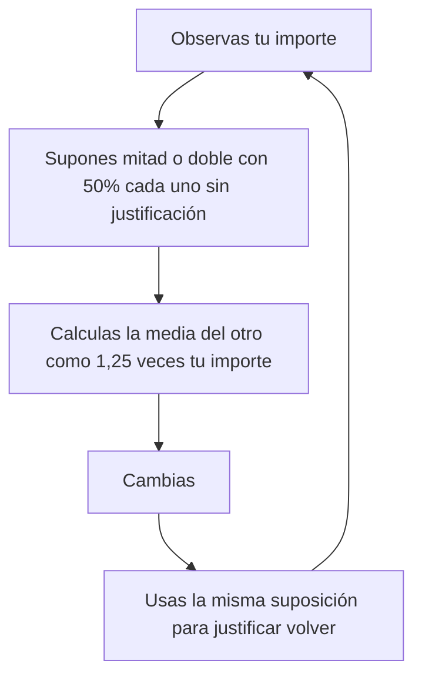
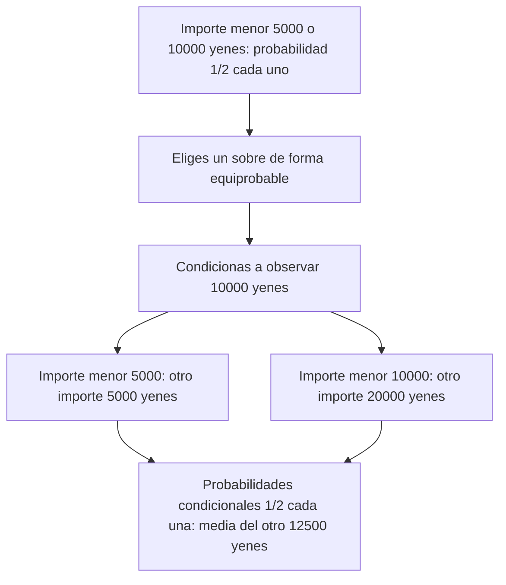

## 1. Especificar cómo se elige el sobre

Dos sobres de aspecto idéntico contienen dinero: uno guarda el doble que el otro. Tras elegir uno, puedes cambiarlo. ¿Conviene hacerlo antes de abrirlo o después de ver su contenido?

Sea $S$ el importe menor, una variable aleatoria positiva y finita. Los sobres contienen $S$ y $2S$. Elige uno lanzando una moneda equilibrada, cuyo resultado sea independiente de los contenidos. Llamaremos $X$ al importe elegido y $Y$ al otro. Condicionando a un importe menor fijo $S=s$, estos dos resultados tienen probabilidad $1/2$ cada uno.

$$
(X,Y)=(s,2s)\quad\text{or}\quad(X,Y)=(2s,s).
$$

La elección equiprobable antes de ver un importe no determina las probabilidades después de observarlo. Para calcular estas últimas hace falta también una **distribución a priori** que describa cómo se genera el importe menor. «Importe finito» se refiere a cada realización, no a que la esperanza o la cota superior de los importes sean finitas.

## 2. El tentador cálculo de «ganar un 25% cada vez»

Supón que observas $X=x$. Resulta tentador decir: «El otro sobre tiene la mitad o el doble, con probabilidad $1/2$ cada uno», y calcular:

$$
\frac12\cdot\frac{x}{2}+\frac12\cdot2x=\frac54x.
$$

La aritmética es correcta, pero **la equiprobabilidad después de observar el importe no está justificada**. Repetir el argumento tras cambiar sugeriría que ir y volver aumenta el dinero sin cesar. El siguiente diagrama muestra ese razonamiento erróneo, no una estrategia válida.

Tampoco es adecuado atribuir el error a que una variable aleatoria toma valores distintos en casos distintos: eso es precisamente lo que hacen las variables aleatorias. El problema es cambiar qué se mantiene fijo y qué probabilidades se utilizan.

## 3. Simetría antes de abrir y esperanza finita

Fijado el importe menor, los importes esperados antes y después de cambiar coinciden.

$$
\mathbb E[X\mid S=s]=\mathbb E[Y\mid S=s]=\frac{3s}{2}.
$$

Aunque el importe menor sea aleatorio, el importe elegido y el otro tienen la misma distribución. En particular, si la esperanza del importe menor es finita,

$$
\mathbb E[X]=\mathbb E[Y]=\frac32\mathbb E[S]<\infty.
$$

Por tanto, cambiar sin observar ningún importe no aumenta el dinero esperado. Esto no descarta una ventaja condicionada a un importe observado concreto. Si la esperanza es infinita, la simetría de las distribuciones se mantiene, pero restar dos infinitos no permite establecer una ganancia media.

## 4. Después de abrir, calcular a partir de la distribución a priori

Consideremos primero un importe menor discreto, con $p(s)=\Pr(S=s)$ y masa nula fuera de su soporte. Para un importe $x$ observable con probabilidad positiva, sea $q(x)$ la probabilidad condicional de que el otro sobre contenga el doble. El [teorema de Bayes](https://kenji.blog/es/p/bayes-theorem/) da:

$$
q(x)=\Pr(Y=2x\mid X=x)=\frac{p(x)}{p(x)+p(x/2)}.
$$

El numerador corresponde a que el importe menor sea el observado y se haya elegido el sobre menor. El otro término corresponde a que el importe menor sea la mitad de lo observado y se haya elegido el sobre mayor. Los factores comunes de la selección se cancelan. El denominador debe ser positivo.

$$
\begin{aligned}\mathbb E[Y\mid X=x]&=2xq(x)+\frac{x}{2}(1-q(x)),\\ g(x)&=\mathbb E[Y\mid X=x]-x=\frac{x}{2}(3q(x)-1).\end{aligned}
$$

Cambiar mejora el importe esperado condicional cuando $q(x)>1/3$. Esto no garantiza una ganancia realizada. Estas fórmulas usan masas de probabilidad discretas; no se pueden trasladar a densidades continuas mediante una simple sustitución.

## 5. Cuándo observar 10 000 yenes da una esperanza de 12 500

Supongamos que el importe menor es de 5 000 o 10 000 yenes, con probabilidad 1/2 cada uno. Elegimos un sobre de forma equiprobable y observamos 10 000 yenes. Condicionado a esta observación, el otro importe es de 5 000 o 20 000 yenes, con probabilidad 1/2 cada uno. En este modelo, el cálculo anterior sí está justificado.

$$
\mathbb E[Y\mid X=10000]=\frac12\cdot5000+\frac12\cdot20000=12500.
$$

El diagrama solo muestra la parte condicionada a observar 10 000 yenes. Considerando todas las observaciones, tu importe es de 5 000, 10 000 o 20 000 yenes con probabilidades 1/4, 1/2 y 1/4. Las ganancias condicionales al cambiar son, respectivamente, 5 000, 2 500 y −10 000 yenes, y su media es cero.

$$
\frac14\cdot5000+\frac12\cdot2500-\frac14\cdot10000=0.
$$

Un presupuesto finito acota los importes. Si el modelo admite un importe máximo observable, este no puede tener un importe correspondiente que sea el doble. Eso no implica que la probabilidad de obtener el doble siempre disminuya con el importe observado. Si los importes menores 1, 2 y 4 tienen probabilidades 49/100, 1/100 y 1/2, entonces $q(2)=1/50$, pero $q(4)=50/51$. Importa la forma de la distribución a priori.

## 6. Con esperanza finita, no puede haber ventaja en toda observación

Si el importe menor tiene esperanza finita, $g(X)$ es integrable. La [ley de la esperanza total](https://ocw.mit.edu/courses/6-436j-fundamentals-of-probability-fall-2018/c1ab69cb198badcebee42d5880784439_MIT6_436JF18_rec3.pdf) da:

$$
\mathbb E[g(X)]=\mathbb E[Y]-\mathbb E[X]=0.
$$

Por tanto, no puede cumplirse que la ganancia condicional sea estrictamente positiva casi seguramente. En un modelo discreto, cambiar no puede ser estrictamente favorable para cada observación de probabilidad positiva. La hipótesis decisiva es la **esperanza finita**, no solo que las probabilidades sumen uno.

## 7. Una distribución a priori propia con esperanza infinita da un contraejemplo

Consideremos la distribución estudiada en el [artículo de Broome](https://users.ox.ac.uk/~sfop0060/pdf/Two%20envelope%20paradox.pdf):

$$
\Pr(S=2^n)=\frac13\left(\frac23\right)^n,\qquad n=0,1,2,\ldots.
$$

$$
\sum_{n=0}^{\infty}\frac13\left(\frac23\right)^n=1,\qquad \mathbb E[S]=\frac13\sum_{n=0}^{\infty}\left(\frac43\right)^n=\infty.
$$

Es una **distribución de probabilidad propia y normalizada**, no una distribución a priori uniforme impropia. Para una observación $x=2^n$ con $n\ge1$,

$$
q(x)=\frac25,\qquad \mathbb E[Y\mid X=x]=\frac25(2x)+\frac35\frac{x}{2}=\frac{11}{10}x>x.
$$

En la observación mínima, 1, el otro importe es necesariamente 2. Por tanto, en cada observación de probabilidad positiva, el importe esperado condicional del otro sobre supera al tuyo. Esto no afirma nada sobre condicionar a importes fuera del soporte.

Sin embargo, no se deduce una ganancia media incondicional positiva. Sea $D=Y-X$, con parte positiva $D^+=\max(D,0)$ y parte negativa $D^-=\max(-D,0)$:

$$
\mathbb E[D^+]=\mathbb E[D^-]=\frac12\mathbb E[S]=\infty.
$$

Ambas partes tienen esperanza infinita, así que la esperanza de la diferencia con signo [no está definida](https://www.stat.berkeley.edu/~wfithian/courses/stat210a/measure-theory-basics.html). La ley de la esperanza total sigue siendo válida para el importe no negativo:

$$
\mathbb E[\mathbb E[Y\mid X]]=\mathbb E[Y]=\infty.
$$

El infinito no rompe la ley. Lo que no se puede hacer es aplicar sin comprobar sus hipótesis la resta o la linealidad del caso de esperanza finita a una diferencia con signo no integrable. Hay que distinguir los cálculos finitos condicionados a cada observación posible de una esperanza incondicional con signo. Al truncar y renormalizar la distribución a priori, queda una pérdida en la mayor observación y la ganancia media al cambiar vuelve a ser cero.

## 8. Las densidades continuas requieren un cambio de variable

Si el importe menor tiene densidad continua $f$, la rama en la que se elige el menor aporta densidad $f(x)/2$, mientras que la rama en la que se elige el mayor aporta $f(x/2)/4$. La segunda incluye tanto el factor de selección equiprobable como el del cambio de variable $x=2s$.

$$
q(x)=\frac{f(x)}{f(x)+\tfrac12f(x/2)}.
$$

Esta fórmula condicional se usa donde la densidad del importe observado es positiva. Observar un valor exacto de una variable continua es un suceso de probabilidad cero; no estamos dividiendo probabilidades de sucesos discretos. Broome también presenta la densidad propia:

$$
f(s)=\frac{1}{(1+s)^2},\qquad s>0.
$$

Su integral es uno, pero la esperanza del importe menor es infinita. Para un importe observado positivo,

$$
\frac{f(x/2)}{f(x)}=\frac{4(1+x)^2}{(2+x)^2}<4
\quad\Longrightarrow\quad q(x)>\frac13.
$$

Así, la versión continua de la esperanza condicional determinada por estas densidades supera tu importe en cada observación positiva. Es otro contraejemplo a que la normalización por sí sola obligue a que cambiar resulte desfavorable en algún importe.

## 9. Cocientes de intercambio, decisiones e infinito

Para el cociente antes de abrir $R=Y/X$, la elección equiprobable da un cociente de 2 o de 1/2 con probabilidad 1/2 cada uno. Su esperanza es realmente 5/4, igual que la del cociente recíproco. Pero los cocientes de dos cambios sucesivos son recíprocos, no independientes.

$$
\mathbb E[R]=\mathbb E[1/R]=\frac54,\qquad \mathbb E[R(1/R)]=1\ne\frac{25}{16}=\mathbb E[R]\mathbb E[1/R].
$$

Volver al sobre original devuelve el importe original. No se puede multiplicar tu importe por una media incondicional del cociente, ni multiplicar las medias de dos cocientes sucesivos, sin justificación. Ver ambos importes también cambia la información: desaparece la incertidumbre entre la mitad y el doble.

El problema está relacionado con la [paradoja de San Petersburgo](https://kenji.blog/es/p/st-petersburg-paradox/), que también trata apuestas de esperanza infinita. Los límites presupuestarios reales, la generación de los importes, la utilidad y la actitud ante el riesgo pueden cambiar las decisiones. Aquí comparamos dinero esperado, no una regla universal de decisión ni un beneficio garantizado.

Las probabilidades condicionales necesitan un modelo que genere los importes, y normalizar no equivale a tener esperanza finita. Con esperanza finita, la simetría y la esperanza total dan una ganancia media nula al cambiar. Con esperanza infinita existen contraejemplos basados en distribuciones propias: hay que distinguir entre la esperanza infinita de una variable no negativa y el caso de una diferencia con signo cuya esperanza no está definida.
