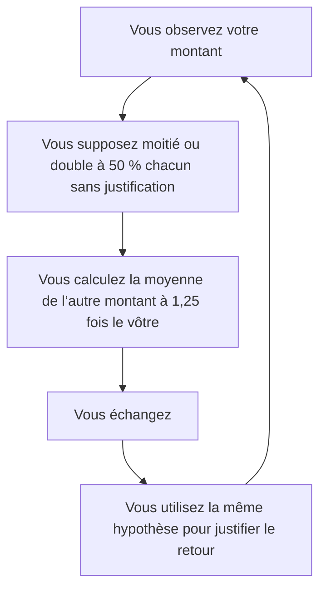
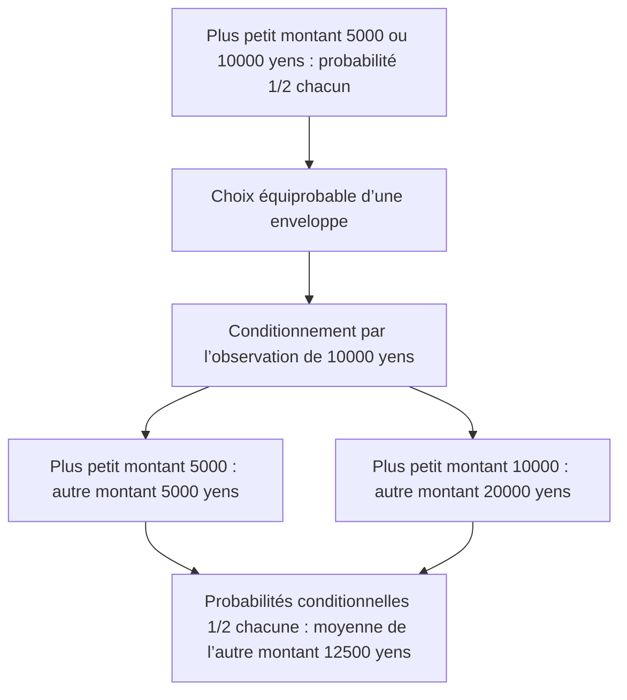

## 1. Préciser comment l’enveloppe est choisie

Deux enveloppes d’apparence identique contiennent de l’argent : l’une renferme le double du montant de l’autre. Après en avoir choisi une, vous pouvez l’échanger. Faut-il le faire avant de l’ouvrir ou après avoir vu son contenu ?

Notons $S$ le plus petit montant, une variable aléatoire strictement positive et finie. Les enveloppes contiennent $S$ et $2S$. Choisissez-en une au moyen d’un lancer de pièce équilibré, indépendant des contenus. Notons $X$ le montant choisi et $Y$ l’autre. Conditionnellement à un plus petit montant fixé $S=s$, les deux résultats suivants ont chacun une probabilité $1/2$.

$$
(X,Y)=(s,2s)\quad\text{or}\quad(X,Y)=(2s,s).
$$

Le choix équiprobable avant d’observer un montant ne détermine pas les probabilités après cette observation. Pour calculer ces dernières, il faut aussi une **loi a priori** décrivant comment le plus petit montant est généré. « Montant fini » concerne chaque réalisation : cela n’implique ni une espérance finie ni une borne supérieure finie des montants.

## 2. Le calcul séduisant d’un « gain de 25 % à chaque échange »

Supposons que vous observiez $X=x$. Il est tentant de dire : « L’autre enveloppe contient la moitié ou le double, avec une probabilité $1/2$ pour chaque cas », puis de calculer :

$$
\frac12\cdot\frac{x}{2}+\frac12\cdot2x=\frac54x.
$$

L’arithmétique est correcte, mais **l’équiprobabilité après observation du montant n’est pas justifiée**. Répéter ce raisonnement après l’échange laisserait croire que les allers-retours augmentent indéfiniment l’argent. Le diagramme représente ce raisonnement erroné, pas une stratégie valide.

Il est également trompeur d’attribuer l’erreur au fait qu’une variable aléatoire prend des valeurs différentes selon les cas : c’est précisément une propriété normale des variables aléatoires. Le problème est de changer ce qui est tenu fixe et les probabilités utilisées.

## 3. Symétrie avant l’ouverture et espérance finie

Une fois le plus petit montant fixé, les espérances avant et après l’échange sont identiques.

$$
\mathbb E[X\mid S=s]=\mathbb E[Y\mid S=s]=\frac{3s}{2}.
$$

Même si le plus petit montant est aléatoire, le montant choisi et l’autre ont la même loi. En particulier, si l’espérance du plus petit montant est finie,

$$
\mathbb E[X]=\mathbb E[Y]=\frac32\mathbb E[S]<\infty.
$$

Échanger sans observer aucun montant n’augmente donc pas l’espérance du montant reçu. Cela n’exclut pas un avantage conditionnel à une observation particulière. Si l’espérance est infinie, la symétrie des lois subsiste, mais soustraire deux infinis ne permet pas de calculer un gain moyen.

## 4. Après l’ouverture, partir de la loi a priori

Considérons d’abord un plus petit montant discret, avec $p(s)=\Pr(S=s)$ et une masse nulle hors de son support. Pour un montant $x$ observable avec une probabilité non nulle, notons $q(x)$ la probabilité conditionnelle que l’autre enveloppe contienne le double. Le [théorème de Bayes](https://kenji.blog/fr/p/bayes-theorem/) donne :

$$
q(x)=\Pr(Y=2x\mid X=x)=\frac{p(x)}{p(x)+p(x/2)}.
$$

Le numérateur correspond au cas où le plus petit montant est celui observé et où l’enveloppe contenant le moins d’argent a été choisie. L’autre terme correspond au cas où le plus petit montant est la moitié de celui observé et où l’enveloppe contenant le plus d’argent a été choisie. Les facteurs de sélection communs se simplifient. Le dénominateur doit être strictement positif.

$$
\begin{aligned}\mathbb E[Y\mid X=x]&=2xq(x)+\frac{x}{2}(1-q(x)),\\ g(x)&=\mathbb E[Y\mid X=x]-x=\frac{x}{2}(3q(x)-1).\end{aligned}
$$

Échanger augmente l’espérance conditionnelle du montant lorsque $q(x)>1/3$. Cela ne garantit pas un gain effectif. Ces formules utilisent des masses de probabilité discrètes ; on ne peut pas les transposer à des densités continues par simple substitution.

## 5. Quand observer 10 000 yens donne une espérance de 12 500

Supposons que le plus petit montant soit de 5 000 ou 10 000 yens, avec une probabilité 1/2 pour chacun. Nous choisissons une enveloppe de façon équiprobable et observons 10 000 yens. Conditionnellement à cette observation, l’autre montant est de 5 000 ou 20 000 yens, avec une probabilité 1/2 pour chacun. Dans ce modèle, le calcul précédent est justifié.

$$
\mathbb E[Y\mid X=10000]=\frac12\cdot5000+\frac12\cdot20000=12500.
$$

Le diagramme ne montre que la partie conditionnée par l’observation de 10 000 yens. Pour l’ensemble des observations, votre montant est de 5 000, 10 000 ou 20 000 yens avec les probabilités respectives 1/4, 1/2 et 1/4. Les gains conditionnels de l’échange sont respectivement de 5 000, 2 500 et −10 000 yens, et leur moyenne est nulle.

$$
\frac14\cdot5000+\frac12\cdot2500-\frac14\cdot10000=0.
$$

Un budget fini borne les montants. Si le modèle admet un montant maximal observable, celui-ci ne peut pas avoir un montant correspondant qui soit le double. Cela ne signifie pas que la probabilité d’obtenir le double diminue toujours avec le montant observé. Si les plus petits montants 1, 2 et 4 ont les probabilités 49/100, 1/100 et 1/2, alors $q(2)=1/50$, mais $q(4)=50/51$. La forme de la loi a priori compte.

## 6. Avec une espérance finie, pas d’avantage à chaque observation

Si le plus petit montant a une espérance finie, $g(X)$ est intégrable. La [formule de l’espérance totale](https://ocw.mit.edu/courses/6-436j-fundamentals-of-probability-fall-2018/c1ab69cb198badcebee42d5880784439_MIT6_436JF18_rec3.pdf) donne :

$$
\mathbb E[g(X)]=\mathbb E[Y]-\mathbb E[X]=0.
$$

Il est donc impossible que le gain conditionnel soit strictement positif presque sûrement. Dans un modèle discret, échanger ne peut pas être strictement avantageux pour chaque observation de probabilité non nulle. L’hypothèse décisive est une **espérance finie**, pas seulement des probabilités dont la somme vaut un.

## 7. Une loi a priori propre d’espérance infinie fournit un contre-exemple

Considérons la loi étudiée dans [l’article de Broome](https://users.ox.ac.uk/~sfop0060/pdf/Two%20envelope%20paradox.pdf) :

$$
\Pr(S=2^n)=\frac13\left(\frac23\right)^n,\qquad n=0,1,2,\ldots.
$$

$$
\sum_{n=0}^{\infty}\frac13\left(\frac23\right)^n=1,\qquad \mathbb E[S]=\frac13\sum_{n=0}^{\infty}\left(\frac43\right)^n=\infty.
$$

C’est une **loi de probabilité propre et normalisée**, et non une loi a priori uniforme impropre. Pour une observation $x=2^n$ avec $n\ge1$,

$$
q(x)=\frac25,\qquad \mathbb E[Y\mid X=x]=\frac25(2x)+\frac35\frac{x}{2}=\frac{11}{10}x>x.
$$

Pour l’observation minimale, 1, l’autre montant est nécessairement 2. Ainsi, à chaque observation de probabilité non nulle, l’espérance conditionnelle de l’autre montant dépasse le vôtre. Cela ne concerne pas un conditionnement par des montants hors du support.

On ne peut pourtant pas en déduire un gain moyen inconditionnel positif. Posons $D=Y-X$, avec la partie positive $D^+=\max(D,0)$ et la partie négative $D^-=\max(-D,0)$ :

$$
\mathbb E[D^+]=\mathbb E[D^-]=\frac12\mathbb E[S]=\infty.
$$

Les deux parties ont une espérance infinie : l’espérance de la différence signée [n’est donc pas définie](https://www.stat.berkeley.edu/~wfithian/courses/stat210a/measure-theory-basics.html). La formule de l’espérance totale reste valable pour le montant positif ou nul :

$$
\mathbb E[\mathbb E[Y\mid X]]=\mathbb E[Y]=\infty.
$$

L’infini ne brise pas cette formule. Ce qui n’est pas permis, c’est d’appliquer sans vérifier les hypothèses la soustraction ou la linéarité du cas d’espérance finie à une différence signée non intégrable. Il faut distinguer les calculs finis conditionnés par chaque observation possible de l’espérance inconditionnelle de la différence. En tronquant puis en renormalisant la loi a priori, on conserve une perte à l’observation maximale et le gain moyen de l’échange redevient nul.

## 8. Les densités continues nécessitent un changement de variable

Si le plus petit montant a une densité continue $f$, la contribution à la densité du montant observé est $f(x)/2$ lorsque le plus petit montant est choisi, et $f(x/2)/4$ lorsque le plus grand est choisi. La seconde contribution inclut à la fois le facteur de sélection équiprobable et celui du changement de variable $x=2s$.

$$
q(x)=\frac{f(x)}{f(x)+\tfrac12f(x/2)}.
$$

Cette formule conditionnelle s’utilise là où la densité du montant observé est strictement positive. Pour une variable à densité, l’événement « prendre une valeur donnée » est de probabilité nulle ; il ne s’agit pas d’un quotient de probabilités d’événements discrets. Broome présente aussi la densité propre :

$$
f(s)=\frac{1}{(1+s)^2},\qquad s>0.
$$

Son intégrale vaut un, mais l’espérance du plus petit montant est infinie. Pour un montant observé strictement positif,

$$
\frac{f(x/2)}{f(x)}=\frac{4(1+x)^2}{(2+x)^2}<4
\quad\Longrightarrow\quad q(x)>\frac13.
$$

La version continue de l’espérance conditionnelle déterminée par ces densités dépasse donc votre montant à chaque observation strictement positive. C’est un autre contre-exemple à l’affirmation selon laquelle la normalisation seule rendrait nécessairement l’échange défavorable pour certains montants.

## 9. Rapports d’échange, décisions et infini

Pour le rapport avant l’ouverture $R=Y/X$, le choix équiprobable donne un rapport de 2 ou de 1/2 avec une probabilité 1/2 pour chacun. Son espérance vaut bien 5/4, tout comme celle du rapport inverse. Mais les rapports de deux échanges successifs sont inverses l’un de l’autre, et ne sont pas indépendants.

$$
\mathbb E[R]=\mathbb E[1/R]=\frac54,\qquad \mathbb E[R(1/R)]=1\ne\frac{25}{16}=\mathbb E[R]\mathbb E[1/R].
$$

Revenir à l’enveloppe d’origine restitue le montant d’origine. On ne peut pas multiplier votre montant par l’espérance inconditionnelle du rapport, ni multiplier les espérances des rapports de deux échanges, sans justification. Voir les deux montants change aussi l’information : l’incertitude entre la moitié et le double disparaît.

Ce problème est lié au [paradoxe de Saint-Pétersbourg](https://kenji.blog/fr/p/st-petersburg-paradox/), qui traite aussi de paris d’espérance infinie. Les limites budgétaires réelles, la génération des montants, l’utilité et l’attitude face au risque peuvent modifier les décisions. Nous comparons ici des montants espérés, pas une règle universelle de décision ni un bénéfice garanti.

Les probabilités conditionnelles nécessitent un modèle de génération des montants, et normaliser ne signifie pas avoir une espérance finie. Avec une espérance finie, la symétrie et l’espérance totale donnent un gain moyen nul à l’échange. Avec une espérance infinie, des lois propres fournissent des contre-exemples : il faut distinguer l’espérance infinie d’une variable positive ou nulle du cas d’une différence signée dont l’espérance n’est pas définie.
