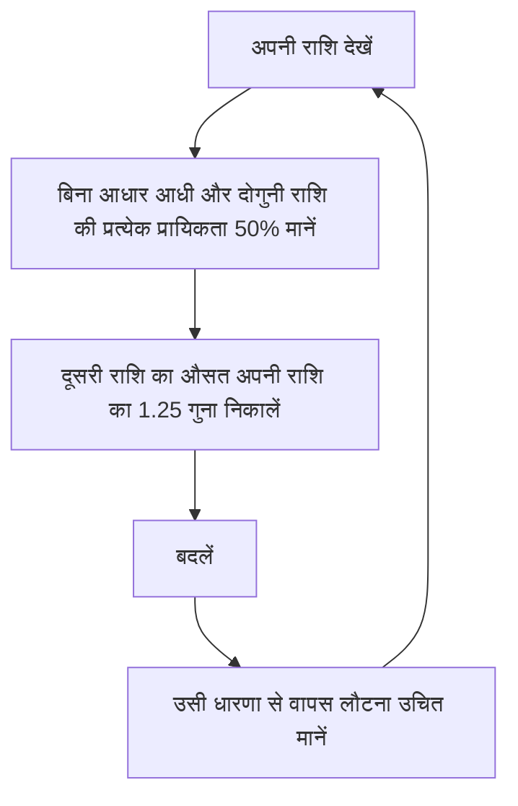
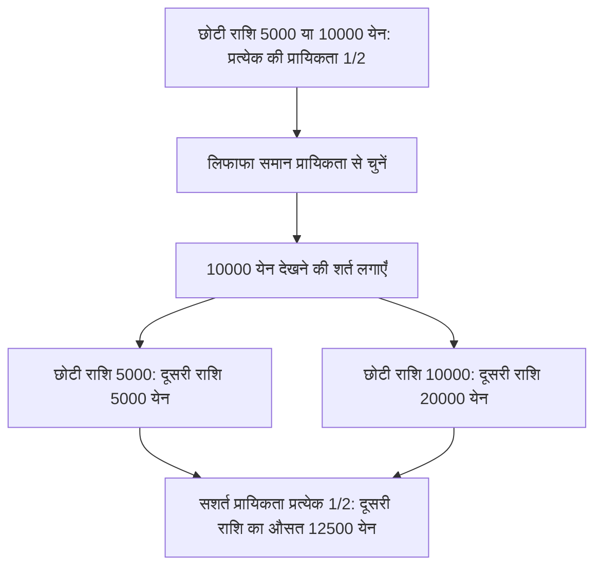

## 1. पहले तय करें कि लिफाफा कैसे चुना जाता है

एक जैसे दिखने वाले दो लिफाफों में पैसे हैं। एक में दूसरे से दोगुनी राशि है। एक लिफाफा चुनने के बाद आपको उसे बदलने का अवसर मिलता है। क्या खोलने से पहले या राशि देखने के बाद बदलना बेहतर है?

छोटी राशि को धनात्मक और परिमित यादृच्छिक चर $S$ मानें। लिफाफों में $S$ और $2S$ हैं। एक निष्पक्ष सिक्का उछालकर लिफाफा चुनें; उछाल का परिणाम लिफाफों की सामग्री से स्वतंत्र है। चुनी हुई राशि को $X$ और दूसरी राशि को $Y$ कहेंगे। छोटी राशि को $S=s$ पर स्थिर रखने की शर्त के अंतर्गत निम्न दो परिणामों में से प्रत्येक की प्रायिकता $1/2$ है।

$$
(X,Y)=(s,2s)\quad\text{or}\quad(X,Y)=(2s,s).
$$

राशि देखने से पहले की समान प्रायिकता वाली पसंद और कोई विशेष राशि देखने के बाद की प्रायिकताएँ अलग हैं। बाद वाली प्रायिकताओं के लिए यह बताने वाला **पूर्व वितरण (prior distribution)** भी चाहिए कि छोटी राशि कैसे उत्पन्न होती है। राशि परिमित होने का मतलब प्रत्येक बार प्राप्त राशि का परिमित होना है; इससे प्रत्याशा (अपेक्षित मान) या राशियों की ऊपरी सीमा का परिमित होना नहीं निकलता।

## 2. हर बार 25% लाभ की आकर्षक गणना

मानें कि आपने $X=x$ देखा। यह सोचना आकर्षक है कि “दूसरे लिफाफे में आधी या दोगुनी राशि है, प्रत्येक की प्रायिकता $1/2$ है”, और फिर गणना करें:

$$
\frac12\cdot\frac{x}{2}+\frac12\cdot2x=\frac54x.
$$

अंकगणित सही है, लेकिन **राशि देखने के बाद भी दोनों स्थितियों की प्रायिकताएँ समान होने की धारणा का आधार नहीं है**। बदलने के बाद वही तर्क दोहराने पर लगेगा कि वापस लौटते रहने से पैसे बढ़ते जाते हैं। चित्र इस गलत तर्क का चक्र दिखाता है, कोई सही रणनीति नहीं।

यह कहना भी भ्रामक है कि गलती इसलिए हुई क्योंकि यादृच्छिक चर अलग-अलग स्थितियों में अलग मान लेता है। यह यादृच्छिक चरों का सामान्य गुण है। समस्या यह है कि बीच में बदल जाता है कि किस बात को स्थिर माना गया है और किन प्रायिकताओं का उपयोग हो रहा है।

## 3. खोलने से पहले सममिति और परिमित प्रत्याशा

छोटी राशि को स्थिर करने पर बदलने से पहले और बाद की प्रत्याशाएँ समान हैं।

$$
\mathbb E[X\mid S=s]=\mathbb E[Y\mid S=s]=\frac{3s}{2}.
$$

छोटी राशि स्वयं यादृच्छिक होने पर भी चुनी हुई और दूसरी राशि का वितरण समान रहता है। विशेष रूप से, यदि छोटी राशि की प्रत्याशा परिमित हो, तो

$$
\mathbb E[X]=\mathbb E[Y]=\frac32\mathbb E[S]<\infty.
$$

इसलिए बिना कोई राशि देखे बदलने से मिलने वाली राशि की प्रत्याशा नहीं बढ़ती। इससे किसी विशेष राशि के अवलोकन की शर्त पर लाभ होने की संभावना समाप्त नहीं होती। प्रत्याशा अनंत होने पर भी वितरणों की सममिति बनी रहती है, लेकिन दो अनंत राशियों को घटाकर औसत लाभ नहीं निकाला जा सकता।

## 4. खोलने के बाद पूर्व वितरण से गणना करें

पहले छोटी राशि का विविक्त वितरण लें और $p(s)=\Pr(S=s)$ लिखें। संभव मानों के बाहर प्रायिकता द्रव्यमान 0 रखें। धनात्मक प्रायिकता से देखी जा सकने वाली राशि $x$ के लिए, दूसरे लिफाफे में दोगुनी राशि होने की सशर्त प्रायिकता $q(x)$ हो। [बेयस प्रमेय](https://kenji.blog/hi/p/bayes-theorem/) से

$$
q(x)=\Pr(Y=2x\mid X=x)=\frac{p(x)}{p(x)+p(x/2)}.
$$

अंश उस स्थिति का है जिसमें छोटी राशि देखी गई राशि के बराबर है और कम पैसे वाला लिफाफा चुना गया। दूसरा पद उस स्थिति का है जिसमें छोटी राशि देखी गई राशि की आधी है और अधिक पैसे वाला लिफाफा चुना गया। समान चयन प्रायिकताओं के गुणक कट जाते हैं। भिन्न का हर धनात्मक होना चाहिए।

$$
\begin{aligned}\mathbb E[Y\mid X=x]&=2xq(x)+\frac{x}{2}(1-q(x)),\\ g(x)&=\mathbb E[Y\mid X=x]-x=\frac{x}{2}(3q(x)-1).\end{aligned}
$$

$q(x)>1/3$ होने पर बदलने से मिलने वाली राशि की सशर्त प्रत्याशा बढ़ती है। इसका मतलब वास्तविक लाभ की गारंटी नहीं है। ये सूत्र विविक्त प्रायिकता द्रव्यमान का उपयोग करते हैं; इनमें सीधे सतत प्रायिकता घनत्व नहीं रख सकते।

## 5. 10,000 येन देखने पर 12,500 की प्रत्याशा कब मिलती है?

मानें कि छोटी राशि 5,000 या 10,000 येन है और दोनों की प्रायिकता 1/2 है। लिफाफा समान प्रायिकता से चुनने पर 10,000 येन दिखते हैं। इस अवलोकन की शर्त पर दूसरी राशि 5,000 या 20,000 येन है और दोनों की सशर्त प्रायिकता 1/2 है। इस मॉडल में पिछली गणना उचित है।

$$
\mathbb E[Y\mid X=10000]=\frac12\cdot5000+\frac12\cdot20000=12500.
$$

चित्र केवल 10,000 येन देखने की शर्त वाला हिस्सा दिखाता है। सभी अवलोकनों को शामिल करने पर अपनी राशि 5,000, 10,000 या 20,000 येन होने की प्रायिकताएँ क्रमशः 1/4, 1/2 और 1/4 हैं। बदलने के सशर्त अपेक्षित लाभ क्रमशः 5,000, 2,500 और −10,000 येन हैं, जिनका औसत 0 है।

$$
\frac14\cdot5000+\frac12\cdot2500-\frac14\cdot10000=0.
$$

परिमित बजट राशियों पर ऊपरी सीमा लगाता है। यदि मॉडल में देखी जा सकने वाली कोई अधिकतम राशि है, तो दूसरे लिफाफे में उससे दोगुनी राशि नहीं हो सकती। लेकिन इससे यह नहीं निकलता कि देखी गई राशि बढ़ने पर दोगुनी राशि की प्रायिकता हमेशा घटती है। यदि छोटी राशियों 1, 2 और 4 की प्रायिकताएँ 49/100, 1/100 और 1/2 हैं, तो $q(2)=1/50$, जबकि $q(4)=50/51$ है। पूर्व वितरण का स्वरूप महत्वपूर्ण है।

## 6. परिमित प्रत्याशा: सभी अवलोकनों पर अपेक्षित लाभ धनात्मक होना असंभव है

छोटी राशि की प्रत्याशा परिमित होने पर $g(X)$ समाकलनीय है। [संपूर्ण प्रत्याशा के नियम](https://ocw.mit.edu/courses/6-436j-fundamentals-of-probability-fall-2018/c1ab69cb198badcebee42d5880784439_MIT6_436JF18_rec3.pdf) से

$$
\mathbb E[g(X)]=\mathbb E[Y]-\mathbb E[X]=0.
$$

इसलिए यह संभव नहीं कि सशर्त अपेक्षित लाभ प्रायिकता 1 के साथ धनात्मक हो। इस प्रायिकता-1 वाली शर्त को “लगभग निश्चित रूप से” कहा जाता है। विविक्त मॉडल में ऐसा नहीं हो सकता कि धनात्मक प्रायिकता वाले हर अवलोकन पर बदलने से अपेक्षित राशि सख्ती से बढ़े। मुख्य शर्त **परिमित प्रत्याशा** है, केवल प्रायिकताओं का योग 1 होना नहीं।

## 7. कुल प्रायिकता 1 और अनंत प्रत्याशा वाला वितरण प्रतिउदाहरण देता है

[Broome के लेख](https://users.ox.ac.uk/~sfop0060/pdf/Two%20envelope%20paradox.pdf) में चर्चित वितरण लें:

$$
\Pr(S=2^n)=\frac13\left(\frac23\right)^n,\qquad n=0,1,2,\ldots.
$$

$$
\sum_{n=0}^{\infty}\frac13\left(\frac23\right)^n=1,\qquad \mathbb E[S]=\frac13\sum_{n=0}^{\infty}\left(\frac43\right)^n=\infty.
$$

यह **कुल प्रायिकता 1 वाला प्रसामान्यीकृत वितरण** है, ऐसा एकसमान पूर्व वितरण नहीं जिसे प्रसामान्यीकृत ही न किया जा सके। अवलोकन $x=2^n$ और $n\ge1$ होने पर

$$
q(x)=\frac25,\qquad \mathbb E[Y\mid X=x]=\frac25(2x)+\frac35\frac{x}{2}=\frac{11}{10}x>x.
$$

न्यूनतम अवलोकित राशि 1 पर दूसरी राशि निश्चित रूप से 2 है। इसलिए धनात्मक प्रायिकता से होने वाले हर अवलोकन पर दूसरी राशि की सशर्त प्रत्याशा अपनी राशि से अधिक है। यह संभव मानों के बाहर की राशियों पर शर्त लगाने का दावा नहीं है।

फिर भी इससे बिना शर्त औसत लाभ धनात्मक होने का निष्कर्ष नहीं मिलता। $D=Y-X$ रखें और धन भाग $D^+=\max(D,0)$ तथा ऋण भाग $D^-=\max(-D,0)$ लें; ये दोनों अऋणात्मक हैं:

$$
\mathbb E[D^+]=\mathbb E[D^-]=\frac12\mathbb E[S]=\infty.
$$

दोनों भागों की प्रत्याशा अनंत है, इसलिए चिह्नयुक्त अंतर की प्रत्याशा [परिभाषित नहीं है](https://www.stat.berkeley.edu/~wfithian/courses/stat210a/measure-theory-basics.html)। दूसरी ओर, अऋणात्मक राशि के लिए संपूर्ण प्रत्याशा का नियम अब भी सही है:

$$
\mathbb E[\mathbb E[Y\mid X]]=\mathbb E[Y]=\infty.
$$

अनंत नियम को नहीं तोड़ता। गलत यह है कि समाकलनीय न होने वाले चिह्नयुक्त अंतर पर परिमित प्रत्याशा वाले मामले का घटाव या रैखिकता बिना शर्तों की जाँच के लागू कर दी जाए। हर संभव अवलोकन की शर्त पर की गई परिमित गणना और अंतर की बिना शर्त प्रत्याशा अलग हैं। पूर्व वितरण को परिमित पदों तक काटकर फिर प्रसामान्यीकृत करने पर अधिकतम अवलोकित राशि पर हानि बनी रहती है और औसत अदला-बदली लाभ फिर 0 हो जाता है।

## 8. सतत घनत्व में चर परिवर्तन भी आवश्यक है

यदि छोटी राशि का सतत घनत्व $f$ है, तो छोटी राशि चुने जाने वाली शाखा अवलोकित राशि के घनत्व में $f(x)/2$ का योगदान देती है। बड़ी राशि चुने जाने वाली शाखा का योगदान $f(x/2)/4$ है। दूसरे योगदान में समान चयन प्रायिकता का गुणक ही नहीं, चर परिवर्तन $x=2s$ का गुणक भी है।

$$
q(x)=\frac{f(x)}{f(x)+\tfrac12f(x/2)}.
$$

यह सशर्त घनत्व सूत्र वहाँ उपयोग होता है जहाँ अवलोकित राशि का घनत्व धनात्मक है। घनत्व वाले यादृच्छिक चर के किसी निर्दिष्ट मान के बराबर होने की घटना की प्रायिकता 0 है; यह विविक्त घटनाओं की प्रायिकताओं का अनुपात नहीं है। Broome निम्न प्रसामान्यीकृत घनत्व भी देते हैं:

$$
f(s)=\frac{1}{(1+s)^2},\qquad s>0.
$$

इसका समाकल 1 है, लेकिन छोटी राशि की प्रत्याशा अनंत है। धनात्मक अवलोकित राशि के लिए

$$
\frac{f(x/2)}{f(x)}=\frac{4(1+x)^2}{(2+x)^2}<4
\quad\Longrightarrow\quad q(x)>\frac13.
$$

इसलिए इन घनत्वों से निर्धारित सशर्त प्रत्याशा का सतत रूप हर धनात्मक अवलोकित राशि पर अपनी राशि से अधिक है। यह भी उस दावे का प्रतिउदाहरण है कि केवल कुल प्रायिकता 1 होने से किसी राशि पर बदलना अवश्य प्रतिकूल होगा।

## 9. अदला-बदली के अनुपात, निर्णय और अनंत

खोलने से पहले का अनुपात $R=Y/X$ हो। समान चयन प्रायिकता के कारण अनुपात 2 या 1/2 है और दोनों की प्रायिकता 1/2 है। इसकी प्रत्याशा सचमुच 5/4 है, और व्युत्क्रम अनुपात की प्रत्याशा भी यही है। लेकिन लगातार दो अदला-बदलियों के अनुपात एक-दूसरे के व्युत्क्रम हैं, स्वतंत्र नहीं।

$$
\mathbb E[R]=\mathbb E[1/R]=\frac54,\qquad \mathbb E[R(1/R)]=1\ne\frac{25}{16}=\mathbb E[R]\mathbb E[1/R].
$$

मूल लिफाफे में लौटने पर वास्तविक राशि भी मूल राशि हो जाती है। बिना औचित्य अपनी राशि को बिना शर्त औसत अनुपात से गुणा नहीं कर सकते, न ही दोनों अदला-बदलियों के औसत अनुपातों को आपस में गुणा कर सकते हैं। दोनों राशियाँ देखने के बाद जानकारी भी बदल जाती है: आधी या दोगुनी राशि की अनिश्चितता समाप्त हो जाती है।

यह समस्या अनंत प्रत्याशा वाले दाँवों पर विचार करने वाले [सेंट पीटर्सबर्ग विरोधाभास](https://kenji.blog/hi/p/st-petersburg-paradox/) से भी जुड़ी है। वास्तविक बजट सीमा, राशियाँ उत्पन्न करने का तरीका, उपयोगिता और जोखिम के प्रति दृष्टिकोण निर्णय बदल सकते हैं। यहाँ तुलना राशि की प्रत्याशा की है, किसी सार्वभौमिक निर्णय नियम या निश्चित लाभ की नहीं।

सशर्त प्रायिकताओं के लिए राशि उत्पन्न करने वाला मॉडल चाहिए, और कुल प्रायिकता 1 होना परिमित प्रत्याशा होने के समान नहीं है। परिमित प्रत्याशा में सममिति और संपूर्ण प्रत्याशा का नियम औसत अदला-बदली लाभ 0 देते हैं। अनंत प्रत्याशा में प्रसामान्यीकृत वितरण प्रतिउदाहरण देते हैं: अऋणात्मक चर की अनंत प्रत्याशा और चिह्नयुक्त अंतर की अपरिभाषित प्रत्याशा में सावधानी से अंतर करना चाहिए।
