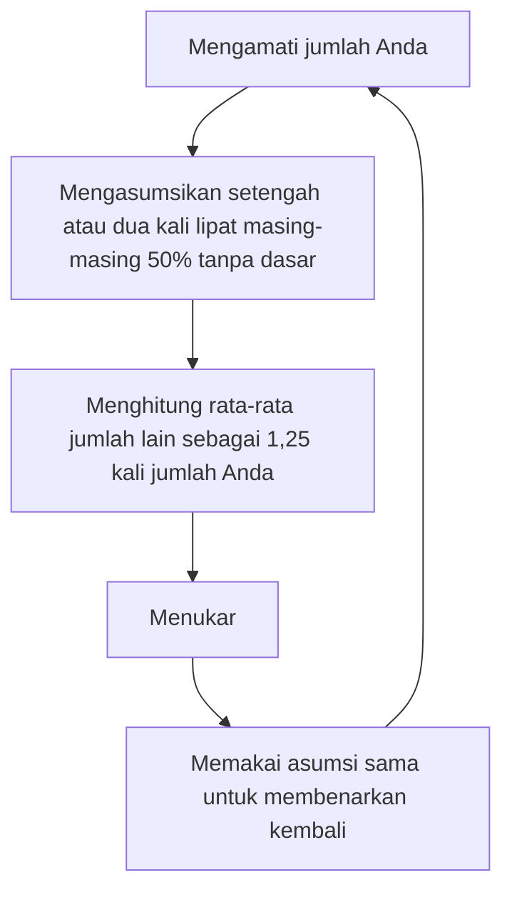
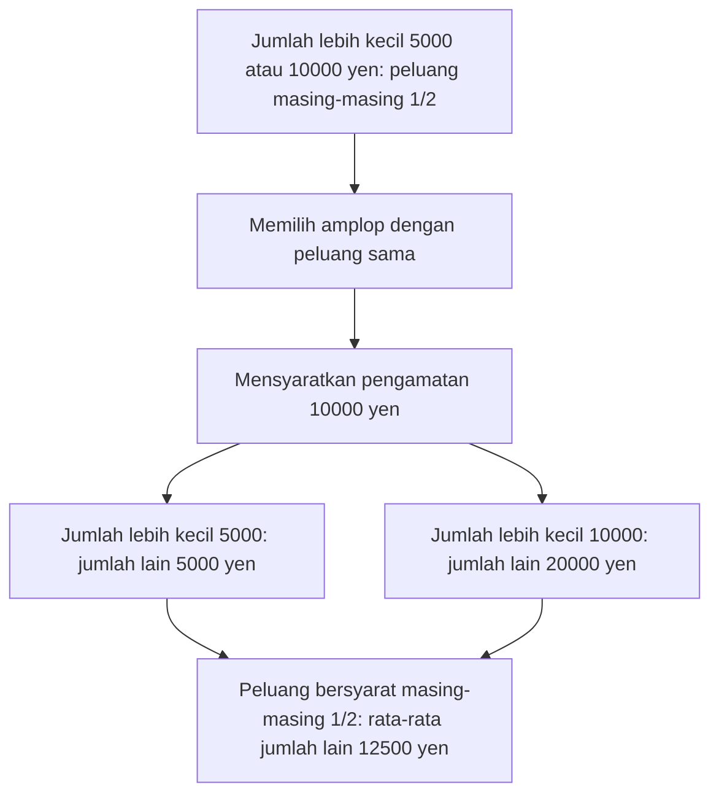

## 1. Tentukan dahulu cara memilih amplop

Dua amplop yang tampak sama berisi uang. Salah satunya berisi dua kali jumlah pada amplop lainnya. Setelah memilih satu, Anda boleh menukarnya. Apakah menukar menguntungkan sebelum amplop dibuka atau setelah jumlahnya terlihat?

Misalkan $S$ adalah jumlah yang lebih kecil, suatu variabel acak positif dan berhingga. Kedua amplop berisi $S$ dan $2S$. Pilih satu dengan lemparan koin seimbang yang hasilnya independen dari isi amplop. Sebut jumlah yang dipilih $X$ dan jumlah lainnya $Y$. Dengan syarat jumlah yang lebih kecil ditetapkan pada $S=s$, dua hasil berikut masing-masing memiliki peluang $1/2$.

$$
(X,Y)=(s,2s)\quad\text{or}\quad(X,Y)=(2s,s).
$$

Pemilihan dengan peluang sama sebelum melihat jumlah uang tidak menentukan peluang setelah suatu jumlah diamati. Untuk menghitung yang terakhir, diperlukan **distribusi prior** yang menjelaskan bagaimana jumlah yang lebih kecil dihasilkan. Jumlah berhingga berarti setiap realisasi bernilai berhingga, bukan berarti nilai harapan atau batas atas jumlah uang juga berhingga.

## 2. Perhitungan menggoda: «untung 25% setiap menukar»

Misalkan Anda mengamati $X=x$. Kita mungkin tergoda mengatakan, «Amplop lain berisi setengah atau dua kali lipat, masing-masing dengan peluang $1/2$», lalu menghitung:

$$
\frac12\cdot\frac{x}{2}+\frac12\cdot2x=\frac54x.
$$

Aritmetikanya benar, tetapi **asumsi bahwa kedua kemungkinan tetap sama peluangnya setelah jumlah uang diamati tidak memiliki dasar**. Mengulang alasan itu setelah menukar akan memberi kesan bahwa bolak-balik menukar terus menambah uang. Diagram ini menunjukkan penalaran yang keliru, bukan strategi yang benar.

Menganggap kesalahannya terletak pada variabel acak yang mengambil nilai berbeda dalam kasus berbeda juga menyesatkan. Itu justru sifat biasa variabel acak. Masalahnya adalah mengubah apa yang dianggap tetap dan peluang mana yang digunakan.

## 3. Simetri sebelum membuka dan nilai harapan berhingga

Jika jumlah yang lebih kecil ditetapkan, nilai harapan sebelum dan sesudah menukar sama.

$$
\mathbb E[X\mid S=s]=\mathbb E[Y\mid S=s]=\frac{3s}{2}.
$$

Sekalipun jumlah yang lebih kecil bersifat acak, jumlah yang dipilih dan jumlah lainnya berdistribusi sama. Khususnya, jika nilai harapan jumlah yang lebih kecil berhingga,

$$
\mathbb E[X]=\mathbb E[Y]=\frac32\mathbb E[S]<\infty.
$$

Jadi, menukar tanpa mengamati jumlah apa pun tidak meningkatkan nilai harapan uang. Hal ini tidak menutup kemungkinan adanya keuntungan bersyarat untuk suatu pengamatan tertentu. Bila nilai harapannya tak terhingga, simetri distribusi tetap berlaku, tetapi mengurangkan dua besaran tak terhingga tidak menentukan rata-rata keuntungan.

## 4. Setelah membuka, hitung dari distribusi prior

Pertimbangkan dahulu jumlah yang lebih kecil yang dipilih secara diskret, dengan $p(s)=\Pr(S=s)$ dan massa peluang nol di luar himpunan nilai yang mungkin. Untuk jumlah $x$ yang dapat diamati dengan peluang positif, tulis $q(x)$ sebagai peluang bersyarat bahwa amplop lain berisi dua kali lipat. [Teorema Bayes](https://kenji.blog/id/p/bayes-theorem/) memberikan:

$$
q(x)=\Pr(Y=2x\mid X=x)=\frac{p(x)}{p(x)+p(x/2)}.
$$

Pembilang mewakili kasus ketika jumlah yang lebih kecil sama dengan jumlah yang diamati dan amplop dengan uang lebih sedikit dipilih. Suku lainnya mewakili kasus ketika jumlah yang lebih kecil adalah setengah dari jumlah yang diamati dan amplop dengan uang lebih banyak dipilih. Faktor pemilihan yang sama saling menghapus. Penyebut harus positif.

$$
\begin{aligned}\mathbb E[Y\mid X=x]&=2xq(x)+\frac{x}{2}(1-q(x)),\\ g(x)&=\mathbb E[Y\mid X=x]-x=\frac{x}{2}(3q(x)-1).\end{aligned}
$$

Menukar meningkatkan nilai harapan uang bersyarat ketika $q(x)>1/3$. Ini bukan jaminan memperoleh keuntungan nyata. Rumus ini menggunakan massa peluang diskret; kita tidak dapat langsung menggantinya dengan kepadatan peluang kontinu.

## 5. Kapan melihat 10.000 yen memberi nilai harapan 12.500?

Misalkan jumlah yang lebih kecil adalah 5.000 atau 10.000 yen, masing-masing dengan peluang 1/2. Kita memilih amplop dengan peluang sama dan mengamati 10.000 yen. Dengan syarat pengamatan ini, jumlah lainnya adalah 5.000 atau 20.000 yen, masing-masing dengan peluang 1/2. Dalam model ini, perhitungan sebelumnya memiliki dasar.

$$
\mathbb E[Y\mid X=10000]=\frac12\cdot5000+\frac12\cdot20000=12500.
$$

Diagram hanya menunjukkan bagian dengan syarat pengamatan 10.000 yen. Untuk semua pengamatan, jumlah Anda adalah 5.000, 10.000, atau 20.000 yen dengan peluang berturut-turut 1/4, 1/2, dan 1/4. Keuntungan bersyarat yang diharapkan dari menukar berturut-turut adalah 5.000, 2.500, dan −10.000 yen, sehingga rata-ratanya nol.

$$
\frac14\cdot5000+\frac12\cdot2500-\frac14\cdot10000=0.
$$

Anggaran berhingga membatasi jumlah uang. Jika model memiliki jumlah uang maksimum yang dapat diamati, tidak mungkin amplop lain berisi dua kali jumlah tersebut. Namun, ini tidak berarti peluang memperoleh dua kali lipat selalu menurun ketika jumlah yang diamati meningkat. Jika jumlah yang lebih kecil 1, 2, dan 4 memiliki peluang 49/100, 1/100, dan 1/2, maka $q(2)=1/50$, tetapi $q(4)=50/51$. Bentuk distribusi prior penting.

## 6. Dengan nilai harapan berhingga, peningkatan nilai harapan tidak mungkin terjadi pada setiap pengamatan

Jika jumlah yang lebih kecil memiliki nilai harapan berhingga, $g(X)$ dapat diintegralkan. [Hukum nilai harapan total](https://ocw.mit.edu/courses/6-436j-fundamentals-of-probability-fall-2018/c1ab69cb198badcebee42d5880784439_MIT6_436JF18_rec3.pdf) memberikan:

$$
\mathbb E[g(X)]=\mathbb E[Y]-\mathbb E[X]=0.
$$

Karena itu, tidak mungkin keuntungan bersyarat yang diharapkan bernilai positif hampir pasti, yaitu dengan peluang 1. Dalam model diskret, menukar tidak dapat benar-benar lebih menguntungkan pada setiap pengamatan berpeluang positif. Syarat kuncinya adalah **nilai harapan berhingga**, bukan sekadar jumlah peluang sama dengan satu.

## 7. Prior ternormalisasi dengan nilai harapan tak terhingga memberikan contoh penyangkal

Pertimbangkan distribusi yang dibahas dalam [artikel Broome](https://users.ox.ac.uk/~sfop0060/pdf/Two%20envelope%20paradox.pdf):

$$
\Pr(S=2^n)=\frac13\left(\frac23\right)^n,\qquad n=0,1,2,\ldots.
$$

$$
\sum_{n=0}^{\infty}\frac13\left(\frac23\right)^n=1,\qquad \mathbb E[S]=\frac13\sum_{n=0}^{\infty}\left(\frac43\right)^n=\infty.
$$

Ini adalah **distribusi peluang yang ternormalisasi dengan jumlah peluang satu**, bukan prior seragam yang tidak dapat dinormalisasi. Untuk pengamatan $x=2^n$ dengan $n\ge1$,

$$
q(x)=\frac25,\qquad \mathbb E[Y\mid X=x]=\frac25(2x)+\frac35\frac{x}{2}=\frac{11}{10}x>x.
$$

Pada pengamatan terkecil, 1, jumlah lainnya pasti 2. Jadi, untuk setiap pengamatan berpeluang positif, nilai harapan bersyarat dari jumlah lainnya melebihi jumlah Anda. Ini tidak menyatakan apa pun tentang pengondisian pada jumlah di luar himpunan nilai yang mungkin.

Meskipun demikian, kita tidak dapat menyimpulkan bahwa rata-rata keuntungan tanpa syarat positif. Tulis $D=Y-X$, dengan bagian positif $D^+=\max(D,0)$ dan bagian negatif $D^-=\max(-D,0)$, yang keduanya tidak negatif:

$$
\mathbb E[D^+]=\mathbb E[D^-]=\frac12\mathbb E[S]=\infty.
$$

Kedua bagian memiliki nilai harapan tak terhingga, sehingga nilai harapan selisih bertanda [tidak terdefinisi](https://www.stat.berkeley.edu/~wfithian/courses/stat210a/measure-theory-basics.html). Hukum nilai harapan total tetap berlaku untuk jumlah uang yang tidak negatif:

$$
\mathbb E[\mathbb E[Y\mid X]]=\mathbb E[Y]=\infty.
$$

Tak terhingga tidak merusak hukum tersebut. Yang tidak boleh dilakukan adalah menerapkan pengurangan atau linearitas dari kasus nilai harapan berhingga pada selisih bertanda yang tidak dapat diintegralkan, tanpa memeriksa syaratnya. Perhitungan berhingga dengan syarat setiap pengamatan harus dibedakan dari nilai harapan selisih tanpa syarat. Jika prior dipotong menjadi sejumlah suku yang berhingga lalu dinormalisasi ulang, kerugian pada pengamatan terbesar tetap ada dan rata-rata keuntungan menukar kembali nol.

## 8. Kepadatan kontinu juga memerlukan perubahan variabel

Jika jumlah yang lebih kecil memiliki kepadatan kontinu $f$, cabang pemilihan jumlah lebih kecil menyumbang kepadatan $f(x)/2$, sedangkan cabang jumlah lebih besar menyumbang $f(x/2)/4$. Kontribusi kedua memuat faktor pemilihan dengan peluang sama sekaligus faktor perubahan variabel $x=2s$.

$$
q(x)=\frac{f(x)}{f(x)+\tfrac12f(x/2)}.
$$

Rumus bersyarat ini digunakan ketika kepadatan jumlah yang diamati positif. Untuk variabel acak berkepadatan, kejadian mengambil satu nilai tertentu memiliki peluang nol; ini bukan pembagian peluang kejadian diskret. Broome juga memberikan kepadatan ternormalisasi berikut:

$$
f(s)=\frac{1}{(1+s)^2},\qquad s>0.
$$

Integralnya satu, tetapi nilai harapan jumlah yang lebih kecil tak terhingga. Untuk jumlah uang teramati yang positif,

$$
\frac{f(x/2)}{f(x)}=\frac{4(1+x)^2}{(2+x)^2}<4
\quad\Longrightarrow\quad q(x)>\frac13.
$$

Jadi, versi kontinu dari nilai harapan bersyarat yang ditentukan oleh kepadatan ini melebihi jumlah Anda pada setiap pengamatan positif. Ini juga menyangkal klaim bahwa normalisasi saja memaksa menukar menjadi tidak menguntungkan pada suatu jumlah.

## 9. Rasio pertukaran, keputusan, dan tak terhingga

Untuk rasio sebelum membuka $R=Y/X$, pemilihan dengan peluang sama menghasilkan rasio 2 atau 1/2, masing-masing dengan peluang 1/2. Nilai harapannya memang 5/4, begitu pula nilai harapan rasio kebalikannya. Namun, rasio dua pertukaran berturut-turut saling berkebalikan, bukan independen.

$$
\mathbb E[R]=\mathbb E[1/R]=\frac54,\qquad \mathbb E[R(1/R)]=1\ne\frac{25}{16}=\mathbb E[R]\mathbb E[1/R].
$$

Kembali ke amplop semula mengembalikan jumlah semula. Tanpa alasan yang sah, kita tidak boleh mengalikan jumlah Anda dengan rata-rata rasio tanpa syarat, atau mengalikan rata-rata rasio dua pertukaran. Melihat kedua jumlah juga mengubah informasi: ketidakpastian antara setengah dan dua kali lipat menghilang.

Masalah ini berkaitan dengan [paradoks St. Petersburg](https://kenji.blog/id/p/st-petersburg-paradox/), yang juga membahas taruhan dengan nilai harapan tak terhingga. Batas anggaran nyata, cara jumlah uang dihasilkan, utilitas, dan sikap terhadap risiko dapat mengubah keputusan. Yang dibandingkan di sini adalah nilai harapan uang, bukan aturan keputusan universal atau keuntungan yang dijamin.

Peluang bersyarat memerlukan model pembentukan jumlah uang, dan normalisasi tidak sama dengan nilai harapan berhingga. Dengan nilai harapan berhingga, simetri dan hukum nilai harapan total memberikan rata-rata keuntungan menukar nol. Dengan nilai harapan tak terhingga, distribusi ternormalisasi dapat memberikan contoh penyangkal: kita perlu membedakan nilai harapan tak terhingga dari variabel tidak negatif dengan selisih bertanda yang nilai harapannya tidak terdefinisi.
