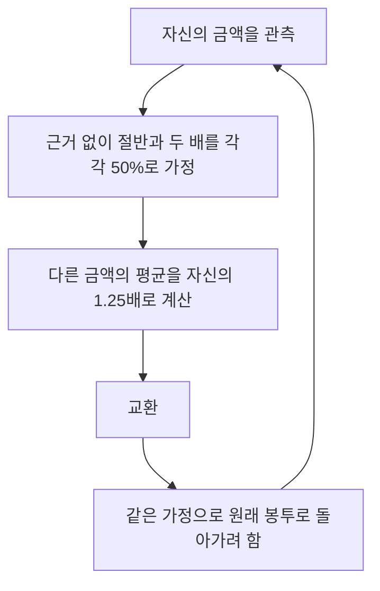
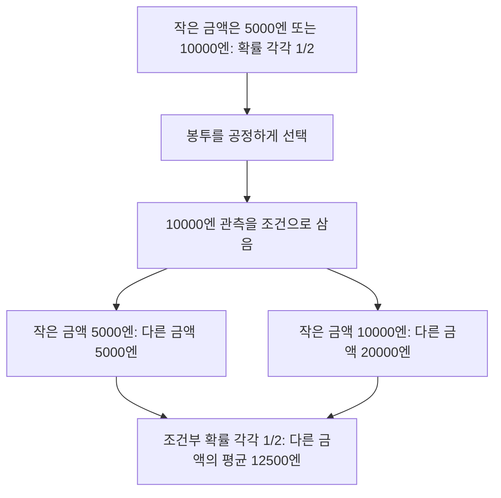

## 1. 먼저 봉투를 선택하는 방법을 정하기

겉모습이 같은 두 봉투에 돈이 들어 있고, 한쪽 금액은 다른 쪽의 두 배입니다. 하나를 선택한 뒤 교환할 기회가 주어집니다. 봉투를 열기 전에도, 금액을 확인한 뒤에도 교환하는 편이 유리할까요?

작은 금액을 양수이며 유한한 확률변수 $S$로 두겠습니다. 두 봉투에는 $S$와 $2S$가 들어 있습니다. 내용물과 독립인 공정한 동전 던지기로 봉투를 선택합니다. 선택한 금액은 $X$, 다른 쪽 금액은 $Y$라고 부르겠습니다. 작은 금액이 $S=s$로 고정되었다는 조건에서는 다음 두 결과의 확률이 각각 $1/2$입니다.

$$
(X,Y)=(s,2s)\quad\text{or}\quad(X,Y)=(2s,s).
$$

금액을 보기 전의 공정한 선택과 특정 금액을 본 뒤의 확률은 다릅니다. 후자를 계산하려면 작은 금액이 어떻게 정해지는지를 설명하는 **사전 분포**도 필요합니다. 여기서 금액이 유한하다는 말은 매번 실현되는 금액이 유한하다는 뜻이지, 기댓값이나 금액의 상한도 유한하다는 뜻은 아닙니다.

## 2. 매번 25% 이득이라는 유혹적인 계산

자신의 금액이 $X=x$라고 합시다. “다른 쪽은 절반 아니면 두 배이고 각각 확률이 $1/2$이다”라고 생각하면 다음 계산을 하고 싶어집니다.

$$
\frac12\cdot\frac{x}{2}+\frac12\cdot2x=\frac54x.
$$

산술은 맞지만, **금액을 관측한 뒤에도 두 경우가 같은 확률이라는 가정에는 근거가 없습니다**. 교환 후에도 같은 논리를 반복하면, 원래 봉투로 돌아오기만 해도 금액이 계속 늘어난다는 결론이 나옵니다. 다음 그림은 올바른 전략이 아니라 잘못된 추론의 순환을 보여 줍니다.

오류를 “확률변수가 경우에 따라 다른 값을 갖기 때문”이라고 설명하는 것도 적절하지 않습니다. 그것은 확률변수의 정상적인 성질입니다. 문제는 무엇을 조건으로 고정하고 어떤 확률을 사용하는지가 도중에 바뀐다는 점입니다.

## 3. 열기 전의 대칭성과 유한한 기댓값

작은 금액을 고정하면 교환 전후의 기대 금액은 같습니다.

$$
\mathbb E[X\mid S=s]=\mathbb E[Y\mid S=s]=\frac{3s}{2}.
$$

작은 금액 자체가 무작위로 정해져도, 선택한 금액과 다른 쪽 금액은 같은 분포를 가집니다. 특히 작은 금액의 기댓값이 유한하면,

$$
\mathbb E[X]=\mathbb E[Y]=\frac32\mathbb E[S]<\infty.
$$

따라서 아무 금액도 관측하지 않은 채 교환한다고 기대 금액이 증가하지는 않습니다. 다만 특정 금액을 관측한 조건에서 교환이 유리할 가능성까지 부정하는 것은 아닙니다. 기댓값이 무한대여도 분포의 대칭성은 유지되지만, 무한대에서 무한대를 빼서 평균 이득을 구할 수는 없습니다.

## 4. 연 뒤에는 사전 분포로 계산하기

먼저 작은 금액이 이산적으로 선택되는 경우를 생각하고 $p(s)=\Pr(S=s)$로 쓰겠습니다. 가능한 값의 범위 밖에서는 이 확률을 0으로 둡니다. 양의 확률로 관측할 수 있는 금액 $x$에 대해, 다른 쪽이 두 배일 조건부 확률을 $q(x)$라고 하면 [베이즈 정리](https://kenji.blog/ko/p/bayes-theorem/)에서 다음을 얻습니다.

$$
q(x)=\Pr(Y=2x\mid X=x)=\frac{p(x)}{p(x)+p(x/2)}.
$$

분자는 “작은 금액이 관측액과 같고 작은 봉투를 선택한 경우”, 분모의 다른 항은 “작은 금액이 관측액의 절반이고 큰 봉투를 선택한 경우”에 해당합니다. 양쪽에 공통인 선택 확률은 약분됩니다. 분모는 양수여야 합니다.

$$
\begin{aligned}\mathbb E[Y\mid X=x]&=2xq(x)+\frac{x}{2}(1-q(x)),\\ g(x)&=\mathbb E[Y\mid X=x]-x=\frac{x}{2}(3q(x)-1).\end{aligned}
$$

$q(x)>1/3$일 때 교환하면 조건부 기대 금액이 증가합니다. 이것이 실제 이익을 보장하지는 않습니다. 이 식은 이산적인 확률질량을 사용하는 식이므로, 단순히 연속 확률밀도로 바꿔 넣어서는 안 됩니다.

## 5. 10,000엔을 보고 12,500엔으로 계산할 수 있는 경우

작은 금액이 5,000엔 또는 10,000엔이고 그 확률은 각각 1/2이라고 합시다. 봉투를 공정하게 선택해 10,000엔을 관측했다면, 이 관측을 조건으로 다른 쪽 금액은 5,000엔 또는 20,000엔이며 각각의 조건부 확률은 1/2입니다. 이 모델에서는 앞의 계산이 정당화됩니다.

$$
\mathbb E[Y\mid X=10000]=\frac12\cdot5000+\frac12\cdot20000=12500.
$$

그림은 10,000엔의 관측을 조건으로 한 부분만 보여 줍니다. 모든 관측을 포함하면 자신의 금액이 5,000엔, 10,000엔, 20,000엔일 확률은 각각 1/4, 1/2, 1/4입니다. 각 경우의 조건부 교환 이득은 5,000엔, 2,500엔, −10,000엔이며, 평균은 0입니다.

$$
\frac14\cdot5000+\frac12\cdot2500-\frac14\cdot10000=0.
$$

유한한 예산은 금액에 상한을 줍니다. 가능한 관측액에 최댓값이 있는 모델이라면, 그 금액의 두 배가 다른 봉투에 들어 있을 수는 없습니다. 그러나 “관측액이 커질수록 두 배일 확률이 반드시 낮아진다”는 뜻은 아닙니다. 예를 들어 작은 금액 1, 2, 4의 확률이 각각 49/100, 1/100, 1/2이면 $q(2)=1/50$인 반면 $q(4)=50/51$입니다. 사전 분포의 구체적인 형태가 중요합니다.

## 6. 기댓값이 유한하면 모든 관측에서 유리할 수는 없다

작은 금액의 기댓값이 유한하면 $g(X)$는 적분 가능합니다. [전체 기댓값의 법칙(law of total expectation)](https://ocw.mit.edu/courses/6-436j-fundamentals-of-probability-fall-2018/c1ab69cb198badcebee42d5880784439_MIT6_436JF18_rec3.pdf)에 의해,

$$
\mathbb E[g(X)]=\mathbb E[Y]-\mathbb E[X]=0.
$$

따라서 조건부 이득이 거의 확실하게, 즉 확률 1로 양수가 될 수는 없습니다. 이산 모델에서는 양의 확률로 일어나는 모든 관측에 대해 교환이 엄격하게 유리할 수 없다는 뜻입니다. 핵심 가정은 **유한한 기댓값**이지, 확률의 합이 1이라는 조건만이 아닙니다.

## 7. 정규화되었지만 기댓값은 무한대인 분포의 반례

[Broome의 논문](https://users.ox.ac.uk/~sfop0060/pdf/Two%20envelope%20paradox.pdf)에서 다루는 다음 분포를 생각해 봅시다.

$$
\Pr(S=2^n)=\frac13\left(\frac23\right)^n,\qquad n=0,1,2,\ldots.
$$

$$
\sum_{n=0}^{\infty}\frac13\left(\frac23\right)^n=1,\qquad \mathbb E[S]=\frac13\sum_{n=0}^{\infty}\left(\frac43\right)^n=\infty.
$$

이는 정규화할 수 없는 균등 사전 분포가 아니라, **확률의 합이 1인 정규화된 확률분포**입니다. 관측액이 $x=2^n$이고 $n\ge1$이면,

$$
q(x)=\frac25,\qquad \mathbb E[Y\mid X=x]=\frac25(2x)+\frac35\frac{x}{2}=\frac{11}{10}x>x.
$$

가장 작은 관측액 1에서는 다른 쪽 금액이 반드시 2입니다. 따라서 양의 확률로 일어나는 모든 관측에서 다른 봉투의 조건부 기대 금액이 자신의 금액보다 큽니다. 분포의 가능한 값 밖에 있는 금액을 조건으로 삼는 주장은 아닙니다.

그렇다고 무조건부 평균 이익이 양수라고 결론 내릴 수는 없습니다. $D=Y-X$로 놓고 양의 부분 $D^+=\max(D,0)$와 음의 부분 $D^-=\max(-D,0)$를 생각하면,

$$
\mathbb E[D^+]=\mathbb E[D^-]=\frac12\mathbb E[S]=\infty.
$$

두 부분의 기댓값이 모두 무한대이므로 부호가 있는 차이의 기댓값은 [정의되지 않습니다](https://www.stat.berkeley.edu/~wfithian/courses/stat210a/measure-theory-basics.html). 한편 음이 아닌 금액에 대한 전체 기댓값의 법칙은 그대로 성립합니다.

$$
\mathbb E[\mathbb E[Y\mid X]]=\mathbb E[Y]=\infty.
$$

무한대가 법칙을 무너뜨리는 것은 아닙니다. 사용할 수 없는 것은 적분 가능하지 않은 부호 있는 차이에 유한한 기댓값의 경우처럼 뺄셈이나 선형성을 조건 확인 없이 적용하는 연산입니다. 각 가능한 관측액에 조건을 건 유한한 계산과 차이의 무조건부 기댓값을 구분해야 합니다. 사전 분포를 유한한 항에서 잘라 다시 정규화하면 최대 관측액에서의 손실이 남으며, 평균 교환 이득은 다시 0이 됩니다.

## 8. 연속 밀도에서는 변수변환도 필요하다

작은 금액이 연속 밀도 $f$를 가지면 “작은 금액을 선택한” 분기의 관측액 밀도 기여분은 $f(x)/2$, “큰 금액을 선택한” 분기의 기여분은 $f(x/2)/4$입니다. 후자에는 공정한 선택의 계수뿐 아니라 변수변환 $x=2s$에 따른 계수도 포함됩니다.

$$
q(x)=\frac{f(x)}{f(x)+\tfrac12f(x/2)}.
$$

이 조건부 밀도 식은 관측액의 밀도가 양수인 곳에서 사용합니다. 연속변수가 정확히 한 값을 갖는 사건의 확률은 0이므로, 이산 사건 확률의 비율과 구별해야 합니다. Broome의 논문에는 다음과 같이 정규화된 밀도도 나옵니다.

$$
f(s)=\frac{1}{(1+s)^2},\qquad s>0.
$$

적분값은 1이지만 작은 금액의 기댓값은 무한대입니다. 양의 관측액에 대해,

$$
\frac{f(x/2)}{f(x)}=\frac{4(1+x)^2}{(2+x)^2}<4
\quad\Longrightarrow\quad q(x)>\frac13.
$$

따라서 이 밀도들로부터 정해지는 연속인 조건부 기댓값 함수는 모든 양의 관측액에서 자신의 금액보다 큽니다. 이는 “정규화된 분포라면 어디에선가는 반드시 교환이 불리하다”는 주장에 대한 또 다른 반례입니다.

## 9. 교환 비율, 의사결정, 무한대

열기 전의 비율을 $R=Y/X$로 놓으면, 공정한 선택에 따라 비율은 2 또는 1/2이며 각각의 확률은 1/2입니다. 이 비율의 기댓값이 5/4라는 계산 자체는 맞고, 역수 비율의 기댓값도 같습니다. 하지만 연속 두 번의 교환 비율은 서로 역수이며 독립이 아닙니다.

$$
\mathbb E[R]=\mathbb E[1/R]=\frac54,\qquad \mathbb E[R(1/R)]=1\ne\frac{25}{16}=\mathbb E[R]\mathbb E[1/R].
$$

원래 봉투로 돌아가면 실제 금액도 원래대로 돌아옵니다. 무조건부 평균 비율을 자신의 금액에 곱하거나, 두 교환의 평균 비율을 곱하려면 정당한 근거가 필요합니다. 두 봉투의 금액을 모두 본 뒤에는 정보도 달라져 절반인지 두 배인지에 대한 불확실성 자체가 사라집니다.

이 문제는 무한한 기댓값을 가진 도박을 다루는 [상트페테르부르크의 역설](https://kenji.blog/ko/p/st-petersburg-paradox/)과도 관련됩니다. 현실의 예산 상한, 금액이 정해지는 방식, 효용과 위험에 대한 태도에 따라 의사결정은 달라질 수 있습니다. 여기서 비교한 것은 기대 금액이지, 보편적인 의사결정 규칙이나 확실한 이익이 아닙니다.

핵심은 조건부 확률을 구하려면 금액을 만드는 모델이 필요하며, 정규화와 유한한 기댓값은 서로 다른 조건이라는 점입니다. 기댓값이 유한하면 대칭성과 전체 기댓값의 법칙으로 평균 교환 이득은 0입니다. 기댓값이 무한대인 정규화된 분포에는 반례가 존재하므로, 음이 아닌 변수의 무한한 기댓값과 부호 있는 차이의 정의되지 않는 기댓값을 주의 깊게 구분해야 합니다.
