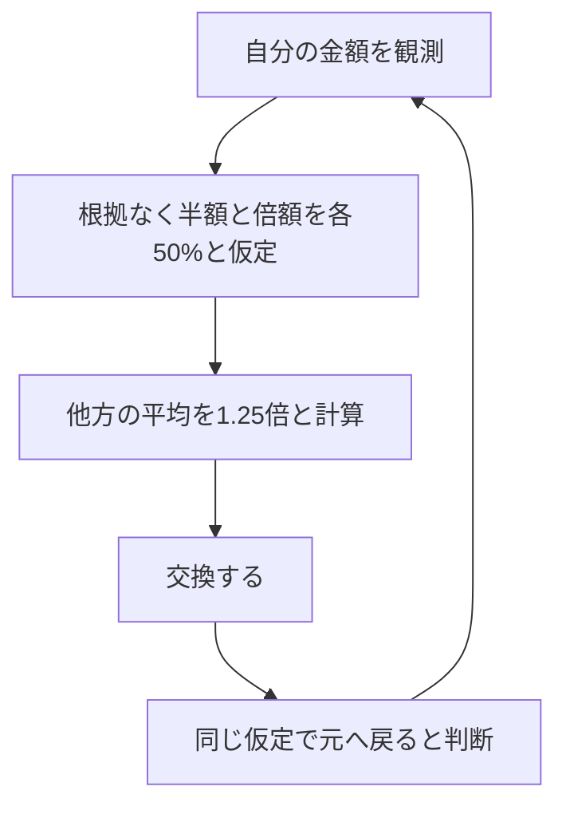
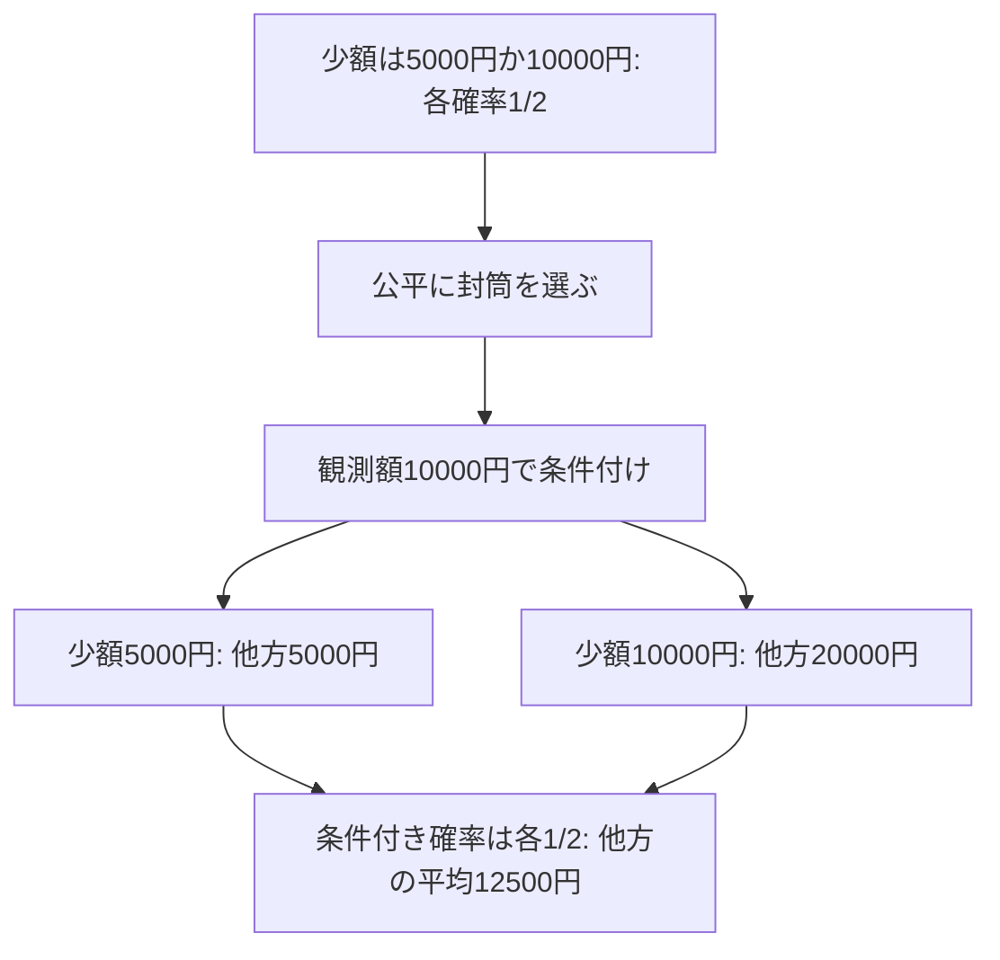

## 1. まず、封筒の選び方を定める

見た目が同じ2つの封筒があり、一方には他方の2倍のお金が入っています。どちらかを選んだ後、交換する機会を与えられます。開ける前でも、金額を見た後でも、交換した方が得なのでしょうか。

少ない方の金額を正の有限な確率変数 $S$ とし、封筒には $S$ と $2S$ が入っているとします。中身と独立な公平なコイントスで封筒を選び、選んだ方の金額を $X$、他方を $Y$ と呼びます。少額が固定された $S=s$ という条件の下では、次の2通りが各確率 $1/2$ です。

$$
(X,Y)=(s,2s)\quad\text{or}\quad(X,Y)=(2s,s).
$$

まだ金額を見ていないときの公平な選択と、特定の金額を見た後の確率は別物です。後者を求めるには、少額がどのように決まるかという**事前分布**も必要です。ここで「有限な金額」とは各回の実現額のことで、分布の平均や金額の上限が有限だとは限りません。

## 2. 誘惑的な「いつでも25%得をする」計算

自分の金額が $X=x$ だとします。「他方は半額か倍額で、それぞれ確率 $1/2$ だから」と考えると、次の計算をしたくなります。

$$
\frac12\cdot\frac{x}{2}+\frac12\cdot2x=\frac54x.
$$

算術は正しくても、**観測後にも2通りが等確率だという仮定には根拠がありません**。このまま交換後にも同じ計算を繰り返せば、元に戻すだけで増え続けるというおかしな結論になります。次の図は正しい戦略ではなく、誤った推論の循環です。

誤りを「確率変数が場合によって違う値を取るから」と説明するのも適切ではありません。それは確率変数の普通の性質です。問題は、何を条件として固定し、どの確率を使っているかが途中で変わることです。

## 3. 開ける前の対称性と有限平均

少額を固定して平均を取れば、交換前後の期待額は同じです。

$$
\mathbb E[X\mid S=s]=\mathbb E[Y\mid S=s]=\frac{3s}{2}.
$$

少額自体がランダムでも、選んだ方と他方の金額は同じ分布を持ちます。特に少額の期待値が有限なら、

$$
\mathbb E[X]=\mathbb E[Y]=\frac32\mathbb E[S]<\infty.
$$

したがって、何も観測せずに交換することで期待額が増えることはありません。ただし、観測後の特定の金額で交換が有利になることまで否定しているわけではありません。平均が無限大の場合も分布の対称性は残りますが、無限大同士を引いて平均利得を求めることはできません。

## 4. 開けた後は事前分布から計算する

まず少額が離散的に選ばれる場合を考え、$p(s)=\Pr(S=s)$ と書きます。サポート外ではこの確率を0とします。正の確率で観測できる金額 $x$ について、他方が倍額である条件付き確率を $q(x)$ とすると、[ベイズの定理](https://kenji.blog/p/bayes-theorem/)から、

$$
q(x)=\Pr(Y=2x\mid X=x)=\frac{p(x)}{p(x)+p(x/2)}.
$$

分子は「少額が観測額と同じで、少ない封筒を選んだ」場合、もう一つの項は「少額が観測額の半分で、多い封筒を選んだ」場合です。どちらにも付く選択確率は打ち消し合います。分母が正であることが必要です。

$$
\begin{aligned}\mathbb E[Y\mid X=x]&=2xq(x)+\frac{x}{2}(1-q(x)),\\ g(x)&=\mathbb E[Y\mid X=x]-x=\frac{x}{2}(3q(x)-1).\end{aligned}
$$

交換が条件付き期待額の意味で有利なのは $q(x)>1/3$ のときです。これは「実際に必ず儲かる」という意味ではありません。また、この式は離散的な確率質量の式であり、連続密度へそのまま置き換えることはできません。

## 5. 1万円を見たとき、12,500円と計算できる例

少額が5,000円か10,000円で、それぞれ確率1/2だとしましょう。封筒を公平に選び、10,000円を見た場合、他方は5,000円か20,000円で条件付き確率が各1/2です。このモデルでは、先ほどの計算が正当化されます。

$$
\mathbb E[Y\mid X=10000]=\frac12\cdot5000+\frac12\cdot20000=12500.
$$

図は10,000円の観測に条件付けた部分だけを示しています。すべての観測を含めると、自分の額が5,000円・10,000円・20,000円となる確率はそれぞれ1/4・1/2・1/4です。各場合の条件付き交換利得は5,000円・2,500円・−10,000円となり、平均は0です。

$$
\frac14\cdot5000+\frac12\cdot2500-\frac14\cdot10000=0.
$$

有限の予算は金額に上限を与えます。最大の観測額があるモデルなら、その額に対して倍額の相手はありません。しかし「観測額が増えるほど倍額の確率が必ず下がる」とは限りません。例えば少額1・2・4の確率を49/100・1/100・1/2とすると、$q(2)=1/50$ に対して $q(4)=50/51$ です。事前分布の形が重要です。

## 6. 「どの観測でも有利」は、有限平均なら不可能

少額の平均が有限なら、$g(X)$ は可積分で、[全期待値の法則](https://ocw.mit.edu/courses/6-436j-fundamentals-of-probability-fall-2018/c1ab69cb198badcebee42d5880784439_MIT6_436JF18_rec3.pdf)から、

$$
\mathbb E[g(X)]=\mathbb E[Y]-\mathbb E[X]=0.
$$

したがって、条件付き利得がほとんど確実に正になることはありません。離散モデルで言えば、正の確率で起こるすべての観測で交換が厳密に有利、ということは不可能です。ここで必要なのは**有限平均**であり、単に確率の総和が1であることではありません。

## 7. 正規化された無限平均分布では反例がある

[Broomeの論文](https://users.ox.ac.uk/~sfop0060/pdf/Two%20envelope%20paradox.pdf)で扱われる次の分布を考えます。

$$
\Pr(S=2^n)=\frac13\left(\frac23\right)^n,\qquad n=0,1,2,\ldots.
$$

$$
\sum_{n=0}^{\infty}\frac13\left(\frac23\right)^n=1,\qquad \mathbb E[S]=\frac13\sum_{n=0}^{\infty}\left(\frac43\right)^n=\infty.
$$

これは非正則な一様分布ではなく、**適切に正規化された確率分布**です。観測額が $x=2^n$、$n\ge1$ なら、

$$
q(x)=\frac25,\qquad \mathbb E[Y\mid X=x]=\frac25(2x)+\frac35\frac{x}{2}=\frac{11}{10}x>x.
$$

最小の観測額1では、他方は確実に2です。したがって、正の確率で起こるすべての観測において、他方の条件付き期待額が自分の額を上回ります。サポート外の金額に条件付けた主張ではありません。

それでも無条件の「平均利益が正」とは結論できません。$D=Y-X$ と置き、正部 $D^+=\max(D,0)$ と負部 $D^-=\max(-D,0)$ を考えると、

$$
\mathbb E[D^+]=\mathbb E[D^-]=\frac12\mathbb E[S]=\infty.
$$

両方が無限大なので、符号付き差の期待値は[定義されません](https://www.stat.berkeley.edu/~wfithian/courses/stat210a/measure-theory-basics.html)。一方、非負の金額に対する全期待値の法則はそのまま成立します。

$$
\mathbb E[\mathbb E[Y\mid X]]=\mathbb E[Y]=\infty.
$$

無限大でも法則が壊れるわけではありません。使えないのは、可積分でない符号付き差へ有限平均の場合の引き算や線形性を無条件に持ち込む操作です。各可能観測額に条件付けた有限の計算と、無条件の符号付き期待値を区別します。分布を有限で打ち切って再正規化すると、最大観測額での損失が残り、平均交換利得は0に戻ります。

## 8. 連続密度では変数変換も必要

少額が連続密度 $f$ を持つ場合、「選んだ額が少額」である側の密度は $f(x)/2$、倍額側は $f(x/2)/4$ になります。後者には公平な選択の係数だけでなく、$x=2s$ という変数変換の係数も含まれます。

$$
q(x)=\frac{f(x)}{f(x)+\tfrac12f(x/2)}.
$$

この条件付き密度の式は、観測額の密度が正のところで使います。連続変数では一点を観測する事象の確率自体は0なので、離散的な事象確率の比とは区別します。Broomeの論文には次の適切な密度も登場します。

$$
f(s)=\frac{1}{(1+s)^2},\qquad s>0.
$$

積分は1ですが、少額の平均は無限大です。正の観測額について、

$$
\frac{f(x/2)}{f(x)}=\frac{4(1+x)^2}{(2+x)^2}<4
\quad\Longrightarrow\quad q(x)>\frac13.
$$

したがって、この密度から得られる連続な条件付き期待額は、すべての正の観測額で自分の額を上回ります。これも「正規化された分布なら常にどこかで交換が不利になる」という主張への反例です。

## 9. 交換の比率、意思決定、無限の扱い

開ける前の比率を $R=Y/X$ とすると、公平な選択により比率は2か1/2で各確率1/2です。その平均が5/4になる計算自体は正しく、逆比率の平均も同じです。しかし、2回の交換比率は互いに逆数で、独立ではありません。

$$
\mathbb E[R]=\mathbb E[1/R]=\frac54,\qquad \mathbb E[R(1/R)]=1\ne\frac{25}{16}=\mathbb E[R]\mathbb E[1/R].
$$

元へ戻せば実際の金額も元に戻ります。平均比率を自分の金額へ無条件に掛けたり、2回分の平均比率を掛け合わせたりしてはいけません。また、両方の金額を見た後は情報が変わり、半額・倍額という不確実性そのものが消えます。

この問題は、無限平均を持つ賭けを扱う[サンクトペテルブルクのパラドックス](https://kenji.blog/p/st-petersburg-paradox/)とも関係します。現実の予算上限、提示された金額の決め方、効用や危険への態度によって意思決定は変わります。ここで比較したのは期待金額であり、普遍的な意思決定規則や確実な利益ではありません。

要点は、条件付き確率には金額を生むモデルが要り、正規化と有限平均は異なる、ということです。有限平均なら対称性と全期待値から平均交換利得は0です。無限平均のモデルでは適切な反例があり、非負の無限期待値と未定義の符号付き期待値を丁寧に区別する必要があります。
