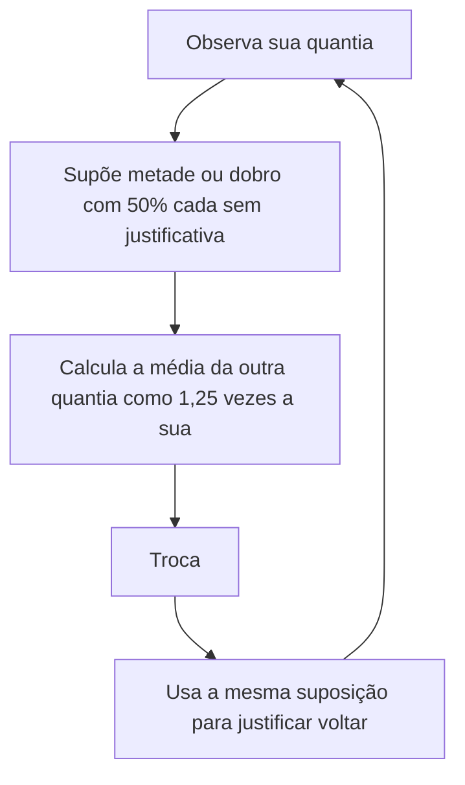
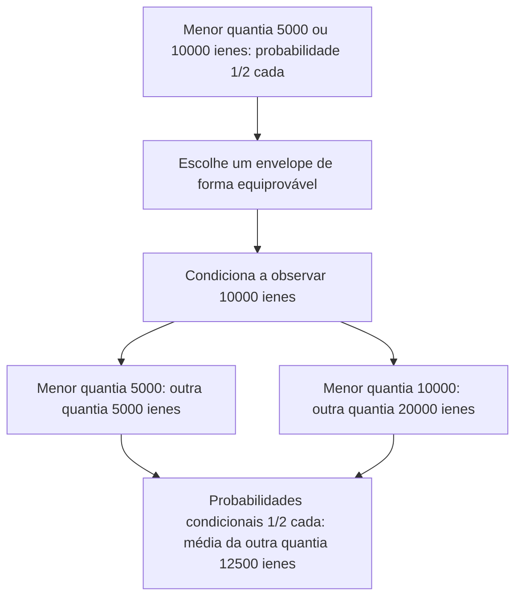

## 1. Definir como o envelope é escolhido

Dois envelopes de aparência idêntica contêm dinheiro: um guarda o dobro da quantia do outro. Depois de escolher um deles, você pode trocar. Vale a pena fazer isso antes de abrir ou depois de ver a quantia?

Seja $S$ a menor quantia, uma variável aleatória positiva e finita. Os envelopes contêm $S$ e $2S$. Escolha um deles lançando uma moeda equilibrada, com resultado independente dos conteúdos. Chamaremos de $X$ a quantia escolhida e de $Y$ a outra. Condicionando ao valor fixo $S=s$ da menor quantia, os dois resultados abaixo têm probabilidade $1/2$ cada um.

$$
(X,Y)=(s,2s)\quad\text{or}\quad(X,Y)=(2s,s).
$$

A escolha equiprovável antes de ver a quantia não determina as probabilidades depois da observação. Para calcular estas últimas, é preciso também uma **distribuição a priori** que descreva como a menor quantia é gerada. «Quantia finita» se refere a cada realização; não implica que a esperança (valor esperado) ou um limite superior para as quantias sejam finitos.

## 2. O tentador cálculo de «ganhar 25% a cada troca»

Suponha que você observe $X=x$. É tentador pensar: «O outro envelope tem metade ou o dobro, com probabilidade $1/2$ para cada caso», e calcular:

$$
\frac12\cdot\frac{x}{2}+\frac12\cdot2x=\frac54x.
$$

A aritmética está correta, mas **não há justificativa para a equiprobabilidade depois de observar a quantia**. Repetir o argumento após a troca sugeriria que ir e voltar aumenta o dinheiro sem parar. O diagrama mostra esse raciocínio incorreto, não uma estratégia válida.

Também não é adequado atribuir o erro ao fato de uma variável aleatória assumir valores diferentes em casos diferentes: isso é uma propriedade normal de variáveis aleatórias. O problema é mudar o que se mantém fixo e quais probabilidades são usadas.

## 3. Simetria antes de abrir e esperança finita

Fixada a menor quantia, os valores esperados antes e depois da troca coincidem.

$$
\mathbb E[X\mid S=s]=\mathbb E[Y\mid S=s]=\frac{3s}{2}.
$$

Mesmo quando a menor quantia é aleatória, a quantia escolhida e a outra têm a mesma distribuição. Em particular, se a esperança da menor quantia é finita,

$$
\mathbb E[X]=\mathbb E[Y]=\frac32\mathbb E[S]<\infty.
$$

Portanto, trocar sem observar nenhuma quantia não aumenta o dinheiro esperado. Isso não descarta uma vantagem condicionada a uma observação específica. Se a esperança é infinita, a simetria das distribuições permanece, mas subtrair dois infinitos não permite estabelecer um ganho médio.

## 4. Depois de abrir, calcular a partir da distribuição a priori

Considere primeiro uma menor quantia discreta, com $p(s)=\Pr(S=s)$ e massa nula fora do seu suporte. Para uma quantia $x$ observável com probabilidade positiva, seja $q(x)$ a probabilidade condicional de o outro envelope conter o dobro. Pelo [teorema de Bayes](https://kenji.blog/pt/p/bayes-theorem/),

$$
q(x)=\Pr(Y=2x\mid X=x)=\frac{p(x)}{p(x)+p(x/2)}.
$$

O numerador corresponde ao caso em que a menor quantia coincide com a observada e o envelope com menos dinheiro é escolhido. O outro termo corresponde ao caso em que a menor quantia é metade da observada e o envelope com mais dinheiro é escolhido. Os fatores comuns da seleção se cancelam. O denominador deve ser positivo.

$$
\begin{aligned}\mathbb E[Y\mid X=x]&=2xq(x)+\frac{x}{2}(1-q(x)),\\ g(x)&=\mathbb E[Y\mid X=x]-x=\frac{x}{2}(3q(x)-1).\end{aligned}
$$

Trocar aumenta o valor esperado condicional da quantia quando $q(x)>1/3$. Isso não significa ganho certo. Estas fórmulas usam massas de probabilidade discretas; não podem ser transferidas para densidades contínuas por simples substituição.

## 5. Quando observar 10.000 ienes permite calcular uma esperança de 12.500

Suponha que a menor quantia seja de 5.000 ou 10.000 ienes, com probabilidade 1/2 para cada uma. Escolhemos um envelope de forma equiprovável e observamos 10.000 ienes. Condicionada a essa observação, a outra quantia é de 5.000 ou 20.000 ienes, com probabilidade 1/2 para cada uma. Nesse modelo, o cálculo anterior é justificado.

$$
\mathbb E[Y\mid X=10000]=\frac12\cdot5000+\frac12\cdot20000=12500.
$$

O diagrama mostra apenas a parte condicionada a observar 10.000 ienes. Considerando todas as observações, sua quantia é de 5.000, 10.000 ou 20.000 ienes com probabilidades 1/4, 1/2 e 1/4. Os ganhos condicionais da troca são, respectivamente, 5.000, 2.500 e −10.000 ienes, e sua média é zero.

$$
\frac14\cdot5000+\frac12\cdot2500-\frac14\cdot10000=0.
$$

Um orçamento finito limita as quantias. Se o modelo admite uma quantia máxima observável, ela não pode ter uma correspondente que seja o dobro. Isso não significa que a probabilidade de obter o dobro sempre diminua com a quantia observada. Se as menores quantias 1, 2 e 4 têm probabilidades 49/100, 1/100 e 1/2, então $q(2)=1/50$, mas $q(4)=50/51$. A forma da distribuição a priori importa.

## 6. Com esperança finita, não pode haver vantagem em toda observação

Se a menor quantia tem esperança finita, $g(X)$ é integrável. Pela [lei da esperança total](https://ocw.mit.edu/courses/6-436j-fundamentals-of-probability-fall-2018/c1ab69cb198badcebee42d5880784439_MIT6_436JF18_rec3.pdf),

$$
\mathbb E[g(X)]=\mathbb E[Y]-\mathbb E[X]=0.
$$

Portanto, não é possível que o ganho condicional seja estritamente positivo quase certamente. Em um modelo discreto, trocar não pode ser estritamente vantajoso para toda observação de probabilidade positiva. A hipótese decisiva é a **esperança finita**, não apenas a soma das probabilidades ser um.

## 7. Uma distribuição a priori própria com esperança infinita dá um contraexemplo

Considere a distribuição discutida no [artigo de Broome](https://users.ox.ac.uk/~sfop0060/pdf/Two%20envelope%20paradox.pdf):

$$
\Pr(S=2^n)=\frac13\left(\frac23\right)^n,\qquad n=0,1,2,\ldots.
$$

$$
\sum_{n=0}^{\infty}\frac13\left(\frac23\right)^n=1,\qquad \mathbb E[S]=\frac13\sum_{n=0}^{\infty}\left(\frac43\right)^n=\infty.
$$

Esta é uma **distribuição de probabilidade própria e normalizada**, não uma distribuição a priori uniforme imprópria. Para uma observação $x=2^n$ com $n\ge1$,

$$
q(x)=\frac25,\qquad \mathbb E[Y\mid X=x]=\frac25(2x)+\frac35\frac{x}{2}=\frac{11}{10}x>x.
$$

Na menor observação, 1, a outra quantia é necessariamente 2. Assim, para toda observação de probabilidade positiva, a esperança condicional da outra quantia supera a sua. Isso não faz afirmações sobre condicionar a quantias fora do suporte.

Mesmo assim, não se pode concluir que o ganho médio incondicional seja positivo. Seja $D=Y-X$, com parte positiva $D^+=\max(D,0)$ e parte negativa $D^-=\max(-D,0)$:

$$
\mathbb E[D^+]=\mathbb E[D^-]=\frac12\mathbb E[S]=\infty.
$$

As duas partes têm esperança infinita, logo a esperança da diferença com sinal [não está definida](https://www.stat.berkeley.edu/~wfithian/courses/stat210a/measure-theory-basics.html). A lei da esperança total continua válida para a quantia não negativa:

$$
\mathbb E[\mathbb E[Y\mid X]]=\mathbb E[Y]=\infty.
$$

O infinito não quebra a lei. O que não se pode fazer é aplicar, sem verificar as hipóteses, a subtração ou a linearidade do caso de esperança finita a uma diferença com sinal não integrável. Cálculos finitos condicionados a cada observação possível devem ser distinguidos da esperança incondicional da diferença. Ao truncar e renormalizar a distribuição a priori, resta uma perda na maior observação, e o ganho médio da troca volta a ser zero.

## 8. Densidades contínuas exigem uma mudança de variável

Se a menor quantia tem densidade contínua $f$, o ramo em que se escolhe a menor quantia contribui com densidade $f(x)/2$, enquanto o ramo da maior quantia contribui com $f(x/2)/4$. A segunda contribuição inclui tanto o fator da seleção equiprovável quanto o da mudança de variável $x=2s$.

$$
q(x)=\frac{f(x)}{f(x)+\tfrac12f(x/2)}.
$$

Essa fórmula condicional é usada onde a densidade da quantia observada é positiva. Uma variável contínua assumir um valor exato é um evento de probabilidade zero; não estamos dividindo probabilidades de eventos discretos. Broome também apresenta a densidade própria:

$$
f(s)=\frac{1}{(1+s)^2},\qquad s>0.
$$

Sua integral é um, mas a esperança da menor quantia é infinita. Para uma quantia observada positiva,

$$
\frac{f(x/2)}{f(x)}=\frac{4(1+x)^2}{(2+x)^2}<4
\quad\Longrightarrow\quad q(x)>\frac13.
$$

Assim, a versão contínua da esperança condicional determinada por essas densidades supera a sua quantia em toda observação positiva. É outro contraexemplo à afirmação de que a normalização, por si só, obrigue a troca a ser desfavorável em alguma quantia.

## 9. Razões de troca, decisões e infinito

Para a razão antes de abrir $R=Y/X$, a escolha equiprovável dá uma razão de 2 ou de 1/2 com probabilidade 1/2 para cada caso. Sua esperança é realmente 5/4, assim como a da razão recíproca. Mas as razões de duas trocas sucessivas são recíprocas, não independentes.

$$
\mathbb E[R]=\mathbb E[1/R]=\frac54,\qquad \mathbb E[R(1/R)]=1\ne\frac{25}{16}=\mathbb E[R]\mathbb E[1/R].
$$

Voltar ao envelope original devolve a quantia original. Não se pode multiplicar sua quantia pela média incondicional da razão, nem multiplicar as médias das razões de duas trocas, sem justificativa. Ver as duas quantias também muda a informação: desaparece a incerteza entre metade e dobro.

O problema está relacionado ao [paradoxo de São Petersburgo](https://kenji.blog/pt/p/st-petersburg-paradox/), que também envolve apostas com esperança infinita. Limites orçamentários reais, a geração das quantias, a utilidade e a atitude em relação ao risco podem mudar as decisões. Aqui comparamos dinheiro esperado, não uma regra universal de decisão ou lucro garantido.

Probabilidades condicionais precisam de um modelo que gere as quantias, e normalizar não equivale a ter esperança finita. Com esperança finita, a simetria e a esperança total dão ganho médio nulo ao trocar. Com esperança infinita, há contraexemplos baseados em distribuições próprias: é preciso distinguir a esperança infinita de uma variável não negativa de uma diferença com sinal cuja esperança não está definida.
