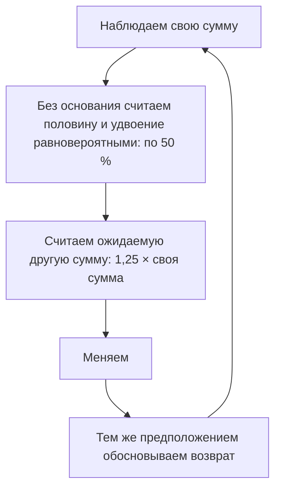
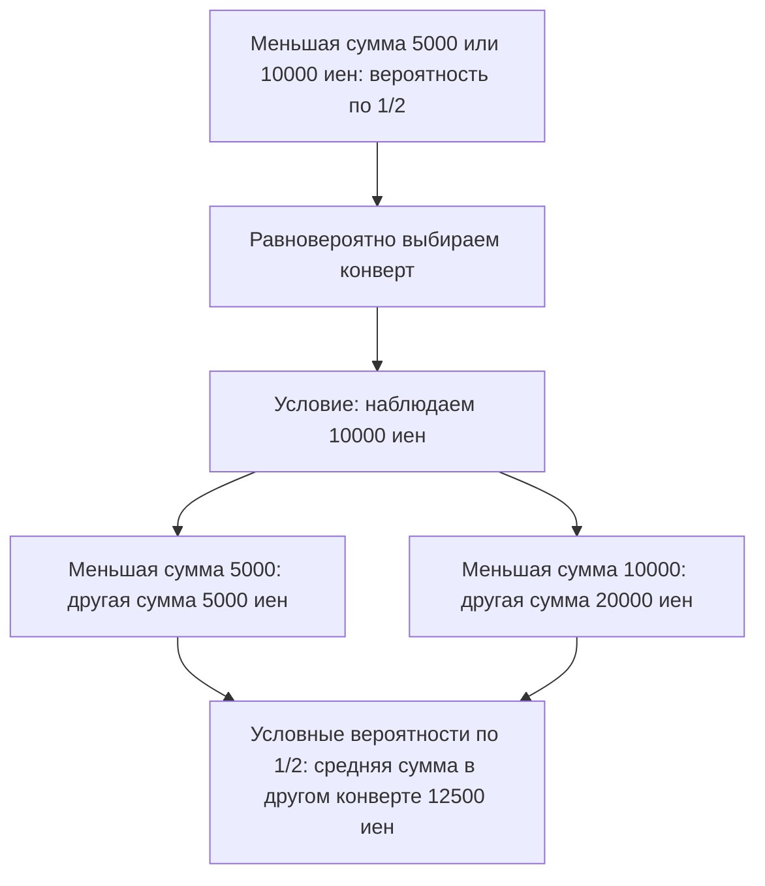

## 1. Сначала зададим способ выбора конверта

В двух одинаково выглядящих конвертах лежат деньги: в одном вдвое больше, чем в другом. После выбора одного конверта вам предлагают обмен. Выгодно ли менять его до открытия или после того, как вы увидели сумму?

Пусть $S$ — меньшая сумма, случайная величина с положительными конечными значениями. В конвертах лежат $S$ и $2S$. Выберем конверт броском симметричной монеты, результат которого независим от содержимого. Обозначим выбранную сумму через $X$, другую — через $Y$. При фиксированной меньшей сумме $S=s$ следующие два исхода имеют вероятность $1/2$ каждый.

$$
(X,Y)=(s,2s)\quad\text{or}\quad(X,Y)=(2s,s).
$$

Равновероятный выбор до наблюдения суммы не определяет вероятности после наблюдения конкретного значения. Для последних нужно также **априорное распределение**, описывающее, как задаётся меньшая сумма. Конечность суммы относится к каждой реализации, а не к математическому ожиданию или верхней границе возможных сумм.

## 2. Соблазнительный расчёт «25 % выигрыша при каждом обмене»

Предположим, вы наблюдаете $X=x$. Возникает соблазн сказать: «В другом конверте половина или удвоенная сумма, с вероятностью $1/2$ для каждого случая», и посчитать:

$$
\frac12\cdot\frac{x}{2}+\frac12\cdot2x=\frac54x.
$$

Арифметика верна, но **равновероятность после наблюдения суммы ничем не обоснована**. Повторение рассуждения после обмена создало бы впечатление, что переходы туда и обратно непрерывно увеличивают деньги. Диаграмма показывает ошибочное рассуждение, а не правильную стратегию.

Неверно также объяснять ошибку тем, что случайная величина принимает разные значения в разных случаях: это её нормальное свойство. Проблема в изменении того, что считается фиксированным и какие вероятности используются.

## 3. Симметрия до открытия и конечное математическое ожидание

При фиксированной меньшей сумме математические ожидания до и после обмена совпадают.

$$
\mathbb E[X\mid S=s]=\mathbb E[Y\mid S=s]=\frac{3s}{2}.
$$

Даже если меньшая сумма случайна, выбранная и другая суммы имеют одинаковое распределение. В частности, если математическое ожидание меньшей суммы конечно,

$$
\mathbb E[X]=\mathbb E[Y]=\frac32\mathbb E[S]<\infty.
$$

Поэтому обмен без наблюдения каких-либо сумм не увеличивает ожидаемую сумму денег. Это не исключает условного преимущества при конкретном наблюдении. При бесконечном ожидании симметрия распределений сохраняется, но вычитание двух бесконечностей не определяет средний прирост.

## 4. После открытия считаем по априорному распределению

Сначала рассмотрим дискретную меньшую сумму с $p(s)=\Pr(S=s)$ и нулевой вероятностной массой вне её возможных значений. Для суммы $x$, наблюдаемой с положительной вероятностью, обозначим через $q(x)$ условную вероятность того, что в другом конверте вдвое больше. По [теореме Байеса](https://kenji.blog/ru/p/bayes-theorem/),

$$
q(x)=\Pr(Y=2x\mid X=x)=\frac{p(x)}{p(x)+p(x/2)}.
$$

Числитель соответствует случаю, когда меньшая сумма равна наблюдаемой и выбран конверт с меньшим количеством денег. Другой член соответствует случаю, когда меньшая сумма равна половине наблюдаемой и выбран конверт с большим количеством денег. Общие множители вероятности выбора сокращаются. Знаменатель должен быть положительным.

$$
\begin{aligned}\mathbb E[Y\mid X=x]&=2xq(x)+\frac{x}{2}(1-q(x)),\\ g(x)&=\mathbb E[Y\mid X=x]-x=\frac{x}{2}(3q(x)-1).\end{aligned}
$$

Обмен увеличивает условное математическое ожидание суммы при $q(x)>1/3$. Это не гарантирует фактической прибыли. Формулы используют дискретные вероятностные массы; нельзя просто заменить их непрерывными плотностями.

## 5. Когда наблюдение 10 000 иен даёт ожидание 12 500

Пусть меньшая сумма равна 5 000 или 10 000 иен с вероятностью 1/2 для каждого значения. Выбираем конверт равновероятно и наблюдаем 10 000 иен. При этом условии другая сумма равна 5 000 или 20 000 иен с условной вероятностью 1/2 для каждого случая. В такой модели прежний расчёт обоснован.

$$
\mathbb E[Y\mid X=10000]=\frac12\cdot5000+\frac12\cdot20000=12500.
$$

Диаграмма показывает только часть, обусловленную наблюдением 10 000 иен. Среди всех наблюдений ваша сумма равна 5 000, 10 000 или 20 000 иен с вероятностями 1/4, 1/2 и 1/4. Соответствующие условные ожидаемые приросты при обмене равны 5 000, 2 500 и −10 000 иен, а их среднее — нулю.

$$
\frac14\cdot5000+\frac12\cdot2500-\frac14\cdot10000=0.
$$

Конечный бюджет ограничивает суммы сверху. Если модель допускает наибольшую наблюдаемую сумму, в другом конверте не может оказаться вдвое больше. Но это не означает, что вероятность удвоения всегда убывает с наблюдаемой суммой. Если меньшие суммы 1, 2 и 4 имеют вероятности 49/100, 1/100 и 1/2, то $q(2)=1/50$, но $q(4)=50/51$. Форма априорного распределения существенна.

## 6. При конечном ожидании преимущество при каждом наблюдении невозможно

Если математическое ожидание меньшей суммы конечно, случайная величина $g(X)$ интегрируема. По [формуле полного математического ожидания](https://ocw.mit.edu/courses/6-436j-fundamentals-of-probability-fall-2018/c1ab69cb198badcebee42d5880784439_MIT6_436JF18_rec3.pdf),

$$
\mathbb E[g(X)]=\mathbb E[Y]-\mathbb E[X]=0.
$$

Поэтому невозможно, чтобы условный ожидаемый прирост был строго положительным с вероятностью 1, то есть почти наверное. В дискретной модели невозможно, чтобы при каждом наблюдении с положительной вероятностью обмен давал строго положительный условный ожидаемый прирост. Ключевое условие — **конечное математическое ожидание**, а не только сумма вероятностей, равная единице.

## 7. Нормированное распределение с бесконечным ожиданием даёт контрпример

Рассмотрим распределение из [статьи Брума](https://users.ox.ac.uk/~sfop0060/pdf/Two%20envelope%20paradox.pdf):

$$
\Pr(S=2^n)=\frac13\left(\frac23\right)^n,\qquad n=0,1,2,\ldots.
$$

$$
\sum_{n=0}^{\infty}\frac13\left(\frac23\right)^n=1,\qquad \mathbb E[S]=\frac13\sum_{n=0}^{\infty}\left(\frac43\right)^n=\infty.
$$

Это **нормированное распределение вероятностей с общей массой 1**, а не ненормируемое равномерное априорное распределение. При наблюдении $x=2^n$ с $n\ge1$ имеем:

$$
q(x)=\frac25,\qquad \mathbb E[Y\mid X=x]=\frac25(2x)+\frac35\frac{x}{2}=\frac{11}{10}x>x.
$$

При минимальном наблюдении, 1, другая сумма обязательно равна 2. Следовательно, при каждом наблюдении положительной вероятности условное математическое ожидание другой суммы превышает вашу. Мы не рассматриваем условные ожидания при наблюдениях вне множества возможных сумм.

Тем не менее отсюда не следует положительный безусловный средний прирост. Положим $D=Y-X$, с положительной частью $D^+=\max(D,0)$ и отрицательной частью $D^-=\max(-D,0)$; обе части неотрицательны:

$$
\mathbb E[D^+]=\mathbb E[D^-]=\frac12\mathbb E[S]=\infty.
$$

Обе части имеют бесконечное ожидание, поэтому математическое ожидание знакопеременной разности [не определено](https://www.stat.berkeley.edu/~wfithian/courses/stat210a/measure-theory-basics.html). Формула полного математического ожидания по-прежнему верна для неотрицательной суммы:

$$
\mathbb E[\mathbb E[Y\mid X]]=\mathbb E[Y]=\infty.
$$

Бесконечность не нарушает эту формулу. Нельзя без проверки условий переносить вычитание или линейность из случая конечных ожиданий на неинтегрируемую знакопеременную разность. Конечные расчёты при каждом возможном наблюдении нужно отличать от безусловного ожидания разности. Если усечь априорное распределение до конечного числа членов и нормировать заново, при наибольшем наблюдении останется потеря, а средний прирост от обмена вновь будет нулевым.

## 8. Для непрерывных плотностей нужна замена переменной

Если меньшая сумма имеет непрерывную плотность $f$, ветвь выбора меньшей суммы даёт вклад $f(x)/2$ в плотность наблюдаемой суммы, а ветвь выбора большей суммы — $f(x/2)/4$. Второй вклад учитывает и множитель равновероятного выбора, и множитель замены переменной $x=2s$.

$$
q(x)=\frac{f(x)}{f(x)+\tfrac12f(x/2)}.
$$

Эта условная формула применяется там, где плотность наблюдаемой суммы положительна. Для случайной величины с плотностью событие принятия одного заданного значения имеет вероятность ноль; речь не идёт о делении вероятностей дискретных событий. Брум приводит и следующую нормированную плотность:

$$
f(s)=\frac{1}{(1+s)^2},\qquad s>0.
$$

Её интеграл равен единице, но ожидание меньшей суммы бесконечно. Для положительной наблюдаемой суммы

$$
\frac{f(x/2)}{f(x)}=\frac{4(1+x)^2}{(2+x)^2}<4
\quad\Longrightarrow\quad q(x)>\frac13.
$$

Поэтому непрерывная версия условного математического ожидания, определяемая этими плотностями, превышает вашу сумму при каждом положительном наблюдаемом значении. Это ещё один контрпример к утверждению, будто одной нормировки достаточно, чтобы обмен был невыгоден при какой-либо сумме.

## 9. Отношения сумм, решения и бесконечность

Для отношения до открытия $R=Y/X$ равновероятный выбор даёт значения 2 или 1/2 с вероятностью 1/2 для каждого случая. Его ожидание действительно равно 5/4, как и ожидание обратного отношения. Но отношения при двух последовательных обменах взаимно обратны, а не независимы.

$$
\mathbb E[R]=\mathbb E[1/R]=\frac54,\qquad \mathbb E[R(1/R)]=1\ne\frac{25}{16}=\mathbb E[R]\mathbb E[1/R].
$$

Возврат к исходному конверту возвращает исходную сумму. Нельзя без обоснования умножать вашу сумму на безусловное среднее отношение или перемножать средние отношения двух обменов. Наблюдение обеих сумм также меняет информацию: неопределённость между половиной и удвоенной суммой исчезает.

Проблема связана с [Санкт-Петербургским парадоксом](https://kenji.blog/ru/p/st-petersburg-paradox/), который тоже рассматривает игры с бесконечным ожиданием. Реальные ограничения бюджета, способ задания сумм, полезность и отношение к риску могут изменить решение. Здесь сравниваются ожидаемые денежные суммы, а не предлагается универсальное правило выбора или гарантированная прибыль.

Условным вероятностям нужна модель генерации сумм, а нормировка не равносильна конечному ожиданию. При конечном ожидании симметрия и формула полного математического ожидания дают нулевой средний прирост от обмена. При бесконечном ожидании нормированные распределения дают контрпримеры: нужно различать бесконечное ожидание неотрицательной величины и неопределённое ожидание знакопеременной разности.
