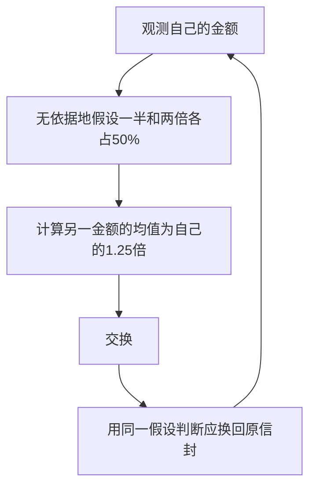
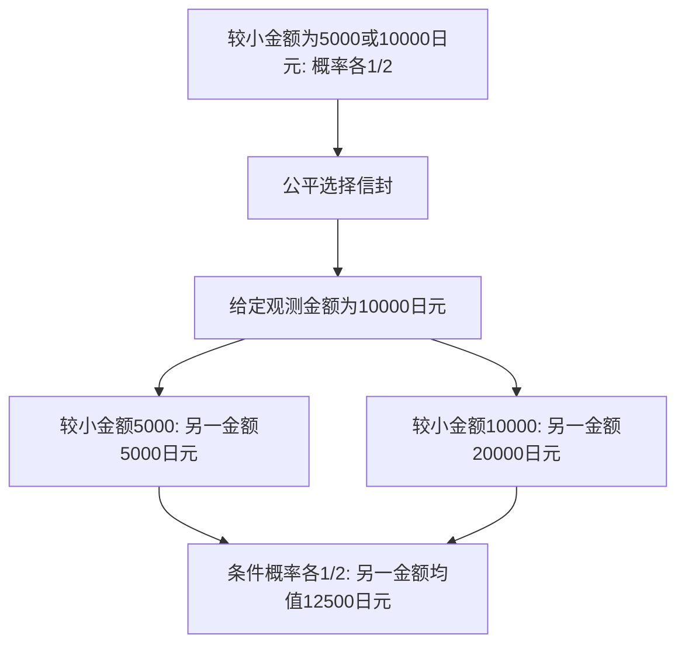

## 1. 先明确如何选择信封

两个外观相同的信封里都装着钱，一个信封的金额是另一个的两倍。选定一个后，你有机会交换。无论是在打开之前，还是在看到金额之后，交换都会更划算吗？

设较小的金额为正且有限的随机变量 $S$，两个信封里分别装着 $S$ 和 $2S$。通过抛一枚公平硬币来选择信封，并假定抛掷结果与信封内容独立。所选信封的金额记为 $X$，另一个的金额记为 $Y$。在给定较小金额为 $S=s$ 的条件下，以下两种结果的概率各为 $1/2$。

$$
(X,Y)=(s,2s)\quad\text{or}\quad(X,Y)=(2s,s).
$$

看到金额之前的公平选择，与给定某个观测金额之后的概率，并不是一回事。计算后者还需要描述较小金额如何产生的**先验分布**。这里的“金额有限”指每次实现的金额有限，并不意味着分布的均值或金额的上界也有限。

## 2. 诱人的“每次都多赚25%”计算

假设你看到的金额为 $X=x$。你可能会想：“另一个信封的金额要么是一半，要么是两倍，各有 $1/2$ 的概率。”于是计算：

$$
\frac12\cdot\frac{x}{2}+\frac12\cdot2x=\frac54x.
$$

算术本身没有错，但**观测金额之后两种情况仍然等概率的假设，并没有依据**。如果交换后继续使用同样的推理，就会以为来回交换能不断增加金额。下图展示的是错误推理的循环，而不是正确策略。

把错误归咎于“随机变量在不同情况下取了不同的值”也不恰当。这正是随机变量的正常性质。真正的问题是：计算过程中改变了固定的条件，却继续使用原来的概率。

## 3. 打开之前的对称性与有限均值

给定较小金额后，交换前后的期望金额相同。

$$
\mathbb E[X\mid S=s]=\mathbb E[Y\mid S=s]=\frac{3s}{2}.
$$

即使较小金额本身是随机的，所选信封与另一个信封的金额仍然同分布。特别地，如果较小金额的期望有限，

$$
\mathbb E[X]=\mathbb E[Y]=\frac32\mathbb E[S]<\infty.
$$

因此，在没有观测到任何金额时，交换不会提高期望金额。但这并不排除在给定某个特定观测金额后，交换会更有利。均值为无穷大时，同分布的对称性仍然成立，但不能通过无穷大减去无穷大来计算平均收益。

## 4. 打开之后，要从先验分布计算

先考虑较小金额是离散随机变量的情况，记 $p(s)=\Pr(S=s)$，并约定在其可能取值之外概率为0。对于能以正概率观测到的金额 $x$，用 $q(x)$ 表示另一个信封金额为两倍的条件概率。[贝叶斯定理](https://kenji.blog/zh-cn/p/bayes-theorem/)给出：

$$
q(x)=\Pr(Y=2x\mid X=x)=\frac{p(x)}{p(x)+p(x/2)}.
$$

分子对应“较小金额等于观测金额，并选中了较小信封”，分母中的另一项对应“较小金额是观测金额的一半，并选中了较大信封”。两种情况共同包含的选择概率会约去。分母必须为正。

$$
\begin{aligned}\mathbb E[Y\mid X=x]&=2xq(x)+\frac{x}{2}(1-q(x)),\\ g(x)&=\mathbb E[Y\mid X=x]-x=\frac{x}{2}(3q(x)-1).\end{aligned}
$$

当 $q(x)>1/3$ 时，交换能提高条件期望金额。这并不意味着实际收益必定为正。这些公式使用的是离散概率质量，不能直接把它们替换成连续概率密度。

## 5. 看到10,000日元时，何时能算出12,500日元？

假设较小金额为5,000或10,000日元，概率各为1/2。公平选择一个信封后，观测到10,000日元。在这个观测条件下，另一个信封的金额是5,000或20,000日元，概率各为1/2。在这个模型中，前面的计算确实成立。

$$
\mathbb E[Y\mid X=10000]=\frac12\cdot5000+\frac12\cdot20000=12500.
$$

图中只展示了给定观测金额为10,000日元的部分。考虑所有观测结果时，你的金额为5,000、10,000、20,000日元的概率分别是1/4、1/2、1/4，对应的条件交换收益分别为5,000、2,500、−10,000日元，平均为0。

$$
\frac14\cdot5000+\frac12\cdot2500-\frac14\cdot10000=0.
$$

有限预算给金额设置了上界。若模型存在最大的可能观测金额，这一金额就不可能还有一个两倍的对应金额。但这不意味着“观测金额越大，翻倍的概率就必然越低”。例如，较小金额为1、2、4的概率分别是49/100、1/100、1/2时，$q(2)=1/50$，而 $q(4)=50/51$。先验分布的具体形状很重要。

## 6. 有限均值下，不可能在所有观测中都有优势

如果较小金额的均值有限，$g(X)$ 就是可积的。由[全期望公式](https://ocw.mit.edu/courses/6-436j-fundamentals-of-probability-fall-2018/c1ab69cb198badcebee42d5880784439_MIT6_436JF18_rec3.pdf)，

$$
\mathbb E[g(X)]=\mathbb E[Y]-\mathbb E[X]=0.
$$

因此，条件收益不可能几乎必然严格为正。在离散模型中，这意味着不可能在每一个正概率的观测条件下，交换都严格有利。这里的关键假设是**均值有限**，而不只是概率总和为1。

## 7. 归一化的无穷均值先验给出了反例

考虑[Broome的论文](https://users.ox.ac.uk/~sfop0060/pdf/Two%20envelope%20paradox.pdf)中讨论的分布：

$$
\Pr(S=2^n)=\frac13\left(\frac23\right)^n,\qquad n=0,1,2,\ldots.
$$

$$
\sum_{n=0}^{\infty}\frac13\left(\frac23\right)^n=1,\qquad \mathbb E[S]=\frac13\sum_{n=0}^{\infty}\left(\frac43\right)^n=\infty.
$$

这是一个**正确归一化的概率分布**，而不是无法归一化的均匀先验。若观测金额为 $x=2^n$，其中 $n\ge1$，

$$
q(x)=\frac25,\qquad \mathbb E[Y\mid X=x]=\frac25(2x)+\frac35\frac{x}{2}=\frac{11}{10}x>x.
$$

当观测到最小金额1时，另一个金额必定为2。因此，对于所有以正概率出现的观测金额，另一个信封的条件期望金额都比自己的金额高。这并不是在对分布可能取值之外的金额作条件化。

尽管如此，仍不能得出“无条件平均收益为正”的结论。令 $D=Y-X$，并定义正部 $D^+=\max(D,0)$ 和负部 $D^-=\max(-D,0)$，则

$$
\mathbb E[D^+]=\mathbb E[D^-]=\frac12\mathbb E[S]=\infty.
$$

正部和负部的期望都为无穷大，所以带符号差值的期望[没有定义](https://www.stat.berkeley.edu/~wfithian/courses/stat210a/measure-theory-basics.html)。但对于非负金额，全期望公式仍然成立：

$$
\mathbb E[\mathbb E[Y\mid X]]=\mathbb E[Y]=\infty.
$$

无穷大并没有破坏这条法则。不能做的是：不检查条件，就把有限均值情况下的减法或线性运算用于不可积的带符号差值。给定每个可能观测金额后的有限计算，与无条件的带符号期望必须区分。如果把该先验截断为有限项并重新归一化，最大观测金额处仍有损失，平均交换收益就恢复为0。

## 8. 连续密度还需要变量变换

如果较小金额具有连续密度 $f$，“选中较小金额”这一分支对观测金额的密度贡献为 $f(x)/2$，“选中较大金额”分支的贡献为 $f(x/2)/4$。后者不仅包含公平选择的系数，还包含 $x=2s$ 这一变量变换的系数。

$$
q(x)=\frac{f(x)}{f(x)+\tfrac12f(x/2)}.
$$

这个条件密度公式用于观测金额的密度为正之处。连续变量恰好取某一点的概率为0，因此不能把它当作离散事件概率之比。Broome的论文还给出了如下满足归一化条件的概率密度：

$$
f(s)=\frac{1}{(1+s)^2},\qquad s>0.
$$

它的积分为1，但较小金额的均值为无穷大。对于正的观测金额，

$$
\frac{f(x/2)}{f(x)}=\frac{4(1+x)^2}{(2+x)^2}<4
\quad\Longrightarrow\quad q(x)>\frac13.
$$

因此，由这些密度给出的连续条件期望函数，在每个正的观测金额处都高于自己的金额。这也反驳了“只要分布归一化，就总会在某些金额上交换不利”的说法。

## 9. 交换比率、决策与无穷大

打开之前，令比率为 $R=Y/X$。由于公平选择，比率为2或1/2的概率各为1/2。其均值确实为5/4，倒数比率的均值也相同。然而，两次连续交换的比率互为倒数，并不独立。

$$
\mathbb E[R]=\mathbb E[1/R]=\frac54,\qquad \mathbb E[R(1/R)]=1\ne\frac{25}{16}=\mathbb E[R]\mathbb E[1/R].
$$

换回原来的信封，实际金额也回到原样。不能未经论证，就把无条件平均比率乘在自己的金额上，或把两次交换的平均比率相乘。而且，在看到两个信封的金额后，信息已经改变，关于一半或两倍的不确定性也就消失了。

这个问题与讨论无穷均值赌局的[圣彼得堡悖论](https://kenji.blog/zh-cn/p/st-petersburg-paradox/)有关。现实中的预算上限、金额的生成方式、效用与风险态度，都会影响决策。这里比较的是期望金额，不是在提出普遍适用的决策规则，更不是保证实际获利。

关键在于：条件概率需要金额的生成模型，而归一化不等于均值有限。在有限均值下，对称性与全期望公式说明平均交换收益为0。在无穷均值下，已归一化的分布也可以给出反例，必须仔细区分非负变量的无穷期望与没有定义的带符号期望。
