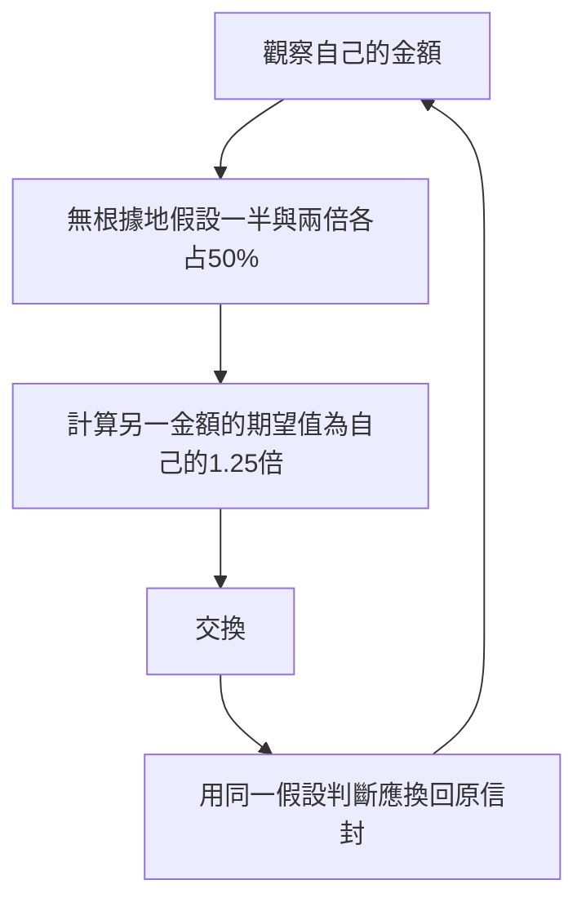
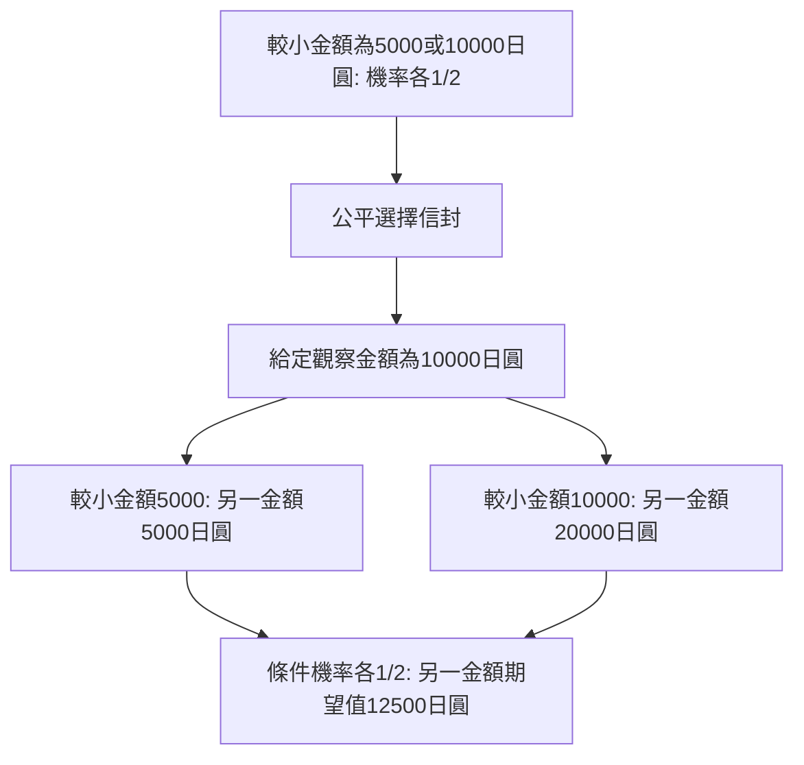

## 1. 先明確設定如何選擇信封

兩個外觀相同的信封裡都裝著錢，其中一個的金額是另一個的兩倍。選定一個之後，你有機會交換。無論是在打開之前，還是在看到金額之後，交換都會比較划算嗎？

設較小金額為正且有限的隨機變數 $S$，兩個信封分別裝著 $S$ 與 $2S$。透過擲一枚公平硬幣來選擇信封，並假設擲幣結果與信封內容獨立。所選信封的金額記為 $X$，另一個的金額記為 $Y$。在給定較小金額為 $S=s$ 的條件下，以下兩種結果的機率各為 $1/2$。

$$
(X,Y)=(s,2s)\quad\text{or}\quad(X,Y)=(2s,s).
$$

看到金額之前的公平選擇，與給定某個觀察金額之後的機率，並不是同一回事。計算後者還需要描述較小金額如何產生的**事前分配**。這裡的「金額有限」是指每次實現的金額有限，不表示分配的期望值或金額的上界也有限。

## 2. 誘人的「每次都多賺25%」計算

假設你看到的金額是 $X=x$。你可能會想：「另一個信封的金額是一半或兩倍，各有 $1/2$ 的機率。」於是計算：

$$
\frac12\cdot\frac{x}{2}+\frac12\cdot2x=\frac54x.
$$

算術本身沒有錯，但**看到金額後，兩種情況仍然等機率的假設並沒有根據**。若交換後繼續使用同樣的推理，就會以為來回交換能不斷增加金額。下圖呈現的是錯誤推理的循環，而非正確策略。

把錯誤歸咎於「隨機變數在不同情況下取不同值」也不恰當，那正是隨機變數的正常性質。真正的問題是：計算過程改變了固定的條件，卻沿用原來的機率。

## 3. 打開之前的對稱性與有限期望值

給定較小金額後，交換前後的期望金額相同。

$$
\mathbb E[X\mid S=s]=\mathbb E[Y\mid S=s]=\frac{3s}{2}.
$$

即使較小金額本身是隨機的，所選信封與另一個信封的金額仍然同分配。特別是，若較小金額的期望值有限，

$$
\mathbb E[X]=\mathbb E[Y]=\frac32\mathbb E[S]<\infty.
$$

因此，在尚未觀察任何金額時，交換不會提高期望金額。但這不排除給定某個特定金額後，交換可能更有利。期望值為無窮大時，同分配的對稱性仍然成立，但不能用無窮大減去無窮大來計算平均利得。

## 4. 打開之後，從事前分配計算

先考慮較小金額是離散隨機變數的情況，記 $p(s)=\Pr(S=s)$，並約定在其可能取值之外，機率為0。對於能以正機率觀察到的金額 $x$，用 $q(x)$ 表示另一個信封金額是兩倍的條件機率。[貝氏定理](https://kenji.blog/zh-tw/p/bayes-theorem/)給出：

$$
q(x)=\Pr(Y=2x\mid X=x)=\frac{p(x)}{p(x)+p(x/2)}.
$$

分子對應「較小金額等於觀察金額，且選中較小信封」，分母的另一項對應「較小金額是觀察金額的一半，且選中較大信封」。兩者共有的選擇機率可以約去。分母必須為正。

$$
\begin{aligned}\mathbb E[Y\mid X=x]&=2xq(x)+\frac{x}{2}(1-q(x)),\\ g(x)&=\mathbb E[Y\mid X=x]-x=\frac{x}{2}(3q(x)-1).\end{aligned}
$$

當 $q(x)>1/3$ 時，交換能提高條件期望金額。這不表示實際利得必定為正。這些公式使用離散機率質量，不能直接將它們換成連續機率密度。

## 5. 看到10,000日圓時，何時可以算出12,500日圓？

假設較小金額是5,000或10,000日圓，機率各為1/2。公平選擇信封後，觀察到10,000日圓。給定這個觀察結果，另一個信封的金額是5,000或20,000日圓，條件機率各為1/2。在這個模型裡，前面的計算確實成立。

$$
\mathbb E[Y\mid X=10000]=\frac12\cdot5000+\frac12\cdot20000=12500.
$$

圖中只呈現給定觀察金額為10,000日圓的部分。考慮所有觀察結果時，你的金額為5,000、10,000、20,000日圓的機率依序是1/4、1/2、1/4，對應的條件交換利得為5,000、2,500、−10,000日圓，平均為0。

$$
\frac14\cdot5000+\frac12\cdot2500-\frac14\cdot10000=0.
$$

有限預算為金額設定上界。若模型存在最大的可能觀察金額，就不可能還有該金額兩倍的對應金額。然而，這不表示「觀察金額越大，翻倍的機率必然越低」。例如，較小金額1、2、4的機率依序為49/100、1/100、1/2時，$q(2)=1/50$，但 $q(4)=50/51$。事前分配的具體形狀很重要。

## 6. 有限期望值下，不可能在所有觀察結果中都有優勢

若較小金額的期望值有限，$g(X)$ 就是可積分的。由[全期望法則](https://ocw.mit.edu/courses/6-436j-fundamentals-of-probability-fall-2018/c1ab69cb198badcebee42d5880784439_MIT6_436JF18_rec3.pdf)，

$$
\mathbb E[g(X)]=\mathbb E[Y]-\mathbb E[X]=0.
$$

因此，條件利得不可能幾乎必然嚴格為正。在離散模型中，這表示不可能對每一個正機率的觀察結果，交換都嚴格有利。關鍵假設是**期望值有限**，而不只是機率總和為1。

## 7. 正規化且期望值為無窮大的事前分配給出了反例

考慮[Broome的論文](https://users.ox.ac.uk/~sfop0060/pdf/Two%20envelope%20paradox.pdf)中討論的分配：

$$
\Pr(S=2^n)=\frac13\left(\frac23\right)^n,\qquad n=0,1,2,\ldots.
$$

$$
\sum_{n=0}^{\infty}\frac13\left(\frac23\right)^n=1,\qquad \mathbb E[S]=\frac13\sum_{n=0}^{\infty}\left(\frac43\right)^n=\infty.
$$

這是**正確正規化的機率分配**，不是無法正規化的均勻事前分配。若觀察金額是 $x=2^n$，其中 $n\ge1$，

$$
q(x)=\frac25,\qquad \mathbb E[Y\mid X=x]=\frac25(2x)+\frac35\frac{x}{2}=\frac{11}{10}x>x.
$$

當觀察到最小金額1時，另一個金額必定為2。因此，在所有以正機率出現的觀察金額下，另一個信封的條件期望金額都高於自己的金額。這不是針對分配可能取值之外的金額作條件化的主張。

即使如此，也不能推論「無條件的平均利得為正」。令 $D=Y-X$，並定義正部 $D^+=\max(D,0)$ 與負部 $D^-=\max(-D,0)$，則

$$
\mathbb E[D^+]=\mathbb E[D^-]=\frac12\mathbb E[S]=\infty.
$$

正部與負部的期望值都是無窮大，所以帶正負號差值的期望值[沒有定義](https://www.stat.berkeley.edu/~wfithian/courses/stat210a/measure-theory-basics.html)。另一方面，非負金額的全期望法則仍然成立：

$$
\mathbb E[\mathbb E[Y\mid X]]=\mathbb E[Y]=\infty.
$$

無窮大沒有破壞這條法則。不能做的是：不檢查條件，就把有限期望值時的減法或線性運算套用到不可積分的帶正負號差值上。給定各個可能觀察金額後的有限計算，與無條件的帶正負號期望值必須分開。如果將這個事前分配截斷為有限項並重新正規化，最大觀察金額處仍有損失，平均交換利得就恢復為0。

## 8. 連續密度還需要變數變換

若較小金額具有連續密度 $f$，「選中較小金額」分支對觀察金額的密度貢獻為 $f(x)/2$，「選中較大金額」分支則為 $f(x/2)/4$。後者不僅包含公平選擇的係數，也包含 $x=2s$ 這個變數變換的係數。

$$
q(x)=\frac{f(x)}{f(x)+\tfrac12f(x/2)}.
$$

這個條件密度公式用於觀察金額的密度為正之處。連續變數恰好取某一點的機率為0，因此這不是離散事件機率的比值。Broome的論文也給出了以下符合正規化條件的機率密度：

$$
f(s)=\frac{1}{(1+s)^2},\qquad s>0.
$$

它的積分為1，但較小金額的期望值為無窮大。對正的觀察金額，

$$
\frac{f(x/2)}{f(x)}=\frac{4(1+x)^2}{(2+x)^2}<4
\quad\Longrightarrow\quad q(x)>\frac13.
$$

因此，這些密度所給出的連續條件期望函數，在每個正的觀察金額處都高於自己的金額。這也反駁了「只要分配正規化，就總會在某些金額上交換不利」的說法。

## 9. 交換比率、決策與無窮大

打開之前，令比率為 $R=Y/X$。由於公平選擇，比率為2或1/2的機率各為1/2。其期望值確實為5/4，倒數比率的期望值也相同。然而，連續交換兩次的比率互為倒數，並不獨立。

$$
\mathbb E[R]=\mathbb E[1/R]=\frac54,\qquad \mathbb E[R(1/R)]=1\ne\frac{25}{16}=\mathbb E[R]\mathbb E[1/R].
$$

換回原來的信封，實際金額也回到原樣。不能未經論證，就把無條件平均比率乘在自己的金額上，或把兩次交換的平均比率相乘。此外，在看到兩個信封的金額後，資訊已經改變，關於一半或兩倍的不確定性也會消失。

這個問題與討論無窮期望值賭局的[聖彼得堡悖論](https://kenji.blog/zh-tw/p/st-petersburg-paradox/)有關。現實的預算上限、金額的產生方式、效用與風險態度都會影響決策。這裡比較的是期望金額，並非普遍適用的決策規則，也不是保證實際獲利。

關鍵是：條件機率需要金額的產生模型，而正規化不等於期望值有限。有限期望值下，對稱性與全期望法則說明平均交換利得為0。期望值無窮大時，正規化的分配也能給出反例，必須仔細區分非負變數的無窮期望值與沒有定義的帶正負號期望值。
