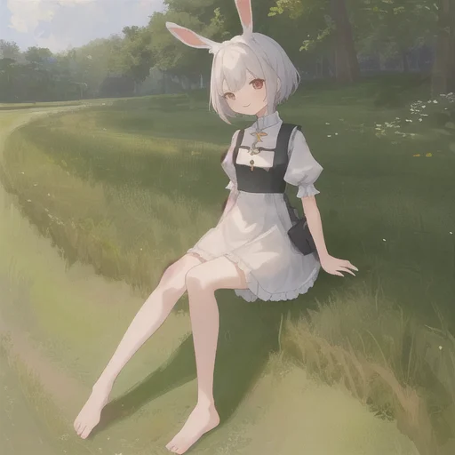

# Qu'est-ce que Stable diffusion
Stable Diffusion est une famille de modèles de diffusion latente qui génèrent des images à partir de conditions telles que du texte. Les travaux associés comprennent ceux de l’équipe CompVis, dont les auteurs comptent des chercheurs de l’Université Louis-et-Maximilien de Munich.

# Ce dont vous aurez besoin

- Compte Google

Seulement ça

# Procédure de génération

Ce tutoriel actualise un exemple de 2023 pour l’API actuelle de Diffusers. Colab ne garantit pas l’accès à un GPU gratuit ; les limites, les types de GPU et leur disponibilité évoluent. Si aucun GPU n’est attribué, réessayez plus tard ou utilisez un autre environnement disponible.

Avant de charger les poids, consultez la fiche du modèle et sa licence CreativeML OpenRAIL-M sur Hugging Face. Respectez les usages interdits, les conditions de distribution et le droit local. La licence ne garantit ni la légalité des résultats ni l’absence de droits de tiers.

`EasyNegative` est ici un embedding de textual inversion distribué séparément. Le code ci-dessous le charge avant d’utiliser ce jeton dans le prompt.

1. Ouvrez https://colab.research.google.com
2. Sélectionnez `Fichier` en haut à gauche, puis `Nouveau notebook`
3. Sélectionnez `Modifier`, puis `Paramètres du notebook`
4. Changez l'`Accélérateur matériel` en `GPU`

5. Collez et exécutez le code ci-dessous
```
!pip install -U diffusers transformers accelerate
```
6. Collez et exécutez le code ci-dessous
```
import torch
from diffusers import DiffusionPipeline
from huggingface_hub import hf_hub_download
```
7. Collez et exécutez le code ci-dessous
```
pipe = DiffusionPipeline.from_pretrained("gsdf/Counterfeit-V2.5", dtype=torch.float16)
easynegative_path = hf_hub_download(repo_id="gsdf/EasyNegative", repo_type="dataset", filename="EasyNegative.safetensors")
pipe.load_textual_inversion(easynegative_path, token="EasyNegative")
pipe.to("cuda")
```
8. Collez et exécutez le code ci-dessous
```
prompt = "((masterpiece,best quality)),1girl, solo, animal ears, rabbit, barefoot, knees up, dress, sitting, rabbit ears, short sleeves, looking at viewer, grass, short hair, smile, white hair, puffy sleeves, outdoors, puffy short sleeves, bangs, on ground, full body, animal, white dress, sunlight, brown eyes, dappled sunlight, day, depth of field"
n_prompt = "EasyNegative, extra fingers,fewer fingers"

image = pipe(prompt, negative_prompt = n_prompt).images[0]
image
```

Le `Prompt` utilisé ici est basé sur le `Prompt` de [https://huggingface.co/gsdf/Counterfeit-V2.5](https://huggingface.co/gsdf/Counterfeit-V2.5).

## Résultats générés (quelques-uns)





## Références

- [https://huggingface.co/gsdf/Counterfeit-V2.5](https://huggingface.co/gsdf/Counterfeit-V2.5)
- [J'ai créé un programme de génération d'images à l'aide de l'Intelligence Artificielle (IA) en 15 minutes 【Programmation en direct】](https://www.youtube.com/watch?v=l8-fVSM2PVQ)
- [Google Colab FAQ: resource limits](https://research.google.com/colaboratory/faq.html)
- [Diffusers: loading pipelines](https://huggingface.co/docs/diffusers/using-diffusers/loading)
- [Stable Diffusion model card and license](https://huggingface.co/gsdf/Counterfeit-V2.5)
- [CompVis: Stable Diffusion research and code](https://github.com/CompVis/stable-diffusion)
- [EasyNegative textual-inversion embedding](https://huggingface.co/datasets/gsdf/EasyNegative)
