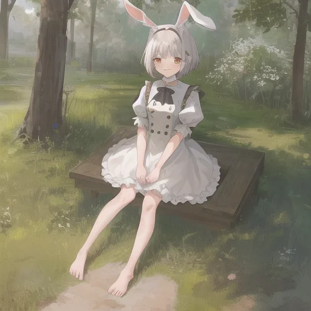

# Apa itu Stable diffusion
Stable Diffusion adalah keluarga model difusi laten yang menghasilkan gambar berdasarkan kondisi seperti teks. Penelitian terkait mencakup karya tim CompVis, dengan peneliti dari Ludwig Maximilian University of Munich sebagai beberapa penulisnya.

# Yang perlu disiapkan

- Akun Google

Hanya itu

# Langkah-langkah pembuatan

Tutorial ini memperbarui contoh tahun 2023 agar sesuai dengan API Diffusers saat ini. Colab tidak menjamin GPU gratis; batas penggunaan, jenis GPU, dan ketersediaan runtime dapat berubah. Jika GPU tidak diberikan, coba lagi nanti atau gunakan runtime lain yang tersedia.

Sebelum memuat bobot model, baca kartu model dan lisensi CreativeML OpenRAIL-M di Hugging Face. Patuhi penggunaan yang dilarang, ketentuan distribusi, dan hukum setempat. Lisensi ini tidak menjamin hasilnya sah atau bebas dari hak pihak ketiga.

`EasyNegative` dalam contoh ini adalah embedding textual inversion yang didistribusikan terpisah. Kode berikut memuatnya sebelum token tersebut digunakan dalam prompt.

1. Buka https://colab.research.google.com
2. Dari menu `File` di kiri atas, pilih `Buku catatan baru`
3. Dari menu `Edit`, pilih `Setelan buku catatan`
4. Ubah `Akselerator hardware` menjadi `GPU`

5. Tempelkan kode berikut dan jalankan
```
!pip install -U diffusers transformers accelerate
```
6. Tempelkan kode berikut dan jalankan
```
import torch
from diffusers import DiffusionPipeline
from huggingface_hub import hf_hub_download
```
7. Tempelkan kode berikut dan jalankan
```
pipe = DiffusionPipeline.from_pretrained("gsdf/Counterfeit-V2.5", dtype=torch.float16)
easynegative_path = hf_hub_download(repo_id="gsdf/EasyNegative", repo_type="dataset", filename="EasyNegative.safetensors")
pipe.load_textual_inversion(easynegative_path, token="EasyNegative")
pipe.to("cuda")
```
8. Tempelkan kode berikut dan jalankan
```
prompt = "((masterpiece,best quality)),1girl, solo, animal ears, rabbit, barefoot, knees up, dress, sitting, rabbit ears, short sleeves, looking at viewer, grass, short hair, smile, white hair, puffy sleeves, outdoors, puffy short sleeves, bangs, on ground, full body, animal, white dress, sunlight, brown eyes, dappled sunlight, day, depth of field"
n_prompt = "EasyNegative, extra fingers,fewer fingers"

image = pipe(prompt, negative_prompt = n_prompt).images[0]
image
```

`Prompt` yang digunakan di sini didasarkan pada `Prompt` dari [https://huggingface.co/gsdf/Counterfeit-V2.5](https://huggingface.co/gsdf/Counterfeit-V2.5).

## Hasil pembuatan (beberapa)




## Referensi

- [https://huggingface.co/gsdf/Counterfeit-V2.5](https://huggingface.co/gsdf/Counterfeit-V2.5)
- [Saya mencoba membuat program penghasil gambar menggunakan Kecerdasan Buatan (AI) dalam 15 menit 【Pemrograman Langsung】](https://www.youtube.com/watch?v=l8-fVSM2PVQ)
- [Google Colab FAQ: resource limits](https://research.google.com/colaboratory/faq.html)
- [Diffusers: loading pipelines](https://huggingface.co/docs/diffusers/using-diffusers/loading)
- [Stable Diffusion model card and license](https://huggingface.co/gsdf/Counterfeit-V2.5)
- [CompVis: Stable Diffusion research and code](https://github.com/CompVis/stable-diffusion)
- [EasyNegative textual-inversion embedding](https://huggingface.co/datasets/gsdf/EasyNegative)
