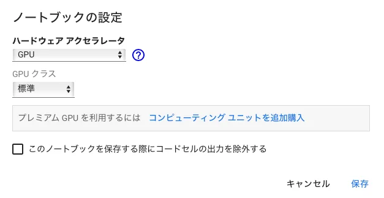
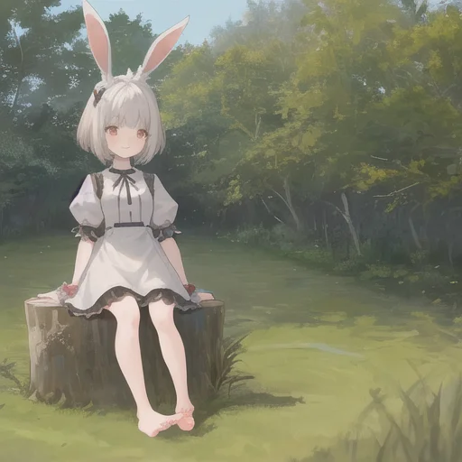

---


title: "Stable Diffusion으로 AI 일러스트 생성하기: Google Colab 절차와 주의사항"
lastmod: "2026-11-23"
slug: "AI(StableDiffusion)を使って일러스트이미지 생성する方法"
date: 2023-04-06T00:43:19+09:00
tags: ["AI", "Stable Diffusion", "일러스트", "이미지 생성", "Google Colaboratory"]
draft: false
image: "img.webp"
categories: ["programming", "image-generation"]
description: "Stable Diffusion과 Google Colab으로 일러스트를 생성하는 절차를 안내하고 GPU 사용 가능 여부와 모델 라이선스 등 주의사항을 설명합니다."
---


# Stable diffusion이란
Stable Diffusion은 텍스트와 같은 조건으로 이미지를 생성하는 잠재 확산 모델 계열입니다. 관련 연구에는 뮌헨대학교 연구자들이 저자로 참여한 CompVis 팀의 연구가 포함됩니다.

# 준비물

- Google 계정

이 전부입니다.

# 생성 절차

이 문서는 2023년 예제를 현재 Diffusers API에 맞게 업데이트한 것입니다. Colab 무료 GPU는 항상 제공되지 않으며 사용 한도, GPU 종류, 실행 가능 시간은 바뀔 수 있습니다. GPU가 배정되지 않으면 나중에 다시 시도하거나 다른 사용 가능한 실행 환경을 이용하세요.

모델 가중치를 불러오기 전에 Hugging Face의 모델 카드와 CreativeML OpenRAIL-M 라이선스를 확인하고 금지된 사용, 배포 조건, 현지 법률을 준수하세요. 라이선스가 생성물의 적법성이나 제3자 권리로부터의 자유를 보장하지는 않습니다.

이 예제의 `EasyNegative`는 별도로 배포되는 Textual Inversion 임베딩입니다. 아래 코드는 프롬프트에서 해당 토큰을 사용하기 전에 이를 불러옵니다.

1. https://colab.research.google.com 을 엽니다.
2. 왼쪽 상단의 `파일`에서 `새 노트 만들기`를 선택합니다.
3. `수정`에서 `노트 설정`을 선택합니다.
4. `하드웨어 가속기`를 `GPU`로 변경합니다.

5. 아래의 코드를 붙여넣고 실행합니다.
```
!pip install -U diffusers transformers accelerate
```
6. 아래의 코드를 붙여넣고 실행합니다.
```
import torch
from diffusers import DiffusionPipeline
from huggingface_hub import hf_hub_download
```
7. 아래의 코드를 붙여넣고 실행합니다.
```
pipe = DiffusionPipeline.from_pretrained("gsdf/Counterfeit-V2.5", dtype=torch.float16)
easynegative_path = hf_hub_download(repo_id="gsdf/EasyNegative", repo_type="dataset", filename="EasyNegative.safetensors")
pipe.load_textual_inversion(easynegative_path, token="EasyNegative")
pipe.to("cuda")
```
8. 아래의 코드를 붙여넣고 실행합니다.
```
prompt = "((masterpiece,best quality)),1girl, solo, animal ears, rabbit, barefoot, knees up, dress, sitting, rabbit ears, short sleeves, looking at viewer, grass, short hair, smile, white hair, puffy sleeves, outdoors, puffy short sleeves, bangs, on ground, full body, animal, white dress, sunlight, brown eyes, dappled sunlight, day, depth of field"
n_prompt = "EasyNegative, extra fingers,fewer fingers"

image = pipe(prompt, negative_prompt = n_prompt).images[0]
image
```

여기서 사용한 `Prompt`는 [https://huggingface.co/gsdf/Counterfeit-V2.5](https://huggingface.co/gsdf/Counterfeit-V2.5)의 `Prompt`를 참고했습니다.

## 생성 결과 (일부)



## 참고

- [https://huggingface.co/gsdf/Counterfeit-V2.5](https://huggingface.co/gsdf/Counterfeit-V2.5)
- [인공지능(AI)을 사용한 이미지 생성 프로그램을 15분 만에 만들어 보았다【실황 프로그래밍】](https://www.youtube.com/watch?v=l8-fVSM2PVQ)
- [Google Colab FAQ: resource limits](https://research.google.com/colaboratory/faq.html)
- [Diffusers: loading pipelines](https://huggingface.co/docs/diffusers/using-diffusers/loading)
- [Stable Diffusion model card and license](https://huggingface.co/gsdf/Counterfeit-V2.5)
- [CompVis: Stable Diffusion research and code](https://github.com/CompVis/stable-diffusion)
- [EasyNegative textual-inversion embedding](https://huggingface.co/datasets/gsdf/EasyNegative)
