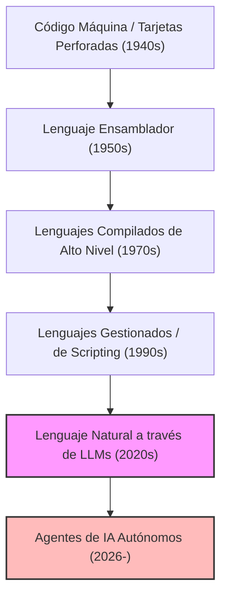
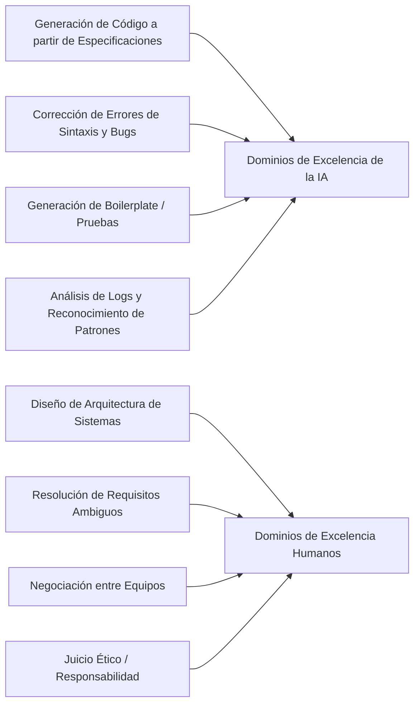
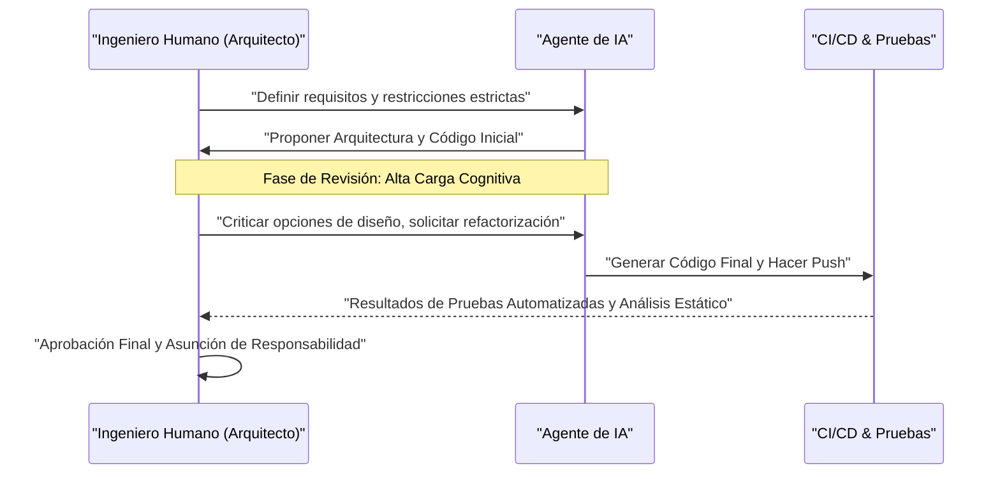

# ¿Cómo deberían sobrevivir los programadores en la era de la IA? El fin de la codificación y el amanecer de una nueva ingeniería

Los asistentes y agentes de programación con IA pueden ayudar en tareas como generar código, investigar y probar. No construyen de forma fiable un sistema completo listo para producción a partir de una especificación; la precisión y el tiempo dependen de la tarea, el entorno y la revisión. No se puede predecir de forma uniforme su efecto en el empleo y la demanda.

---

## 1. La historia de la abstracción (Abstraction) y la redefinición de la "programación"

Al repasar la historia de la ingeniería de software, nos damos cuenta de que siempre ha sido una historia de "abstracción (Abstraction)". Siempre hemos construido capas para describir sistemas más complejos en un lenguaje más cercano al humano.

Los primeros científicos de la computación utilizaban tarjetas perforadas para manipular directamente los interruptores del hardware físico, dando instrucciones a las computadoras en código máquina (secuencias de 0 y 1). Más tarde, apareció el lenguaje ensamblador, que permitió operar el hardware con mnemónicos que los humanos podían entender fácilmente. A medida que avanzaba la época, surgieron lenguajes de alto nivel como C y Fortran, que lograron encapsular los detalles complejos del hardware, como la gestión de memoria y los registros de la CPU. Posteriormente, con los lenguajes modernos que aparecieron, como [Java](https://kenji.blog/es/p/programming-languages-history-paradigm-evolution/), Python, Ruby y TypeScript, los programadores pudieron concentrarse más en "qué queremos que haga la computadora (What)" en lugar de en "cómo hacer que la computadora funcione (How)".

La aparición de la IA ([LLM](https://kenji.blog/es/p/large-language-models-llm-transformer-prompt-engineering/)) es el cambio de paradigma más reciente y más grande en esta historia de abstracción. Si la evolución de los lenguajes de programación fue la "ocultación del hardware", la evolución de los LLM es la "ocultación de la sintaxis (gramática)".

La era en la que los desarrolladores manipulaban [punteros](/es/p/c-language-pointers-memory-management-stack-heap/) preocupándose por las fugas de memoria o escribían cientos de líneas de código repetitivo para el procesamiento de análisis de JSON ha terminado. El estándar de "programación" en 2026 es definir sistemas utilizando el lenguaje natural (japonés, inglés, español, etc.), el lenguaje con el nivel más alto de abstracción para la humanidad.

---

## 2. Modelo matemático de la productividad: Surfeando la ola del crecimiento exponencial

Evaluemos cuantitativamente el aumento de productividad que aporta la IA utilizando un modelo matemático.
La productividad individual $P_{traditional}$ en el desarrollo de software tradicional podría modelarse como una combinación lineal del nivel de habilidad individual $S$, la experiencia en el dominio $E$ y la eficiencia de las herramientas $T$.

> Esta ecuación es un esquema conceptual, no un modelo validado ni calibrado empíricamente.

$$ P_{traditional} = c_1 \cdot S + c_2 \cdot E + c_3 \cdot T $$

La ecuación siguiente es hipotética; no constituye evidencia empírica del crecimiento exponencial de la IA ni de su relación con la productividad, y no sirve para hacer previsiones.

$$ P_{AI}(t) = \alpha \cdot S_{core} \cdot e^{\beta \cdot A(t)} $$

Aquí, cada variable significa lo siguiente:
*   $\alpha$: Coeficiente base de productividad humana
*   $S_{core}$: Las "habilidades centrales humanas" no reemplazables por la IA (diseño de arquitectura, comprensión de requisitos de negocio, juicio ético, etc.)
*   $A(t)$: Capacidad absoluta de los modelos de IA (recuento de parámetros, ventana de contexto, capacidad de razonamiento) en el momento $t$
*   $\beta$: Coeficiente que indica la eficacia con la que se pueden aprovechar las herramientas de IA (calidad de la ingeniería de prompts o sofisticación de los flujos de trabajo colaborativos con la IA)

Al no ser un modelo validado, esta fórmula no permite establecer la productividad ni el valor de mercado de ciertas habilidades. Su valor debe evaluarse en cada trabajo y organización.

---

## 3. Probabilidad de automatización de tareas (Probability of Automation)

Entonces, ¿qué tipo de tareas se automatizarán y qué tipo de tareas quedarán en manos de los humanos?
La probabilidad $P_{auto}(T)$ de que una tarea determinada $T$ sea completamente automatizada por IA se puede formular de la siguiente manera:

> Esta ecuación es un esquema conceptual, no un modelo validado ni calibrado empíricamente.

$$ P_{auto}(T) = 1 - \exp\left(-\lambda \cdot \frac{\text{Predictability}(T)}{\text{Complexity}(T) \times \text{Context Dependency}(T)}\right) $$

*   $\text{Predictability}(T)$: Previsibilidad de la tarea (cuántos patrones existen en los datos históricos)
*   $\text{Complexity}(T)$: Complejidad de la tarea
*   $\text{Context Dependency}(T)$: La fuerza del "contexto implícito (conocimiento específico del dominio o relaciones humanas)" del que depende la tarea
*   $\lambda$: Tasa de progreso tecnológico de la IA

La expresión carece de datos medidos y escalas calibradas, por lo que $P_{auto}$ no es una probabilidad real. Evalúa la automatización midiendo resultados y costes de verificación en tareas acotadas.

---

## 4. Retorno de la sintaxis (gramática) a la arquitectura (estructura)

Separar claramente en qué es buena la IA y en qué son buenos los humanos es un requisito absoluto para la supervivencia.

La IA puede mejorar la eficiencia en tareas acotadas, con requisitos y verificación claros, pero la precisión y el ahorro de tiempo varían según la tarea y el contexto. Las fortalezas humanas y de la IA no forman fronteras fijas; el reparto depende del contexto, la verificación y la responsabilidad.

Los programadores del futuro deben cambiar su papel de "trabajadores que escriben código" a "arquitectos que orquestan innumerables componentes generados por IA". Tener una visión general del sistema completo, dónde trazar los límites de los [microservicios](/es/p/microservices-architecture-bff-api-gateway/), cómo resolver el compromiso entre disponibilidad y consistencia en el Teorema CAP para adaptarlo al contexto del negocio, y cómo controlar la deuda técnica. Estos son trabajos intelectuales de alto nivel que solo pueden ser realizados por humanos que comprenden el panorama general y los objetivos del negocio.

---

## 5. La definición de requisitos es la "verdadera ingeniería de prompts"

El término "ingeniería de prompts", que escuchamos a menudo últimamente, se malinterpreta con frecuencia como "un truco para engañar a la IA y obtener el resultado deseado". Sin embargo, la esencia de la ingeniería de prompts en el desarrollo de software es, sin lugar a dudas, **la "ingeniería de requisitos avanzada (Requirements Engineering)"**.

Para dar instrucciones a la IA en lenguaje natural y hacer que genere el software deseado, los siguientes elementos deben ser estrictamente articulados:

1.  **Propósito (Why)**: ¿Por qué se necesita esta característica? ¿Cuál es el valor empresarial?
2.  **Restricciones (Constraints)**: Requisitos de rendimiento (latencia, rendimiento), requisitos de seguridad, restricciones de costos.
3.  **Casos Extremos (Edge Cases)**: Procesamiento alternativo (fallback) para cuando el usuario proporciona una entrada inesperada.
4.  **Interfaces (Interfaces)**: Especificaciones de integración con los sistemas existentes.

Las instrucciones vagas (prompts) solo generarán sistemas vagos y frágiles. La capacidad de escuchar profundamente para descubrir "lo que el cliente realmente quería", organizar requisitos contradictorios y crear especificaciones lógicamente consistentes (prompts). Esta es la "habilidad de codificación" más poderosa en la era de la IA. Los programadores pasarán cada vez más tiempo enfrentándose a archivos de Notion o Markdown en lugar de editores de código, describiendo con precisión cómo debería ser el sistema mediante texto.

---

## 6. La ventaja abrumadora del conocimiento del dominio (Domain Knowledge)

Los datos de entrenamiento y la información accesible varían según el servicio de IA. Un modelo no conoce automáticamente la información interna de una empresa; el acceso depende de las integraciones y los permisos. Al compartir contexto empresarial, comprueba la confidencialidad y los controles de acceso, y haz que un experto del dominio revise el resultado.

Por ejemplo, supongamos que estás desarrollando un sistema de historia clínica electrónica en una startup médica. La IA sabe "cómo crear una interfaz de usuario tabular en React" y "la estructura de datos general de HL7 FHIR". Sin embargo, no ha aprendido el conocimiento tácito de "en un departamento médico específico del Hospital A, en qué orden ven los médicos los datos de los pacientes, y qué tipo de interfaz de usuario minimizaría el riesgo de errores médicos".

En un mundo donde la tecnología misma se mercantiliza (se convierte en un bien de consumo común), el verdadero valor de los ingenieros nace en la intersección de la "tecnología" y el "dominio de negocio". En lugar de competir solo con la destreza técnica, los individuos que posean una profunda experiencia en un dominio específico, como la medicina, las finanzas, la logística o el entretenimiento, y que puedan resolver los problemas de ese dominio utilizando la poderosa herramienta de la IA, liderarán el mercado del futuro.

---

## 7. El "Problema del Tranvía" en el desarrollo de software: ¿Quién asume la responsabilidad?

A medida que aumenta nuestra dependencia de la IA, nos enfrentamos a graves problemas filosóficos y éticos. Este es el problema de "dónde recae la responsabilidad" en la ingeniería de software.

La responsabilidad legal depende de la jurisdicción, los contratos, las funciones y la normativa aplicable. No debe suponerse que un cargo siempre asume toda la responsabilidad; en usos de alto riesgo, consulta a especialistas legales y del dominio.

Si el código generado de forma autónoma por la IA causa un error grave en un entorno de producción, lo que resulta en millones de dólares en pérdidas para una empresa, o si causa un mal funcionamiento en un sistema médico que afecta vidas humanas, ¿quién asume la responsabilidad? ¿La empresa que desarrolló el modelo de IA? ¿O el ingeniero que ingresó el prompt? No se puede "despedir" ni "arrestar" a la IA.

No importa cuánto avance la tecnología, el papel de los "humanos" como el sujeto que asume la "responsabilidad legal y ética (Accountability)" por el impacto que los sistemas tienen en la sociedad no desaparecerá. De hecho, cuanto más se convierta el proceso de generación de código en una caja negra, mayor será la pesada responsabilidad de los humanos como "aprobadores finales (Approvers)" y "supervisores (Supervisors)" de los sistemas.

Auditar si la arquitectura y el código propuestos por la IA cumplen con los estándares de seguridad, no tienen problemas éticos (están libres de sesgos) y cumplen con las normativas, y luego dar la luz verde final. El acto de "asumir la responsabilidad" en sí mismo se convierte en una parte importante del trabajo del ingeniero.

---

## 8. Programación en parejas con IA y gestión de la carga cognitiva (Cognitive Load)

A medida que trabajamos junto a la IA, la naturaleza de la "carga cognitiva (Cognitive Load)" humana también está cambiando. La carga cognitiva al escribir código desde cero es completamente diferente de la carga cognitiva al "leer y revisar" cientos de líneas de código desconocido generado por la IA.

Según la teoría de la carga cognitiva en psicología, cuando se procesa información compleja que no coincide con los esquemas existentes (estructuras de conocimiento en la mente), la memoria de trabajo humana se agota rápidamente. El código generado por IA a veces contiene optimizaciones avanzadas que a un humano no se le ocurrirían, mientras que otras veces contiene "alucinaciones (hallucinations)" que ignoran el contexto.

Para evitar esto, es necesario sistematizar el proceso de revisión de la IA.

Los humanos necesitan perfeccionar al máximo la habilidad de "lectura rápida y detección instantánea de fallas lógicas (Code Reading & Auditing)" incluso más que la habilidad de "escribir". La importancia del [Desarrollo Guiado por Pruebas](/es/p/test-driven-development-tdd-bdd/) (TDD) es aún mayor en la era de la IA. El enfoque principal será que un humano u otra IA escriba código de prueba estricto antes de dejar que la IA escriba el código, y luego haga que la IA corrija el código hasta que pase las pruebas.

El TDD es una opción útil, pero no es óptimo para todas las tareas y superar las pruebas no garantiza por sí solo la corrección. Valida los cambios generados por IA con modificaciones pequeñas, pruebas independientes, revisión de código y controles de seguridad.

---

## 9. Estrategia de supervivencia concreta: Qué aprender a partir de mañana

Basado en el análisis realizado hasta ahora, presento un plan de acción concreto para que los programadores sobrevivan a la era de la IA.

1.  **Reaprender a fondo los "fundamentos" de la tecnología**: Puedes dejar cómo usar frameworks a la IA. Sin embargo, un profundo conocimiento de cómo funcionan los sistemas operativos, los protocolos de red ([TCP](https://kenji.blog/es/p/http3-quic-protocol-tcp-udp/)/IP, HTTP/3), la estructura interna de las bases de datos ([B-Tree](https://kenji.blog/es/p/b-tree-database-index-theory/), niveles de aislamiento de transacciones), las estructuras de datos y algoritmos es absolutamente necesario. Para juzgar si el resultado de la IA es correcto, es indispensable una base sólida en ciencias de la computación.
2.  **Dominar la arquitectura en la nube y los [sistemas distribuidos](/es/p/cap-theorem-distributed-systems-tradeoff/)**: Concéntrate en cómo combinar recursos en la nube como AWS, GCP y Azure para construir sistemas escalables, en lugar de código individual. Comprende el concepto de [IaC](https://kenji.blog/es/p/iac-infrastructure-as-code-terraform/) (Infrastructure as Code) como Terraform y cultiva la capacidad de diseñar todo el sistema como código.
3.  **Conviértete en un experto en tu dominio de negocio**: Aprende profundamente el modelo de negocio, las regulaciones legales y la psicología del comportamiento del usuario de la industria a la que perteneces. Ve más allá de los límites de un ingeniero y ten una perspectiva más cercana a la de un Product Manager (PM).
4.  **Perfecciona las habilidades de comunicación y facilitación**: El proceso de resolver la "ambigüedad" entre humanos y lograr consensos no puede ser reemplazado por la IA. Las habilidades blandas de interactuar con las partes interesadas y descubrir los verdaderos problemas serán las habilidades más valiosas.
5.  **Usa la IA al máximo como un "colega"**: En lugar de temer a la evolución de las herramientas de IA, utilízalas como tu arma más poderosa. Utiliza rutinariamente los últimos LLMs y agentes de codificación de IA para acumular el "conocimiento tácito" de dónde falla la IA y cómo ajustar los prompts para extraer el máximo rendimiento.

---

## Conclusión: No temas, surfea la ola

La automatización de la programación por parte de la IA no significa la "muerte" de la profesión de programador. Más bien, es un **"Renacimiento"** que nos libera del "trabajo no esencial" en el desarrollo de software, como la corrección de errores tipográficos, la solución de problemas de configuración del entorno y la escritura de aburrido código repetitivo (boilerplate).

A lo largo de la historia, cuando apareció el telar automático o cuando apareció el software de hojas de cálculo (Excel), se extendió el pesimismo de que los trabajos desaparecerían. Sin embargo, la realidad es que a medida que la productividad mejoró drásticamente, se creó nueva demanda y nacieron trabajos más sofisticados. Lo mismo sucederá en el mundo del software. A medida que se vuelva posible "construir sistemas a bajo costo", el software penetrará en todas las áreas que antes no estaban informatizadas debido a los altos costos, y los problemas (What) que los ingenieros tendrán que resolver se expandirán infinitamente.

A nosotros, los programadores, se nos da ahora la oportunidad de evolucionar de artesanos que escriben código a "directores de orquesta" que comandan la poderosa inteligencia de la IA. En lugar de quedarnos en la orilla temerosos de la ola tecnológica, vamos a montarla rápidamente y zarpar hacia un viaje para crear sistemas más grandes y valiosos. La era de la IA es exactamente la era en la que comienza la "ingeniería" en su verdadero sentido.

## Lecturas recomendadas

- [Google DORA 2025 State of AI-assisted Software Development](https://research.google/pubs/dora-2025-state-of-ai-assisted-software-development-report/)
- [METR randomized trial of AI tools on software tasks (2025)](https://arxiv.org/abs/2507.09089)
