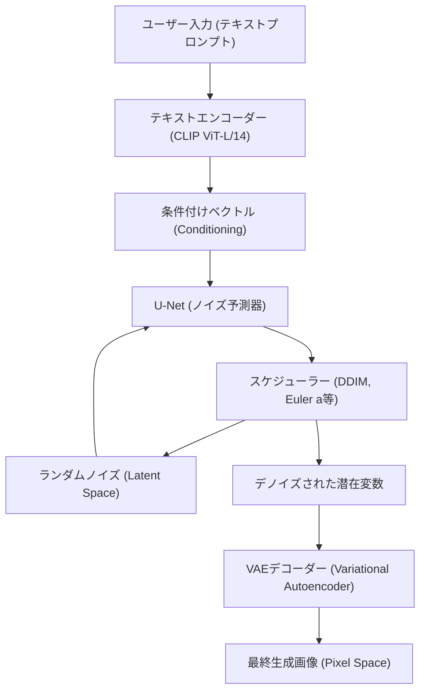
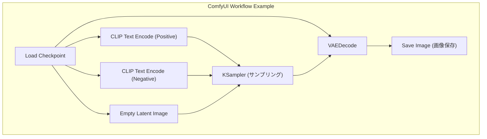

## 1. はじめに：なぜローカル環境でAI画像生成を行うのか？

AI画像生成技術は、Stable Diffusionのオープンソース化を皮切りに爆発的な進化を遂げています。現在、MidjourneyやDALL-E 3、Adobe Fireflyといったクラウドベースの商用サービスも非常に強力で使いやすいものになっています。しかし、それらのサービスには利用規約による生成コンテンツの制限（NSFWフィルターなど）、サブスクリプションによる継続的なコスト、そして詳細な生成プロセスの制御ができないというデメリットが存在します。

> **2026年11月23日確認：現行環境向けの訂正** — 以下の手順には特定バージョンを前提にした記述があります。矛盾する場合は、リンク先の公式資料を優先してください。必要なVRAM・RAM・ストレージはモデル、精度、解像度、バッチ数、拡張機能で変わり、一律の最低値はありません。ComfyUI PortableはPythonを内包し、WindowsではNVIDIA・AMD・Intel GPU別の配布物があります。GPUに合う[公式手順](https://docs.comfy.org/installation/comfyui_portable_windows)を選んでください。AUTOMATIC1111の[公式手順](https://github.com/AUTOMATIC1111/stable-diffusion-webui)が示すPython 3.10.6は同プロジェクト向けで、他ツール共通の要件ではありません。ビルド済みPyTorchを使うだけなら、システム全体へのCUDA Toolkit/cuDNN導入は通常不要です。Fooocusは[公式リポジトリ](https://github.com/lllyasviel/Fooocus)でバグ修正のみのLTSとされています。ComfyUI Managerの導入も必須ではなく、[Comfy Registry](https://docs.comfy.org/registry/claim-my-node)への移行が進んでいます。起動フラグや高速化の効果は環境依存なので、複数を一括指定せず個別に測定してください。ローカル実行でも初回ダウンロードや拡張機能が通信する場合があり、モデルのライセンス・利用条件も個別に確認してください。

ローカル環境（自身のPC）でAI画像生成ツールを構築することには、以下のような利点があります（利用条件と運用コストも確認してください）。

1. **運用の柔軟性**: 生成回数ごとのサービス料金を抑えられますが、電気代・機材費・保存容量・待ち時間がかかり、モデルやソフトウェアのライセンス条件も適用されます。
2. **高度なカスタマイズ性**: LoRAやControlNetで画風・構図などを調整できます。ただし、出力は条件に沿う傾向を強めるもので、特定の人物や構図を完全に再現する保証はありません。
3. **データ管理の選択肢**: ローカルで処理できる一方、初回のモデル取得、拡張機能、API連携などで通信する場合があります。機密データを扱う前に通信先と設定を確認してください。
4. **更新を自分で管理**: 新しいモデルや拡張機能を試せますが、更新で互換性が崩れたり、未検証コードが実行されたりする可能性もあります。信頼できる配布元を選んでください。

本マニュアルでは、Windows環境を前提とし、現在主流となっている3つのAI画像生成環境（AUTOMATIC1111 Stable Diffusion WebUI、ComfyUI、Fooocus）の構築方法から、基盤となる数学的背景、さらには[VRAMの最適化手法](/p/ai-gpu-vram-optimization-cpu-offloading/)までを10,000文字を超えるボリュームで徹底的に解説します。

---

## 2. 拡散モデル（Diffusion Model）の数学的背景とアーキテクチャ

ローカル環境を構築し、パラメータを適切に設定するためには、Stable Diffusionなどの **潜在拡散モデル（Latent Diffusion Model: LDM）** がどのように機能しているかを理解することが非常に有益です。

### 2.1 ノイズ付加プロセス（Forward Process）と除去プロセス（Reverse Process）

拡散モデルの基本原理は、元のデータ（画像）に対して段階的に[ガウス](https://kenji.blog/p/gauss/)ノイズを加え、最終的に完全なノイズにする「Forward Process」と、そのノイズから元の画像を復元する「Reverse Process」から成り立ちます。

Forward Process は[マルコフ連鎖](https://kenji.blog/p/markov-chain/)として定義され、ステップ $t$ における状態 $x_t$ は以下の式で表されます。

$$ q(x_t | x_{t-1}) = \mathcal{N}(x_t; \sqrt{1 - \beta_t} x_{t-1}, \beta_t I) $$

これを再パラメータ化トリック（Reparameterization trick）を用いることで、任意のステップ $t$ の状態を初期状態 $x_0$ から直接計算することができます。

$$ x_t = \sqrt{\bar{\alpha}_t} x_0 + \sqrt{1 - \bar{\alpha}_t} \epsilon $$

ここで、$\alpha_t = 1 - \beta_t$、$\bar{\alpha}_t = \prod_{s=1}^t \alpha_s$ であり、$\epsilon \sim \mathcal{N}(0, I)$ は標準正規分布からサンプリングされたノイズです。

画像生成フェーズである Reverse Process では、ニューラルネットワーク（U-Net）$\epsilon_\theta$ を用いて、加えられたノイズを予測し除去します。損失関数はシンプルに以下のようになります。

$$ L_{simple} = \mathbb{E}_{x_0, \epsilon \sim \mathcal{N}(0, I), t} \left[ || \epsilon - \epsilon_\theta(\sqrt{\bar{\alpha}_t} x_0 + \sqrt{1 - \bar{\alpha}_t} \epsilon, t) ||^2 \right] $$

### 2.2 Latent Space（潜在空間）による計算量削減

ピクセル空間（Pixel Space）で直接ノイズ除去を行うと、計算量が画像の解像度に対して二乗で増加するため、非常に重い処理となります。Stable Diffusionは、 **VAE（Variational Autoencoder）** を用いて画像を圧縮された「潜在空間（Latent Space）」に変換してから処理を行います。

エンコーダー $E$ は、解像度 $H \times W \times 3$ の画像を $z \in \mathbb{R}^{H/8 \times W/8 \times 4}$ に圧縮します。空間次元が8分の1になるため、自己注意機構（Self-Attention）の計算量は $\mathcal{O}((\frac{H \times W}{64})^2)$ となり、劇的なパフォーマンス向上をもたらします。生成後はデコーダー $D$ によって $\tilde{x} = D(z)$ としてピクセル空間に復元されます。

### 2.3 Stable Diffusionのシステムアーキテクチャ

以下のMermaid図は、Stable Diffusionの全体的な生成プロセス（テキストからの画像生成：txt2img）を示しています。



---

## 3. ハードウェア要件の徹底解剖

ローカルAI画像生成において、ハードウェアの選定は最も重要です。

### 3.1 GPU（グラフィックボード）
GPUの選択肢と対応状況は、使うUI・モデル・ドライバーに左右されます。NVIDIAは広く使われますが、ComfyUI PortableにはAMD（ROCm）やIntel GPU向けのWindows版もあります。導入前に公式の対応GPU・配布パッケージを確認してください。

必要なVRAMはモデル、数値精度、解像度、バッチ数、同時に使うControlNet等によって変わります。小さい解像度や軽量モデルから試し、メモリ不足になる場合は解像度・バッチ数・追加機能を減らしてください。LoRAの学習は画像生成より多くの計算資源を必要とするため、学習手順とモデル固有の要件を別途確認します。

### 3.2 メモリ（RAM）とストレージ
必要なRAMとストレージ容量は、モデル数、ワークフロー、出力保存量で変わります。SSDはモデル読み込みを速めますが、NVMeは必須ではありません。モデル用の空き容量を確保し、メモリ不足が起きる場合は実際の使用量を確認してください。AUTOMATIC1111のトラブルシューティング資料は同アプリをスムーズに動かす目安としてRAM 16GBを挙げていますが、全環境共通の最低要件ではありません。

---

## 4. 基盤ソフトウェアのセットアップ (Windows編)

ツール本体をインストールする前に、必要な基盤ソフトウェアを整えます。

### 4.1 Python のインストール
Pythonの要否と対応バージョンはUIごとに異なります。ComfyUI PortableはPythonを同梱するため、別途インストールせずに始められます。AUTOMATIC1111のWindows手動導入は公式手順に従いPython 3.10.6を使います。この指定を他のアプリに流用しないでください。

1.  Python公式アーカイブから `python-3.10.6-amd64.exe` をダウンロードします。
2.  インストーラー起動時、一番下にある **"Add Python 3.10 to PATH"** に必ずチェックを入れます。
3.  インストール完了画面で **"Disable path length limit"** （パス長の制限を無効化）をクリックします（重要：Windowsの260文字パス制限を解除しないと、深い階層の依存ライブラリでエラーが起きます）。

### 4.2 Git for Windows のインストール
GitHubからソースコードやモデルを取得するためにGitが必要です。
1.  Git for Windows公式サイトからインストーラーをダウンロードし、すべてデフォルトの設定でインストールします。

### 4.3 CUDA Toolkit と cuDNN
ComfyUI Portableやビルド済みPyTorchパッケージを使う場合、通常はCUDA ToolkitやcuDNNをシステム全体へ個別導入する必要はありません。ソースからPyTorchやネイティブ拡張をビルドする場合は、対象バージョンの公式要件に合わせて開発ツールを用意してください。過去の固定バージョン指定を現在の環境へそのまま適用しないでください。

---

## 5. 3大フロントエンドの構築手順

以下は3つの選択肢の概要です。開発状況は同じではありません。AUTOMATIC1111とComfyUIの現行手順、Fooocusの限定的な保守状況を確認して選んでください。

### 5.1 AUTOMATIC1111 Stable Diffusion WebUI の構築
最も歴史があり、拡張機能が豊富で、細かなパラメータ調整が可能な万能ツールです。

**インストール手順:**
1.  任意のディレクトリ（例：`C:\work\ai`）でコマンドプロンプトを開きます。
2.  以下のコマンドを実行してリポジトリをクローンします。
    ```cmd
    git clone https://github.com/AUTOMATIC1111/stable-diffusion-webui.git
    ```
3.  クローンされたディレクトリ内の `webui-user.bat` を右クリックし、編集モードで開きます。
4.  パフォーマンスを向上させるため、起動引数 `COMMANDLINE_ARGS` を以下のように設定します。
    ```bat
    set COMMANDLINE_ARGS=
    ```
    まず既定設定で起動し、必要がある場合だけ、使用中のバージョンがサポートするオプションを一つずつ追加して測定します。
5.  `webui-user.bat` をダブルクリックして実行します。初回はPyTorch等の巨大なライブラリがダウンロードされるため、環境によっては数十分かかります。
6.  完了すると `Running on local URL: http://127.0.0.1:7860` と表示されるので、ブラウザでアクセスします。

### 5.2 ComfyUI の構築とノードベースの利点
ComfyUIは、生成プロセスを「ノード」と呼ばれるブロックで視覚的に繋ぎ合わせる（Node-based）UIです。VRAMの管理が極めて優秀で、AUTOMATIC1111ではメモリ不足になるような環境でも動作することが多いです。



**インストール手順:**
1.  ComfyUIの公式GitHubリリースページから、Windows Standalone版の7zファイルをダウンロードします。
2.  解凍し、中にある `run_nvidia_gpu.bat` を実行するだけで起動します（Python内包ポータブル版のため設定不要）。
3. **拡張機能の管理**: Managerの手動導入は必須ではありません。使用するComfyUIの版に対応する公式ガイドと[Comfy Registry](https://docs.comfy.org/registry/claim-my-node)を確認してください。カスタムノードは任意のコードを実行し得るため、配布元と依存関係を確認してから導入します。

### 5.3 Fooocus の構築：初心者向けの高画質生成
Fooocusは、Midjourneyのような「短いプロンプトでも圧倒的に美しい画像が出る」ことを目指して作られたUIです。SDXLモデル専用にチューニングされており、内部でGPT-2ベースのプロンプト拡張や複雑なパイプラインを自動で行います。

**インストール手順:**
1.  Fooocus公式GitHubからWindows用リリースパックをダウンロードし解凍します。
2. `run.bat` を実行します。初回セットアップ時にモデル等の追加取得が必要な場合があります。取得されるモデルや手順は配布パッケージの版で変わるため、公式リポジトリの現行説明を確認してください。Fooocusは現在、バグ修正のみの限定的な長期サポートです。
3.  「Advanced」にチェックを入れることで、Image Prompt（画像プロンプト）やInpaintingなどの高度な機能も利用可能です。

---

## 6. モデル管理とデータ構造の理解

AI画像生成の品質は、使用するモデル（学習済みデータ）に完全に依存します。

### 6.1 Checkpoints (Base Models)
画像生成の核となるメインモデルです。以前は `.ckpt`（Pickle形式）が主流でしたが、これは任意のPythonコードを実行可能な[脆弱性](https://kenji.blog/p/web-application-vulnerability-owasp-top-10/)（Arbitrary Code Execution）を含んでいました。現在はPickle形式の危険な読み込みを避けるため、重みをテンソルデータとして保存する **`.safetensors`** が広く使われます。ただし、ファイル形式だけでは配布物の出所や中身の正当性までは保証されません。信頼できる配布元から取得し、対応するUIの安全な読み込み設定を確認してください。

### 6.2 LoRA (Low-Rank Adaptation) の数学的挙動
LoRAは、フルモデルの微調整（ファインチューニング）に必要な膨大な計算資源を回避し、特定のキャラクターや画風を追加学習させる技術です。

数十億のパラメータを持つ重み行列 $W_0 \in \mathbb{R}^{d \times k}$ を直接更新する代わりに、LoRAでは2つの低ランク行列 $A \in \mathbb{R}^{r \times k}$ と $B \in \mathbb{R}^{d \times r}$ を導入します（ランク $r \ll \min(d, k)$）。新しい重みは以下のように計算されます。

$$ W = W_0 + \Delta W = W_0 + B A $$

これにより、学習・保存するパラメータ数が $d \times k$ から $r \times (d + k)$ に激減し、数百MBの軽量なファイルで強力なスタイル適用が可能になります。

### 6.3 VAE (Variational Autoencoder)
前述の通り、潜在空間とピクセル空間を変換するモデルです。アニメ系モデルでは、VAEを適切に設定しないと全体的に白っぽく、コントラストの低い「眠い画像」が出力されることがあります。`kl-f8-anime2.ckpt` などのアニメ特化VAEを `models/VAE` フォルダに配置して適用します。

### 6.4 ディレクトリ構造の例 (AUTOMATIC1111)
```text
stable-diffusion-webui/
├── models/
│   ├── Stable-diffusion/  <-- Checkpoints (.safetensors) を配置
│   ├── Lora/              <-- LoRA モデルを配置
│   ├── VAE/               <-- VAE モデルを配置
│   └── ControlNet/        <-- ControlNet 用モデルを配置
├── embeddings/            <-- Textual Inversion (PTファイル) を配置
├── extensions/            <-- Git Cloneした拡張機能群
└── webui-user.bat         <-- 起動用バッチファイル
```

---

## 7. VRAM最適化とパフォーマンスチューニング

ローカル生成最大の壁である「VRAM不足（CUDA Out Of Memory）」を回避し、生成速度を極限まで引き上げるための技術です。

### 7.1 Attention機構の最適化（xFormers / SDP Attention）
Stable Diffusionの計算の大部分は、U-Net内のCross-Attentionに費やされます。デフォルトのAttention計算はメモリ消費が大きいため、以下のアプローチで最適化します。

xFormersやPyTorchのScaled Dot Product Attention（SDPA）など複数の実装があります。利用可否、速度、メモリ使用量、再現性はPyTorch・UI・GPUの組み合わせで変わるため、既定値から始め、同じ条件で個別に比較してください。起動フラグ名もバージョンにより異なります。

### 7.2 VRAM節約起動オプション
メモリ不足が出たときは、まず解像度・バッチ数・同時処理する条件付けを減らしてください。メモリ節約オプションはUIの版やモデルで互換性が異なり、速度も落ちることがあります。現在のアプリ内説明を確認してから一つずつ試します。

### 7.3 TensorRTによる超高速化
NVIDIA GPUのテンソルコアを極限まで活用するためのフレームワークが **TensorRT** です。
Stable DiffusionのU-Netを、使用しているGPU専用のエンジン（`.trt` ファイル）としてコンパイルします。最適化エンジンの作成には追加時間・容量が必要で、効果はGPU、モデル、精度、解像度、バッチ数に依存します。NVIDIAは特定条件での高速化例を公開していますが、どの環境でも1.5〜2倍になるわけではありません。実際のワークフローで導入前後を計測してください。

### 7.4 Tiled VAE / Tiled Diffusion
高解像度（4Kなど）の画像を生成・アップスケールする際、VAEのデコード処理で一気にVRAMが枯渇します。Tiled VAEなどのタイル処理は、高解像度時のメモリ使用を抑える選択肢の一つです。境界の継ぎ目や処理時間に影響することがあるため、通常のデコードと結果を比較し、必要な場合に使用してください。

---

## 8. 高度な制御技術：ControlNet

テキストプロンプトだけでは、キャラクターのポーズや複雑なパース、指先の細かな動きを指定することは不可能です。これを解決するのが **ControlNet** です。

ControlNetは、学習済みのStable Diffusionモデルの重みを固定したまま、エンコーダーの構造をコピーして「Zero-convolutions（重みがゼロで初期化された畳み込み層）」を挟み込むアーキテクチャを持ちます。これにより、元の生成能力を破壊することなく、追加の条件付けを行うことができます。

**代表的なプリプロセッサとモデル:**
*   **OpenPose**: 人物の骨格を条件として与え、ポーズが近い画像を生成しやすくします。
*   **Canny**: エッジ検出を行い、線画をベースに色塗りや実写化を行います。
*   **Depth**: 深度マップ（Depth Map）を生成し、空間的な前後関係を維持した画像を生成します。
*   **Lineart**: Cannyよりもアニメ調の線画抽出に優れています。

複数のControlNetを組み合わせると複数の条件を同時に反映しやすくなりますが、条件同士が競合することもあり、指定どおりの構図を保証するものではありません。重みや適用範囲を調整して結果を確認してください。

---

## 9. トラブルシューティング（FAQ）

ローカル環境構築・運用において頻発するエラーとその解決策です。

### Q1. `CUDA out of memory.` というエラーが出て生成が止まる。
**A1:** VRAMが不足しています。生成解像度を下げるか、バッチサイズを1にしてください。A1111では、現在の版で対応するメモリ節約・Attentionオプションを公式説明で確認し、必要な場合に一つずつ試してください。高解像度化（Hires. fix）を行う場合は、UpscalerにLatent系ではなくR-ESRGAN等のESRGAN系を使用するとVRAM消費を抑えられます。

### Q2. 生成された画像が真っ黒、またはノイズだらけになる。
**A2:** 計算中にNaN（Not a Number）値が発生し、テンソルが崩壊している現象です。以下の対処を行ってください。
1. 起動オプションに `--no-half-vae` を追加し、VAEのみ単精度（FP32）で計算させる。
2. 設定やモデルを変更した直後なら元に戻し、エラーログで原因を特定します。エラー検査を無効化する起動オプションは、診断を難しくするため安易に使わないでください。
3. 使用しているモデル（特にSD 2.1系）に対してFP16での計算が適していない可能性があるため、フル精度モードを試す。

### Q3. `webui-user.bat` 起動時にPythonエラーやGitエラーが出る。
**A3:** 依存ライブラリの不整合が疑われます。WebUIディレクトリ内の `venv` フォルダを完全に削除し、再度 `webui-user.bat` を実行してください。仮想環境がクリーンな状態で再構築されます（数GBの再ダウンロードが発生します）。

### Q4. モデル（Safetensors）をダウンロードしたが一覧に表示されない。
**A4:** `models/Stable-diffusion` フォルダに配置した上で、UI上のCheckpoint選択ドロップダウンの横にある「リフレッシュ（更新）」ボタンを押してください。サブフォルダに入れている場合は、拡張子が間違っていないか確認してください。

---

## 10. 結びとして：AI画像生成の未来とローカル環境の優位性

画像生成モデルとUIは継続的に変化しており、必要なハードウェアもモデル・精度・解像度・ワークフロー次第です。特定の将来VRAM要件を一律に予測することはできません。

しかし、TensorRTや量子化技術（Quantization）、[GGUF](/p/llama-cpp-quantization-gguf/)などのローカル最適化技術も同様に進化のスピードを速めており、一般コンシューマー向けのハードウェアでも十分な推論が可能になるエコシステムが形成されつつあります。

本記事の設定例は、更新前に現行の公式手順・ライセンス・セキュリティ情報を再確認してください。ローカル実行にも機材、電力、保存容量、更新管理の制約があります。環境に合わせて安全に試し、出力と利用条件を確認してください。

