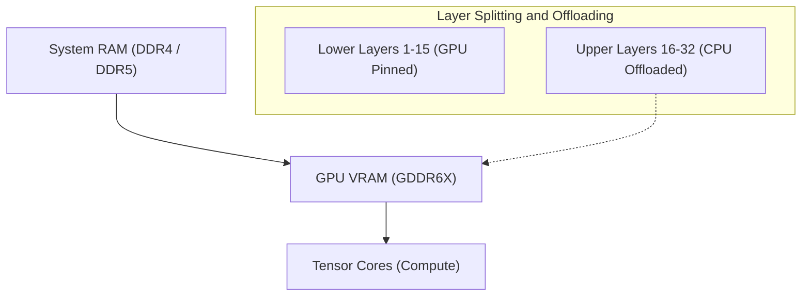
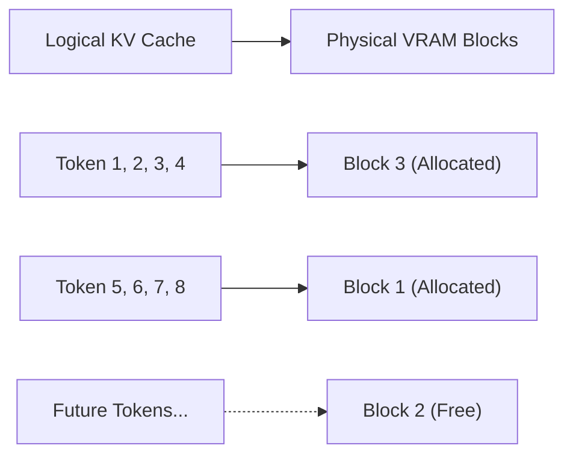
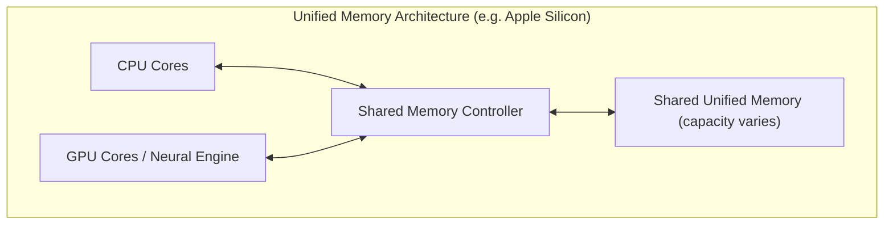
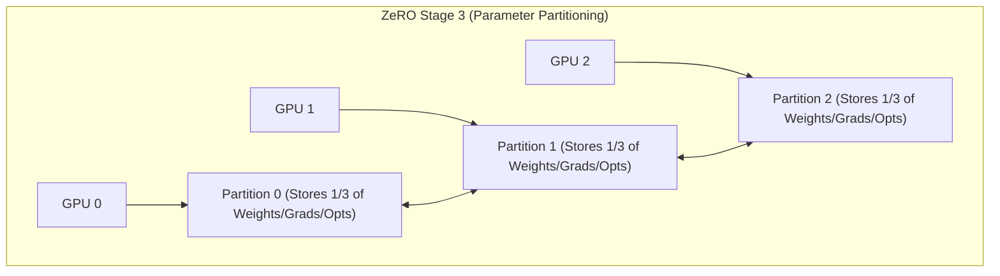

# はじめに：AI開発と「VRAMの壁」

近年、[大規模言語モデル](https://kenji.blog/p/large-language-models-llm-transformer-prompt-engineering/)（LLM）や拡散モデルなどの生成AI技術が急速に発展しています。ローカルでモデルを学習・推論するとき、重みだけでなくKVキャッシュ、中間活性、ワークスペース、バッチ数もGPUメモリを使います。このため、必要量はモデル・精度・系列長・バッチ数・実装により変わります。

> **2026年11月23日確認：式・必要容量・実装の注意** — 以下の容量式は条件を置いた概算で、VRAMの保証値ではありません。量子化メタデータ、KVキャッシュ、活性、一時領域、OSの使用量を見込んでください。FlashAttentionはAttentionの計算量そのものを $O(N)$ にする手法ではなく、中間行列の保存やメモリ転送を抑えます。PagedAttentionは主にvLLMのサービング向けです。QLoRA論文の「65Bを48GBで学習」は論文内の特定設定で、24GBで70Bが一般に学習できるという意味ではありません。CPU/ディスク/ZeROオフロードは容量と引き換えにRAM・通信・速度の制約があります。統合メモリも空き容量やGPU性能の制約をなくしません。最新版の[Accelerate](https://huggingface.co/docs/accelerate/main/concept_guides/big_model_inference)、[Transformers量子化](https://huggingface.co/docs/transformers/main/quantization/bitsandbytes)、[QLoRA論文](https://proceedings.neurips.cc/paper_files/paper/2023/hash/1feb87871436031bdc0f2beaa62a049b-Abstract.html)、[PagedAttention論文](https://arxiv.org/abs/2309.06180)、[FlashAttention論文](https://proceedings.neurips.cc/paper/2022/hash/67d57c32e20fd0a7a302cb81d36e40d5-Abstract.html)、[DeepSpeed ZeRO-Offload](https://www.deepspeed.ai/tutorials/zero-offload/)、[Apple仕様](https://www.apple.com/mac-studio/specs/)を参照してください。 翻訳本文に残る旧製品容量、固定速度倍率、計算量の説明も、この条件付き訂正とリンク先の現行資料を優先して読んでください。

必要なメモリを超えるモデルでも、量子化、複数GPUへの分割、CPU/ディスクオフロードで動かせる場合があります。ただし、速度、対応演算、品質、必要なホストRAMとストレージに制約が生じます。メーカー公称容量と、OSや他のプロセスを差し引いた実利用可能量も区別してください。

この記事では、推論と学習における代表的なメモリ最適化を説明します。式は構成を理解するための概算です。ライブラリやモデルの版ごとの対応状況を確認し、実際のメモリ使用量と速度を測定してください。

---

# 1. AIモデルのVRAM消費の解剖学（推論・学習）

VRAM不足を解消するための第一歩は、まず「何が」「どれだけの」メモリを消費しているのかをミクロの視点から正確に把握することです。ブラックボックスとして扱うのではなく、数式を用いて正確に見積もることができれば、適切な最適化手法を選択できます。

## 1.1 モデルパラメータ（重み）のメモリ計算

AIモデルを構成するパラメータ（Weights）が消費する基本的なメモリ量は、モデルの総パラメータ数と、それを表現するためのデータ型（Precision: 精度）によって決定されます。

ディープラーニングで一般的に使用されるデータ型と、1パラメータあたりのバイト数（$B$）は以下の通りです。
- **FP32 (単精度浮動小数点数):** 4 bytes (標準的な学習時の精度)
- **FP16 / BF16 (半精度浮動小数点数):** 2 bytes (一般的な推論および混合精度学習)
- **INT8 (8ビット整数):** 1 byte (量子化モデル)
- **INT4 (4ビット整数量子化):** 0.5 bytes (GPTQ, AWQ, [GGUF](/p/llama-cpp-quantization-gguf/)などの極度な量子化)

モデル全体のパラメータ数を $P$、1パラメータあたりの格納サイズを $B$ bytes とすると、重みだけの理論的な下限は以下です。量子化メタデータ、アラインメント、一時バッファー、ランタイムのメモリは含みません。

$$ M_{weights} = P \times B $$

例えば、[Meta](/p/history-of-meta-facebook/)が公開している「Llama 3 8B」モデル（約80億パラメータ）をFP16（半精度）でロードする場合、以下のような計算になります。

$$ M_{weights} = 8,000,000,000 \times 2 \text{ bytes} \approx 16,000,000,000 \text{ bytes} \approx 16 \text{ GB} $$

この例では重みだけで約16GB（10進表記。16GiBとは異なります）を使うため、12GBのGPUにはそのまま収まりません。INT4の理論値は約4GBですが、実際の4-bit形式では量子化スケール等の追加領域が必要で、推論にはKVキャッシュや作業領域も要ります。搭載メモリ内で動くかは、モデル形式・実装・文脈長を含めて確認してください。

## 1.2 推論時のメモリ消費：KVキャッシュの増大

[LLM](/p/large-language-models-llm-transformer-prompt-engineering/)の推論（特に自己回帰的なテキスト生成）において、重みと同じかそれ以上にVRAMを激しく圧迫するのが **KVキャッシュ（[Key-Value](https://kenji.blog/p/nosql-database-selection-kvs-document-graph-wide-column/) Cache）** です。
[Transformer](https://kenji.blog/p/large-language-models-llm-transformer-prompt-engineering/)アーキテクチャでは、過去に生成・処理したトークンの情報を再計算するのを防ぐため、各アテンション層でのKeyとValueのテンソルをVRAMにキャッシュし続けます。これにより計算速度（Compute）は向上しますが、コンテキスト長（入力プロンプト長＋生成長）が長くなるにつれて、メモリ消費量が線形に爆発的に増加します。

均一な層・ヘッド形状で、KとVを同じ精度で保持すると仮定した1トークンあたりのKVキャッシュ量 $M_{kv\_token}$ の概算は次のとおりです。実装によるパディング、スライディングウィンドウ、量子化メタデータ等は別途考慮します。

$$ M_{kv\_token} = 2 \times N_{layers} \times N_{heads\_kv} \times D_{head} \times B $$

ここで各変数は以下の意味を持ちます：
- $2$ : KeyとValueの2つのテンソルが存在するため
- $N_{layers}$ : Transformerのレイヤー（層）数
- $N_{heads\_kv}$ : KVアテンションヘッド数（GQA: Grouped Query Attentionの場合は通常のヘッド数より少なくなります）
- $D_{head}$ : 各ヘッドの次元数（通常、隠れ層の次元数 $D_{model} / N_{heads}$）
- $B$ : データ型のバイト数（FP16なら2）

全体のKVキャッシュ量 $M_{kv\_total}$ は、これにシーケンス長（$L_{seq}$）とバッチサイズ（$BatchSize$）を掛けたものになります。

$$ M_{kv\_total} = M_{kv\_token} \times L_{seq} \times BatchSize $$

**具体例：Llama 2 7Bの場合**
- $N_{layers} = 32$
- $N_{heads\_kv} = 32$ (MHAの場合)
- $D_{head} = 128$
- FP16 ($B=2$)
- バッチサイズ1、シーケンス長 8192 (8Kコンテキスト)

$$ M_{kv\_total} = 2 \times 32 \times 32 \times 128 \times 2 \times 8192 \times 1 = 4,294,967,296 \text{ bytes} \approx 4 \text{ GB} $$

同じ仮定でコンテキストを32KにするとKVキャッシュは約16GiB、バッチサイズ4では約64GiBになります。これは構成を示す例であり、実際の使用量はモデルのKVヘッド数・精度・共有方式等で変わります。

## 1.3 学習時のメモリ消費：オプティマイザと勾配とアクティベーション

推論時と比較して、モデルの学習（事前学習やファインチューニング）では遥かに多くのVRAMを消費します。それは、単純なフォワードパス（順伝播）だけではなく、バックプロパゲーション（逆伝播）のための情報を保持する必要があるためです。学習時のメモリは主に以下の4要素で構成されます。

1. **モデルの重み (Model Weights):** 推論時と同様ですが、混合精度学習ではFP16とFP32（マスターウェイト）の両方を保持することがあります。
2. **勾配 (Gradients):** 逆伝播で計算されるパラメータごとの勾配。FP16の場合はパラメータあたり2バイト。
3. **オプティマイザ状態 (Optimizer States):** AdamWなどの高機能なオプティマイザは、各パラメータに対して一次モーメント（Momentum）と二次モーメント（Variance）を保持します。学習の安定性を保つため、これらは通常FP32（4バイト）で保持されます。つまり、2つのモーメントで $4 + 4 = 8$ バイト/パラメータを消費します。
4. **アクティベーション (Activations):** 逆伝播の勾配計算のために、順伝播時の各層の出力（中間状態）をメモリに保持しておく必要があります。これはバッチサイズやシーケンス長に強く依存し、非常に巨大になります。

例えばFP32マスター重み、FP16重みと勾配、FP32 Adamの2つのモーメントをすべて保持する構成なら、パラメータ関連だけで概ね16 bytes/parameterです。実装やオプティマイザが異なれば値も変わり、アクティベーションや一時領域は別に必要です。

$$ M_{train\_param} \approx P \times 16 \text{ bytes} $$

この仮定で7Bモデルなら、重み・勾配・オプティマイザ状態の合計は約112GB（10進）に達し得ます。これは全モデルがGPUに常駐する標準的な学習例であり、特定のモデルや学習方式に必要なVRAMを示す固定値ではありません。

---

# 2. 推論時におけるVRAM節約テクニック

推論時に巨大モデルを動かすためのアプローチとして、ハードウェアの境界を越えるソフトウェア技術が多数開発されています。

## 2.1 CPUオフロード（CPU Offloading）とレイヤー分割

巨大なモデルが単一または複数のGPUに収まりきらない場合、モデルの一部をシステムメモリ（CPU RAM）に配置し、必要な時だけGPUに転送しながら計算を進める手法が **CPUオフロード** です。`llama.cpp`やHugging Faceの`Accelerate`などがこの機能をサポートしています。



**メカニズムと課題:**
[Transformer](https://kenji.blog/p/large-language-models-llm-transformer-prompt-engineering/)モデルは層（レイヤー）が直列に積み重なった構造をしているため、ある層の計算が終わるまで次の層の計算は始まりません。これを利用し、GPUに収まる層（例：1層〜15層）だけをVRAMに常駐（ピン留め）させ、残りの層（16層〜32層）は大容量だが低速なCPU RAMに置いておきます。推論中、15層までの計算が終わると、16層目の重みをCPUからGPUへPCIeバス経由で転送（コピー）し、GPU上で計算を実行します。

ただし、CPUとGPU間の転送帯域や遅延は制約になり、層の移動を頻繁に行う構成では推論速度が下がることがあります。実効帯域はPCIe世代・レーン数・プラットフォーム・転送方法で変わるため、理論値だけで速度を予測せず実測してください。
速度とメモリの折り合いをつけるには、対象ランタイムの配置設定を調整し、実際のモデルと系列長で評価します。

## 2.2 KVキャッシュの量子化とPagedAttention

推論時のVRAM消費の元凶であるKVキャッシュに対しても、二つの強力な最適化が行われています。

**1. KVキャッシュ量子化（KV Cache Quantization）:**
対応する推論エンジンやモデルでは、KVキャッシュをFP8等の低精度形式で保持でき、理論上は格納量を減らせます。対応方式、精度への影響、速度は実装・ハードウェア・モデルにより異なり、必ず半分〜4分の1になるとは限りません。導入前に公式ドキュメントと実タスクで確認してください。

**2. PagedAttention:**
vLLMの **PagedAttention** は、OSのページ管理に着想を得てKVキャッシュをブロック単位で管理する方式です。vLLMの論文は特定の既存サービングシステムの評価で、予約や断片化によりKV領域の多くが未使用になる例を報告しています。その割合は実装やワークロードに固有で、すべての推論環境に当てはまる値ではありません。

vLLMはKVキャッシュを固定サイズのブロックに分割し、非連続な物理メモリへ割り当てます。これにより従来方式で起きる予約・断片化の無駄を大きく減らせますが、内部断片化がゼロになるわけではありません。この主な用途はLLMサービングであり、すべてのローカル推論UIの機能ではありません。



## 2.3 FlashAttention：アテンション計算のメモリ複雑性を打破

VRAM不足は、データを保存するメモリ量だけでなく、計算中の「一時的なワークスペース」の不足によっても引き起こされます。標準的な[Transformer](https://kenji.blog/p/large-language-models-llm-transformer-prompt-engineering/)のSelf-Attentionメカニズムは、シーケンス長 $N$ に対して $N \times N$ の巨大なアテンション行列をVRAM上に実体化（Materialize）する必要があります。これはメモリ計算量が $O(N^2)$ となり、長いコンテキストではOOMの主要因となります。

これを解決したのが **FlashAttention** （およびFlashAttention-2, 3）です。
FlashAttentionは、GPUのハードウェアアーキテクチャ（巨大だが遅いHBMと、極小だが超高速なSRAMの階層構造）を意識したアルゴリズムです。タイル化（Tiling）と呼ばれる手法を用い、ブ[ロック](https://kenji.blog/p/rdbms-transaction-acid-isolation-level-lock/)ごとにデータをSRAMにロードしてアテンション計算を完結させることで、$N \times N$ の行列をHBM（VRAM）に書き出す処理を完全に回避します。

FlashAttentionは厳密なAttentionの計算結果を保ちながら、タイル化によってHBMへの読み書きを減らし、中間の $N \times N$ 行列をGPUメモリに丸ごと保存する必要をなくします。Attentionの計算量自体が一般に $O(N^2)$ から $O(N)$ へ変わるわけではありません。実装とGPUにより、メモリ使用量や速度の改善幅は異なります。

## 2.4 統合メモリ（Unified Memory）の台頭とApple Silicon

PCアーキテクチャの別の選択肢が、Apple Siliconなどが採用する **統合メモリアーキテクチャ（Unified Memory Architecture: UMA）** です。製品ごとの上限や対応ソフトウェアは更新されるため、購入・構築前に公式仕様を確認してください。

これらのアーキテクチャではCPUとGPUが物理メモリを共有し、別個のディスクリートGPU VRAMへのPCIeコピーを避けられる場合があります。ただし、メモリ帯域・GPU演算性能・アプリ対応は個別GPUと異なり、統合メモリの全容量をモデルが使えるわけでもありません。



統合メモリは、モデルの重みとCPU/GPUが共有するメモリ容量を増やす選択肢です。モデル本体に加え、OS・実行環境・KVキャッシュ・アクティベーション用の余裕が必要です。モデルのロード可否だけから生成速度を推定することはできません。利用可能容量や帯域は機種・構成で異なるため、最新の[Apple仕様](https://www.apple.com/mac-studio/specs/)等を確認し、対象アプリで測定してください。

---

# 3. 学習（ファインチューニング）時のVRAM節約テクニック

推論以上のVRAMを要求する学習（Training）時にも、多くのブレイクスルーが生まれています。限られたリソースでファインチューニングを行うためには、以下の技術を組み合わせることが不可欠です。

## 3.1 勾配チェックポイント（Gradient Checkpointing）

ディープラーニングのバックプロパゲーション（逆伝播）では、勾配を計算するためにフォワードパス（順伝播）での全レイヤーの中間出力（Activations）をメモリに保持しておく必要があります。シーケンス長やバッチサイズが大きくなると、このアクティベーションメモリがVRAMを支配し始めます。

**勾配チェックポイント（Gradient Checkpointing / Activation Recomputation）** は、メモリ容量と計算時間（Compute）のトレードオフを利用した天才的なテクニックです。
全ての中間出力をメモリに保存するのではなく、特定のレイヤー（チェックポイント）の出力だけを保存しておきます。バックプロパゲーション時にチェックポイントされていない中間の値が必要になったら、 **保存しておいた最寄りのチェックポイントから再度フォワードパスを計算（再計算）して値を復元** します。

チェックポイントの配置によっては、逆伝播で一部の順伝播を再実行するため、メモリを節約する代わりに計算時間が増えます。削減量と速度低下はモデル、チェックポイント間隔、バッチ・系列長、実装で変わります。固定の20〜30%や $O(\sqrt{N})$ を全方式共通の保証値とはみなさず、使用中の学習ライブラリの説明を確認してください。

## 3.2 LoRA と QLoRA (Low-Rank Adaptation)

VRAM不足を根本から解決した立役者が、PEFT（Parameter-Efficient Fine-Tuning）の代表格である **LoRA** です。

モデルの元の巨大な重み行列 $W_0 \in \mathbb{R}^{d \times k}$ を凍結（Frozen）し、学習させません。代わりに、2つの非常に小さな低ランク行列 $A \in \mathbb{R}^{r \times k}$ と $B \in \mathbb{R}^{d \times r}$ を並列に導入し、この $A$ と $B$ だけを学習させます。（ここでランク $r$ は $r \ll d, k$ となる小さな値です）。

$$ W_{adapted} = W_0 + \Delta W = W_0 + B A $$

これにより、学習対象のパラメータ数が元の1%未満（時には0.1%未満）になり、それに伴ってメモリを大食いしていた「勾配」や「オプティマイザ状態」も1%未満に激減します。

さらに、これを極限まで進化させたのが **QLoRA (Quantized LoRA)** です。
QLoRAでは、ベースモデルの重み $W_0$ を4ビット（NF4: NormalFloat4形式）に極限まで量子化してVRAMにロードします。そして、LoRAの小さな行列 $A, B$ は計算精度を保つためBF16（16ビット）で学習させます。
4-bit基底重みとLoRA、ページドオプティマイザを組み合わせる方法があります。QLoRA論文では、特定の設定で65Bモデルを48GBの単一GPU上で微調整した例を報告しています。これは24GB GPUで70Bモデルが一般に学習できるという意味ではありません。文脈長、バッチ、チェックポイント、GPU、実装等で必要量が変わるため、再現条件を確認してください。

## 3.3 DeepSpeed ZeRO と オフローディング

複数のGPU（マルチGPU）を使用する環境において、単なるデータ並列化（Data Parallelism）ではVRAM問題は解決しません。各GPUがモデル全体のコピーを保持するため、個々のVRAM容量の限界は超えられないからです。

MicrosoftのDeepSpeedにある **ZeRO (Zero Redundancy Optimizer)** は、データ並列学習の重複状態を段階的にGPU間で分割する仕組みです。Stage 3でも各GPUに全状態を単純に複製せずに済みますが、GPUメモリが一つの物理プールになるわけではありません。通信・再構築・モデル対応などのコストがあります。



- **ZeRO Stage 1:** オプティマイザ状態を各GPUに分割
- **ZeRO Stage 2:** 勾配も各GPUに分割
- **ZeRO Stage 3:** モデルのパラメータ（重み）自体も各GPUに分割

ZeRO-Offloadは構成に応じてオプティマイザ状態・計算をCPUメモリ側へ移します。GPUメモリを節約できますが、ホストRAM、CPU処理、転送帯域を使い、学習速度が低下する場合があります。OOMを必ず防ぐものではなく、モデル・データ・ライブラリの条件を満たす必要があります。

---

# 4. 実装例：Hugging Face Accelerate と DeepSpeed

最後に、実際にPythonコードでCPUオフロードやVRAM最適化をどのように実装するか、簡単な例を示します。

## 4.1 Hugging Face `device_map="auto"` による自動オフロード

Hugging Faceの`transformers`と`accelerate`ライブラリを使うと、モデルをロードする際にGPUとCPU間で自動的にレイヤーを分割してくれます。

```python
from transformers import AutoModelForCausalLM, AutoTokenizer

model_id = "meta-llama/Llama-2-13b-hf"

model = AutoModelForCausalLM.from_pretrained(
    model_id,
    dtype="auto",
    device_map="auto",
    max_memory={0: "10GiB", "cpu": "48GiB"},
    offload_folder="offload_dir",
)
tokenizer = AutoTokenizer.from_pretrained(model_id)
```

このコードでは、`accelerate`がモデル配置を計画します。デバイスの空き容量、配置上限、モデル構造によって結果が変わり、自動配置が速度やメモリ効率の最適解とは限りません。

## 4.2 DeepSpeedのCPUオフロード設定 (ZeRO-2)

学習時にDeepSpeedでCPUオフロードを有効にするための設定ファイル（JSON）の例です。

```json
{
  "fp16": {
    "enabled": true
  },
  "zero_optimization": {
    "stage": 2,
    "offload_optimizer": {
      "device": "cpu",
      "pin_memory": true
    },
    "allgather_partitions": true,
    "allgather_bucket_size": 2e8,
    "overlap_comm": true,
    "reduce_scatter": true,
    "reduce_bucket_size": 2e8,
    "contiguous_gradients": true
  },
  "train_batch_size": 16,
  "train_micro_batch_size_per_gpu": 4,
  "gradient_accumulation_steps": 4
}
```
この1 GPU例では、`offload_optimizer`を`"cpu"`にしてオプティマイザ状態と更新をCPU側へ移します。一般に `train_batch_size = GPU数 × train_micro_batch_size_per_gpu × gradient_accumulation_steps` となるよう、GPU数に応じて設定を合わせます。`pin_memory: true`はページロックされたホストメモリを使用し転送を速める場合がありますが、ホストRAMを占有します。使用中のDeepSpeed版の設定仕様と実測を確認してください。

---

# まとめ

AI開発では、モデルやワークロードに応じてGPUメモリの制約に対処する必要があります。メモリ最適化は実行可能なモデルやバッチ数を広げる一方、精度・速度・互換性とのトレードオフがあります。使用するライブラリの現行仕様と実測値に基づいて組み合わせてください。

**推論時における対策のまとめ：**
1. **量子化 (INT4 / INT8 / FP8):** モデルそのもののサイズを劇的に圧縮し、VRAM占有量を削減する。
2. **CPUオフロード:** VRAMに入り切らないレイヤーをシステムメモリへ逃がす（PCIe帯域による速度低下とのトレードオフ）。
3. **KVキャッシュ最適化:** ページング（PagedAttention）やキャッシュの量子化、FlashAttentionを用いて文脈長（Context Length）を確保する。
4. **統合メモリ活用:** Apple SiliconなどのUMAを活用し、大容量メモリを直接推論に用いる。

**学習時における対策のまとめ：**
1. **PEFT (LoRA / QLoRA):** 学習対象のパラメータを限定し、ベースモデルを極限まで量子化する。
2. **勾配チェックポイント (Gradient Checkpointing):** 順伝播の中間出力を破棄し、逆伝播時に再計算することでVRAM消費を計算時間と引き換えに抑える。
3. **ZeRO & CPU オフロード (DeepSpeed):** オプティマイザ状態や勾配を複数GPUで分割、あるいはCPUメモリにオフロードしてVRAM限界を突破する。

これらの高度な技術を駆使し、限られたハードウェアリソースの中で最大限のAI開発パフォーマンスを引き出していきましょう。日進月歩のこの分野では、今後も新たなメモリ節約アルゴリズムが登場することが期待されます。最新のライブラリの動向を定期的にチェックし、実装に取り入れていくことが鍵となるでしょう。


