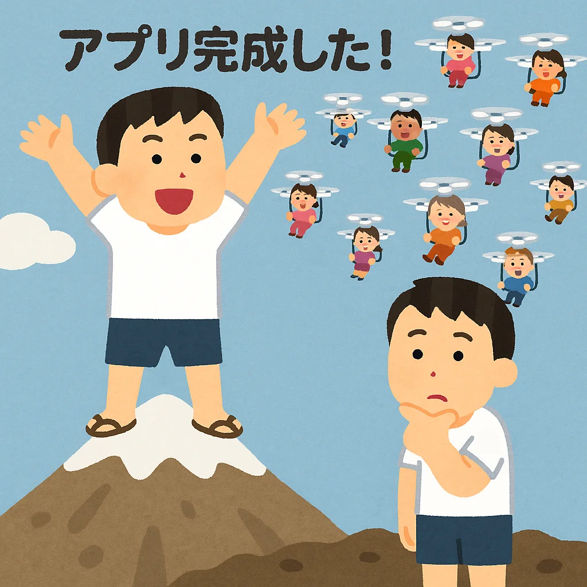

> **關於本文（2025 年 7 月 20 日發布）：** 本文描述的是作者對 AI 輔助應用程式開發的個人經驗與看法。「八合目」借用富士山登山路線作比喻，並非適用於所有專案的測量結果或未來預測。AI 工具、平台審核規則與服務能力都會改變，實際開發時請查閱所用工具的最新要求。

# AI開發的壁壘

**～雖然來到了第八合目，但從那之後才是地獄的故事～**

大家好，我是kenji。

最近，非常頻繁地聽到大家說：「只要拜託AI，就能輕易做出應用程式了！」
我們已經跨越了無程式碼（No-code）或低程式碼（Low-code）的時代，進入了「Vibe Coding（憑感覺寫程式碼）」的階段。

舉例來說，只要說「做一個可以編輯圖片並發布到社群媒體的應用程式」，AI就會吐出程式碼甚至UI。
**你是不是會覺得：「太厲害了，已經不需要人類了吧？」**

但是，這其實 **就像是穿著涼鞋降落在富士山的第八合目一樣** 。

---

## 到第八合目為止看起來像是「輕而易舉」

一開始，用AI開發真的非常輕鬆。
檔案I/O？總之能運作。
網路？嘛，能連上。
資料庫？用JSON就可以了吧。
UI？ChatGPT已經幫我寫出React程式碼了。
支付？Stripe的API大概複製貼上就行了。

在這裡，你會產生一種錯覺：「我，是不是已經是個工程師了？」
但是，真正的地獄從這裡才開始。

---

## 為什麼會卡關？

理由很簡單，因為「AI雖然能做出看起來像樣的東西，但最終調整還是全丟給人類」。

* 因為檔案I/O導致資料消失
* 資料庫正規化不夠嚴謹導致搜尋緩慢
* UI不夠直覺
* 沒有進行壓力測試，流量一集中就崩潰
* 被Apple/Google的審查退回
* 觸及法律規範要求而差點引發公關危機

也就是說， **AI擅長製作「外表看起來已完成的原型」** ，但
**將其打磨成「真正在世上行得通的產品」，至今依然是人類的工作** 。

---

## 但是，這裡存在一個悖論

在這裡，我們會發現一個 **悖論** 。

> 如果未來AI真的變得什麼都能做到了呢？
> 也就是說，當「安全性、計費、設計全都能由AI完美處理」的時候呢？

到那時候， **人類可能根本不再需要製作應用程式了** 。

因為只要使用者直接對AI說「我想做這件事」，
即使沒有應用程式，任務也會被立即執行完畢。

---

### 🌀 舉例來說

以前我們會「為了計算而開啟計算機應用程式」，但
現在只要說「Hey Siri，12乘32是多少？」就結束了。

同樣地，
如果說「請AI幫我編輯照片並分享」，可能根本不需要經過應用程式的UI或API，處理就已經完成了。

換句話說，
**當「用AI製作應用程式」這個目標實現時，或許就會迎來一個根本不需要應用程式的世界** 。

---

## 說到底，我們現在能做什麼

那麼，我們該怎麼辦呢？

* 現在「第八合目以上」仍然是人類的領域，所以要精進這部分
* 專注於本質上的使用者理解與服務設計
* 思考「有價值的東西」而不是「能被做出來的東西」
* 甚至，探索「不侷限於應用程式形式」的價值提供方式

AI是工具、是升降機，有時也是競爭對手。
但是， **「要做什麼」以及「為什麼要做」，依然是我們人類面臨的課題** 。

---

## 總結：

**AI開發的壁壘，並非技術問題，而是結構上的悖論**

這是一個任何人都能到達富士山第八合目的時代。
但從那之後才是真正的考驗。

而且，當我們終於登頂時，
或許會迎來一個讓我們重新思考：「我們真的有必要爬這座山嗎？」的未來。

