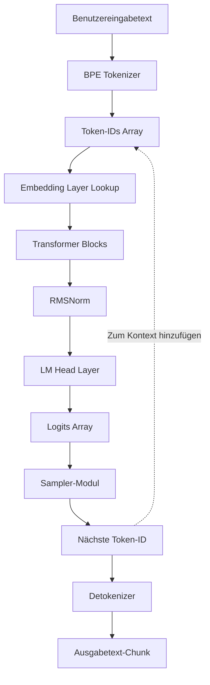
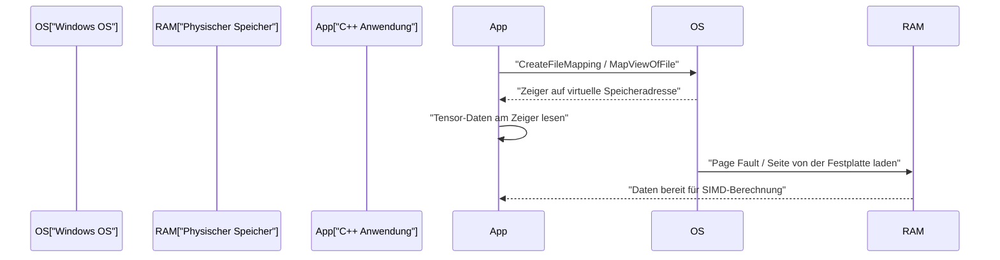
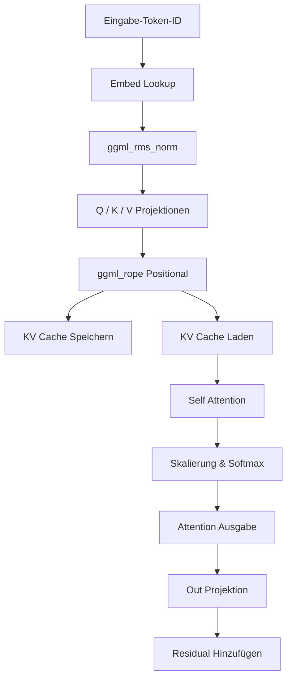

# Kleine LLMs mit C++ ausführen: Einstieg mit TinyLlama, llama.cpp und ggml

> **Umfang und Korrekturen:** Dies ist eine Einführung in die Inferenzarchitektur und den Build des gepflegten Projekts [llama.cpp](https://github.com/ggml-org/llama.cpp), keine vollständige Neuimplementierung. llama.cpp basiert auf [ggml](https://github.com/ggml-org/ggml). Speicher- und Geschwindigkeitswerte sind Schätzungen und hängen von Modell, Quantisierung, Kontextlänge, Hardware und Build ab. mmap lädt Seiten bei Bedarf; es garantiert weder durchgängiges Zero-Copy noch den Verzicht auf physischen Speicher. Das frühere CMake-Beispiel verknüpfte keine funktionsfähigen ggml-Quellen und wurde durch den offiziellen Build-Ablauf ersetzt.

> **Hinweise zur Implementierung (Ergänzungen und Korrekturen):** GGUF-Tensoroffsets richten sich nach `general.alignment` (standardmäßig 32 Byte, wenn der Wert fehlt); 32 oder 64 Byte sind nicht universell festgelegt. Q4_0 speichert Blöcke mit 32 Werten, Q4_K Blöcke mit 256. Bei 1,1 Milliarden Parametern benötigen allein FP16-Gewichte etwa 2,2 GB (2,05 GiB); eine einfache 4-Bit-Schätzung beträgt etwa 0,55 GB. Quantisierungsmetadaten, GGUF-Overhead, Laufzeitarbeitsbereich und KV-Cache erhöhen den tatsächlichen Speicherbedarf. Allokation und KV-Cache in ggml/llama.cpp hängen von Version, Backend und Einstellungen ab; allokationsfreie Inferenz oder eine Vorabreservierung des gesamten Kontextes darf nicht vorausgesetzt werden. TinyLlama 1.1B Chat verwendet laut Konfiguration 32 Query-Heads und 4 Key/Value-Heads. Tensorformen und Operationen müssen zur Modellkonfiguration und Laufzeit passen. Die Abschnitte 3–8 sind konzeptionell und keine direkt ausführbare Anleitung für eine eigene Engine. GQA erfordert nicht grundsätzlich eine explizite Replikation der KV-Tensoren; Operationen und Tensorformen hängen von der Laufzeit ab. Verwenden Sie den Tokenizer, die Spezialtokens und das Chat-Template des jeweiligen Modells. GGUF ist ein weit verbreitetes Format, aber nicht für jedes Modell und jede Laufzeit universell das beste. Prüfen Sie vor einer festen Vorgabe wie AVX2 die CPU-Unterstützung und richten Sie sich nach den Backend-Optionen der offiziellen Build-Anleitung.

## 1. Warum C++ und ggml?

Python bietet ein umfangreiches Ökosystem für Training und Experimente. C und C++ eignen sich für die Integration in native Anwendungen, die Bereitstellung und die Kontrolle der Laufzeit. C++ ist nicht in jeder Konfiguration automatisch schneller; die gemessene Leistung hängt von Modell, Backend und Hardware ab.

## 2. Gesamtbild der Architektur

Der Fluss der gesamten Inferenz-[Pipeline](https://kenji.blog/de/p/cicd-pipeline-github-actions-best-practices/) ist im folgenden Mermaid-Diagramm dargestellt. Dies ist der Prozess vom Eingabetext des Benutzers bis zur endgültigen Generierung des nächsten Tokens.



Da es sich um ein autoregressives Modell handelt, wird das ausgegebene Token wieder dem Kontext hinzugefügt und als Eingabe für die Vorhersage des nächsten Tokens zyklisch verwendet (gestrichelte Linie im Diagramm).

---

## 3. Modellformat und Memory Mapping (mmap)

Das größte Hindernis beim Umgang mit den Gewichten riesiger neuronaler Netze sind Festplatten-I/O und Speicherverbrauch. In der C++-Implementierung wird dies durch **Memory Mapping (mmap)** gelöst.

### 3.1 Funktionsweise von Memory Mapping und Implementierung in Windows

Mit mmap kann der Inhalt einer Datei direkt in den virtuellen Adressraum des Prozesses abgebildet (gemappt) werden.

* **Zero-copy**: Die Daten werden von der Festplatte direkt in den Page-Cache des Kernels geladen, ohne dass eine zusätzliche Kopie in den Userspace erfolgt.
* **On-Demand-Laden (Page Fault)**: In dem Moment, in dem die CPU tatsächlich auf diese Speicheradresse zugreift, tritt ein Page Fault (Seitenfehler) auf, und nur der benötigte Chunk (normalerweise 4 KB) wird in den physischen Speicher geladen.

In Windows-Umgebungen werden anstelle des POSIX `mmap` die [Win32](/de/p/modern-cpp-win32-api-safe-handling/)-APIs `CreateFileMapping` und `MapViewOfFile` verwendet.



### 3.2 Binäre Struktur des GGUF-Formats

Das aus Formaten wie `.safetensors` von Hugging Face konvertierte **[GGUF](/de/p/llama-cpp-quantization-gguf/) (GPT-Generated Unified Format)** ist das ultimative Format für Inferenzen. Es verfügt über das folgende strikte binäre [Layout](https://kenji.blog/de/p/browser-rendering-mechanism-dom-paint/).

1. **Magic Bytes**: `0x46554747` ([GGUF](/de/p/llama-cpp-quantization-gguf/)).
2. **Version**: Die Versionsnummer des Formats.
3. **Tensor Count & Metadata Count**: Anzahl der Tensoren und der Metadaten-Schlüssel-Wert-Paare.
4. **Metadata ([Key-Value](https://kenji.blog/de/p/nosql-database-selection-kvs-document-graph-wide-column/) Pairs)**: Schlüssel mit Präfix für die Zeichenfolgenlänge und typisierte Werte.
5. **Tensor Info**: Name, Dimensionen, Datentyp (FP16, Q4_K usw.) jedes Tensors und die Offset-Position in der Datei.
6. **Padding**: Polsterung (Padding), die eingefügt wird, damit die Tensordaten an bestimmten Grenzen (normalerweise 32 oder 64 Byte) ausgerichtet (aligned) werden. Dies ist entscheidend für den schnellen Speicherzugriff mit SIMD-Befehlen (insbesondere AVX).
7. **Tensor Data**: Das eigentliche Array der ausgerichteten Gewichtsdaten.

---

## 4. Mathematische Grundlagen von TinyLLaMA und C++-Algorithmen

TinyLLaMA beinhaltet einige fortgeschrittene architektonische Tricks zur Effizienzsteigerung. Die mathematischen Ausdrücke zur korrekten Implementierung in C++ werden hier erläutert.

### 4.1 RMSNorm (Root Mean Square Normalization)

Die Rechenkosten werden reduziert, indem die Mittelwert-Zentrierung aus LayerNorm weggelassen und nur die Varianz-Skalierung durchgeführt wird.

$$ \text{RMSNorm}(x) = \frac{x}{\sqrt{\frac{1}{d}\sum_{i=1}^{d} x_i^2 + \epsilon}} \odot \gamma $$

$d$ ist die Anzahl der Dimensionen, $\gamma$ ist der gelernte Skalierungstensor.
Bei der Implementierung in C++ wird dies optimiert, indem zunächst die Summe der Quadrate des Arrays schnell mit AVX2s `_mm256_fmadd_ps` etc. berechnet wird und dann mit der inversen Quadratwurzel (z. B. `_mm256_rsqrt_ps` Befehl) multipliziert wird.

### 4.2 RoPE (Rotary Position Embedding)

Eine Technik, um die Positionsinformationen von Tokens als Rotation im Tensorraum anzuwenden. Es kann als Rotation auf einer komplexen Ebene betrachtet werden, wobei für benachbarte Dimensionspaare $(x_1, x_2)$ des Vektors $x$ die folgende Rotation angewendet wird.

$$ \text{RoPE}(x, m) = \begin{pmatrix} x_{1} \cos(m\theta) - x_{2} \sin(m\theta) \\ x_{1} \sin(m\theta) + x_{2} \cos(m\theta) \end{pmatrix} $$

Hier ist $m$ der absolute Positionsindex des Tokens und $\theta$ die vorberechnete Grundfrequenz. In ggml wird es parallel ausgeführt, indem einfach der `ggml_rope`-Operator während der Konstruktion des Inferenzgraphen hinzugefügt wird.

### 4.3 Grouped-Query Attention (GQA)

Bei der normalen Multi-Head Attention (MHA) gibt es die gleiche Anzahl von Heads für Query, Key und Value. TinyLLaMA verwendet jedoch **Grouped-Query Attention (GQA)**, um die Speicherbandbreite und den KV-Cache-Verbrauch drastisch zu reduzieren.

$$ \text{Attention}(Q, K, V) = \text{softmax}\left(\frac{Q K^T}{\sqrt{d_k}}\right) V $$

Bei GQA teilen sich mehrere Query-Heads einen Key/Value-Head. In der C++-Implementierung ist es erforderlich, den KV-Tensor so zu broadcasten (zu replizieren), dass er der Anzahl der Queries entspricht, bevor die Matrixmultiplikation `ggml_mul_mat` ausgeführt wird.

### 4.4 SwiGLU-Aktivierungsfunktion

Im Feed-Forward Network (FFN)-Layer wird anstelle von GELU SwiGLU verwendet.

$$ \text{SwiGLU}(x) = \text{Swish}(x W_{\text{gate}}) \otimes (x W_{\text{up}}) $$
$$ \text{Swish}(z) = z \cdot \sigma(z) = z \cdot \frac{1}{1 + e^{-z}} $$

Im Berechnungsgraphen wird dies durch eine Kombination aus dem `ggml_silu`-Operator und `ggml_mul` dargestellt.

---

## 5. Konstruktion des Berechnungsgraphen mit ggml und Speicherverwaltung

ggml verfolgt einen „Define-and-Run“-Ansatz, bei dem ein statischer Berechnungsgraph für die Inferenz konstruiert und anschließend evaluiert wird.

### 5.1 ggml_context und Arena-Allocator

Die einzigartigste Eigenschaft von ggml ist die „Arena-Allokation“, bei der in der Inferenzschleife keinerlei dynamische Speicherzuweisungen (`malloc` oder `new`) stattfinden.
Bei der Initialisierung wird ein riesiger zusammenhängender Speicherbereich (die Arena) reserviert, und bei jedem Aufruf von z. B. `ggml_new_tensor` wird der [Zeiger](/de/p/c-language-pointers-memory-management-stack-heap/) dieses Bereichs inkrementiert. Sobald ein Inferenzschritt abgeschlossen ist, wird der Allokationszeiger einfach auf seine Ausgangsposition zurückgesetzt, wodurch die Speicherzuweisung für den nächsten Inferenzschritt sofort abgeschlossen ist.

### 5.2 Konkretes Beispiel für die Konstruktion eines Graphen

Für jeden Inferenzschritt wird der folgende Berechnungsgraph im Speicher aufgebaut.



---

## 6. Quantisierung (Quantization) und Windows / SIMD-Optimierung

Wenn TinyLLaMA (1,1B) in FP16 verwendet wird, werden etwa 2,2 GB Speicher benötigt, aber durch 4-Bit-Quantisierung (wie Q4_K) kann dies drastisch auf etwa 600 MB komprimiert werden.

### 6.1 Block-Quantisierungsarchitektur

ggml quantisiert nicht den gesamten Tensor einheitlich, sondern in „Blöcken“.
Im `Q4_0`-Format werden 32 FP16-Werte in einem Block zusammengefasst.
- **Skalierungsfaktor (Scale Factor)**: Ein FP16-Wert (2 Byte)
- **Quantisierte Daten**: 32 4-Bit-Werte (16 Byte)
Dadurch wird der Einfluss von lokalen Ausreißern (Outliers) minimiert.

### 6.2 Beschleunigung des Skalarprodukts durch AVX2

Beim Kompilieren für die neuesten x86-CPUs in einer Windows-Umgebung werden Compiler-Flags wie `/arch:AVX2` verwendet und die SIMD-Verarbeitung läuft im folgenden Fluss ab:

1. **Laden**: Die quantisierten 4-Bit-Daten werden aus dem Speicher in ein 256-Bit-AVX-Register geladen.
2. **Entpacken (Unpack)**: Die 4-Bit-Werte werden durch Bitmasken- und Shift-Operationen in Int8 oder Int16 entpackt.
3. **Dequantisierung**: Multiplikation mit dem Skalierungsfaktor zur Umwandlung in Gleitkommazahlen.
4. **FMA-Berechnung**: Parallele Ausführung der Multiply-Add-Operation mit den Aktivierungswerten über `_mm256_fmadd_ps` (Fused Multiply-Add).

---

## 7. Details zur Implementierung des KV-Caches

Bei der autoregressiven Generierung ist ein „KV-Cache“, der die Berechnung von Key und Value vergangener Tokens überspringt, eine zwingend erforderliche Funktion.

Bei der Implementierung in C++ sind die folgenden Punkte wichtig:
1. **Vorabreservierung des Tensors**: Ein riesiger Tensor für die maximale Kontextlänge (z. B. 2048 Tokens) wird für den KV-Cache initialisiert (FP16 wird empfohlen).
2. **Offset-Kopie**: Wenn die Berechnung für die Token-Position $N$ durchgeführt wird, werden die in diesem Schritt erhaltenen K- und V-Vektoren in der $N$-ten Zeile des KV-Cache-Tensors mithilfe von `ggml_cpy` o. Ä. gespeichert.
3. **Erstellung eines Views bei der Attention**: Bei der Berechnung der Attention wird ein „View“ (Ansicht) erstellt, der nur auf den Bereich der Tokens 0 bis $N$ verweist, und dieser View wird an die Matrixmultiplikation übergeben.

---

## 8. BPE Tokenizer und Dekodierung

Der Eingabe-String wird als Bytefolge in UTF-8 behandelt und mit einem vordefinierten Vokabular abgeglichen. Um die Vokabularsuche in C++ zu beschleunigen, werden Algorithmen implementiert, die **Trie-Bäume (Präfixbäume)** oder Prioritätswarteschlangen verwenden.

Die vom LM Head ausgegebenen Logits werden mithilfe des Temperature-Parameters skaliert, um Wahrscheinlichkeiten zu erhalten. Die Kandidaten werden durch Top-K-Extraktion oder Top-P-Methoden (Nucleus Sampling) eingegrenzt, und das endgültige nächste Token wird mithilfe von Zufallszahlen bestimmt.

---

## 9. Aufbau eines C++-Projekts (Windows / PowerShell-Umgebung)

Installieren Sie Visual Studio 2022 mit der C++-Desktopentwicklung und CMake. Bauen Sie das Repository gemäß der [offiziellen llama.cpp-Bauanleitung](https://github.com/ggml-org/llama.cpp/blob/master/docs/build.md). Damit wird eine vorhandene Inferenzlaufzeit erstellt, keine vollständige eigene Inferenz-Engine.

```powershell
git clone https://github.com/ggml-org/llama.cpp
Set-Location llama.cpp
cmake -B build
cmake --build build --config Release
```

Laden Sie zusätzlich ein mit llama.cpp kompatibles GGUF-Modell herunter und prüfen Sie Lizenz und Quelle. Die [TinyLlama-Modellkarte und -Konfiguration](https://huggingface.co/TinyLlama/TinyLlama-1.1B-Chat-v1.0) dienen als Referenz. Ersetzen Sie den folgenden Pfad durch Ihre lokale Datei und prüfen Sie Chat-Template sowie Quantisierungstyp.

```powershell
.\build\bin\Release\llama-cli.exe -m "C:\models\model.gguf"
```

## 10. Zusammenfassung

Für den ersten lokalen LLM-Lauf mit C++ empfiehlt sich der gepflegte llama.cpp-Build mit einem kompatiblen GGUF-Modell. Eine eigene Engine auf Basis von ggml ist ein separates Projekt und muss modellspezifische Tokenisierung, Operatoren, Gewichtsformate, KV-Cache, Backends und Tests berücksichtigen.
