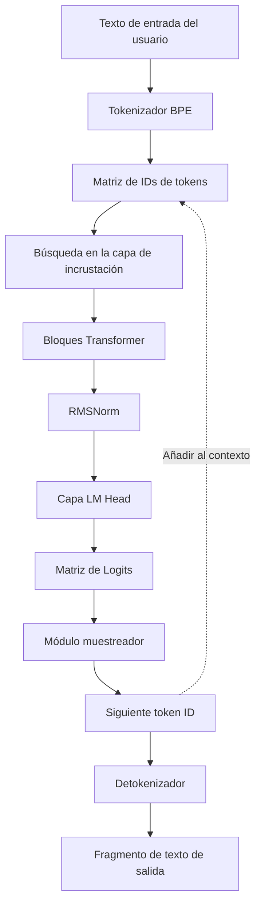
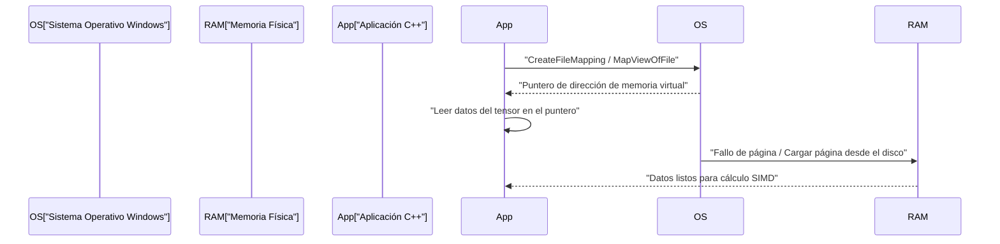
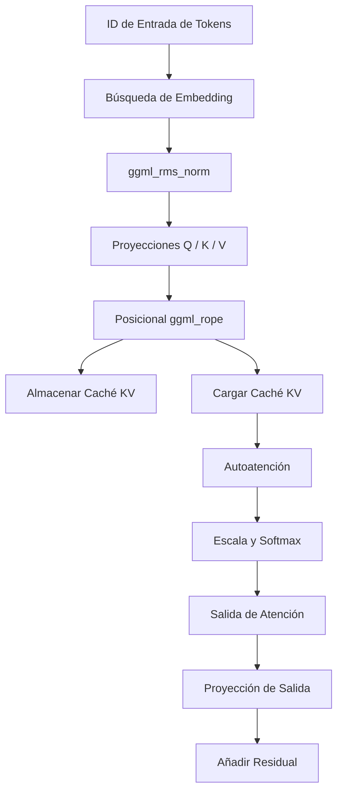

# Primeros pasos con la inferencia de LLM pequeños en C++: TinyLlama, llama.cpp y ggml

> **Alcance y correcciones:** Esta es una introducción a la arquitectura de inferencia y a la compilación del proyecto mantenido [llama.cpp](https://github.com/ggml-org/llama.cpp), no una implementación completa desde cero. llama.cpp se basa en [ggml](https://github.com/ggml-org/ggml). Las cifras de memoria y velocidad son estimaciones que dependen del modelo, la cuantización, el contexto, el hardware y la compilación. mmap carga páginas bajo demanda; no garantiza cero copias de principio a fin ni elimina el uso de memoria física. El ejemplo CMake anterior no enlazaba fuentes ggml que formasen una aplicación funcional y se ha sustituido por el proceso oficial.

> **Notas de implementación (aclaraciones al texto):** Los offsets de tensores GGUF siguen `general.alignment` (32 bytes por defecto si se omite); no existe una alineación universal de 32 o 64 bytes. Q4_0 agrupa 32 valores y Q4_K, 256. Para 1,1 mil millones de parámetros, solo los pesos FP16 ocupan unos 2,2 GB (2,05 GiB); el cálculo simple de 4 bits da unos 0,55 GB. Los metadatos de cuantización, el contenedor GGUF, el espacio de trabajo y la caché KV aumentan el tamaño real y la RAM necesaria. La asignación de memoria y la caché KV de ggml/llama.cpp dependen de la versión, el backend y la configuración; no se debe suponer que la inferencia no asigna memoria o que reserva siempre todo el contexto máximo. TinyLlama 1.1B Chat configura 32 cabezas Query y 4 cabezas Key/Value; adapta formas y operaciones a la configuración del modelo y al runtime. Las secciones 3–8 son conceptuales, no instrucciones copiables para crear un motor propio funcional. GQA no requiere siempre replicar explícitamente los tensores KV; las operaciones y formas dependen del runtime. Usa el tokenizador, los tokens especiales y la plantilla de chat del modelo. GGUF es un formato extendido, no el mejor universal para todos los modelos y runtimes. Antes de forzar instrucciones como AVX2, comprueba que la CPU las admite y sigue las opciones de backend de la guía oficial.

## 1. ¿Por qué C++ y ggml?

Python ofrece un amplio ecosistema para entrenar y experimentar. C y C++ son útiles para integrar modelos en aplicaciones nativas, distribuirlas y controlar el runtime. C++ no siempre es más rápido por defecto; el rendimiento medido depende del modelo, el backend y el hardware.

## 2. Visión general de la arquitectura

El flujo completo del pipeline de inferencia se muestra en el siguiente diagrama Mermaid. Es un proceso continuo que comienza con el texto de entrada del usuario hasta que se genera el siguiente token final.



Al ser un modelo autorregresivo, el token de salida se añade de nuevo al contexto y circula como entrada para la predicción del siguiente token (la parte punteada del diagrama).

---

## 3. Formato del modelo y mapeo de memoria (mmap)

La mayor barrera al manejar los pesos de una red neuronal gigante es la E/S del disco y el consumo de memoria. En la implementación de C++, esto se resuelve mediante el **mapeo de memoria (mmap)**.

### 3.1 Cómo funciona el mapeo de memoria y su implementación en Windows

Al utilizar mmap, el contenido del archivo se puede mapear directamente en el espacio de memoria virtual del proceso.

* **Copia cero (Zero-copy)**: Los datos se cargan directamente desde el disco a la caché de páginas del kernel, sin que ocurran copias adicionales al espacio de usuario.
* **Carga bajo demanda (Page Fault)**: En el instante exacto en que la CPU accede a esa dirección de memoria, se produce un fallo de página y solo el fragmento necesario (típicamente 4KB) se carga en la memoria física.

En un entorno Windows, en lugar del `mmap` de POSIX, se utilizan las API [Win32](/es/p/modern-cpp-win32-api-safe-handling/) `CreateFileMapping` y `MapViewOfFile`.



### 3.2 Estructura binaria del formato GGUF

**[GGUF](/es/p/llama-cpp-quantization-gguf/) (GPT-Generated Unified Format)**, convertido a partir de formatos como `.safetensors` de Hugging Face, es el formato definitivo para la inferencia. Tiene un diseño binario estricto como el siguiente:

1. **Bytes Mágicos**: `0x46554747` ([GGUF](/es/p/llama-cpp-quantization-gguf/)).
2. **Versión**: Número de versión del formato.
3. **Conteo de tensores y metadatos**: Número de tensores y pares clave-valor de metadatos.
4. **Metadatos (Pares clave-valor)**: Claves con prefijo de longitud de cadena y valores tipados.
5. **Información del tensor**: Nombre de cada tensor, número de dimensiones, tipo de datos (FP16, Q4_K, etc.) y posición de desplazamiento (offset) en el archivo.
6. **Relleno (Padding)**: Relleno insertado para que los datos del tensor se alineen en límites específicos (generalmente 32 o 64 bytes). Es indispensable para un acceso a memoria rápido con instrucciones SIMD (especialmente AVX).
7. **Datos del tensor**: Matriz de datos de pesos reales alineados.

---

## 4. Base matemática de TinyLLaMA y algoritmos en C++

TinyLLaMA incorpora varios ingenios arquitectónicos avanzados para mejorar la eficiencia. Explicaremos las representaciones matemáticas para implementarlos correctamente en C++.

### 4.1 RMSNorm (Root Mean Square Normalization)

Reduce el costo computacional omitiendo el centrado de la media de LayerNorm y realizando solo el escalado de la varianza.

$$ \text{RMSNorm}(x) = \frac{x}{\sqrt{\frac{1}{d}\sum_{i=1}^{d} x_i^2 + \epsilon}} \odot \gamma $$

$d$ es el número de dimensiones y $\gamma$ es el tensor de escalado entrenado.
Al implementar en C++, se optimiza calculando primero rápidamente la suma de los cuadrados de la matriz usando `_mm256_fmadd_ps` de AVX2, y multiplicando por la raíz cuadrada inversa (por ejemplo, con la instrucción `_mm256_rsqrt_ps`).

### 4.2 RoPE (Rotary Position Embedding)

Es una técnica para aplicar la información de posición de los tokens como una rotación en el espacio del tensor. Se puede ver como una rotación en el plano complejo, y aplica la siguiente rotación a los pares de dimensiones adyacentes $(x_1, x_2)$ del vector $x$.

$$ \text{RoPE}(x, m) = \begin{pmatrix} x_{1} \cos(m\theta) - x_{2} \sin(m\theta) \\ x_{1} \sin(m\theta) + x_{2} \cos(m\theta) \end{pmatrix} $$

Aquí, $m$ es el índice de posición absoluta del token y $\theta$ es la frecuencia base precalculada. En ggml, se ejecuta en paralelo simplemente añadiendo el operador `ggml_rope` durante la construcción del grafo de inferencia.

### 4.3 Grouped-Query Attention (GQA)

En la Atención Multicabezal normal (Multi-Head Attention, MHA), se tiene el mismo número de cabezas para Query, Key y Value. Sin embargo, TinyLLaMA adopta **Grouped-Query Attention (GQA)** para reducir drásticamente el ancho de banda de la memoria y el consumo de caché KV.

$$ \text{Attention}(Q, K, V) = \text{softmax}\left(\frac{Q K^T}{\sqrt{d_k}}\right) V $$

En GQA, múltiples cabezas de Query comparten una sola cabeza de Key/Value. En la implementación de C++, antes de ejecutar el producto matricial `ggml_mul_mat`, se requiere una operación para transmitir (broadcast) los tensores KV de acuerdo con el número de Queries.

### 4.4 Función de activación SwiGLU

En la capa de la Red Feed-Forward (FFN), se utiliza SwiGLU en lugar de GELU.

$$ \text{SwiGLU}(x) = \text{Swish}(x W_{\text{gate}}) \otimes (x W_{\text{up}}) $$
$$ \text{Swish}(z) = z \cdot \sigma(z) = z \cdot \frac{1}{1 + e^{-z}} $$

En el grafo computacional, se expresa combinando el operador `ggml_silu` y `ggml_mul`.

---

## 5. Construcción del grafo computacional y gestión de memoria con ggml

ggml adopta un enfoque de "Definir y Ejecutar" (Define-and-Run), donde construye un grafo computacional estático para la inferencia y luego lo evalúa.

### 5.1 ggml_context y el asignador de arena

La característica más singular de ggml es la "asignación por arena", que no realiza ninguna asignación dinámica de memoria (`malloc` o `new`) dentro del bucle de inferencia.
Al inicializar, se reserva una gran área de memoria contigua (arena), y cada vez que se llama a funciones como `ggml_new_tensor`, el puntero de esta área se incrementa. Cuando se completa un paso de inferencia, simplemente se restablece el puntero de asignación a su posición inicial, completando instantáneamente la asignación de memoria para el siguiente paso de inferencia.

### 5.2 Ejemplo concreto de construcción de grafo

En cada paso de inferencia, se construye un grafo computacional en memoria como el siguiente:



---

## 6. Cuantización y optimización para Windows / SIMD

Manejar TinyLLaMA (1.1B) en FP16 requiere aproximadamente 2.2GB de memoria, pero mediante cuantización de 4 bits (como Q4_K), se puede comprimir drásticamente a unos 600MB.

### 6.1 Arquitectura de cuantización por bloques

ggml no cuantiza todo el tensor uniformemente, sino en unidades de "bloques".
En el formato `Q4_0`, 32 valores FP16 se agrupan en un bloque.
- **Factor de escala**: 1 valor FP16 (2 bytes)
- **Datos cuantizados**: 32 valores de 4 bits (16 bytes)
Esto minimiza el impacto de los valores atípicos (outliers) locales.

### 6.2 Aceleración del producto punto con AVX2

Al compilar para las CPU x86 más recientes en entornos Windows, se utilizan banderas del compilador como `/arch:AVX2` y el procesamiento SIMD se realiza con el siguiente flujo:

1. **Carga**: Cargar datos cuantizados de 4 bits desde la memoria a registros AVX de 256 bits.
2. **Expansión y desempaquetado**: Expandir los valores de 4 bits a Int8 o Int16 usando máscaras de bits y operaciones de desplazamiento.
3. **Descuantización**: Multiplicar por el factor de escala para convertir a punto flotante.
4. **Operación FMA**: Ejecutar en paralelo la operación de multiplicación y suma (multiply-add) con los valores de activación y `_mm256_fmadd_ps` (Fused Multiply-Add).

---

## 7. Detalles de implementación de la caché KV

En la generación autorregresiva, la "caché KV" para omitir el cálculo de las Keys y Values de los tokens pasados es una función esencial.

Los puntos clave para la implementación en C++ son los siguientes:
1. **Reserva previa del tensor**: Se inicializa un enorme tensor para la caché KV con la longitud máxima del contexto (ej: 2048 tokens) (se recomienda FP16).
2. **Copia por desplazamiento**: Cuando se realiza el cálculo para la posición del token $N$, los vectores K y V obtenidos en ese paso se almacenan en la fila $N$ del tensor de la caché KV usando `ggml_cpy` u otras funciones.
3. **Creación de vista durante la atención**: Al calcular la atención, se crea una "vista" que apunta solo a la parte de los tokens del 0 al $N$-ésimo y se pasa al producto matricial.

---

## 8. Tokenizador BPE y decodificación

La cadena de entrada se trata como una secuencia de bytes UTF-8 y se compara con un vocabulario predefinido. En C++, para acelerar la búsqueda en el vocabulario, se implementa un **árbol Trie (árbol de prefijos)** o algoritmos que utilizan colas de prioridad.

A partir de los logits generados por el LM Head, se escalan las probabilidades usando el parámetro Temperature, los candidatos se filtran usando métodos Top-K o Top-P (Nucleus Sampling), y se utiliza un número aleatorio para determinar el siguiente token final.

---

## 9. Inicio del proyecto en C++ (Entorno Windows / PowerShell)

Instala Visual Studio 2022 con la carga de trabajo de escritorio en C++ y CMake; después compila el repositorio siguiendo la [guía oficial de compilación de llama.cpp](https://github.com/ggml-org/llama.cpp/blob/master/docs/build.md). Esto compila un runtime de inferencia existente, no un motor completo propio.

```powershell
git clone https://github.com/ggml-org/llama.cpp
Set-Location llama.cpp
cmake -B build
cmake --build build --config Release
```

Obtén por separado un modelo GGUF compatible con llama.cpp y comprueba su licencia y procedencia. La [tarjeta y configuración de TinyLlama](https://huggingface.co/TinyLlama/TinyLlama-1.1B-Chat-v1.0) sirven de referencia. Sustituye la ruta siguiente por la de tu archivo local y comprueba su plantilla de chat y tipo de cuantización.

```powershell
.\build\bin\Release\llama-cli.exe -m "C:\models\model.gguf"
```

## 10. Resumen

Para la primera ejecución local de un LLM desde C++, compila el proyecto mantenido llama.cpp y ejecuta un modelo GGUF compatible. Crear un motor directamente sobre ggml es otro proyecto: requiere manejar la tokenización, los operadores, el formato de pesos, la caché KV, los backends y las pruebas específicas del modelo.
