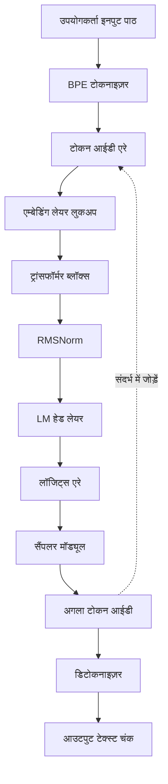
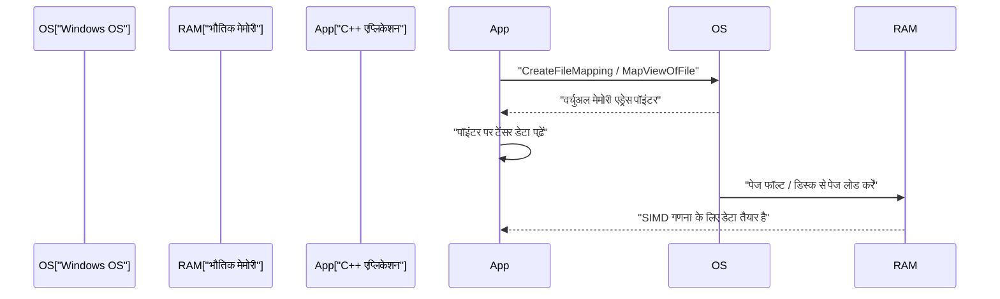
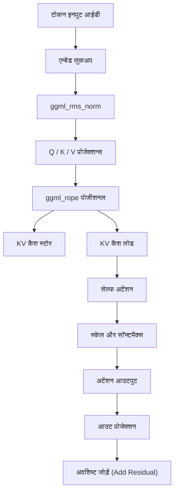

# C++ में छोटे LLM चलाना शुरू करें: TinyLlama, llama.cpp और ggml

> **दायरा और सुधार:** यह inference architecture और maintained [llama.cpp](https://github.com/ggml-org/llama.cpp) project को build करने का परिचय है; यह शून्य से पूरा engine लागू करने की guide नहीं है। llama.cpp, [ggml](https://github.com/ggml-org/ggml) पर आधारित है। Memory और speed के आँकड़े अनुमान हैं और model, quantization, context, hardware तथा build पर निर्भर करते हैं। mmap जरूरत पड़ने पर pages load करता है; यह end-to-end zero-copy या physical memory की जरूरत न होने की गारंटी नहीं देता। पुराना CMake उदाहरण काम करने वाला ggml app नहीं बनाता था, इसलिए इसे official build process से बदला गया है।

> **कार्यान्वयन संबंधी सुधार:** GGUF tensor offsets `general.alignment` का पालन करते हैं (मान न होने पर डिफ़ॉल्ट 32 bytes); alignment हमेशा 32 या 64 bytes नहीं होता। Q4_0 में 32 और Q4_K में 256 values के blocks होते हैं। 1.1 अरब parameters के लिए केवल FP16 weights लगभग 2.2 GB (2.05 GiB) लेते हैं; सरल 4-bit अनुमान लगभग 0.55 GB है। Quantization metadata, GGUF overhead, runtime workspace और KV cache से वास्तविक फ़ाइल तथा RAM आवश्यकता बढ़ती है। ggml/llama.cpp में allocation और KV-cache रणनीति version, backend और settings पर निर्भर हैं; inference में कोई allocation न होने या पूरा अधिकतम context पहले से reserve होने की धारणा न रखें। TinyLlama 1.1B Chat में 32 Query heads और 4 Key/Value heads हैं; tensor shapes और operations को model configuration तथा runtime से मिलाएँ। Sections 3–8 केवल अवधारणात्मक हैं; ये काम करने वाला custom engine बनाने के copy-paste निर्देश नहीं हैं। GQA में KV tensors की explicit replication हमेशा आवश्यक नहीं होती; operations और tensor shapes runtime पर निर्भर हैं। मॉडल का अपना tokenizer, special tokens और chat template इस्तेमाल करें। GGUF एक प्रचलित format है, हर model और runtime के लिए सार्वभौमिक रूप से सर्वोत्तम नहीं। AVX2 जैसे instruction set को force करने से पहले CPU support जाँचें और official build के backend विकल्प अपनाएँ।

## 1. C++ और ggml ही क्यों?

Python में training और experimentation के लिए बड़ा ecosystem है। C और C++ native apps में integration, deployment और runtime control के लिए उपयोगी हैं। हर configuration में C++ अपने-आप तेज नहीं होता; मापा गया performance model, backend और hardware पर निर्भर करता है।

## 2. वास्तुकला का समग्र चित्र (आर्किटेक्चर ओवरव्यू)

संपूर्ण अनुमान पाइपलाइन का प्रवाह नीचे दिए गए Mermaid आरेख में दिखाया गया है। यह उपयोगकर्ता के इनपुट पाठ से शुरू होकर अंततः अगले टोकन के उत्पन्न होने तक की एक श्रृंखला है।



चूँकि यह एक ऑटो-रिग्रेसिव मॉडल है, इसलिए आउटपुट टोकन को फिर से संदर्भ (कॉन्टेक्स्ट) में जोड़ा जाता है और यह अगले टोकन की भविष्यवाणी के लिए इनपुट के रूप में चक्रित होता है (आरेख में बिंदीदार रेखा वाला भाग)।

---

## 3. मॉडल प्रारूप और मेमोरी मैपिंग (mmap)

विशाल न्यूरल नेटवर्क के वेट्स (weights) को संभालने में सबसे बड़ी बाधा डिस्क I/O और मेमोरी की खपत है। C++ कार्यान्वयन में इसे **मेमोरी मैपिंग (mmap)** से हल किया जाता है।

### 3.1 मेमोरी मैपिंग का तंत्र और Windows में कार्यान्वयन

mmap का उपयोग करने से, फ़ाइल की सामग्री को सीधे प्रक्रिया के वर्चुअल मेमोरी स्पेस में मैप किया जा सकता है।

* **ज़ीरो-कॉपी (Zero-copy)**: डेटा सीधे डिस्क से कर्नेल के पेज कैश में पढ़ा जाता है, जिससे यूज़र स्पेस में कोई अतिरिक्त कॉपी नहीं होती।
* **ऑन-डिमांड लोड (Page Fault)**: जब CPU वास्तव में उस मेमोरी एड्रेस तक पहुँचता है, तभी एक पेज फॉल्ट होता है, और केवल आवश्यक चंक (आमतौर पर 4KB) भौतिक मेमोरी में लोड होता है।

Windows वातावरण में, POSIX के `mmap` के बजाय [Win32 API](/hi/p/c-win32-api--winhttp%E3%81%A7slack%E3%81%AB%E3%83%A1%E3%83%83%E3%82%BB%E3%83%BC%E3%82%B8%E3%82%92%E6%8A%95%E7%A8%BF%E3%81%99%E3%82%8B%E6%96%B9%E6%B3%95webhook%E5%AF%BE%E5%BF%9C/) के `CreateFileMapping` और `MapViewOfFile` का उपयोग किया जाता है।



### 3.2 GGUF प्रारूप की बाइनरी संरचना

Hugging Face जैसे प्लेटफार्मों से `.safetensors` प्रारूप से परिवर्तित **[GGUF](/hi/p/llama-cpp-quantization-gguf/) (GPT-Generated Unified Format)** अनुमान के लिए अंतिम प्रारूप है। इसका एक सख्त बाइनरी लेआउट है जैसा कि नीचे दिया गया है:

1. **मैजिक बाइट्स (Magic Bytes)**: `0x46554747` ([GGUF](/hi/p/llama-cpp-quantization-gguf/))।
2. **संस्करण (Version)**: प्रारूप का संस्करण क्रमांक।
3. **टेंसर गणना और मेटाडेटा गणना**: टेंसर की संख्या और मेटाडेटा के की-वैल्यू पेयर की संख्या।
4. **मेटाडेटा ([Key-Value](https://kenji.blog/hi/p/nosql-database-selection-kvs-document-graph-wide-column/) Pairs)**: स्ट्रिंग लेंथ प्रीफिक्स के साथ की (Key), और टाइप की गई वैल्यू।
5. **टेंसर इन्फो (Tensor Info)**: प्रत्येक टेंसर का नाम, आयामों की संख्या, डेटा प्रकार (FP16, Q4_K आदि), और फ़ाइल के भीतर ऑफ़सेट स्थिति।
6. **पैडिंग (Padding)**: पैडिंग डाली जाती है ताकि टेंसर डेटा एक विशिष्ट सीमा (आमतौर पर 32 बाइट्स या 64 बाइट्स) पर संरेखित (aligned) हो। यह SIMD निर्देशों (विशेष रूप से AVX) में उच्च गति मेमोरी एक्सेस के लिए आवश्यक है।
7. **टेंसर डेटा**: संरेखित वास्तविक वेट (weight) डेटा एरे।

---

## 4. TinyLLaMA का गणितीय आधार और C++ एल्गोरिदम

TinyLLaMA दक्षता के लिए कई उन्नत आर्किटेक्चरल तकनीकों को शामिल करता है। C++ में इन्हें सही ढंग से लागू करने के लिए हम गणितीय अभिव्यक्तियों की व्याख्या करेंगे।

### 4.1 RMSNorm (Root Mean Square Normalization)

LayerNorm से माध्य (mean) की सेंटरिंग को हटाकर और केवल वेरिएंस स्केलिंग करके गणना लागत को कम किया जाता है।

$$ \text{RMSNorm}(x) = \frac{x}{\sqrt{\frac{1}{d}\sum_{i=1}^{d} x_i^2 + \epsilon}} \odot \gamma $$

$d$ आयामों की संख्या है, $\gamma$ सीखा हुआ स्केलिंग टेंसर है।
C++ में इसे लागू करते समय, एरे के वर्ग का योग पहले AVX2 के `_mm256_fmadd_ps` आदि के साथ उच्च गति से गणना किया जाता है, और फिर व्युत्क्रम वर्गमूल (जैसे `_mm256_rsqrt_ps` निर्देश) से गुणा करके इसे अनुकूलित किया जाता है।

### 4.2 RoPE (Rotary Position Embedding)

यह एक ऐसी तकनीक है जो टेंसर स्पेस में रोटेशन (Rotate) के रूप में टोकन की स्थितिगत जानकारी लागू करती है। इसे जटिल संख्या तल (complex plane) पर रोटेशन माना जा सकता है, और वेक्टर $x$ के आसन्न आयाम जोड़े $(x_1, x_2)$ पर निम्नलिखित रोटेशन लागू किया जाता है।

$$ \text{RoPE}(x, m) = \begin{pmatrix} x_{1} \cos(m\theta) - x_{2} \sin(m\theta) \\ x_{1} \sin(m\theta) + x_{2} \cos(m\theta) \end{pmatrix} $$

यहाँ, $m$ टोकन का पूर्ण स्थिति सूचकांक है, और $\theta$ पूर्व-गणना की गई मूल आवृत्ति है। ggml में, अनुमान ग्राफ के निर्माण के दौरान `ggml_rope` ऑपरेटर जोड़ने से यह समानांतर रूप से निष्पादित होता है।

### 4.3 Grouped-Query Attention (GQA)

सामान्य Multi-Head Attention (MHA) में, Query, Key और Value प्रत्येक के लिए समान संख्या में हेड्स होते हैं। हालाँकि, TinyLLaMA मेमोरी बैंडविड्थ और KV कैश खपत को भारी मात्रा में कम करने के लिए **Grouped-Query Attention (GQA)** का उपयोग करता है।

$$ \text{Attention}(Q, K, V) = \text{softmax}\left(\frac{Q K^T}{\sqrt{d_k}}\right) V $$

GQA में, कई Query हेड्स एक ही Key/Value हेड साझा shared करते हैं। C++ कार्यान्वयन में, मैट्रिक्स गुणा `ggml_mul_mat` निष्पादित करने से पहले, Query की संख्या से मेल खाने के लिए KV टेंसर को ब्रॉडकास्ट करने की आवश्यकता होती है।

### 4.4 SwiGLU एक्टिवेशन फ़ंक्शन

Feed-Forward Network (FFN) लेयर में, GELU के बजाय SwiGLU का उपयोग किया जाता है।

$$ \text{SwiGLU}(x) = \text{Swish}(x W_{\text{gate}}) \otimes (x W_{\text{up}}) $$
$$ \text{Swish}(z) = z \cdot \sigma(z) = z \cdot \frac{1}{1 + e^{-z}} $$

कम्प्यूटेशन ग्राफ में, इसे `ggml_silu` ऑपरेटर और `ggml_mul` के संयोजन से दर्शाया जाता है।

---

## 5. ggml के साथ कम्प्यूटेशन ग्राफ का निर्माण और मेमोरी प्रबंधन

ggml "Define-and-Run" दृष्टिकोण अपनाता है, जहाँ यह अनुमान के लिए एक स्थिर कम्प्यूटेशन ग्राफ बनाता है और बाद में उसका मूल्यांकन (evaluate) करता है।

### 5.1 ggml_context और एरिना एलोकेटर

ggml की सबसे अनूठी विशेषता "एरिना एलोकेशन" है, जो अनुमान लूप के भीतर कोई डायनामिक मेमोरी आवंटन (`malloc` या `new`) नहीं करता है।
प्रारंभिकरण के दौरान, एक विशाल निरंतर मेमोरी क्षेत्र (एरिना) सुरक्षित किया जाता है, और जब भी `ggml_new_tensor` आदि को कॉल किया जाता है, तो इस क्षेत्र का पॉइंटर बढ़ा (increment) दिया जाता है। एक अनुमान चरण के पूरा होने के बाद, आवंटन पॉइंटर को प्रारंभिक स्थिति में रीसेट करने से, अगले अनुमान चरण के लिए मेमोरी आवंटन तुरंत पूरा हो जाता है।

### 5.2 ग्राफ निर्माण का विशिष्ट उदाहरण

प्रत्येक अनुमान चरण के लिए, मेमोरी में निम्नलिखित कम्प्यूटेशन ग्राफ बनाया जाता है।



---

## 6. क्वांटाइज़ेशन (Quantization) और Windows / SIMD ऑप्टिमाइज़ेशन

TinyLLaMA (1.1B) को FP16 में सँभालने के लिए लगभग 2.2GB मेमोरी की आवश्यकता होती है, लेकिन 4-बिट क्वांटाइज़ेशन (जैसे Q4_K) के साथ इसे नाटकीय रूप से लगभग 600MB तक संपीड़ित किया जा सकता है।

### 6.1 ब्लॉक क्वांटाइज़ेशन आर्किटेक्चर

ggml पूरे टेंसर को एक साथ क्वांटाइज़ करने के बजाय इसे "ब्लॉक" के आधार पर करता है।
`Q4_0` प्रारूप में, 32 FP16 मानों को एक ब्लॉक में समूहीकृत किया जाता है।
- **स्केल फैक्टर**: 1 FP16 मान (2 बाइट्स)
- **क्वांटाइज़्ड डेटा**: 32 4-बिट मान (16 बाइट्स)
यह स्थानीय आउटलायर्स के प्रभाव को कम करता है।

### 6.2 AVX2 के साथ डॉट उत्पाद का त्वरण

Windows वातावरण में नवीनतम x86 CPU के लिए बिल्ड करते समय, `/arch:AVX2` जैसे कंपाइलर फ्लैग्स का उपयोग करके SIMD प्रोसेसिंग निम्नलिखित प्रवाह में की जाती है:

1. **लोड**: मेमोरी से 4-बिट क्वांटाइज़्ड डेटा को 256-बिट AVX रजिस्टर में लोड करना।
2. **विस्तार और अनपैक**: बिट मास्क और शिफ्ट ऑपरेशंस का उपयोग करके 4-बिट मानों को Int8 या Int16 में विस्तारित करना।
3. **डीक्वांटाइज़ेशन**: फ्लोटिंग पॉइंट में बदलने के लिए स्केल फैक्टर से गुणा करना।
4. **FMA ऑपरेशंस**: एक्टिवेशन मानों और `_mm256_fmadd_ps` (Fused Multiply-Add) के साथ समानांतर में मल्टीप्लाई-ऐड (multiply-add) ऑपरेशंस निष्पादित करना।

---

## 7. KV कैश कार्यान्वयन का विवरण

ऑटो-रिग्रेसिव जनरेशन में, पिछले टोकनों के Key और Value की गणना को छोड़ने के लिए "KV कैश" एक आवश्यक विशेषता है।

C++ में इसे लागू करते समय मुख्य बिंदु इस प्रकार हैं:
1. **टेंसर का पूर्व-आवंटन**: KV कैश के लिए अधिकतम संदर्भ लंबाई (उदा: 2048 टोकन) के लिए एक विशाल टेंसर को इनिशियलाइज़ किया जाता है (FP16 अनुशंसित है)।
2. **ऑफ़सेट कॉपी**: जब टोकन स्थिति $N$ के लिए गणना की जाती है, तो उस चरण पर प्राप्त K और V वेक्टर्स को `ggml_cpy` आदि का उपयोग करके KV कैश टेंसर की $N$-वीं पंक्ति में स्टोर किया जाता है।
3. **अटेंशन के दौरान व्यू बनाना**: अटेंशन की गणना करते समय, एक "व्यू (view)" बनाया जाता है जो केवल 0 से $N$वें टोकन भाग को इंगित करता है और उसे मैट्रिक्स गुणन में पास किया जाता है।

---

## 8. BPE टोकनाइज़र और डिकोडिंग

इनपुट स्ट्रिंग को UTF-8 बाइट्स के अनुक्रम के रूप में माना जाता है और पूर्वनिर्धारित शब्दावली के विरुद्ध मिलान किया जाता है। C++ में, शब्दावली खोज को तेज करने के लिए **ट्राई ट्री (प्रिफिक्स ट्री)** या प्राथमिकता कतारों (priority queues) का उपयोग करने वाले एल्गोरिदम लागू किए जाते हैं।

LM Head से आउटपुट लॉजिट्स (logits) से, संभावितताओं को Temperature पैरामीटर का उपयोग करके स्केल किया जाता है, उम्मीदवारों को Top-K निष्कर्षण या Top-P (न्यूक्लियस सैंपलिंग) विधियों का उपयोग करके कम किया जाता है, और यादृच्छिक संख्याओं का उपयोग करके अंतिम अगला टोकन निर्धारित किया जाता है।

---

## 9. C++ प्रोजेक्ट सेट अप करना (Windows / PowerShell वातावरण)

Visual Studio 2022 में C++ desktop workload और CMake स्थापित करें, फिर [llama.cpp की official build guide](https://github.com/ggml-org/llama.cpp/blob/master/docs/build.md) के अनुसार repository build करें। इससे मौजूदा inference runtime बनेगा, पूरा custom engine नहीं।

```powershell
git clone https://github.com/ggml-org/llama.cpp
Set-Location llama.cpp
cmake -B build
cmake --build build --config Release
```

अलग से llama.cpp-संगत GGUF model प्राप्त करें और उसका license तथा source जाँचें। [TinyLlama model card और configuration](https://huggingface.co/TinyLlama/TinyLlama-1.1B-Chat-v1.0) संदर्भ के लिए उपयोगी हैं। नीचे का path अपनी local file से बदलें और chat template तथा quantization type जाँचें।

```powershell
.\build\bin\Release\llama-cli.exe -m "C:\models\model.gguf"
```

## 10. निष्कर्ष

C++ में पहला local LLM चलाने के लिए maintained llama.cpp build करें और compatible GGUF model चलाएँ। सीधे ggml पर engine बनाना अलग project है; उसमें model-specific tokenization, operators, weight format, KV cache, backends और परीक्षण शामिल होंगे।
