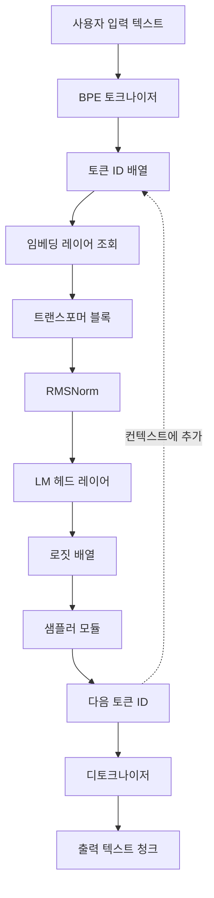
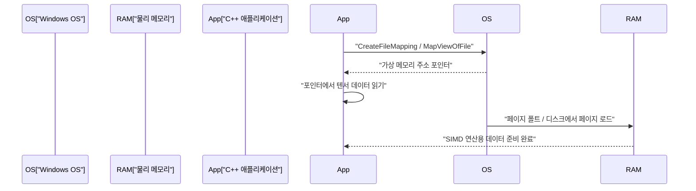
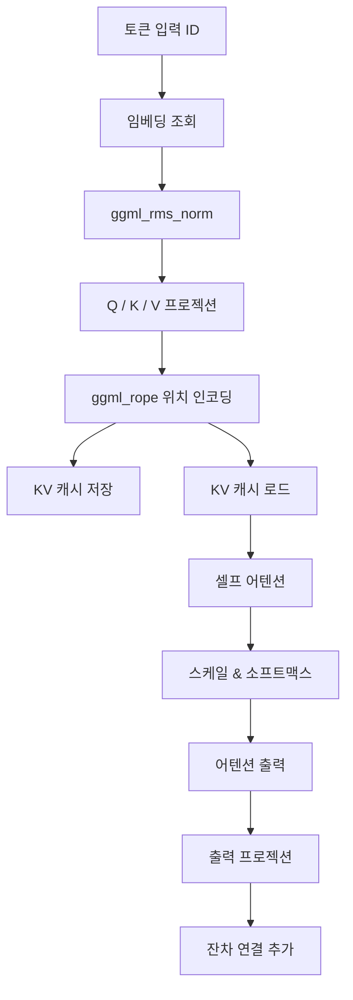

# C++로 소규모 LLM 추론 시작하기: TinyLlama, llama.cpp, ggml

> **범위와 정정:** 이 글은 추론 구조와 유지 관리되는 [llama.cpp](https://github.com/ggml-org/llama.cpp)의 빌드를 소개합니다. llama.cpp를 처음부터 완전히 재구현하는 안내가 아닙니다. llama.cpp는 [ggml](https://github.com/ggml-org/ggml)을 기반으로 합니다. 메모리와 속도 수치는 모델, 양자화, 컨텍스트 길이, 하드웨어, 빌드에 따라 달라지는 추정치입니다. mmap은 필요한 페이지를 읽을 뿐, 전체 처리 과정의 zero-copy나 물리 메모리 불필요를 보장하지 않습니다. 기존 CMake 예제는 작동하는 ggml 앱을 구성하지 못해 공식 빌드 절차로 교체했습니다.

> **구현 관련 보충 및 정정:** GGUF 텐서 오프셋은 `general.alignment`을 따르며(생략 시 기본값 32바이트), 항상 32 또는 64바이트인 것은 아닙니다. Q4_0은 값 32개, Q4_K는 값 256개 단위의 블록을 사용합니다. 11억 파라미터의 FP16 가중치만 약 2.2GB(2.05GiB)이며 단순 4비트 계산은 약 0.55GB입니다. 양자화 메타데이터, GGUF 오버헤드, 런타임 작업 공간, KV 캐시 때문에 실제 파일 및 RAM 요구량은 더 커집니다. ggml/llama.cpp의 할당 및 KV 캐시 방식은 버전·백엔드·설정에 따라 달라지므로 추론 중 할당이 전혀 없거나 최대 컨텍스트 전체를 항상 사전 할당한다고 가정하면 안 됩니다. TinyLlama 1.1B Chat 설정은 Query head 32개와 Key/Value head 4개입니다. 텐서 형태와 연산은 모델 설정 및 런타임에 맞춰야 합니다. 3~8절은 개념 설명이며 그대로 복사해 작동하는 자체 엔진을 만들 수 있는 절차가 아닙니다. GQA에서 KV 텐서를 명시적으로 복제하는 작업이 항상 필요한 것은 아니며, 연산과 텐서 형태는 런타임에 따라 다릅니다. 모델에 맞는 토크나이저, 특수 토큰, 채팅 템플릿을 사용하세요. GGUF는 널리 쓰이는 형식 중 하나이지 모든 모델과 런타임에서 항상 최선인 형식은 아닙니다. AVX2 같은 명령어 집합을 강제하기 전에 CPU 지원을 확인하고 공식 빌드의 백엔드 옵션을 따르세요.

## 1. 왜 C++와 ggml인가?

Python은 학습과 실험을 위한 풍부한 생태계를 제공합니다. C와 C++는 네이티브 앱 통합, 배포, 런타임 제어에 유용합니다. 모든 구성에서 C++가 자동으로 더 빠른 것은 아니며, 실제 성능은 모델·백엔드·하드웨어에 좌우됩니다.

## 2. 아키텍처의 전체 구조

추론 파이프라인 전체의 흐름을 아래 Mermaid 다이어그램에 나타냅니다. 사용자의 입력 텍스트부터 시작하여 최종적으로 다음 토큰이 생성될 때까지의 일련의 과정입니다.



자기 회귀 모델이므로 출력된 토큰은 다시 컨텍스트에 추가되어 다음 토큰 예측을 위한 입력으로 순환합니다(그림의 점선 부분).

---

## 3. 모델 포맷과 메모리 매핑 (mmap)

거대한 신경망의 가중치를 다루는 데 있어 가장 큰 장벽은 디스크 I/O와 메모리 소비입니다. C++ 구현에서는 이를 **메모리 매핑(mmap)** 으로 해결합니다.

### 3.1 메모리 매핑의 원리와 Windows에서의 구현

mmap을 사용하면 파일 내용을 프로세스의 가상 메모리 공간에 직접 매핑할 수 있습니다.

* **제로 카피(Zero-copy)**: 데이터는 디스크에서 커널의 페이지 캐시로 직접 로드되며 사용자 공간으로의 불필요한 복사가 발생하지 않습니다.
* **온디맨드 로드(Page Fault)**: 실제로 CPU가 해당 메모리 주소에 접근하는 순간 페이지 폴트가 발생하며, 필요한 청크(일반적으로 4KB)만 물리 메모리에 로드됩니다.

Windows 환경에서는 POSIX의 `mmap` 대신 [Win32](/ko/p/modern-cpp-win32-api-safe-handling/) API의 `CreateFileMapping`과 `MapViewOfFile`을 사용합니다.



### 3.2 GGUF 포맷의 바이너리 구조

Hugging Face 등의 `.safetensors` 포맷에서 변환된 **[GGUF](/ko/p/llama-cpp-quantization-gguf/) (GPT-Generated Unified Format)** 는 추론을 위한 궁극적인 포맷입니다. 다음과 같은 엄격한 바이너리 레이아웃을 갖습니다.

1. **Magic Bytes**: `0x46554747` ([GGUF](/ko/p/llama-cpp-quantization-gguf/)).
2. **Version**: 포맷의 버전 번호.
3. **Tensor Count & Metadata Count**: 텐서 개수와 메타데이터의 키-값 쌍 개수.
4. **Metadata ([Key-Value](https://kenji.blog/ko/p/nosql-database-selection-kvs-document-graph-wide-column/) Pairs)**: 문자열 길이 접두사가 붙은 키와 타입이 지정된 값.
5. **Tensor Info**: 각 텐서의 이름, 차원 수, 데이터 타입(FP16, Q4_K 등), 파일 내의 오프셋 위치.
6. **Padding**: 텐서 데이터가 특정 경계(일반적으로 32바이트 또는 64바이트)에 정렬되도록 삽입되는 패딩. SIMD 명령(특히 AVX)에서의 빠른 메모리 접근에 필수적입니다.
7. **Tensor Data**: 정렬된 실제 가중치 데이터 배열.

---

## 4. TinyLLaMA의 수학적 기반과 C++ 알고리즘

TinyLLaMA는 효율화를 위해 몇 가지 고도화된 아키텍처적 개선을 도입했습니다. 이를 C++로 올바르게 구현하기 위한 수식 표현을 해설합니다.

### 4.1 RMSNorm (Root Mean Square Normalization)

LayerNorm에서 평균 중심화(centering)를 생략하고 분산 스케일링만 수행함으로써 계산 비용을 절감합니다.

$$ \text{RMSNorm}(x) = \frac{x}{\sqrt{\frac{1}{d}\sum_{i=1}^{d} x_i^2 + \epsilon}} \odot \gamma $$

$d$는 차원 수, $\gamma$는 학습된 스케일링 텐서입니다.
C++로 구현할 경우 먼저 배열의 제곱합을 AVX2의 `_mm256_fmadd_ps` 등으로 빠르게 계산하고 역제곱근(`_mm256_rsqrt_ps` 명령 등)을 곱하여 최적화합니다.

### 4.2 RoPE (Rotary Position Embedding)

토큰의 위치 정보를 텐서 공간에서의 회전(Rotate)으로 적용하는 기술입니다. 복소 평면 위에서의 회전으로 간주할 수 있으며, 벡터 $x$의 인접한 차원 쌍 $(x_1, x_2)$에 대해 다음과 같은 회전을 적용합니다.

$$ \text{RoPE}(x, m) = \begin{pmatrix} x_{1} \cos(m\theta) - x_{2} \sin(m\theta) \\ x_{1} \sin(m\theta) + x_{2} \cos(m\theta) \end{pmatrix} $$

여기서 $m$은 토큰의 절대적인 위치 인덱스, $\theta$는 사전 계산된 기본 주파수입니다. ggml에서는 추론 그래프 구축 중에 `ggml_rope` 연산자를 추가하기만 하면 병렬로 실행됩니다.

### 4.3 Grouped-Query Attention (GQA)

일반적인 Multi-Head Attention(MHA)에서는 Query, Key, Value 각각에 대해 동일한 수의 헤드를 갖습니다. 그러나 TinyLLaMA는 메모리 대역폭과 KV 캐시 소비량을 극적으로 줄이기 위해 **Grouped-Query Attention(GQA)** 을 채택했습니다.

$$ \text{Attention}(Q, K, V) = \text{softmax}\left(\frac{Q K^T}{\sqrt{d_k}}\right) V $$

GQA에서는 여러 Query 헤드가 하나의 Key/Value 헤드를 공유합니다. C++ 구현에서는 행렬 곱 `ggml_mul_mat`를 실행하기 전에 KV 텐서를 Query의 수에 맞게 브로드캐스트하는 작업이 필요합니다.

### 4.4 SwiGLU 활성화 함수

Feed-Forward Network (FFN) 계층에서는 GELU 대신 SwiGLU가 사용됩니다.

$$ \text{SwiGLU}(x) = \text{Swish}(x W_{\text{gate}}) \otimes (x W_{\text{up}}) $$
$$ \text{Swish}(z) = z \cdot \sigma(z) = z \cdot \frac{1}{1 + e^{-z}} $$

계산 그래프에서는 `ggml_silu` 연산자와 `ggml_mul`을 조합하여 표현합니다.

---

## 5. ggml을 통한 계산 그래프 구축 및 메모리 관리

ggml은 추론을 위한 정적인 계산 그래프를 구축하고 이를 나중에 평가(evaluate)하는 'Define-and-Run' 방식을 취합니다.

### 5.1 ggml_context와 아레나 할당자

ggml의 가장 독특한 점은 추론 루프 내에서 동적인 메모리 할당(`malloc`이나 `new`)을 일절 수행하지 않는 '아레나 할당'입니다.
초기화 시 거대한 연속된 메모리 영역(아레나)을 확보하고, `ggml_new_tensor` 등을 호출할 때마다 이 영역의 [포인터](/ko/p/c-language-pointers-memory-management-stack-heap/)가 증가합니다. 추론의 1단계가 완료되면 할당 [포인터](/ko/p/c-language-pointers-memory-management-stack-heap/)를 초기 위치로 재설정하기만 하면 다음 추론 단계를 위한 메모리 확보가 즉시 완료됩니다.

### 5.2 그래프 구축의 구체적인 예

추론 단계마다 다음과 같은 계산 그래프를 메모리상에 조립합니다.



---

## 6. 양자화 (Quantization)와 Windows / SIMD 최적화

TinyLLaMA (1.1B)를 FP16으로 다루면 약 2.2GB의 메모리가 필요하지만, 4비트 양자화(Q4_K 등)를 통해 약 600MB 정도까지 극적으로 압축할 수 있습니다.

### 6.1 블록 양자화 아키텍처

ggml은 텐서 전체를 일률적으로 양자화하는 것이 아니라 '블록' 단위로 수행합니다.
`Q4_0` 포맷에서는 32개의 FP16 값을 1개의 블록으로 묶습니다.
- **스케일 팩터**: 1개의 FP16 값 (2바이트)
- **양자화 데이터**: 32개의 4비트 값 (16바이트)
이를 통해 국소적인 이상치의 영향을 최소화합니다.

### 6.2 AVX2를 통한 내적 연산 가속

Windows 환경의 최신 x86 CPU를 대상으로 빌드할 경우 `/arch:AVX2` 등의 컴파일러 플래그를 활용하여 다음과 같은 흐름으로 SIMD 처리가 이루어집니다.

1. **로드**: 256비트 AVX 레지스터에 메모리로부터 4비트 양자화 데이터를 로드합니다.
2. **전개 및 언팩**: 비트 마스크와 시프트 연산으로 4비트 값을 Int8 또는 Int16으로 전개합니다.
3. **역양자화**: 스케일 팩터를 곱하여 부동소수점으로 변환합니다.
4. **FMA 연산**: 활성화 값과 `_mm256_fmadd_ps`(Fused Multiply-Add)를 사용하여 곱셈-덧셈(積和) 연산을 병렬로 실행합니다.

---

## 7. KV 캐시의 구현 세부 사항

자기 회귀적 생성에 있어 과거 토큰의 Key와 Value 계산을 생략하기 위한 'KV 캐시'는 필수 기능입니다.

C++로 구현할 때의 핵심은 다음과 같습니다.
1. **텐서 사전 확보**: 최대 컨텍스트 길이(예: 2048 토큰)만큼의 거대한 텐서를 KV 캐시용으로 초기화합니다(FP16 권장).
2. **오프셋 복사**: 토큰 위치 $N$에 대한 계산이 수행되면 해당 단계에서 얻은 K와 V 벡터를 KV 캐시 텐서의 $N$번째 행에 `ggml_cpy` 등을 사용하여 저장(store)합니다.
3. **어텐션 시의 뷰 생성**: 어텐션을 계산할 때는 0부터 $N$번째 토큰 부분까지만 가리키는 '뷰(view)'를 생성하여 행렬 곱에 전달합니다.

---

## 8. BPE 토크나이저와 디코딩

입력 문자열을 UTF-8 바이트 열로 취급하여 사전에 정의된 어휘 사전(Vocabulary)과 대조합니다. C++에서는 어휘 사전 검색을 가속화하기 위해 **트라이 트리(Trie tree)** 나 우선순위 큐를 사용한 알고리즘을 구현합니다.

LM Head에서 출력되는 로짓(logit)에서는 Temperature 파라미터를 사용하여 확률을 스케일링하고 Top-K 추출이나 Top-P(Nucleus Sampling) 기법으로 후보를 좁힌 뒤, 난수를 사용하여 최종적인 다음 토큰을 결정합니다.

---

## 9. C++ 프로젝트 시작 (Windows / PowerShell 환경)

C++ 데스크톱 워크로드가 포함된 Visual Studio 2022와 CMake를 준비하고, [llama.cpp 공식 빌드 가이드](https://github.com/ggml-org/llama.cpp/blob/master/docs/build.md)에 따라 저장소를 빌드하세요. 이는 기존 추론 런타임을 빌드하는 절차이며 완성된 자체 추론 엔진을 만들지는 않습니다.

```powershell
git clone https://github.com/ggml-org/llama.cpp
Set-Location llama.cpp
cmake -B build
cmake --build build --config Release
```

llama.cpp와 호환되는 GGUF 모델을 별도로 구하고 라이선스와 출처를 확인하세요. [TinyLlama 모델 카드와 설정](https://huggingface.co/TinyLlama/TinyLlama-1.1B-Chat-v1.0)을 참고할 수 있습니다. 아래 경로는 로컬 파일로 바꾸고 채팅 템플릿과 양자화 유형을 확인하세요.

```powershell
.\build\bin\Release\llama-cli.exe -m "C:\models\model.gguf"
```

## 10. 요약

C++에서 로컬 LLM을 처음 실행할 때는 유지 관리되는 llama.cpp를 빌드하고 호환 GGUF 모델을 실행하는 방법이 현실적입니다. ggml 위에 엔진을 직접 만드는 것은 모델별 토크나이저, 연산자, 가중치 형식, KV 캐시, 백엔드, 검증까지 필요한 별도 프로젝트입니다.
