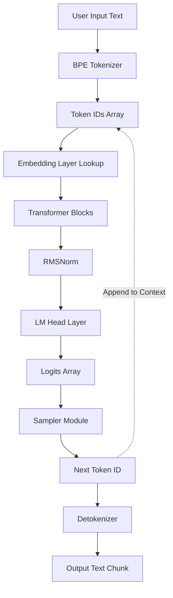
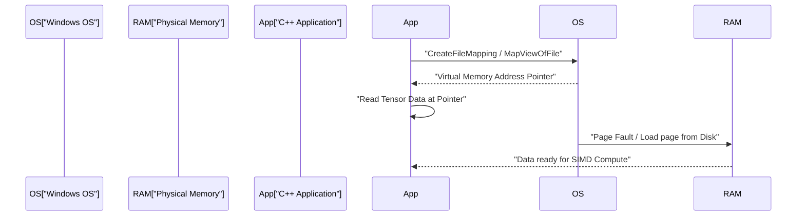
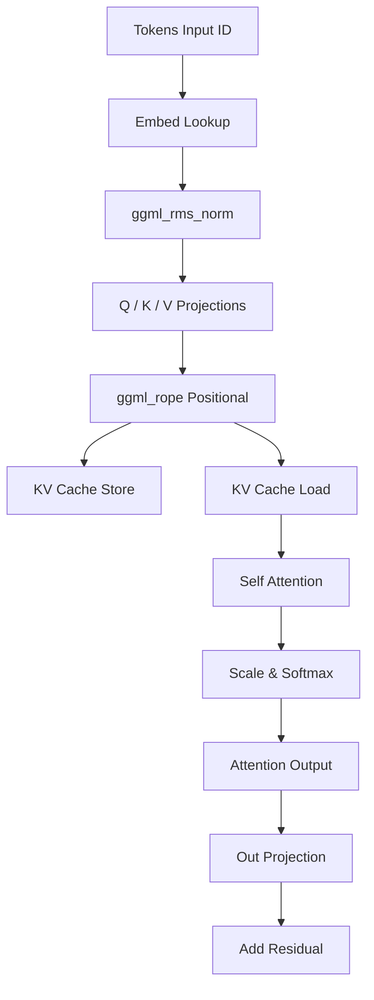

# C++で小規模LLM推論を始める：TinyLlama・llama.cpp・ggml

> **この記事の範囲と訂正**：これはllama.cppをゼロから再実装する完全な手順ではなく、推論の仕組みを理解し、保守されている[llama.cpp](https://github.com/ggml-org/llama.cpp)をビルドして試すための入門です。llama.cppは[ggml](https://github.com/ggml-org/ggml)を基盤にしています。メモリ・速度の数値は概算で、モデル、量子化、コンテキスト長、ハードウェア、ビルドに左右されます。mmapはオンデマンドのページ読込であり、処理全体のゼロコピーや物理メモリ不要を保証しません。下記の構成例は実在しないggmlソースを直結するため、公式CMake手順に置き換えました。

> **実装上の注意（本文の補足）**：GGUFのテンソル配置は `general.alignment`（省略時の既定値は32バイト）に従い、32/64バイトのどちらかに固定されるわけではありません。Q4_0は32値、Q4_Kは256値単位のブロック形式です。1.1BパラメータのFP16重みは理論上約2.2GB（約2.05GiB）、4bitの単純換算は約0.55GBですが、量子化メタデータ、GGUF、実行時ワーク領域、KVキャッシュなどが加わるため、実ファイルや必要RAMは増えます。ggml/llama.cppのメモリ確保やKVキャッシュの方式はバージョン・バックエンド・設定で異なり、推論中に確保がない、最大コンテキスト分を常に事前確保する、といった一般化はできません。TinyLlama 1.1B Chatの設定例は32個のQuery headと4個のKey/Value headです。形状や演算はモデル設定とランタイムに合わせてください。 セクション3～8は概念図であり、そのまま動く独自エンジンの実装手順ではありません。GQAで明示的なKV複製が常に必要とは限らず、演算とテンソル形状はランタイムに従います。トークナイザー、特殊トークン、チャットテンプレートもモデル固有のものを使ってください。GGUFは広く使われる形式の一つで、すべてのモデルやランタイムで唯一最適な形式という意味ではありません。AVX2などの命令セットを固定指定する場合はCPU対応を確認し、公式ビルドのバックエンド選択に従ってください。

## 1. なぜC++とggmlなのか？

Pythonは学習・実験向けの豊富なライブラリを備え、C/C++はネイティブアプリへの組み込み、配布、ランタイム制御に役立ちます。単純にC++の方が常に高速とは限らず、実測はモデル・バックエンド・ハードウェアに依存します。

## 2. アーキテクチャの全体像

推論[パイプライン](https://kenji.blog/p/cicd-pipeline-github-actions-best-practices/)全体の流れを以下のMermaidダイアグラムに示します。ユーザーの入力テキストから始まり、最終的に次のトークンが生成されるまでの一連のプロセスです。



自己回帰モデルであるため、出力されたトークンは再びコンテキストに追加され、次のトークン予測のための入力として循環します（図の点線部分）。

---

## 3. モデルフォーマットとメモリマッピング (mmap)

巨大なニューラルネットワークの重みを扱う上で最大の障壁となるのが、ディスクI/Oとメモリ消費です。C++実装ではこれを **メモリマッピング（mmap）** で解決します。

### 3.1 メモリマッピングの仕組みとWindowsでの実装

mmapを使用すると、ファイルの内容をプロセスの仮想メモリ空間に直接マッピングできます。

* **ゼロコピー（Zero-copy）**: データはディスクから直接カーネルのページキャッシュに読み込まれ、ユーザー空間への余分なコピーが発生しません。
* **オンデマンド・ロード（Page Fault）**: 実際にCPUがそのメモリ[アドレス](https://kenji.blog/p/c-language-pointers-memory-management-stack-heap/)にアクセスした瞬間に、ページフォールトが発生し、必要なチャンク（通常4KB）だけが物理メモリにロードされます。

Windows環境では、POSIXの `mmap` の代わりに[Win32](/p/modern-cpp-win32-api-safe-handling/) APIの `CreateFileMapping` と `MapViewOfFile` を使用します。



### 3.2 GGUFフォーマットのバイナリ構造

Hugging Face等の`.safetensors`フォーマットから変換された **[GGUF](/p/llama-cpp-quantization-gguf/) (GPT-Generated Unified Format)** は、推論のための究極のフォーマットです。以下のような厳密なバイナリレイアウトを持っています。

1. **Magic Bytes**: `0x46554747` ([GGUF](/p/llama-cpp-quantization-gguf/))。
2. **Version**: フォーマットのバージョン番号。
3. **Tensor Count & Metadata Count**: テンソル数とメタデータのキーバリューペア数。
4. **Metadata ([Key-Value](https://kenji.blog/p/nosql-database-selection-kvs-document-graph-wide-column/) Pairs)**: 文字列長プレフィックス付きのキーと、型付けされた値。
5. **Tensor Info**: 各テンソルの名前、次元数、データ型（FP16, Q4_Kなど）、ファイル内のオフセット位置。
6. **Padding**: テンソルデータが特定の境界（通常は32バイトまたは64バイト）にアライメントされるように挿入されるパディング。SIMD命令（特にAVX）での高速なメモリアクセスに不可欠です。
7. **Tensor Data**: アライメントされた実際の重みデータ配列。

---

## 4. TinyLLaMAの数学的基盤とC++アルゴリズム

TinyLLaMAは、効率化のためにいくつかの高度なアーキテクチャ上の工夫を取り入れています。これらをC++で正しく実装するための数式表現を解説します。

### 4.1 RMSNorm (Root Mean Square Normalization)

LayerNormから平均のセンタリングを省略し、分散のスケーリングのみを行うことで計算コストを削減します。

$$ \text{RMSNorm}(x) = \frac{x}{\sqrt{\frac{1}{d}\sum_{i=1}^{d} x_i^2 + \epsilon}} \odot \gamma $$

$d$は次元数、$\gamma$は学習済みのスケーリングテンソルです。
C++で実装する場合、まず配列の二乗和をAVX2の `_mm256_fmadd_ps` 等で高速に計算し、逆平方根（`_mm256_rsqrt_ps` 命令など）を掛けることで最適化します。

### 4.2 RoPE (Rotary Position Embedding)

トークンの[位置情報](/p/technology-gps/)をテンソル空間における回転（Rotate）として適用する技術です。複素数平面上での回転とみなすことができ、ベクトル $x$ の隣り合う次元ペア $(x_1, x_2)$ に対して以下のような回転を適用します。

$$ \text{RoPE}(x, m) = \begin{pmatrix} x_{1} \cos(m\theta) - x_{2} \sin(m\theta) \\ x_{1} \sin(m\theta) + x_{2} \cos(m\theta) \end{pmatrix} $$

ここで、$m$はトークンの絶対的な位置インデックス、$\theta$は事前に計算された基本周波数です。ggmlでは、推論[グラフ](https://kenji.blog/p/tree-graph-data-structures-search-dfs-bfs-dijkstra/)の構築中に `ggml_rope` オペレータを追加するだけで並列実行されます。

### 4.3 Grouped-Query Attention (GQA)

通常のMulti-Head Attention (MHA) では、Query、Key、Valueのそれぞれに対して同じ数のヘッドを持ちます。しかし、TinyLLaMAはメモリ帯域とKVキャッシュの消費量を激減させるために **Grouped-Query Attention (GQA)** を採用しています。

$$ \text{Attention}(Q, K, V) = \text{softmax}\left(\frac{Q K^T}{\sqrt{d_k}}\right) V $$

GQAでは、複数のQueryヘッドが1つのKey/Valueヘッドを共有します。C++実装では行列積 `ggml_mul_mat` を実行する前に、KVテンソルをQueryの数に合わせてブロードキャストする操作が必要になります。

### 4.4 SwiGLU 活性化関数

Feed-Forward Network (FFN) 層では、GELUの代わりにSwiGLUが用いられます。

$$ \text{SwiGLU}(x) = \text{Swish}(x W_{\text{gate}}) \otimes (x W_{\text{up}}) $$
$$ \text{Swish}(z) = z \cdot \sigma(z) = z \cdot \frac{1}{1 + e^{-z}} $$

計算[グラフ](https://kenji.blog/p/tree-graph-data-structures-search-dfs-bfs-dijkstra/)では `ggml_silu` オペレータと `ggml_mul` を組み合わせて表現します。

---

## 5. ggmlによる計算[グラフ](https://kenji.blog/p/tree-graph-data-structures-search-dfs-bfs-dijkstra/)の構築と[メモリ管理](https://kenji.blog/p/memory-management-garbage-collection/)

ggmlは、推論のための静的な計算[グラフ](https://kenji.blog/p/tree-graph-data-structures-search-dfs-bfs-dijkstra/)を構築し、それを後から評価（evaluate）する「Define-and-Run」のアプローチを取ります。

### 5.1 ggml_context とアリーナアロケータ

ggmlの最もユニークな点は、推論ループ内で動的なメモリ確保（`malloc` や `new`）を一切行わない「アリーナアロケーション」です。
初期化時に巨大な連続したメモリ領域（アリーナ）を確保し、`ggml_new_tensor` などを呼び出すたびに、この領域の[ポインタ](https://kenji.blog/p/c-language-pointers-memory-management-stack-heap/)がインクリメントされます。推論の1ステップが完了したら、アロケーション[ポインタ](/p/c-language-pointers-memory-management-stack-heap/)を初期位置にリセットするだけで、次の推論ステップのメモリ確保が即座に完了します。

### 5.2 [グラフ](https://kenji.blog/p/tree-graph-data-structures-search-dfs-bfs-dijkstra/)構築の具体例

推論ステップごとに、以下のような計算グラフをメモリ上に組み立てます。



---

## 6. 量子化 (Quantization) と Windows / SIMD 最適化

TinyLLaMA (1.1B) をFP16で扱うと約2.2GBのメモリが必要ですが、4ビット量子化（Q4_Kなど）により約600MB程度まで劇的に圧縮できます。

### 6.1 ブ[ロック](https://kenji.blog/p/rdbms-transaction-acid-isolation-level-lock/)量子化アーキテクチャ

ggmlはテンソル全体を一律に量子化するのではなく、「ブロック」単位で行います。
`Q4_0` フォーマットでは、32個のFP16値を1つのブ[ロック](https://kenji.blog/p/rdbms-transaction-acid-isolation-level-lock/)にまとめます。
- **スケールファクタ**: 1つのFP16値（2バイト）
- **量子化データ**: 32個の4ビット値（16バイト）
これにより、局所的な外れ値の影響を最小限に抑えています。

### 6.2 AVX2によるドット積の高速化

Windows環境の最新のx86 CPU向けにビルドする場合、`/arch:AVX2` などのコンパイラフラグを活用し、以下のようなフローでSIMD処理が行われます。

1. **ロード**: 256ビットのAVXレジスタに、メモリから4ビット量子化データをロード。
2. **展開とアンパック**: ビットマスクとシフト演算で、4ビット値をInt8またはInt16に展開。
3. **逆量子化**: スケールファクタを乗算して浮動小数点に変換。
4. **FMA演算**: アクティベーション値と `_mm256_fmadd_ps`（Fused Multiply-Add）で積和演算を並列実行。

---

## 7. KVキャッシュの実装詳細

自己回帰的生成において、過去のトークンのKeyとValueの計算を省略するための「KVキャッシュ」は必須機能です。

C++で実装する場合のポイントは以下の通りです。
1. **テンソルの事前確保**: 最大コンテキスト長（例: 2048トークン）分の巨大なテンソルをKVキャッシュ用に初期化します（FP16を推奨）。
2. **オフセットコピー**: トークン位置 $N$ に対する計算が行われると、そのステップで得られたKとVのベクトルをKVキャッシュテンソルの $N$ 行目に `ggml_cpy` 等を用いてストアします。
3. **アテンション時のビュー作成**: アテンションを計算する際は、0から $N$ 番目までのトークン部分だけを指し示す「ビュー」を作成して行列積に渡します。

---

## 8. BPE トークナイザーとデコーディング

入力文字列をUTF-8のバイト列として扱い、事前に定義されたボキャブラリーと照らし合わせます。C++では、ボキャブラリーの検索を高速化するために **Trie木（プレフィックスツリー）** や、優先度付きキューを用いたアルゴリズムを実装します。

LM Headから出力されるロジットからは、Temperatureパラメータを用いて確率をスケーリングし、Top-K抽出やTop-P（Nucleus Sampling）手法によって候補を絞り込み、乱数を用いて最終的な次のトークンを決定します。

---

## 9. C++プロジェクトの立ち上げ（Windows / PowerShell 環境）

Visual Studio 2022のC++デスクトップ開発環境とCMakeを用意し、[llama.cpp公式ビルドガイド](https://github.com/ggml-org/llama.cpp/blob/master/docs/build.md)に沿ってリポジトリをビルドします。これは動作する既存の推論ランタイムを構築する手順で、独自の推論エンジンを完成させるものではありません。

```powershell
git clone https://github.com/ggml-org/llama.cpp
Set-Location llama.cpp
cmake -B build
cmake --build build --config Release
```

別途、llama.cppと互換性のあるGGUFモデルを入手し、利用条件と配布元を確認してください。TinyLlamaのモデル設定は[モデルカードと設定](https://huggingface.co/TinyLlama/TinyLlama-1.1B-Chat-v1.0)を参照できます。以下のパスは手元のファイルに置き換えてください。モデルのチャットテンプレートと量子化方式も確認します。

```powershell
.\build\bin\Release\llama-cli.exe -m "C:\models\model.gguf"
```

## 10. まとめ

C++でローカルLLMを試す場合、まず保守されているllama.cppをビルドし、互換GGUFモデルを実行するのが現実的です。ggmlの内部APIやモデル実装をゼロから組み立てる場合は、モデル固有のトークナイザー、演算子、重み形式、KVキャッシュ、バックエンド対応まで別途実装・検証が必要です。
