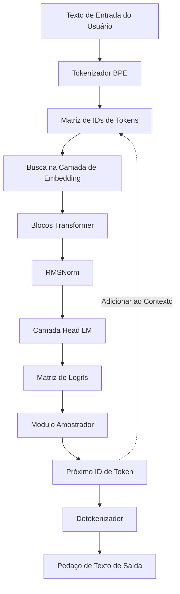
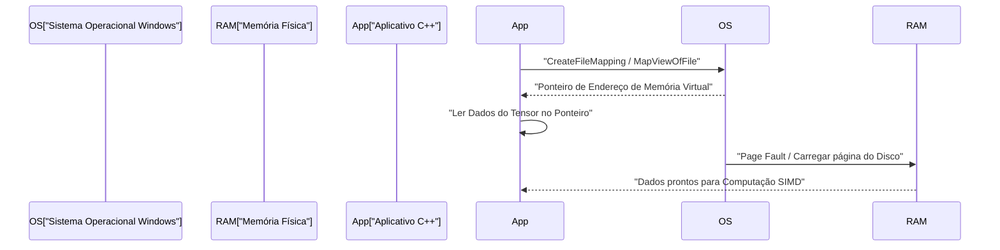
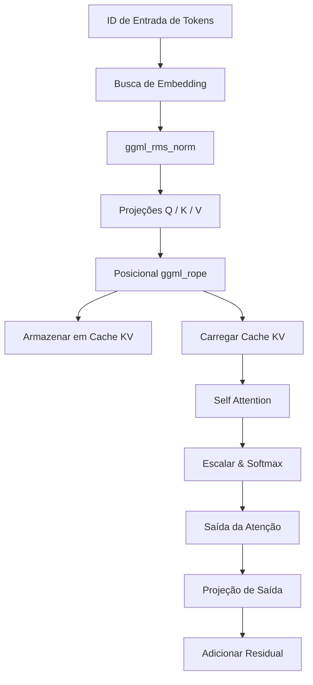

# Primeiros passos com inferência de LLMs pequenos em C++: TinyLlama, llama.cpp e ggml

> **Escopo e correções:** Este artigo apresenta a arquitetura de inferência e o build do projeto mantido [llama.cpp](https://github.com/ggml-org/llama.cpp); não é uma implementação completa do zero. O llama.cpp é baseado em [ggml](https://github.com/ggml-org/ggml). Os valores de memória e velocidade são estimativas que dependem do modelo, da quantização, do contexto, do hardware e do build. mmap carrega páginas sob demanda; não garante processamento sem cópias de ponta a ponta nem elimina o uso de memória física. O antigo exemplo CMake não formava um aplicativo ggml funcional e foi substituído pelo procedimento oficial.

> **Notas de implementação (correções ao texto):** Os offsets dos tensores GGUF seguem `general.alignment` (32 bytes por padrão quando omitido); o alinhamento não é sempre 32 ou 64 bytes. Q4_0 agrupa 32 valores e Q4_K, 256. Para 1,1 bilhão de parâmetros, somente os pesos FP16 ocupam cerca de 2,2 GB (2,05 GiB); a estimativa simples em 4 bits é cerca de 0,55 GB. Metadados de quantização, o contêiner GGUF, a área de trabalho e o cache KV aumentam o tamanho real e a RAM necessária. Alocação e cache KV no ggml/llama.cpp variam conforme versão, backend e configuração; não presuma inferência sem alocações nem reserva antecipada de todo o contexto máximo. TinyLlama 1.1B Chat usa 32 cabeças Query e 4 Key/Value; adapte formas e operações à configuração do modelo e ao runtime. As seções 3–8 são conceituais, não instruções copiáveis para criar um mecanismo próprio funcional. GQA nem sempre exige replicar explicitamente os tensores KV; operações e formas dependem do runtime. Use o tokenizador, os tokens especiais e o template de chat do próprio modelo. GGUF é um formato bastante usado, mas não é universalmente o melhor para todos os modelos e runtimes. Antes de forçar um conjunto de instruções como AVX2, verifique o suporte da CPU e siga as opções de backend do guia oficial.

## 1. Por que C++ e ggml?

Python oferece um ecossistema amplo para treinamento e experimentação. C e C++ são úteis para integração em aplicativos nativos, distribuição e controle do runtime. C++ não é sempre mais rápido por padrão; o desempenho medido depende do modelo, do backend e do hardware.

## 2. Visão Geral da Arquitetura

O fluxo completo do pipeline de inferência é mostrado no diagrama Mermaid abaixo. É um processo em série que começa com o texto de entrada do usuário até a geração final do próximo token.



Por ser um modelo autorregressivo, o token de saída é adicionado novamente ao contexto e circula como entrada para a previsão do próximo token (parte tracejada do diagrama).

---

## 3. Formato do Modelo e Mapeamento de Memória (mmap)

O maior obstáculo ao lidar com os pesos de uma rede neural gigantesca é a E/S de disco e o consumo de memória. Na implementação em C++, isso é resolvido com o **mapeamento de memória (mmap)**.

### 3.1 Mecanismo de Mapeamento de Memória e Implementação no Windows

O mmap permite mapear o conteúdo de um arquivo diretamente para o espaço de memória virtual do processo.

* **Zero-copy**: Os dados são lidos diretamente do disco para o cache de página do kernel, sem causar cópias extras para o espaço do usuário.
* **Carregamento sob Demanda (Page Fault)**: No exato momento em que a CPU acessa aquele endereço de memória, ocorre uma falha de página, e apenas o pedaço necessário (geralmente 4KB) é carregado na memória física.

No ambiente Windows, usa-se as APIs [Win32](/pt/p/modern-cpp-win32-api-safe-handling/) `CreateFileMapping` e `MapViewOfFile` em vez do `mmap` POSIX.



### 3.2 Estrutura Binária do Formato GGUF

O **[GGUF](/pt/p/llama-cpp-quantization-gguf/) (GPT-Generated Unified Format)**, convertido a partir de formatos como `.safetensors` do Hugging Face, é o formato definitivo para inferência. Ele possui o seguinte layout binário estrito:

1. **Magic Bytes**: `0x46554747` ([GGUF](/pt/p/llama-cpp-quantization-gguf/)).
2. **Version**: Número da versão do formato.
3. **Tensor Count & Metadata Count**: Número de tensores e número de pares chave-valor de metadados.
4. **Metadata ([Key-Value](https://kenji.blog/pt/p/nosql-database-selection-kvs-document-graph-wide-column/) Pairs)**: Chaves com prefixo de comprimento de string e valores tipados.
5. **Tensor Info**: Nome de cada tensor, número de dimensões, tipo de dados (FP16, Q4_K, etc.) e a posição de deslocamento no arquivo.
6. **Padding**: Preenchimento inserido para garantir que os dados do tensor sejam alinhados a um limite específico (geralmente 32 bytes ou 64 bytes). Isso é essencial para acessos rápidos à memória em instruções SIMD (especialmente AVX).
7. **Tensor Data**: A matriz real de dados de peso alinhados.

---

## 4. Base Matemática do TinyLLaMA e Algoritmo C++

O TinyLLaMA incorpora várias inovações arquitetônicas avançadas para maior eficiência. Explicaremos as representações matemáticas para implementá-las corretamente em C++.

### 4.1 RMSNorm (Root Mean Square Normalization)

Reduz o custo de cálculo ao omitir a centralização da média do LayerNorm e realizar apenas o dimensionamento da variância.

$$ \text{RMSNorm}(x) = \frac{x}{\sqrt{\frac{1}{d}\sum_{i=1}^{d} x_i^2 + \epsilon}} \odot \gamma $$

$d$ é o número de dimensões, e $\gamma$ é o tensor de escalonamento aprendido.
Ao implementar em C++, ele é otimizado primeiramente calculando rapidamente a soma dos quadrados da matriz com `_mm256_fmadd_ps` do AVX2, e multiplicando pela raiz quadrada inversa (como a instrução `_mm256_rsqrt_ps`).

### 4.2 RoPE (Rotary Position Embedding)

Esta é uma técnica para aplicar informações de posição de tokens como uma rotação no espaço tensorial. Pode ser vista como uma rotação no plano complexo, e aplica a seguinte rotação a pares de dimensões adjacentes $(x_1, x_2)$ do vetor $x$:

$$ \text{RoPE}(x, m) = \begin{pmatrix} x_{1} \cos(m\theta) - x_{2} \sin(m\theta) \\ x_{1} \sin(m\theta) + x_{2} \cos(m\theta) \end{pmatrix} $$

Aqui, $m$ é o índice absoluto de posição do token e $\theta$ é a frequência fundamental pré-calculada. No ggml, a execução paralela é feita simplesmente adicionando o operador `ggml_rope` durante a construção do grafo de inferência.

### 4.3 Grouped-Query Attention (GQA)

Na Multi-Head Attention (MHA) comum, há o mesmo número de cabeças para Query, Key e Value. No entanto, o TinyLLaMA adota o **Grouped-Query Attention (GQA)** para reduzir drasticamente o consumo de largura de banda de memória e cache KV.

$$ \text{Attention}(Q, K, V) = \text{softmax}\left(\frac{Q K^T}{\sqrt{d_k}}\right) V $$

No GQA, várias cabeças de Query compartilham uma única cabeça de Key/Value. Na implementação C++, antes de executar o produto de matrizes `ggml_mul_mat`, é necessária uma operação para transmitir (broadcast) os tensores KV para corresponder ao número de Queries.

### 4.4 Função de Ativação SwiGLU

Na camada Feed-Forward Network (FFN), SwiGLU é usado em vez de GELU.

$$ \text{SwiGLU}(x) = \text{Swish}(x W_{\text{gate}}) \otimes (x W_{\text{up}}) $$
$$ \text{Swish}(z) = z \cdot \sigma(z) = z \cdot \frac{1}{1 + e^{-z}} $$

No grafo computacional, isso é expresso pela combinação do operador `ggml_silu` com `ggml_mul`.

---

## 5. Construção de Grafo Computacional e Gerenciamento de Memória com ggml

O ggml adota uma abordagem "Define-and-Run", onde um grafo computacional estático para inferência é construído e então avaliado posteriormente.

### 5.1 ggml_context e Alocador de Arena

A característica mais singular do ggml é a "alocação de arena", que evita qualquer alocação dinâmica de memória (`malloc` ou `new`) dentro do loop de inferência.
Uma região contígua e gigante de memória (arena) é alocada no momento da inicialização, e toda vez que `ggml_new_tensor` é chamado, o ponteiro dessa região é incrementado. Quando uma etapa de inferência é concluída, simplesmente redefinir o ponteiro de alocação para a posição inicial conclui instantaneamente a alocação de memória para a próxima etapa de inferência.

### 5.2 Exemplo Concreto de Construção de Grafo

Para cada etapa de inferência, o seguinte grafo computacional é montado na memória.



---

## 6. Quantização (Quantization) e Otimização para Windows / SIMD

Lidar com o TinyLLaMA (1.1B) em FP16 requer cerca de 2.2GB de memória, mas por meio da quantização de 4 bits (como Q4_K), pode ser comprimido drasticamente para cerca de 600MB.

### 6.1 Arquitetura de Quantização em Bloco

O ggml não quantiza o tensor inteiro de maneira uniforme, mas o faz em unidades de "blocos".
No formato `Q4_0`, 32 valores FP16 são agrupados em um bloco.
- **Fator de escala**: 1 valor FP16 (2 bytes)
- **Dados quantizados**: 32 valores de 4 bits (16 bytes)
Isso minimiza a influência de outliers locais.

### 6.2 Aceleração de Produto Escalar com AVX2

Ao compilar para a CPU x86 mais recente no ambiente Windows, sinalizadores de compilador como `/arch:AVX2` são utilizados, e o processamento SIMD é realizado no fluxo abaixo.

1. **Carregar**: Dados quantizados de 4 bits são carregados da memória em registradores AVX de 256 bits.
2. **Expansão e Desempacotamento**: Os valores de 4 bits são expandidos para Int8 ou Int16 com máscaras de bits e operações de deslocamento.
3. **Desquantização**: O fator de escala é multiplicado para converter em ponto flutuante.
4. **Operação FMA**: Executa o cálculo paralelo de multiplicar e somar usando o valor de ativação e `_mm256_fmadd_ps` (Fused Multiply-Add).

---

## 7. Detalhes de Implementação do Cache KV

Na geração autorregressiva, o "cache KV" é um recurso indispensável para pular o cálculo de Key e Value dos tokens anteriores.

Os pontos da implementação em C++ são os seguintes:
1. **Alocação Prévia do Tensor**: Um tensor gigante para o tamanho máximo do contexto (ex: 2048 tokens) é inicializado para o cache KV (recomenda-se FP16).
2. **Cópia com Deslocamento**: Quando o cálculo para a posição $N$ do token for realizado, os vetores K e V obtidos nessa etapa são armazenados na $N$-ésima linha do tensor de cache KV usando `ggml_cpy` ou similares.
3. **Criação de Visualização na Atenção**: Ao calcular a atenção, uma "visualização" apontando apenas para a parte dos tokens de 0 a $N$ é criada e passada para a multiplicação de matrizes.

---

## 8. Tokenizador BPE e Decodificação

Trata as strings de entrada como sequências de bytes UTF-8 e as combina com um vocabulário pré-definido. Em C++, algoritmos utilizando **Árvore Trie (árvore de prefixo)** ou filas de prioridade são implementados para acelerar a busca no vocabulário.

A partir dos logits emitidos pelo LM Head, as probabilidades são escalonadas usando o parâmetro Temperature, os candidatos são reduzidos por meio da extração Top-K ou Top-P (Nucleus Sampling), e o próximo token final é determinado por meio de números aleatórios.

---

## 9. Configuração do Projeto C++ (Ambiente Windows / PowerShell)

Instale o Visual Studio 2022 com a carga de trabalho de desktop em C++ e o CMake; depois compile o repositório conforme o [guia oficial de build do llama.cpp](https://github.com/ggml-org/llama.cpp/blob/master/docs/build.md). Isso compila um runtime existente, não um engine de inferência completo próprio.

```powershell
git clone https://github.com/ggml-org/llama.cpp
Set-Location llama.cpp
cmake -B build
cmake --build build --config Release
```

Obtenha separadamente um modelo GGUF compatível com llama.cpp e confira a licença e a origem. O [cartão e a configuração do TinyLlama](https://huggingface.co/TinyLlama/TinyLlama-1.1B-Chat-v1.0) são referências úteis. Substitua o caminho abaixo pelo arquivo local e confira o template de chat e o tipo de quantização.

```powershell
.\build\bin\Release\llama-cli.exe -m "C:\models\model.gguf"
```

## 10. Resumo

Para a primeira execução local de um LLM em C++, compile o projeto mantido llama.cpp e execute um modelo GGUF compatível. Criar um engine diretamente sobre ggml é outro projeto e exige lidar com tokenização, operadores, formatos de pesos, cache KV, backends e validação específicos do modelo.
