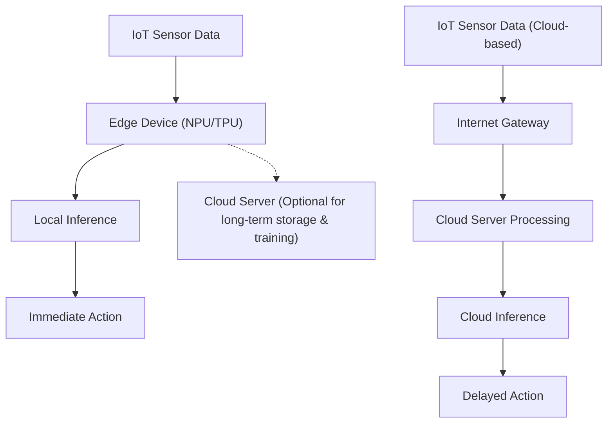
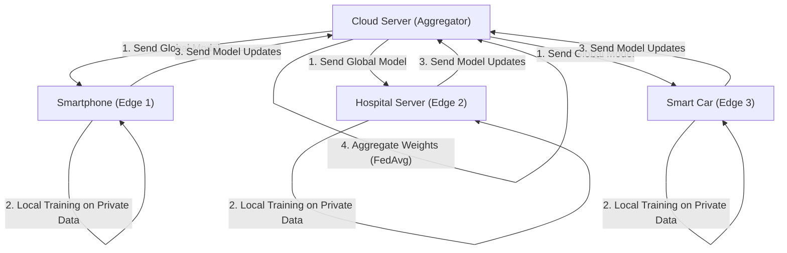

# [Edge AIの未来とIoTデバイスへの実装アプローチ](https://kenji.blog/p/edge-ai-future-iot-implementation/)

## 1. はじめに：なぜ今、エッジAI（Edge AI）なのか？

IoT（Internet of Things）デバイスの普及により、世界中のあらゆる物理的なモノがインターネットに接続される時代となりました。センサー技術の進化とともに、デバイスから生成されるデータ量は爆発的に増加しています。従来、これらの膨大なデータはクラウドに送信され、クラウド上の強力な計算資源（巨大なGPUクラスターなど）を用いてAIモデルによる推論が行われてきました。これが「クラウドAI」の一般的なアプローチです。

しかし、すべてのデータをクラウドに送信し、クラウドで処理して結果をデバイスに送り返すというアーキテクチャには、いくつかの重大な限界が存在します。
1. **レイテンシ（遅延）の問題** ：応答時間の制約が厳しいシステムでは、ネットワーク経路・混雑・再送・サーバー負荷による遅延やばらつきが設計上の課題になります。安全に関わる車両・産業設備の制御は、エッジ推論だけに依存せず、独立した安全機構と実環境での検証が必要です。
2. **プライバシーとセキュリティ** ：監視映像や生体データの処理を端末内で行えば、外部へ送る生データを減らせる場合があります。ただし、端末への不正アクセス、暗号鍵・モデル更新・ログ・通信経路の管理などのリスクは残り、オンデバイス処理だけでプライバシーや安全性が保証されるわけではありません。
3. **ネットワーク帯域とコスト** ：多数のデバイスが大きなデータを継続送信する設計では、帯域、転送料金、保存費用が課題になることがあります。必要なデータ量と料金は、実際の送信頻度・圧縮・契約条件に基づいて見積もる必要があります。
4. **接続の安定性（[オフライン](https://kenji.blog/p/pwa-progressive-web-apps-service-worker/)環境）** ：接続が不安定または利用できない場所で、機能の一部を端末上で継続する設計が役立つ場合があります。必要な機能や安全な停止動作は用途ごとに定義します。

こうした要件への選択肢の一つが、 **「Edge AI（エッジAI）」** です。Edge AIは、データを生成するIoTデバイス、またはその近くのネットワーク機器でAI推論などを実行する構成を指します。通信量やクラウドへの依存を抑えられる場合がありますが、遅延・費用・安全性・プライバシー上の効果は、モデル、端末、アプリケーション全体の設計と測定結果で判断します。

本記事では、Edge AIの構成、アクセラレーター、量子化・枝刈り、ONNX Runtime、Federated Learning（連合学習）を概説します。製品仕様やソフトウェア対応は更新されるため、実装時は対象端末・モデル・ランタイムの公式資料と実測で確認してください。

---

## 2. クラウドAIとエッジAIのアーキテクチャ比較

クラウドAIとエッジAIの違いを視覚的に理解するために、以下のアーキテクチャ図を参照してください。



この図からわかるように、Edge AIのアーキテクチャではデータの発生源から推論、そしてアクション（制御）までのループがエッジデバイス内で完結しています。クラウドはあくまで学習済みモデルの配信や、長期的なデータの集約・傾向分析といった非リアルタイムな補助的役割に回ります。

### 推論レイテンシの数学的モデル

エッジとクラウドにおける遅延を比較する簡略モデルを考えます。システム全体の推論完了までの時間 $T_{total}$ は、前処理、通信、待ち行列、推論、後処理などで構成されます。以下は通信と推論を分けた概略で、実際には各項目を対象システムで測定します。

**クラウドAIの場合:**
$$ T_{total} = T_{pre} + T_{up} + T_{queue} + T_{compute} + T_{down} + T_{post} $$

単純化したアップロード・ダウンロード時間は、次のように近似できます。

$$ T_{up} \approx L_{up} + \frac{D}{B_{up}}, \quad T_{down} \approx L_{down} + \frac{R}{B_{down}} $$

ここで $D$ と $R$ は送受信データ量、$B_{up}$ と $B_{down}$ は実効帯域幅、$L_{up}$ と $L_{down}$ は片方向の伝搬・接続遅延です。RTT（往復遅延）を使う場合は、片方向遅延と重複して加算しないようにします。実際の遅延には、再送、プロトコル、キュー、前後処理なども影響します。

送信量が大きい、または実効帯域幅が小さいと通信がボトルネックになることがあります。どの処理が支配的かは、往復の応答時間を含めたエンドツーエンドの測定で確認します。

**Edge AIの場合:**
$$ T_{total} = T_{pre} + T_{local\_transfer} + T_{inference} + T_{post} $$

ローカルで完結する処理では、クラウドとの往復通信を省ける一方、前処理、端末内転送、推論、後処理の遅延は残ります。エッジとクラウドのどちらが速いかは、モデル、ハードウェア、ネットワーク、負荷に依存するため、対象端末で比較します。

---

## 3. エッジAIを支えるハードウェア技術

エッジデバイス上でディープラーニングモデルを高速に実行するためには、専用のハードウェアアクセラレータが不可欠です。従来のCPUによる処理では、電力消費と処理速度の観点からリアルタイムなAI推論は困難でした。ここでは、代表的なEdge AI向けハードウェアを紹介します。

### 3.1 NPU (Neural Processing Unit) と TPU (Tensor Processing Unit)
ディープラーニングの推論プロセス（特にCNN等の推論）は、大量の行列積和演算（MAC演算：Multiply-Accumulate）で構成されています。NPUやTPUは、このMAC演算を並列かつ超低消費電力で実行するために特化した専用チップ（ASIC）です。

- **Google Coral Edge TPU**:
  Coralの資料では、Edge TPUは4 TOPS・2Wのアクセラレーターとして説明されています。このピーク値だけでアプリの速度や消費電力は判断できません。Edge TPU Compilerが対応する演算子・量子化形式などの条件を満たすモデルを用い、対象ボードで測定します。
- **Raspberry Pi AI Kit / AI HAT**:
  Raspberry Pi AI KitはHailo-8L搭載の13 TOPSモデルでしたが、現在は生産終了で、新規構成ではAI HAT+系が案内されています。AI HAT+にはHailo-8L（13 TOPS）とHailo-8（26 TOPS）の構成があり、AI HAT+ 2は別のHailo-10H（40 TOPS、INT4）構成です。TOPS値、対応モデル、消費電力は製品・精度・ソフトウェア条件を揃えて比較してください。
- **[NVIDIA](/p/history-of-nvidia/) Jetson シリーズ**:
  Jetson製品にはCPU・GPUを組み合わせたモジュールがあり、CUDAやTensorRTを使える構成があります。モデル変換、演算子対応、メモリ、電力、ソフトウェア版によって移植性と性能は異なるため、対象製品のサポート状況を確認します。

### TOPSと電力効率（TOPS/W）
TOPS/Wは、特定条件での理論ピーク演算量と電力の比を表す一つの指標です。精度形式、対応演算子、メモリ転送、バッチサイズ、測定時の電力範囲が違う製品どうしを単純比較することはできません。実際のモデルと入力を使い、必要な精度・遅延・スループットを満たすシステム全体の電力を測定します。

---

## 4. エッジデバイスへの実装：モデル軽量化の理論と実践

端末のメモリや電力には制約があり、大きなモデルの実行が難しい場合があります。一方、必要なメモリは重みだけでなく、活性値、ワークスペース、ランタイム、入出力、生成AIではKVキャッシュなどにも左右され、端末やモデルによって異なります。量子化や枝刈りは選択肢の一つですが、対象ハードウェアで精度・メモリ・遅延を測定して採用を判断します。

### 4.1 モデルの量子化（Quantization）

深層学習モデルは通常、32ビット浮動小数点（FP32）で重みや活性化関数が表現されています。量子化とは、これらを16ビット（FP16）、8ビット整数（INT8）、あるいはさらに低ビットへと精度を落とす技術です。

**メモリ削減効果**:
パラメータ数を $N$ とすると、必要なメモリ量は以下のように計算されます。
$$ M_{FP32} = N \times 4 \text{ (Bytes)} $$
$$ M_{INT8} = N \times 1 \text{ (Bytes)} $$
重みだけをFP32からINT8へ置き換える理想条件では、その重みの格納量は約 $\frac{1}{4}$ になります。モデル全体のファイルサイズや推論時メモリが必ず同じ比率で減るわけではありません。速度・電力・精度への効果はモデル、量子化方法、ランタイム、対象ハードウェアに依存し、実測が必要です。

**量子化の数理モデル**:
実数 $r$ （FP32）を、整数 $q$ （INT8: -128 〜 127）にマッピングするための基本的なアフィン量子化式は以下の通りです。

$$ r = S \times (q - Z) $$
$$ q = \text{round}\left( \frac{r}{S} + Z \right) $$

ここで、$S$ はスケールファクタ（Scale）、$Z$ はゼロポイント（Zero-point: 実数の0を整数型のどの値にマッピングするか）を表します。

量子化には、学習済みモデルを変換する **Post-Training Quantization (PTQ)** と、学習時に量子化の影響を模擬する **Quantization-Aware Training (QAT)** があります。どちらを使うかは、精度要件、利用可能な学習データ、変換ツール、配備先での測定結果に基づいて選びます。QATも精度を保つ保証ではありません。

### 4.2 モデルの枝刈り（Pruning）

ニューラルネットワークには、最終的な推論結果に対してほとんど影響を与えない（重要度の低い）重みが多数存在します。これらの不要な重みをゼロにする、あるいはネットワークの構造自体から削除する技術が枝刈り（Pruning）です。

**Sparsity（スパース性 / 疎性）の定義**:
$$ \text{Sparsity} (S) = \frac{N_{zero}}{N_{total}} \times 100 \text{ (\%)} $$
ここで $N_{zero}$ はゼロにされた重みの数、$N_{total}$ はモデル全体の重みの総数です。

- **非構造化枝刈り（Unstructured Pruning）**: 個々の重みを独立してゼロにする手法。Sparsityは高くなりますが、重み行列が疎行列（Sparse Matrix）になるだけであり、一般的なCPU/GPUではメモリアクセスパターンが不規則になるため、期待したほどの高速化が得られない場合があります。
- **構造化枝刈り（Structured Pruning / Channel Pruning）**: 畳み込み層のフィルタやチャネルを削除する手法です。対応する演算量や重みを減らせる場合がありますが、精度への影響や実際の速度・メモリ改善は、モデル構造、ハードウェア、ランタイムに依存します。

畳み込み層で入力・出力チャネルをそれぞれ $1-c_{in}$、$1-c_{out}$ の割合で残す場合、理想化したMAC演算数の比は次のようになります。

$$ \frac{MAC_{new}}{MAC_{old}} \approx (1-c_{in})(1-c_{out}) $$

これは演算数の概算であり、実測レイテンシの予測式ではありません。枝刈り後に対象ランタイムが使える密な演算へ変換できるかを含め、精度と遅延を実機で評価します。

---

## 5. デプロイメントと推論エンジン：ONNX Runtimeの活用

軽量化されたモデルを実際にエッジデバイスで動かすためには、軽量かつマルチプラットフォームに対応した推論エンジンが必要です。現在、業界標準として広く使われているのが **ONNX (Open Neural Network Exchange)** と **ONNX Runtime** です。

ONNXは、対応するフレームワークや演算子の間でモデルを交換するための共通形式の一つです。ONNX RuntimeはONNXモデルを実行するランタイムで、最適な性能が自動的に得られることや、すべての演算子・ハードウェアへの対応を保証するものではありません。

**Execution Providers (EP)** は、利用可能なプロバイダーへモデルのノードやサブグラフを割り当てます。対応しない演算子が別プロバイダー（多くの場合CPU）に割り当てられることがあり、転送コストやフォールバックで性能が変わります。プロバイダー名を指定するだけでモデル全体がその装置で最適に動くとは限らないため、割り当て状況と実測を確認します。

以下はCPUプロバイダーを使う最小限の推論例です。入力の型・形状はモデル仕様に合わせる必要があり、初回呼び出しには初期化時間が含まれます。これは性能比較用のベンチマークではありません。

```python
import onnxruntime as ort
import numpy as np
import time

def run_edge_inference(model_path, input_data):
    # CPUプロバイダーを使う最小例。ほかのEPの名称・設定・対応演算子は
    # 使用するONNX Runtimeビルドと対象ハードウェアの公式資料で確認する。
    providers = ['CPUExecutionProvider']
    
    # セッションの初期化 (モデルのロードとグラフ最適化)
    session = ort.InferenceSession(model_path, providers=providers)
    
    # モデルの入力名と入力シェイプの取得
    input_name = session.get_inputs()[0].name
    expected_shape = session.get_inputs()[0].shape
    print(f"Expected input shape: {expected_shape}")
    
    # 推論時間の計測
    start_time = time.time()
    
    # 推論の実行
    # 入力データは適切なNumpy配列 (例: np.float32 または np.int8) として渡す
    outputs = session.run(None, {input_name: input_data})
    
    latency = (time.time() - start_time) * 1000.0 # ミリ秒に変換
    print(f"Inference Latency: {latency:.2f} ms")
    
    return outputs[0]

# ダミー入力データ (例: 224x224のRGB画像バッチサイズ1)
dummy_input = np.random.randn(1, 3, 224, 224).astype(np.float32)
# run_edge_inference("lightweight_model.onnx", dummy_input)
```

言語をC++に変えるだけでレイテンシが低下したり、ハードウェア性能を最大化できたりするわけではありません。入出力、スレッド設定、EPの割当、前後処理を含めて計測し、要件に応じて実装を選びます。

---

## 6. プライバシー保護と分散学習：フェデレーテッド・ラーニング（Federated Learning）

Edge AIの究極の進化形の一つが、モデルの「推論」だけでなく「学習」までもエッジに分散させる **Federated Learning（連合学習）** です。

従来の機械学習では、すべてのIoTデバイスから生データ（映像、音声、ログなど）をクラウドに集約し、一括でモデルを学習させていました。しかし、個人のスマートフォンや医療機器のデータをクラウドに集約することは、深刻なプライバシーリスクを伴います。

Federated Learningは生データを中央に集めずに学習する設計の選択肢ですが、共有される更新値から情報が推測される可能性など、プライバシー上のリスクが残ります。



**Federated Learningのプロセス**:
1. クラウドサーバー（アグリゲーター）が、初期化された「グローバルモデル」を各エッジデバイスに配信します。
2. 各クライアントはローカルデータでモデルを学習します。学習データを中央に集めない設計ですが、端末のログやテレメトリーなど別の経路でデータが送られないことも確認します。
3. クライアントはローカル更新を送信し、サーバーが集約します。勾配や更新値だけを共有しても、学習データの情報が漏れる可能性はゼロではありません。
4. 必要な脅威モデルに応じて、セキュア集約、差分プライバシー、アクセス制御、暗号化、保持期間などの対策を評価します。これらにも実装条件や精度・通信上のトレードオフがあります。

**Federated Averaging (FedAvg) の数理モデル**:
最も代表的な集約アルゴリズムであるFedAvgの更新式は以下のようになります。
全体で $K$ 個のクライアントがあり、各クライアント $k$ のサンプル数を $n_k$、$N = \sum_{k=1}^{K} n_k$ とします。クライアントが現在のモデル $w_t$ をローカル学習した結果を $w_{t+1}^k$ とすると、標準的なFedAvgの重み平均は次の形で表せます。

$$ w_{t+1} = \sum_{k=1}^{K} \frac{n_k}{N} w_{t+1}^k $$

ここで $w_{t+1}^k$ はクライアント $k$ のローカル学習後のモデルです。この式は重みの集約を表し、差分を送る方式では差分の集約後に $w_t$ へ加算します。FedAvgが常に中央学習と同等の結果になるわけではなく、データ分布、参加率、ローカル更新回数、学習率などが結果に影響します。重みの集約だけではプライバシーは保証されません。

---

## 7. IoTデバイスへの実装ユースケース

Edge AIは、用途や要件に応じて産業システムに適用されています。以下は構成例であり、モデルの精度や安全性を保証するものではありません。

### 7.1 スマートマニュファクチャリングと予知保全 (Predictive Maintenance)
モーターなどの振動・音響データを端末やエッジサーバーで分析し、異常候補を知らせる構成が考えられます。サンプリング、通信、モデルの偽陽性・偽陰性を検証し、停止などの安全関連制御は認証済み・独立した安全機構と適用規格に従って設計します。

### 7.2 スマート農業 (Smart Agriculture)
通信状況に応じて、ドローンや現地端末で画像の候補抽出を行い、必要な結果だけを送る構成が考えられます。害虫・病害の識別精度は作物、撮影条件、地域で検証し、農薬散布の判断は現地の規制と専門家による確認を含めて設計します。特定モデル名や自動散布による効果を一般化することはできません。

### 7.3 医療用ウェアラブルデバイス
スマートウォッチや心電計で、リズムの異常候補を端末上で提示する製品があります。モデル結果は医療診断を自動的に確定するものではなく、用途に応じた臨床評価・規制上の手続き・医療従事者の関与が必要になる場合があります。端末内処理だけでHIPAAその他のプライバシー法令・医療機器要件への適合が保証されるわけではありません。

---

## 8. エッジAIの課題と未来の展望

Edge AIの技術は急速に発展していますが、まだ多くの課題と興味深い未来の展望が存在します。

**1. エッジでの[LLM](https://kenji.blog/p/large-language-models-llm-transformer-prompt-engineering/)（[大規模言語モデル](https://kenji.blog/p/large-language-models-llm-transformer-prompt-engineering/)）の稼働**:
小型言語モデルを端末で動かす構成は、対応メモリ、アクセラレーター、ランタイムが揃う場合に選択できます。量子化は必要メモリを減らせることがありますが、精度や対応演算子にも影響します。モデル名・ライセンス・端末性能は変化するため、対象用途で品質、遅延、電力、プライバシーを測定します。オフライン利用にはモデル等を事前に端末へ配置する必要があります。

**2. ニューロモルフィック・コンピューティングとSNN**:
ニューロモルフィックチップやスパイキング・ニューラル・ネットワーク（SNN）は研究・開発が続く選択肢です。イベント駆動型の計算は特定の用途で電力効率に利点を持つ可能性がありますが、一般的なモデルに対する倍率や製品の省電力効果を一律に示すことはできません。対象ワークロードと実機で比較します。

**3. MLOpsならぬEdgeOpsの確立**:
数千〜数万台に及ぶ世界中に散らばったエッジデバイスに対し、どのように安全にモデルのアップデート（OTA: Over-The-Airアップデート）を配信し、稼働中のモデルの精度劣化（データドリフト）を監視するかという運用の課題です。デバイスごとにハードウェアアーキテクチャが異なるヘテロジニアスな環境におけるデプロイメントの自動化は、今後最も需要が高まるエンジニアリング領域です。

---

## 9. おわりに

Edge AIは、クラウドと端末の機能をどう分担するかを決める設計上の選択肢です。通信量や応答時間を抑えられる場合がありますが、プライバシー保護やコスト削減は自動的に実現しません。対象システム全体で要件とトレードオフを評価します。

量子化、枝刈り、蒸留などの手法と専用ハードウェアは、モデルの配備先を広げる助けになることがあります。ただし、実行可能なモデル規模、精度、遅延、電力は端末とソフトウェアに依存し、数値は実際の構成で測る必要があります。

さらに、Federated Learningのような分散学習アプローチや、Edgeでの生成AI（SLM）の稼働など、技術のフロンティアは急速に広がっています。エンジニアやアーキテクトにとって、クラウドの巨大なリソースに頼るだけでなく、「いかに限られたリソースのエッジで最大のインテリジェンスを発揮させるか」を追求することは、今後最も挑戦的でエキサイティングな課題となるでしょう。

IoTでEdge AIを採用する際は、モデル単体の性能だけでなく、更新、監視、通信障害時の挙動、セキュリティ、安全性まで含めて設計することが重要です。

---
*この記事は、IoTデバイスへのAI実装に関心を持つエンジニアおよびシステムアーキテクト向けに作成されました。*

## 実装上の注意と一次資料

遅延の式は簡略モデルです。RTT（往復遅延）は往復を含むため、測定定義をせず片方向遅延へ重ねて加算しないでください。待ち行列、再送、前後処理、端末内転送も含め、対象システム全体でエンドツーエンドの遅延を測定します。エッジ実行で遅延が必ず下がるわけではありません。

FP32からINT8への例は重みの格納量だけを数えています。実行時メモリには活性値、ワークスペース、入出力、生成AIではKVキャッシュも含まれます。量子化や枝刈りは精度・電力・速度に影響する場合があり、TOPS/Wや理想的なMAC演算数はアプリケーションのベンチマークではありません。実際のモデルと負荷で測定してください。Raspberry Pi AI Kitは生産終了しており、新規設計ではRaspberry PiがAI HAT+またはAI HAT+ 2を案内しています。Coral Edge TPUのモデルはコンパイラーと対応演算子の要件を満たす必要があります。

ONNX Runtimeは、モデルのノードやサブグラフを異なるExecution Providerへ割り当てる場合があります。未対応の演算子はCPUなど別のプロバイダーへフォールバックすることがあり、プロバイダー名の指定だけでモデル全体の高速化や最適な性能は保証されません。

連合学習では学習データを分散したままにできますが、共有した勾配やモデル更新から情報が推測される可能性があります。それだけでプライバシーが保証されるわけではありません。セキュア集約、差分プライバシー、アクセス制御、ログ、脅威モデルを評価します。FedAvgはローカル学習後のモデル重み（またはグローバルモデルからの差分）を集約する手法で、中央学習と同じ結果を保証しません。

産業・医療の例は構成例です。安全に関わる制御には独立した安全機構と検証が必要です。端末内推論だけで臨床的妥当性やHIPAA、プライバシー法、医療機器規制への適合が証明されるわけではなく、要件は意図する用途と法域に依存します。

一次資料: [Raspberry Pi AI HAT公式資料](https://www.raspberrypi.com/documentation/accessories/ai-hat-plus.html)、[Coral公式資料](https://coral.ai/docs/)、[ONNX Runtimeアーキテクチャ](https://onnxruntime.ai/docs/reference/high-level-design.html)、[NIST: 連合学習におけるプライバシー攻撃](https://www.nist.gov/blogs/cybersecurity-insights/privacy-attacks-federated-learning)、[FDA: Software as a Medical Device](https://www.fda.gov/medical-devices/digital-health-center-excellence/software-medical-device-samd)、[TensorFlowモデル最適化](https://www.tensorflow.org/model_optimization/guide)。


