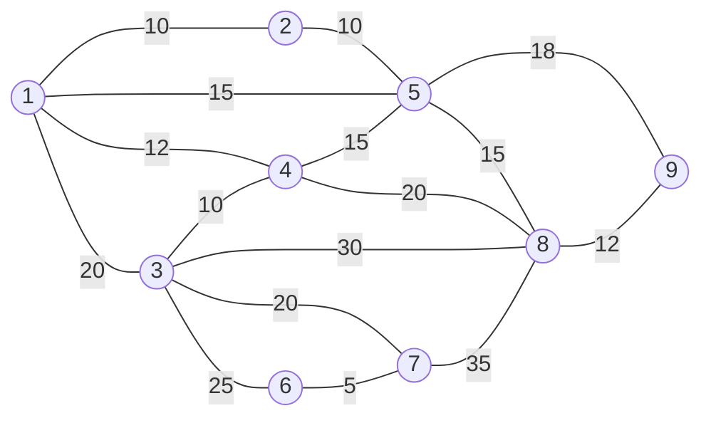

# كيفية حل مشكلة بائع المتجول (TSP) باستخدام Mathematica

## مشكلة

يمثل هذا المثال مسألة البائع المتجول بين تسع مدن كرسم بياني غير موجه، وأوزان حوافه هي المسافات. يوضح الرسم الحواف والمسافات المستخدمة.

**رسم المسافات:**



## حل

```wolfram
d=SparseArray[{{1,2}->10,{2,1}->10,{1,5}->15,{5,1}->15,{1,4}->12,{4,1}->12,{1,3}->20,{3,1}->20,{2,5}->10,{5,2}->10,{3,4}->10,{4,3}->10,{3,8}->30,{8,3}->30,{3,7}->20,{7,3}->20,{3,6}->25,{6,3}->25,{4,5}->15,{5,4}->15,{4,8}->20,{8,4}->20,{5,9}->18,{9,5}->18,{5,8}->15,{8,5}->15,{6,7}->5,{7,6}->5,{7,8}->35,{8,7}->35,{8,9}->12,{9,8}->12},{9,9},Infinity];
```

تحدد الوسيطة الثانية `{9,9}` في `SparseArray` أبعاد المصفوفة (9 في 9). والوسيطة الثالثة `Infinity` هي القيمة الافتراضية للعناصر غير المحددة. يعني ذلك هنا عدم السماح برحلة مباشرة بين المدن غير المدرجة في القائمة. أُدرجت كل حافة في الاتجاهين كي تكون المسافات متناظرة.

```wolfram
{len,tour}=FindShortestTour[{1,2,3,4,5,6,7,8,9},DistanceFunction->(d[[#1,#2]]&)]
```

تعيد `FindShortestTour` دورة مغلقة تمر بالمدن المحددة؛ وتتضمن النتيجة المسافة الإجمالية وترتيب المدن. وتشمل المسافة حافة العودة من المدينة الأخيرة إلى الأولى.

## انتاج

```wolfram
{137, {1, 2, 5, 9, 8, 7, 6, 3, 4}}
```

يوجد في جدول المسافات هذا مساران دائريان أقصر بطول 137، ويكون المسار المعكوس لأي منهما بالطول نفسه. قد يختلف ترتيب الحل الأمثل المعروض باختلاف إصدار Mathematica أو ترتيب البحث. تزداد صعوبة البحث بسرعة مع زيادة عدد المدن؛ لذا ينبغي اختيار طريقة تحسين مناسبة للمسائل الكبيرة.

الوثائق الرسمية: [FindShortestTour](https://reference.wolfram.com/language/ref/FindShortestTour.html) و[SparseArray](https://reference.wolfram.com/language/ref/SparseArray.html).
