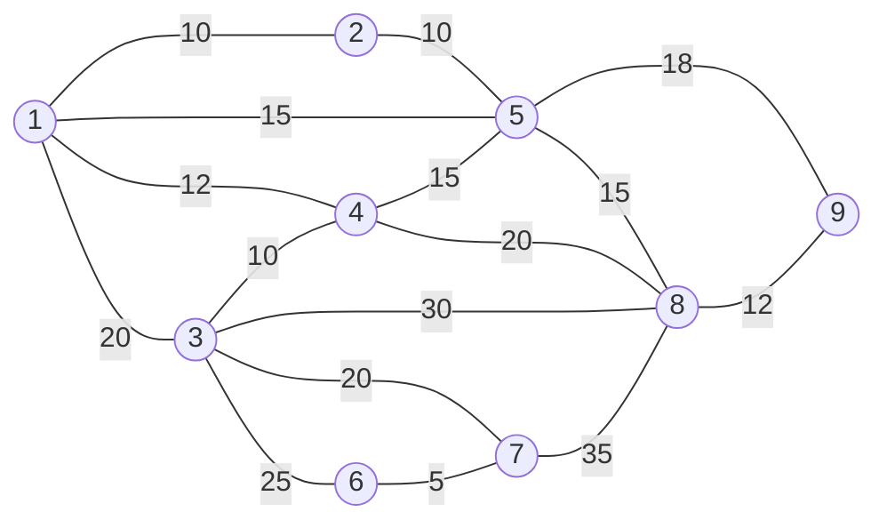

# Wie man das Problem des Handlungsreisenden (TSP) mit Mathematica löst

## Problem

Dieses Beispiel modelliert das Rundreiseproblem mit neun Städten als ungerichteten Graphen, dessen Kantengewichte Entfernungen sind. Die Abbildung zeigt die verwendeten Kanten und Entfernungen.

**Entfernungsgraph:**



## Lösung

```wolfram
d=SparseArray[{{1,2}->10,{2,1}->10,{1,5}->15,{5,1}->15,{1,4}->12,{4,1}->12,{1,3}->20,{3,1}->20,{2,5}->10,{5,2}->10,{3,4}->10,{4,3}->10,{3,8}->30,{8,3}->30,{3,7}->20,{7,3}->20,{3,6}->25,{6,3}->25,{4,5}->15,{5,4}->15,{4,8}->20,{8,4}->20,{5,9}->18,{9,5}->18,{5,8}->15,{8,5}->15,{6,7}->5,{7,6}->5,{7,8}->35,{8,7}->35,{8,9}->12,{9,8}->12},{9,9},Infinity];
```

Das zweite Argument `{9,9}` von `SparseArray` legt die Array-Dimensionen (9 mal 9) fest. Das dritte Argument `Infinity` ist der Standardwert für nicht angegebene Einträge. Hier bedeutet es, dass zwischen nicht aufgeführten Städten keine direkte Fahrt möglich ist. Jede Kante ist in beiden Richtungen angegeben, sodass die Entfernungen symmetrisch sind.

```wolfram
{len,tour}=FindShortestTour[{1,2,3,4,5,6,7,8,9},DistanceFunction->(d[[#1,#2]]&)]
```

`FindShortestTour` gibt eine geschlossene Rundreise durch die angegebenen Städte zurück; das Ergebnis enthält die Gesamtdistanz und die Reihenfolge der Städte. Die Rückkante von der letzten zur ersten Stadt ist in der Summe enthalten.

## Ausgabe

```wolfram
{137, {1, 2, 5, 9, 8, 7, 6, 3, 4}}
```

Für diese Entfernungstabelle gibt es zwei kürzeste Rundreisen mit der Länge 137; die Umkehrung jeder dieser Routen hat dieselbe Länge. Die angezeigte Reihenfolge einer optimalen Lösung kann sich je nach Mathematica-Version oder Suchreihenfolge unterscheiden. Mit wachsender Städtezahl wird die Suche schnell schwieriger; für große Probleme sollte ein geeignetes Optimierungsverfahren erwogen werden.

Offizielle Dokumentation: [FindShortestTour](https://reference.wolfram.com/language/ref/FindShortestTour.html) und [SparseArray](https://reference.wolfram.com/language/ref/SparseArray.html).
