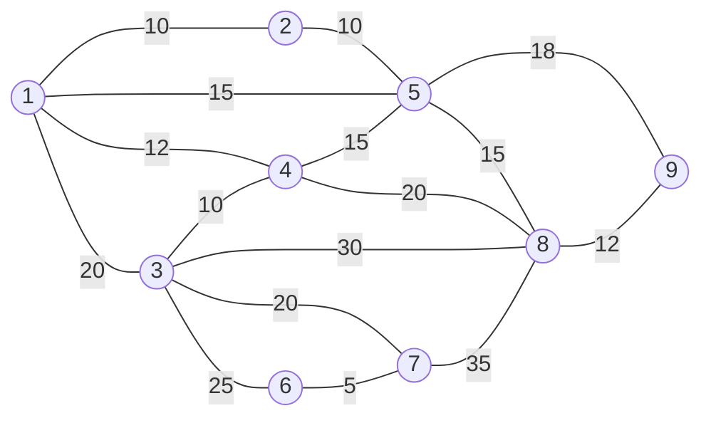

# How to Solve the Traveling Salesperson Problem (TSP) in Mathematica

## Problem

This example models the nine-city traveling salesperson problem as an undirected graph whose edge weights are distances. The diagram shows the edges and distances used in the example.

**Distance graph:**



## Solution

```wolfram
d=SparseArray[{{1,2}->10,{2,1}->10,{1,5}->15,{5,1}->15,{1,4}->12,{4,1}->12,{1,3}->20,{3,1}->20,{2,5}->10,{5,2}->10,{3,4}->10,{4,3}->10,{3,8}->30,{8,3}->30,{3,7}->20,{7,3}->20,{3,6}->25,{6,3}->25,{4,5}->15,{5,4}->15,{4,8}->20,{8,4}->20,{5,9}->18,{9,5}->18,{5,8}->15,{8,5}->15,{6,7}->5,{7,6}->5,{7,8}->35,{8,7}->35,{8,9}->12,{9,8}->12},{9,9},Infinity];
```

The second argument `{9,9}` to `SparseArray` specifies the array dimensions (9 by 9). The third argument, `Infinity`, is the default value for unspecified entries. Here that means no direct trip is allowed between city pairs omitted from the list. Each edge is listed in both directions so the distances are symmetric.

```wolfram
{len,tour}=FindShortestTour[{1,2,3,4,5,6,7,8,9},DistanceFunction->(d[[#1,#2]]&)]
```

`FindShortestTour` returns a closed tour through the specified cities; its result contains the total distance and the city order. The return edge from the last city to the first is included in the total.

## Output

```wolfram
{137, {1, 2, 5, 9, 8, 7, 6, 3, 4}}
```

For this distance table, there are two shortest tours of length 137; the reverse of either tour has the same length. The order of an optimal tour displayed may vary with the Mathematica version or search order. As the number of cities grows, the search quickly becomes harder, so consider an appropriate optimization method for large instances.

Official documentation: [FindShortestTour](https://reference.wolfram.com/language/ref/FindShortestTour.html) and [SparseArray](https://reference.wolfram.com/language/ref/SparseArray.html).
