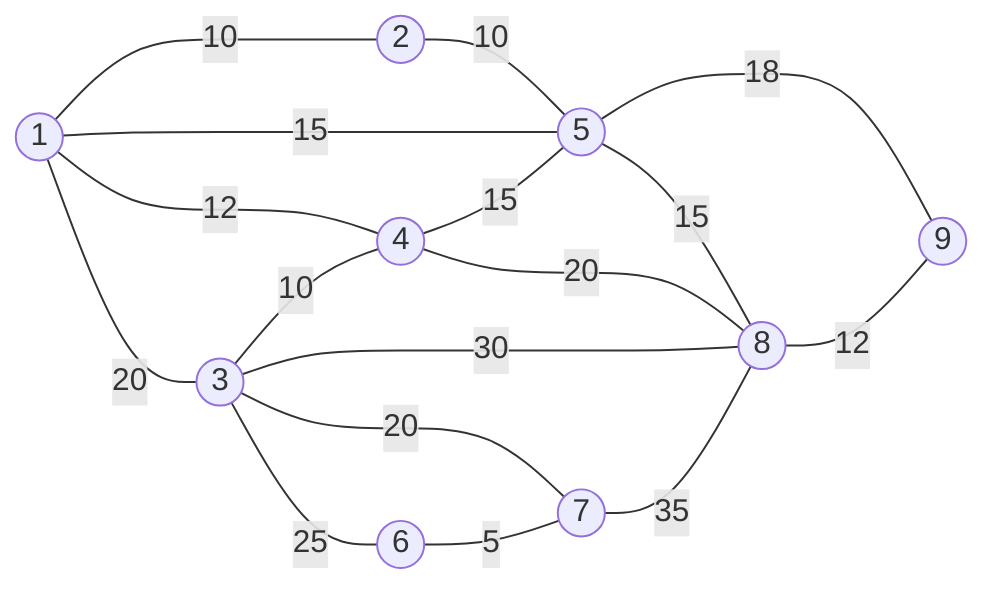

# Comment résoudre le problème du voyageur de commerce (TSP) avec Mathematica

## Problème

Cet exemple modélise le problème du voyageur de commerce à neuf villes sous forme de graphe non orienté pondéré par les distances. Le schéma montre les arêtes et les distances utilisées.

**Graphe des distances:**



## Solution

```wolfram
d=SparseArray[{{1,2}->10,{2,1}->10,{1,5}->15,{5,1}->15,{1,4}->12,{4,1}->12,{1,3}->20,{3,1}->20,{2,5}->10,{5,2}->10,{3,4}->10,{4,3}->10,{3,8}->30,{8,3}->30,{3,7}->20,{7,3}->20,{3,6}->25,{6,3}->25,{4,5}->15,{5,4}->15,{4,8}->20,{8,4}->20,{5,9}->18,{9,5}->18,{5,8}->15,{8,5}->15,{6,7}->5,{7,6}->5,{7,8}->35,{8,7}->35,{8,9}->12,{9,8}->12},{9,9},Infinity];
```

Le deuxième argument `{9,9}` de `SparseArray` spécifie les dimensions du tableau (9 par 9). Le troisième argument, `Infinity`, est la valeur par défaut des éléments non spécifiés. Ici, cela signifie qu'aucun trajet direct n'est autorisé entre les villes absentes de la liste. Chaque arête est indiquée dans les deux sens, ce qui rend les distances symétriques.

```wolfram
{len,tour}=FindShortestTour[{1,2,3,4,5,6,7,8,9},DistanceFunction->(d[[#1,#2]]&)]
```

`FindShortestTour` renvoie un circuit passant par les villes indiquées ; le résultat contient la distance totale et l'ordre des villes. Le total inclut l'arête de retour de la dernière ville à la première.

## Sortie

```wolfram
{137, {1, 2, 5, 9, 8, 7, 6, 3, 4}}
```

Pour cette table, deux circuits de longueur 137 sont optimaux ; le parcours inverse de chacun a la même longueur. L'ordre de la solution optimale affichée peut varier selon la version de Mathematica ou l'ordre de recherche. Lorsque le nombre de villes augmente, la recherche devient rapidement plus difficile ; pour les grands problèmes, envisagez une méthode d'optimisation adaptée.

Documentation officielle : [FindShortestTour](https://reference.wolfram.com/language/ref/FindShortestTour.html) et [SparseArray](https://reference.wolfram.com/language/ref/SparseArray.html).
