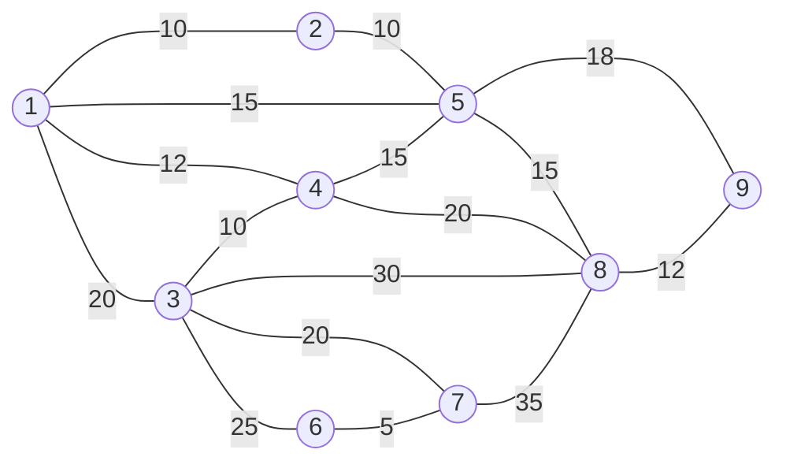

# Mathematica से ट्रैवलिंग सेल्समैन प्रॉब्लम (TSP) कैसे हल करें

## समस्या

यह उदाहरण नौ शहरों की ट्रैवलिंग सेल्सपर्सन समस्या को एक अनिर्देशित ग्राफ़ के रूप में दर्शाता है, जहाँ किनारों के भार दूरियाँ हैं। चित्र में उदाहरण के किनारे और दूरियाँ दिखाई गई हैं।

**दूरी ग्राफ़:**



## समाधान

```wolfram
d=SparseArray[{{1,2}->10,{2,1}->10,{1,5}->15,{5,1}->15,{1,4}->12,{4,1}->12,{1,3}->20,{3,1}->20,{2,5}->10,{5,2}->10,{3,4}->10,{4,3}->10,{3,8}->30,{8,3}->30,{3,7}->20,{7,3}->20,{3,6}->25,{6,3}->25,{4,5}->15,{5,4}->15,{4,8}->20,{8,4}->20,{5,9}->18,{9,5}->18,{5,8}->15,{8,5}->15,{6,7}->5,{7,6}->5,{7,8}->35,{8,7}->35,{8,9}->12,{9,8}->12},{9,9},Infinity];
```

`SparseArray` का दूसरा तर्क `{9,9}` ऐरे के आयाम (9 गुणा 9) बताता है। तीसरा तर्क `Infinity` उन प्रविष्टियों का डिफ़ॉल्ट मान है जिन्हें निर्दिष्ट नहीं किया गया। यहाँ इसका अर्थ है कि सूची में न दिए गए शहरों के बीच सीधे यात्रा की अनुमति नहीं है। दूरी सममित रखने के लिए हर किनारे को दोनों दिशाओं में लिखा गया है।

```wolfram
{len,tour}=FindShortestTour[{1,2,3,4,5,6,7,8,9},DistanceFunction->(d[[#1,#2]]&)]
```

`FindShortestTour` दिए गए शहरों से होकर जाने वाला बंद दौरा लौटाता है; परिणाम में कुल दूरी और शहरों का क्रम होता है। कुल दूरी में अंतिम शहर से पहले शहर तक लौटने वाला किनारा भी शामिल है।

## आउटपुट

```wolfram
{137, {1, 2, 5, 9, 8, 7, 6, 3, 4}}
```

इस दूरी तालिका में लंबाई 137 वाले दो सबसे छोटे दौरे हैं; किसी भी दौरे का उलटा क्रम भी उतनी ही लंबाई का है। दिखाए गए सर्वोत्तम दौरे का क्रम Mathematica संस्करण या खोज क्रम के अनुसार बदल सकता है। शहरों की संख्या बढ़ने पर खोज तेज़ी से कठिन होती है; बड़े उदाहरणों के लिए उपयुक्त अनुकूलन विधि पर विचार करें।

आधिकारिक दस्तावेज़: [FindShortestTour](https://reference.wolfram.com/language/ref/FindShortestTour.html) और [SparseArray](https://reference.wolfram.com/language/ref/SparseArray.html)।
