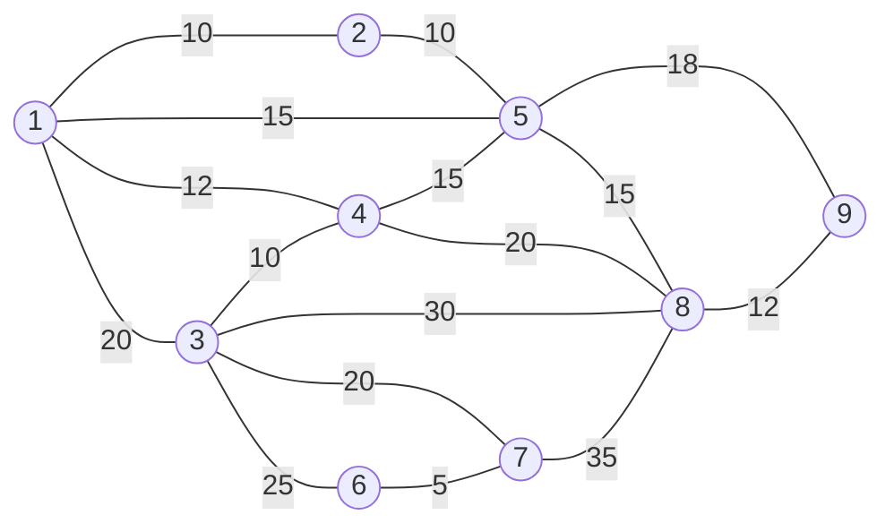

# Cara Memecahkan Masalah Pedagang Keliling (TSP) di Mathematica

## Masalah

Contoh ini memodelkan masalah penjual keliling untuk sembilan kota sebagai graf tak berarah dengan bobot sisi berupa jarak. Diagram menunjukkan sisi dan jarak yang digunakan.

**Graf jarak:**



## Solusi

```wolfram
d=SparseArray[{{1,2}->10,{2,1}->10,{1,5}->15,{5,1}->15,{1,4}->12,{4,1}->12,{1,3}->20,{3,1}->20,{2,5}->10,{5,2}->10,{3,4}->10,{4,3}->10,{3,8}->30,{8,3}->30,{3,7}->20,{7,3}->20,{3,6}->25,{6,3}->25,{4,5}->15,{5,4}->15,{4,8}->20,{8,4}->20,{5,9}->18,{9,5}->18,{5,8}->15,{8,5}->15,{6,7}->5,{7,6}->5,{7,8}->35,{8,7}->35,{8,9}->12,{9,8}->12},{9,9},Infinity];
```

Argumen kedua `{9,9}` pada `SparseArray` menentukan dimensi array (9 kali 9). Argumen ketiga `Infinity` adalah nilai bawaan untuk elemen yang tidak ditentukan. Dalam contoh ini, artinya perjalanan langsung antara pasangan kota yang tidak tercantum tidak diizinkan. Setiap sisi dicantumkan dalam dua arah agar jaraknya simetris.

```wolfram
{len,tour}=FindShortestTour[{1,2,3,4,5,6,7,8,9},DistanceFunction->(d[[#1,#2]]&)]
```

`FindShortestTour` mengembalikan siklus tertutup yang melewati kota-kota yang ditentukan; hasilnya memuat jarak total dan urutan kota. Jarak total mencakup sisi kembali dari kota terakhir ke kota pertama.

## Output

```wolfram
{137, {1, 2, 5, 9, 8, 7, 6, 3, 4}}
```

Untuk tabel jarak ini ada dua tur terpendek dengan panjang 137; urutan terbalik dari salah satunya memiliki panjang yang sama. Urutan solusi optimal yang ditampilkan dapat berbeda menurut versi Mathematica atau urutan pencarian. Saat jumlah kota bertambah, pencarian cepat menjadi lebih sulit; untuk kasus besar, pertimbangkan metode optimisasi yang sesuai.

Dokumentasi resmi: [FindShortestTour](https://reference.wolfram.com/language/ref/FindShortestTour.html) dan [SparseArray](https://reference.wolfram.com/language/ref/SparseArray.html).
