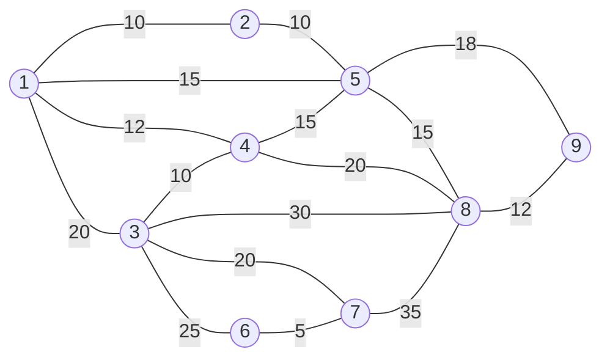

---


title: 'Mathematica로 외판원 문제(TSP)를 푸는 방법'
slug: "Mathematicaで외판원 문제を解く"
date: 2022-10-12T19:05:58+09:00
tags: ["Mathematica", "순회 외판원 문제", "알고리즘", "수학"]
draft: false
image: "img.webp"
categories: ["math-cryptography-quantum"]
description: '수식 처리 시스템 Mathematica를 사용하여 외판원 문제(TSP)를 푸는 방법을 설명합니다. SparseArray 함수를 사용하여 도시 간의 거리 행렬을 만들고, FindShortestTour로 최단 경로를 구하는 절차를 소개합니다.'
lastmod: "2026-11-24T00:00:00+09:00"
mermaid: true
---
# Mathematica로 외판원 문제(TSP)를 푸는 방법

## 문제

이 예제는 9개 도시의 외판원 문제를 간선의 가중치가 거리인 무방향 그래프로 모델링합니다. 아래 그림은 예제에 사용된 간선과 거리를 보여 줍니다.

**거리 그래프:**



## 해결

```wolfram
d=SparseArray[{{1,2}->10,{2,1}->10,{1,5}->15,{5,1}->15,{1,4}->12,{4,1}->12,{1,3}->20,{3,1}->20,{2,5}->10,{5,2}->10,{3,4}->10,{4,3}->10,{3,8}->30,{8,3}->30,{3,7}->20,{7,3}->20,{3,6}->25,{6,3}->25,{4,5}->15,{5,4}->15,{4,8}->20,{8,4}->20,{5,9}->18,{9,5}->18,{5,8}->15,{8,5}->15,{6,7}->5,{7,6}->5,{7,8}->35,{8,7}->35,{8,9}->12,{9,8}->12},{9,9},Infinity];
```

`SparseArray`의 두 번째 인수 `{9,9}`는 배열의 차원(9행 9열)을 지정합니다. 세 번째 인수 `Infinity`는 지정하지 않은 항목의 기본값입니다. 이 예제에서는 목록에 없는 도시 쌍 사이를 직접 이동할 수 없다는 뜻입니다. 거리가 대칭이 되도록 각 간선을 양방향으로 적었습니다.

```wolfram
{len,tour}=FindShortestTour[{1,2,3,4,5,6,7,8,9},DistanceFunction->(d[[#1,#2]]&)]
```

`FindShortestTour`는 지정한 도시를 방문하는 폐회로를 반환하며, 결과에는 총 거리와 도시 순서가 들어 있습니다. 총 거리에는 마지막 도시에서 첫 도시로 돌아가는 간선도 포함됩니다.

## 출력

```wolfram
{137, {1, 2, 5, 9, 8, 7, 6, 3, 4}}
```

이 거리표에는 길이가 137인 최단 순회 경로가 두 개 있으며, 어느 경로든 역순 경로의 길이도 같습니다. 표시되는 최적 경로의 순서는 Mathematica 버전이나 탐색 순서에 따라 달라질 수 있습니다. 도시 수가 늘면 탐색이 빠르게 어려워지므로 규모가 큰 문제에는 적절한 최적화 방법을 고려하세요.

공식 문서: [FindShortestTour](https://reference.wolfram.com/language/ref/FindShortestTour.html), [SparseArray](https://reference.wolfram.com/language/ref/SparseArray.html)
