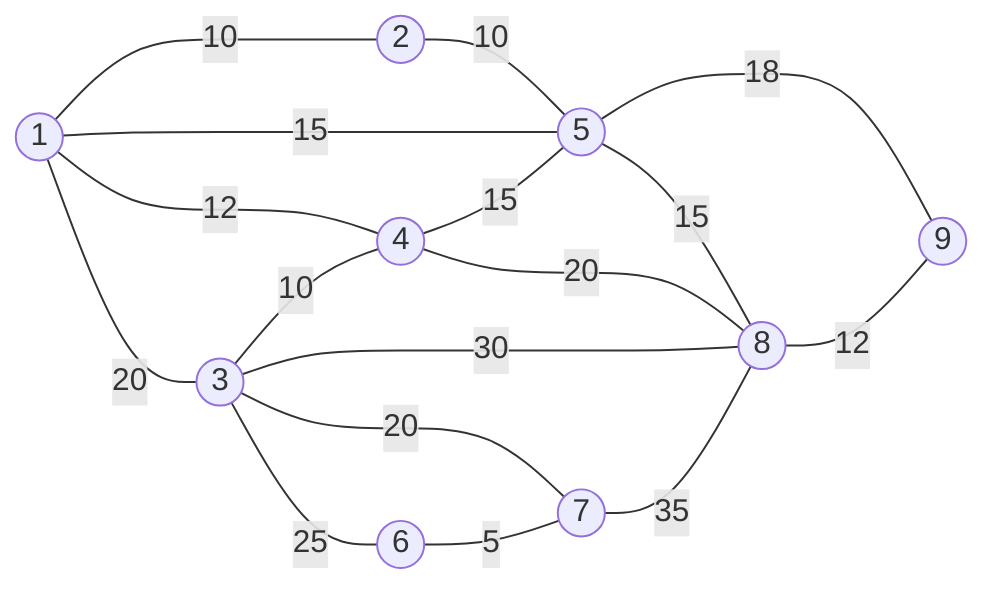

# Mathematicaで巡回セールスマン問題（TSP）を解く方法

## 問題

この例は、9都市の巡回セールスマン問題を、辺の距離を重みとする無向グラフとして扱います。次の図は、元の例にある辺と距離を示しています。

**距離グラフ:**



## 解法

```wolfram
d=SparseArray[{{1,2}->10,{2,1}->10,{1,5}->15,{5,1}->15,{1,4}->12,{4,1}->12,{1,3}->20,{3,1}->20,{2,5}->10,{5,2}->10,{3,4}->10,{4,3}->10,{3,8}->30,{8,3}->30,{3,7}->20,{7,3}->20,{3,6}->25,{6,3}->25,{4,5}->15,{5,4}->15,{4,8}->20,{8,4}->20,{5,9}->18,{9,5}->18,{5,8}->15,{8,5}->15,{6,7}->5,{7,6}->5,{7,8}->35,{8,7}->35,{8,9}->12,{9,8}->12},{9,9},Infinity];
```

SparseArrayの第2引数`{9,9}`は行列の次元（9行9列）です。第3引数`Infinity`は、明示していない成分の既定値です。つまり、この例では記載のない都市間の直接移動を許しません。距離は対称になるよう各辺を両方向に記述しています。

```wolfram
{len,tour}=FindShortestTour[{1,2,3,4,5,6,7,8,9},DistanceFunction->(d[[#1,#2]]&)]
```

`FindShortestTour`は指定した都市を巡る閉路を返し、返却値は合計距離と都市の順序です。出力の最後から最初へ戻る辺も距離に含まれます。

## 出力

```wolfram
{137, {1, 2, 5, 9, 8, 7, 6, 3, 4}}
```

この距離表では、長さ137の最短巡回路が2通りあり、逆順の巡回路も同じ長さです。Mathematicaの版や探索順により、表示される最適解の順序が異なる場合があります。都市数が増えると探索が急速に難しくなるため、大規模問題では適切な最適化手法を検討してください。

公式ドキュメント: [FindShortestTour](https://reference.wolfram.com/language/ref/FindShortestTour.html)、[SparseArray](https://reference.wolfram.com/language/ref/SparseArray.html)
