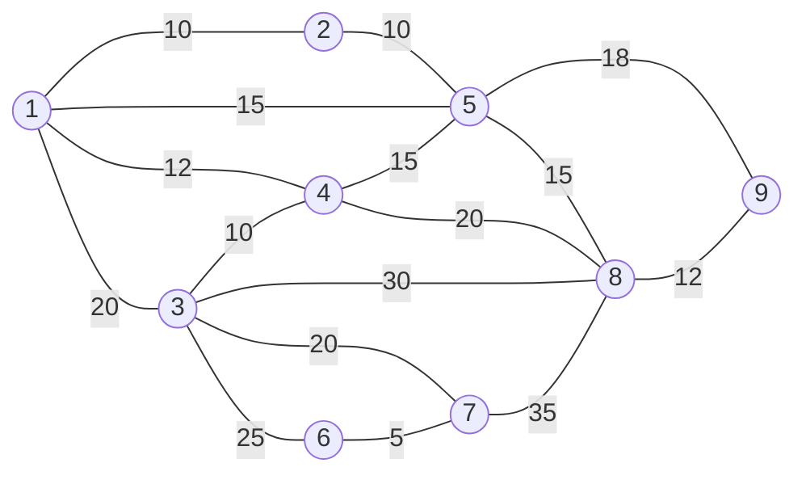

# Como resolver o problema do caixeiro-viajante (TSP) com o Mathematica

## Problema

Este exemplo modela o problema do caixeiro-viajante com nove cidades como um grafo não direcionado cujos pesos são as distâncias. O diagrama mostra as arestas e distâncias usadas.

**Grafo de distâncias:**



## Solução

```wolfram
d=SparseArray[{{1,2}->10,{2,1}->10,{1,5}->15,{5,1}->15,{1,4}->12,{4,1}->12,{1,3}->20,{3,1}->20,{2,5}->10,{5,2}->10,{3,4}->10,{4,3}->10,{3,8}->30,{8,3}->30,{3,7}->20,{7,3}->20,{3,6}->25,{6,3}->25,{4,5}->15,{5,4}->15,{4,8}->20,{8,4}->20,{5,9}->18,{9,5}->18,{5,8}->15,{8,5}->15,{6,7}->5,{7,6}->5,{7,8}->35,{8,7}->35,{8,9}->12,{9,8}->12},{9,9},Infinity];
```

O segundo argumento `{9,9}` de `SparseArray` especifica as dimensões do array (9 por 9). O terceiro argumento, `Infinity`, é o valor padrão para entradas não especificadas. Aqui, isso significa que não é permitido viajar diretamente entre pares de cidades que não aparecem na lista. Cada aresta é indicada nos dois sentidos, portanto as distâncias são simétricas.

```wolfram
{len,tour}=FindShortestTour[{1,2,3,4,5,6,7,8,9},DistanceFunction->(d[[#1,#2]]&)]
```

`FindShortestTour` retorna um circuito que visita as cidades especificadas; o resultado contém a distância total e a ordem das cidades. O total inclui a aresta de retorno da última cidade para a primeira.

## Saída

```wolfram
{137, {1, 2, 5, 9, 8, 7, 6, 3, 4}}
```

Para esta tabela, existem dois circuitos mínimos de comprimento 137; o percurso inverso de qualquer um deles tem o mesmo comprimento. A ordem da solução ótima exibida pode variar conforme a versão do Mathematica ou a ordem de busca. À medida que o número de cidades cresce, a busca fica rapidamente mais difícil; para problemas grandes, considere um método de otimização adequado.

Documentação oficial: [FindShortestTour](https://reference.wolfram.com/language/ref/FindShortestTour.html) e [SparseArray](https://reference.wolfram.com/language/ref/SparseArray.html).
