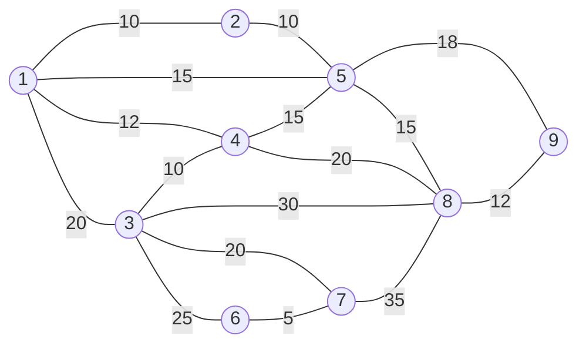

# Как решить задачу коммивояжера (TSP) в Mathematica

## Проблема

В этом примере задача коммивояжёра для девяти городов представлена неориентированным графом, веса рёбер которого равны расстояниям. На схеме показаны используемые рёбра и расстояния.

**Граф расстояний:**



## Решение

```wolfram
d=SparseArray[{{1,2}->10,{2,1}->10,{1,5}->15,{5,1}->15,{1,4}->12,{4,1}->12,{1,3}->20,{3,1}->20,{2,5}->10,{5,2}->10,{3,4}->10,{4,3}->10,{3,8}->30,{8,3}->30,{3,7}->20,{7,3}->20,{3,6}->25,{6,3}->25,{4,5}->15,{5,4}->15,{4,8}->20,{8,4}->20,{5,9}->18,{9,5}->18,{5,8}->15,{8,5}->15,{6,7}->5,{7,6}->5,{7,8}->35,{8,7}->35,{8,9}->12,{9,8}->12},{9,9},Infinity];
```

Второй аргумент `{9,9}` функции `SparseArray` задаёт размерность массива (9 на 9). Третий аргумент `Infinity` — значение по умолчанию для неуказанных элементов. Здесь это означает, что прямой путь между не перечисленными парами городов запрещён. Каждое ребро указано в обоих направлениях, поэтому расстояния симметричны.

```wolfram
{len,tour}=FindShortestTour[{1,2,3,4,5,6,7,8,9},DistanceFunction->(d[[#1,#2]]&)]
```

`FindShortestTour` возвращает замкнутый маршрут через указанные города; результат содержит общую длину и порядок городов. В общую длину входит ребро возврата из последнего города в первый.

## Вывод

```wolfram
{137, {1, 2, 5, 9, 8, 7, 6, 3, 4}}
```

Для этой таблицы расстояний существуют два кратчайших обхода длиной 137; обратный порядок любого из них имеет ту же длину. Порядок отображаемого оптимального решения может зависеть от версии Mathematica или порядка поиска. С ростом числа городов поиск быстро усложняется; для больших задач стоит выбрать подходящий метод оптимизации.

Официальная документация: [FindShortestTour](https://reference.wolfram.com/language/ref/FindShortestTour.html) и [SparseArray](https://reference.wolfram.com/language/ref/SparseArray.html).
