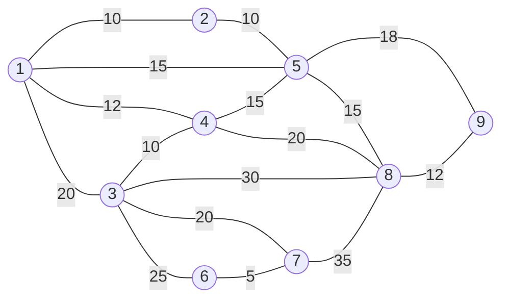

# 使用Mathematica求解旅行商问题（TSP）的方法

## 问题

本例将 9 个城市的旅行商问题建模为无向加权图，边的权重表示距离。下图展示了示例中使用的边及其距离。

**距离图:**



## 解法

```wolfram
d=SparseArray[{{1,2}->10,{2,1}->10,{1,5}->15,{5,1}->15,{1,4}->12,{4,1}->12,{1,3}->20,{3,1}->20,{2,5}->10,{5,2}->10,{3,4}->10,{4,3}->10,{3,8}->30,{8,3}->30,{3,7}->20,{7,3}->20,{3,6}->25,{6,3}->25,{4,5}->15,{5,4}->15,{4,8}->20,{8,4}->20,{5,9}->18,{9,5}->18,{5,8}->15,{8,5}->15,{6,7}->5,{7,6}->5,{7,8}->35,{8,7}->35,{8,9}->12,{9,8}->12},{9,9},Infinity];
```

`SparseArray` 的第二个参数 `{9,9}` 指定数组维度（9 行 9 列）。第三个参数 `Infinity` 是未指定元素的默认值。在本例中，这表示列表中未列出的城市之间不允许直接通行。每条边都按两个方向列出，因此距离矩阵是对称的。

```wolfram
{len,tour}=FindShortestTour[{1,2,3,4,5,6,7,8,9},DistanceFunction->(d[[#1,#2]]&)]
```

`FindShortestTour` 会返回经过指定城市的闭合巡回路线；返回结果包含总距离和城市顺序。总距离包括从最后一个城市返回第一个城市的边。

## 输出

```wolfram
{137, {1, 2, 5, 9, 8, 7, 6, 3, 4}}
```

对于这组距离数据，长度为 137 的最短巡回路线有两条，任一条的反向路线长度也相同。Mathematica 版本或搜索顺序不同，显示的最优路线顺序可能不同。城市数量增加时，搜索会迅速变得困难；大型问题应考虑合适的优化方法。

官方文档：[FindShortestTour](https://reference.wolfram.com/language/ref/FindShortestTour.html) 和 [SparseArray](https://reference.wolfram.com/language/ref/SparseArray.html)。
