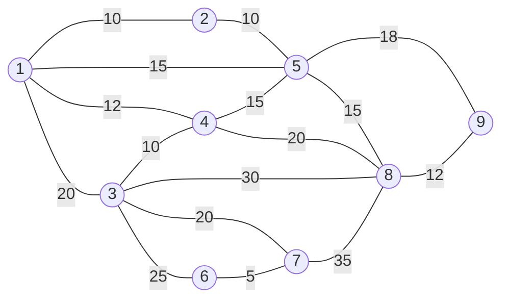

# 使用 Mathematica 解決旅行推銷員問題 (TSP) 的方法

## 問題

本例將 9 個城市的旅行推銷員問題建模為無向加權圖，邊的權重代表距離。下圖列出範例使用的邊與距離。

**距離圖:**



## 解法

```wolfram
d=SparseArray[{{1,2}->10,{2,1}->10,{1,5}->15,{5,1}->15,{1,4}->12,{4,1}->12,{1,3}->20,{3,1}->20,{2,5}->10,{5,2}->10,{3,4}->10,{4,3}->10,{3,8}->30,{8,3}->30,{3,7}->20,{7,3}->20,{3,6}->25,{6,3}->25,{4,5}->15,{5,4}->15,{4,8}->20,{8,4}->20,{5,9}->18,{9,5}->18,{5,8}->15,{8,5}->15,{6,7}->5,{7,6}->5,{7,8}->35,{8,7}->35,{8,9}->12,{9,8}->12},{9,9},Infinity];
```

`SparseArray` 的第二個引數 `{9,9}` 指定陣列維度（9 列 9 欄）。第三個引數 `Infinity` 是未指定元素的預設值。在本例中，這表示清單未列出的城市間不允許直接通行。每條邊都以兩個方向列出，因此距離矩陣是對稱的。

```wolfram
{len,tour}=FindShortestTour[{1,2,3,4,5,6,7,8,9},DistanceFunction->(d[[#1,#2]]&)]
```

`FindShortestTour` 會回傳經過指定城市的封閉巡迴路線；回傳結果包含總距離與城市順序。總距離包含從最後一個城市返回第一個城市的邊。

## 輸出

```wolfram
{137, {1, 2, 5, 9, 8, 7, 6, 3, 4}}
```

這組距離資料有兩條長度為 137 的最短巡迴路線，任一條的反向路線長度也相同。Mathematica 版本或搜尋順序不同，顯示的最佳路線順序可能不同。城市數增加時，搜尋會迅速變得困難；大型問題應考慮合適的最佳化方法。

官方文件：[FindShortestTour](https://reference.wolfram.com/language/ref/FindShortestTour.html) 與 [SparseArray](https://reference.wolfram.com/language/ref/SparseArray.html)。
