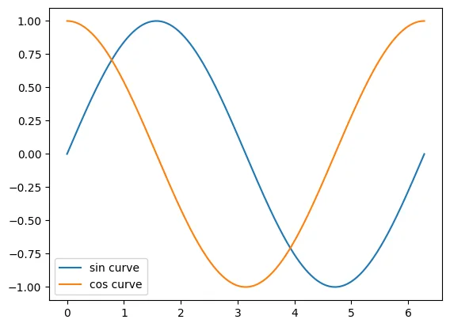

本範例使用 Python、NumPy 和 Matplotlib，在 Google Colab 筆記本繪製正弦與餘弦曲線。Colab 的介面與功能表名稱可能變更，請透過目前介面建立空白筆記本。

## 必要條件

需要 Google 帳戶和網際網路連線。使用 Colab 託管執行階段，不必在本機電腦設定 Python 環境即可執行程式碼。

## 執行筆記本儲存格

將程式碼貼到新筆記本的程式碼儲存格並執行。x 包含從 0 到 2π（含兩端）等間距的 500 個值。圖表以弧度計算這些值的正弦和餘弦，並顯示圖例。

```python
import matplotlib.pyplot as plt
import numpy as np

x = np.linspace(0, 2 * np.pi, 500)
plt.plot(x, np.sin(x), label="sin curve")
plt.plot(x, np.cos(x), label="cos curve")
plt.legend()
plt.show()
```

## 執行結果範例

執行後會顯示包含正弦與餘弦曲線的圖表。如果託管執行階段缺少程式庫，請在儲存格執行 `%pip install numpy matplotlib`，再重新執行範例。




## 官方資料

- [Matplotlib: pyplot](https://matplotlib.org/stable/api/pyplot_summary.html)
- [NumPy: linspace](https://numpy.org/doc/stable/reference/generated/numpy.linspace.html)
- [Google Colab: FAQ](https://research.google.com/colaboratory/faq.html?hl=en)
- [Open Google Colab](https://colab.research.google.com/)
