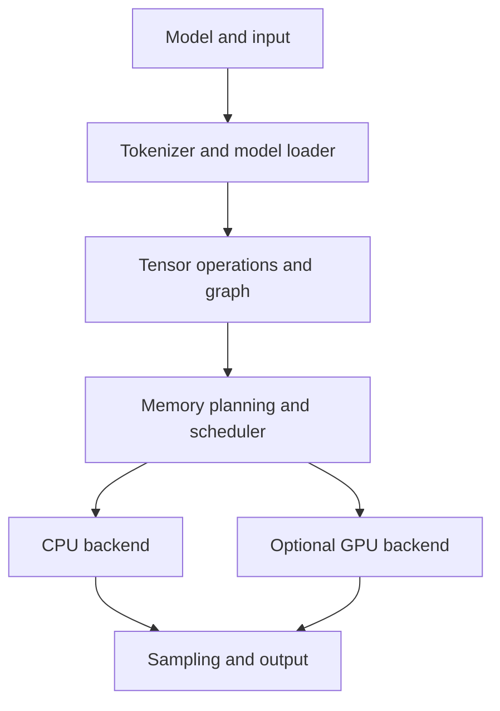

يشرح هذا المقال مفاهيم وبعض عناصر التنفيذ عند تصميم برامج الاستدلال باستخدام C++. الشيفرة أدناه مثال صغير على ساحة ذاكرة فقط؛ ولا تنفذ تحميل النموذج أو أداة التجزئة أو جميع طبقات Transformer أو أخذ العينات أو واجهات CUDA/Metal كاملة. لذلك فهي ليست محرك LLM ولا مقارنة أداء.

## لماذا C++ وما المفاضلات

تفيد C++ عند الحاجة إلى التحكم في تخطيط الذاكرة أو تعليمات CPU أو واجهات الأجهزة، لكن تغيير اللغة لا يجعل العمل أسرع تلقائياً. تفوض أطر مثل PyTorch كثيراً من الحسابات إلى C++ محسّن ونوى GPU، لذا ليست استدعاءات Python عنق الزجاجة دائماً. كما لا يعني النشر دائماً ملفاً تنفيذياً واحداً مستقلاً؛ فقد تبقى أوقات تشغيل GPU والمكتبات المشتركة تبعيات مطلوبة.

## مكونات محرك الاستدلال



## عمليات المصفوفات وتقدير الذاكرة

تستخدم نماذج Transformer عمليات ضرب مصفوفات كثيرة، لكن نسبتها من زمن التنفيذ تختلف حسب النموذج والدفعة وطول التسلسل والعتاد. 7,000,000,000 من أوزان FP32 تتطلب 28,000,000,000 بايت (28 GB عشرياً، نحو 26.1 GiB) للأوزان وحدها. يبلغ الحجم النظري الخام لأوزان FP16/INT8/INT4 نحو النصف والربع والثمن من FP32؛ وتضيف بيانات التكميم وذاكرة KV ومساحات العمل ذاكرة أخرى، وقد يؤثر التكميم في الجودة.

## مثال ساحة ذاكرة في C++17

يعيد المثال استخدام مساحة بايتات محاذاة في C++17. تعيد reset المؤشر فقط ولا تستدعي مدمرات الكائنات الموضوعة في المساحة. أدر أعمار الكائنات بصورة منفصلة وتحقق من ملاءمة التخصيصات.

```cpp
// C++17: illustrative byte arena; this is not an inference engine.
#include <cstddef>
#include <cstdint>
#include <new>
#include <stdexcept>

class MemoryArena {
    static constexpr std::size_t base_alignment = 64;
    std::size_t capacity_;
    std::size_t offset_ = 0;
    std::byte* data_;

public:
    explicit MemoryArena(std::size_t capacity) : capacity_(capacity), data_(nullptr) {
        if (capacity == 0) throw std::invalid_argument("capacity must be positive");
        data_ = static_cast<std::byte*>(
            ::operator new(capacity, std::align_val_t{base_alignment}));
    }

    ~MemoryArena() {
        ::operator delete(data_, std::align_val_t{base_alignment});
    }

    MemoryArena(const MemoryArena&) = delete;
    MemoryArena& operator=(const MemoryArena&) = delete;

    void* allocate(std::size_t bytes, std::size_t alignment = base_alignment) {
        if (alignment == 0 || (alignment & (alignment - 1)) != 0 || alignment > base_alignment)
            throw std::invalid_argument("alignment must be a power of two up to 64");

        const auto address = reinterpret_cast<std::uintptr_t>(data_ + offset_);
        const auto padding = (alignment - address % alignment) % alignment;
        if (padding > capacity_ - offset_ || bytes > capacity_ - offset_ - padding)
            throw std::bad_alloc();

        offset_ += padding;
        void* result = data_ + offset_;
        offset_ += bytes;
        return result;
    }

    void reset() noexcept { offset_ = 0; }
};
```

## واجهات CPU وGPU

ينبغي تصميم وقياس مسارات SIMD في CPU وGPU مع مراعاة دعم التعليمات وبرامج التشغيل وأوقات التشغيل وتخطيط البيانات وعمليات النقل. توفر CUDA عمليات المصفوفات عبر cuBLAS، وتوفر Apple واجهات عبر Metal Performance Shaders، لكن نسخ مقطع قصير لا ينشئ واجهة خلفية كاملة. ولا تلغي الذاكرة المشتركة في Apple silicon الحاجة إلى المزامنة وإدارة الموارد.

## دراسة تطبيقات حقيقية

لدراسة تطبيقات استدلال حقيقية، راجع GGML ومصدر وتعليمات بناء llama.cpp. ابدأ بعمليات موترية صغيرة واختبارات، ووثّق تنسيق النموذج والعمليات المدعومة والدقة واستخدام الذاكرة والعتاد المستهدف. ينبغي أن تتضمن نتائج الأداء النموذج والمدخلات وإعدادات البناء والجهاز وطريقة القياس.

- [GGML project](https://github.com/ggml-org/ggml)
- [llama.cpp source](https://github.com/ggml-org/llama.cpp)
- [llama.cpp build guide](https://github.com/ggml-org/llama.cpp/blob/master/docs/build.md)
- [NVIDIA cuBLAS documentation](https://docs.nvidia.com/cuda/cublas/index.html)
- [Apple Metal Performance Shaders: MPSMatrixMultiplication](https://developer.apple.com/documentation/metalperformanceshaders/mpsmatrixmultiplication)
- [C++ working draft: aligned allocation](https://www.open-std.org/jtc1/sc22/wg21/docs/papers/2025/n5014.pdf)
