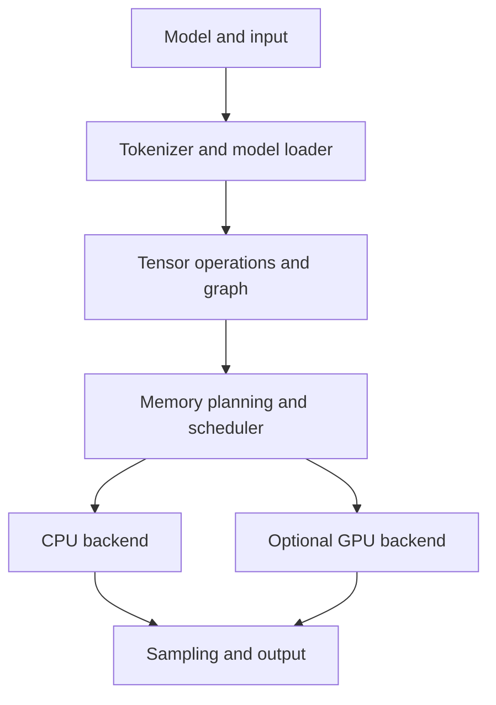

Dieser Artikel erläutert Konzepte und ausgewählte Implementierungsteile für Inferenzsoftware in C++. Der folgende Code zeigt nur eine kleine Speicher-Arena; Modellladen, Tokenizer, alle Transformer-Schichten, Sampling und vollständige CUDA-/Metal-Backends fehlen. Der Code ist weder eine LLM-Engine noch ein Leistungsvergleich.

## Warum C++, und welche Abwägungen gelten

C++ ist nützlich, wenn Speicherlayout, CPU-Befehle oder Geräte-APIs kontrolliert werden müssen, doch ein Sprachwechsel macht einen Arbeitsablauf nicht automatisch schneller. Frameworks wie PyTorch delegieren viele Berechnungen an optimiertes C++ und GPU-Kernels; Python-Aufrufe sind daher nicht zwangsläufig der Engpass. Auch die Bereitstellung besteht nicht immer aus einer einzelnen Binärdatei; GPU-Laufzeiten und gemeinsame Bibliotheken können Abhängigkeiten bleiben.

## Bausteine einer Inferenz-Engine



## Matrixoperationen und Speicherbedarf

Transformer verwenden viele Matrixmultiplikationen, deren Laufzeitanteil jedoch von Modell, Batch, Sequenzlänge und Hardware abhängt. 7.000.000.000 FP32-Gewichte benötigen allein 28.000.000.000 Byte (28 GB dezimal, etwa 26,1 GiB). Das theoretische rohe Gewichtsdatenvolumen von FP16/INT8/INT4 beträgt ungefähr die Hälfte, ein Viertel und ein Achtel von FP32; Quantisierungsmetadaten, KV-Cache und Arbeitsbereiche benötigen zusätzlichen Speicher, und Quantisierung kann die Qualität beeinflussen.

## Ein Arena-Beispiel mit C++17

Das Beispiel verwendet einen ausgerichteten Bytebereich erneut. reset setzt nur den Cursor zurück und ruft keine Destruktoren darin platzierter Objekte auf. Verwalten Sie deren Lebensdauer separat und prüfen Sie, ob die Belegung in den Bereich passt.

```cpp
// C++17: illustrative byte arena; this is not an inference engine.
#include <cstddef>
#include <cstdint>
#include <new>
#include <stdexcept>

class MemoryArena {
    static constexpr std::size_t base_alignment = 64;
    std::size_t capacity_;
    std::size_t offset_ = 0;
    std::byte* data_;

public:
    explicit MemoryArena(std::size_t capacity) : capacity_(capacity), data_(nullptr) {
        if (capacity == 0) throw std::invalid_argument("capacity must be positive");
        data_ = static_cast<std::byte*>(
            ::operator new(capacity, std::align_val_t{base_alignment}));
    }

    ~MemoryArena() {
        ::operator delete(data_, std::align_val_t{base_alignment});
    }

    MemoryArena(const MemoryArena&) = delete;
    MemoryArena& operator=(const MemoryArena&) = delete;

    void* allocate(std::size_t bytes, std::size_t alignment = base_alignment) {
        if (alignment == 0 || (alignment & (alignment - 1)) != 0 || alignment > base_alignment)
            throw std::invalid_argument("alignment must be a power of two up to 64");

        const auto address = reinterpret_cast<std::uintptr_t>(data_ + offset_);
        const auto padding = (alignment - address % alignment) % alignment;
        if (padding > capacity_ - offset_ || bytes > capacity_ - offset_ - padding)
            throw std::bad_alloc();

        offset_ += padding;
        void* result = data_ + offset_;
        offset_ += bytes;
        return result;
    }

    void reset() noexcept { offset_ = 0; }
};
```

## CPU- und GPU-Backends

CPU-SIMD und GPU-Pfade müssen zusammen mit Befehlssatzunterstützung, Treibern, Laufzeiten, Datenlayout und Transfers entwickelt und gemessen werden. CUDA bietet Matrixoperationen über cuBLAS; Apple stellt Matrix-APIs über Metal Performance Shaders bereit. Ein vollständiges Backend entsteht jedoch nicht durch das Kopieren eines kurzen Beispiels. Gemeinsamer Speicher auf Apple Silicon macht Synchronisierung und Ressourcenverwaltung ebenfalls nicht überflüssig.

## Reale Implementierungen untersuchen

Für echte Inferenzimplementierungen eignen sich GGML sowie Quellcode und Build-Anleitung von llama.cpp als Lernmaterial. Beginnen Sie mit kleinen Tensoroperationen und Tests. Dokumentieren Sie Modellformat, unterstützte Operationen, numerische Genauigkeit, Speicherbedarf und Zielhardware. Leistungswerte sollten Modell, Eingabe, Build-Einstellungen, Gerät und Messmethode nennen.

- [GGML project](https://github.com/ggml-org/ggml)
- [llama.cpp source](https://github.com/ggml-org/llama.cpp)
- [llama.cpp build guide](https://github.com/ggml-org/llama.cpp/blob/master/docs/build.md)
- [NVIDIA cuBLAS documentation](https://docs.nvidia.com/cuda/cublas/index.html)
- [Apple Metal Performance Shaders: MPSMatrixMultiplication](https://developer.apple.com/documentation/metalperformanceshaders/mpsmatrixmultiplication)
- [C++ working draft: aligned allocation](https://www.open-std.org/jtc1/sc22/wg21/docs/papers/2025/n5014.pdf)
