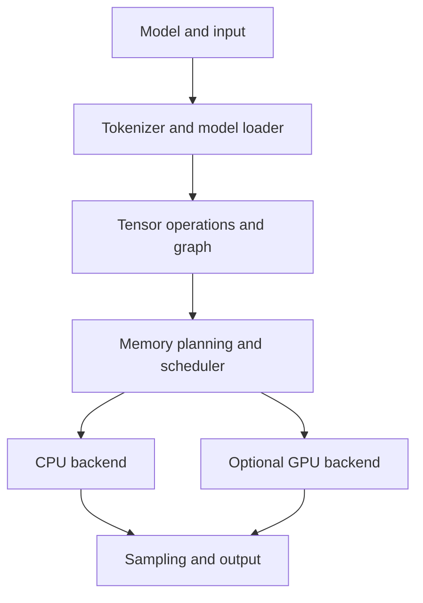

This article explains concepts and selected implementation pieces involved in designing inference software in C++. The code below is only a small memory-arena example; it does not implement model loading, a tokenizer, all Transformer layers, sampling, or complete CUDA/Metal backends. It is not an LLM engine or a performance comparison.

## Why C++, and its trade-offs

C++ is useful when you need control over memory layout, CPU instructions, or device APIs, but changing languages does not automatically make a workload faster. Frameworks such as PyTorch delegate much of the computation to optimized C++ and GPU kernels, so Python calls are not necessarily the bottleneck. Deployment also does not always mean one self-contained binary; GPU runtimes and shared libraries may remain dependencies.

## Inference-engine components



## Matrix operations and memory estimates

Transformers use many matrix multiplications, but their share of runtime varies with the model, batch, sequence length, and hardware. Storing 7,000,000,000 FP32 weights takes 28,000,000,000 bytes (28 GB decimal, about 26.1 GiB) for weights alone. The theoretical raw weight payload for FP16/INT8/INT4 is about one-half, one-quarter, and one-eighth of FP32; quantization metadata, the KV cache, and workspaces add memory, and quantization can affect quality.

## A C++17 arena example

The example below reuses an aligned byte region in C++17. reset only rewinds the cursor; it does not call destructors for objects placed in the region. Manage object lifetimes separately and verify that allocations fit.

```cpp
// C++17: illustrative byte arena; this is not an inference engine.
#include <cstddef>
#include <cstdint>
#include <new>
#include <stdexcept>

class MemoryArena {
    static constexpr std::size_t base_alignment = 64;
    std::size_t capacity_;
    std::size_t offset_ = 0;
    std::byte* data_;

public:
    explicit MemoryArena(std::size_t capacity) : capacity_(capacity), data_(nullptr) {
        if (capacity == 0) throw std::invalid_argument("capacity must be positive");
        data_ = static_cast<std::byte*>(
            ::operator new(capacity, std::align_val_t{base_alignment}));
    }

    ~MemoryArena() {
        ::operator delete(data_, std::align_val_t{base_alignment});
    }

    MemoryArena(const MemoryArena&) = delete;
    MemoryArena& operator=(const MemoryArena&) = delete;

    void* allocate(std::size_t bytes, std::size_t alignment = base_alignment) {
        if (alignment == 0 || (alignment & (alignment - 1)) != 0 || alignment > base_alignment)
            throw std::invalid_argument("alignment must be a power of two up to 64");

        const auto address = reinterpret_cast<std::uintptr_t>(data_ + offset_);
        const auto padding = (alignment - address % alignment) % alignment;
        if (padding > capacity_ - offset_ || bytes > capacity_ - offset_ - padding)
            throw std::bad_alloc();

        offset_ += padding;
        void* result = data_ + offset_;
        offset_ += bytes;
        return result;
    }

    void reset() noexcept { offset_ = 0; }
};
```

## CPU and GPU backends

CPU SIMD and GPU paths must be designed and measured together with instruction-set support, drivers, runtimes, data layout, and transfers. CUDA offers matrix operations through cuBLAS, and Apple provides matrix APIs through Metal Performance Shaders, but neither becomes a complete backend by copying one short snippet. Shared memory on Apple silicon also does not remove synchronization or resource-management requirements.

## Study real implementations

For working inference implementations, study GGML and the source and build instructions of llama.cpp, which uses it. Start with small tensor operations and tests; document the model format, supported operations, numerical precision, memory use, and target hardware. Any performance result should state the model, input, build settings, device, and measurement method.

- [GGML project](https://github.com/ggml-org/ggml)
- [llama.cpp source](https://github.com/ggml-org/llama.cpp)
- [llama.cpp build guide](https://github.com/ggml-org/llama.cpp/blob/master/docs/build.md)
- [NVIDIA cuBLAS documentation](https://docs.nvidia.com/cuda/cublas/index.html)
- [Apple Metal Performance Shaders: MPSMatrixMultiplication](https://developer.apple.com/documentation/metalperformanceshaders/mpsmatrixmultiplication)
- [C++ working draft: aligned allocation](https://www.open-std.org/jtc1/sc22/wg21/docs/papers/2025/n5014.pdf)
