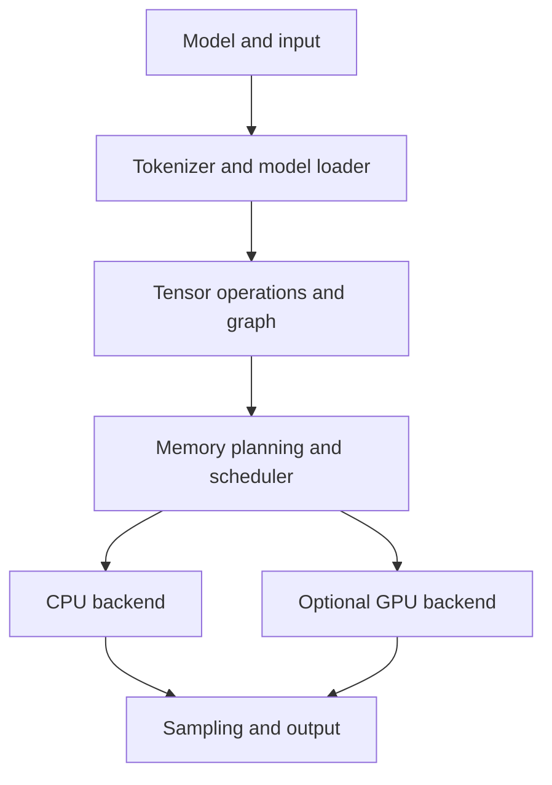

Este artículo explica conceptos y algunas piezas de implementación para diseñar software de inferencia en C++. El código solo muestra una pequeña arena de memoria; no implementa la carga del modelo, el tokenizador, todas las capas Transformer, el muestreo ni backends CUDA/Metal completos. No es un motor LLM ni una comparación de rendimiento.

## Por qué C++ y qué implica

C++ resulta útil cuando se necesita controlar la memoria, las instrucciones de CPU o las API de dispositivos, pero cambiar de lenguaje no acelera automáticamente una tarea. Frameworks como PyTorch delegan gran parte del cálculo a C++ optimizado y kernels de GPU, por lo que las llamadas de Python no siempre son el cuello de botella. La distribución no siempre consiste en un único binario; pueden seguir siendo necesarias bibliotecas compartidas y runtimes de GPU.

## Componentes de un motor de inferencia



## Operaciones matriciales y estimación de memoria

Los Transformers realizan muchas multiplicaciones de matrices, pero su proporción del tiempo depende del modelo, el lote, la longitud de secuencia y el hardware. 7.000.000.000 de pesos FP32 ocupan 28.000.000.000 bytes (28 GB decimales, unos 26,1 GiB) solo para los pesos. El volumen teórico FP16/INT8/INT4 es aproximadamente la mitad, un cuarto y un octavo del FP32; metadatos, caché KV y espacios de trabajo añaden memoria, y la cuantización puede afectar a la calidad.

## Ejemplo de arena en C++17

El ejemplo reutiliza una región de bytes alineada en C++17. reset solo retrocede el cursor; no llama a los destructores de los objetos almacenados. Gestiona su ciclo de vida por separado y comprueba que las asignaciones quepan.

```cpp
// C++17: illustrative byte arena; this is not an inference engine.
#include <cstddef>
#include <cstdint>
#include <new>
#include <stdexcept>

class MemoryArena {
    static constexpr std::size_t base_alignment = 64;
    std::size_t capacity_;
    std::size_t offset_ = 0;
    std::byte* data_;

public:
    explicit MemoryArena(std::size_t capacity) : capacity_(capacity), data_(nullptr) {
        if (capacity == 0) throw std::invalid_argument("capacity must be positive");
        data_ = static_cast<std::byte*>(
            ::operator new(capacity, std::align_val_t{base_alignment}));
    }

    ~MemoryArena() {
        ::operator delete(data_, std::align_val_t{base_alignment});
    }

    MemoryArena(const MemoryArena&) = delete;
    MemoryArena& operator=(const MemoryArena&) = delete;

    void* allocate(std::size_t bytes, std::size_t alignment = base_alignment) {
        if (alignment == 0 || (alignment & (alignment - 1)) != 0 || alignment > base_alignment)
            throw std::invalid_argument("alignment must be a power of two up to 64");

        const auto address = reinterpret_cast<std::uintptr_t>(data_ + offset_);
        const auto padding = (alignment - address % alignment) % alignment;
        if (padding > capacity_ - offset_ || bytes > capacity_ - offset_ - padding)
            throw std::bad_alloc();

        offset_ += padding;
        void* result = data_ + offset_;
        offset_ += bytes;
        return result;
    }

    void reset() noexcept { offset_ = 0; }
};
```

## Backends de CPU y GPU

Las rutas SIMD de CPU y GPU deben diseñarse y medirse junto con instrucciones compatibles, controladores, runtimes, disposición de datos y transferencias. CUDA ofrece operaciones matriciales mediante cuBLAS y Apple ofrece API mediante Metal Performance Shaders; copiar un fragmento corto no crea un backend completo. La memoria unificada de Apple Silicon tampoco elimina sincronización ni gestión de recursos.

## Estudiar implementaciones reales

Para estudiar implementaciones reales, consulta GGML y el código e instrucciones de compilación de llama.cpp. Empieza con operaciones tensoriales pequeñas y pruebas; documenta formato del modelo, operaciones admitidas, precisión numérica, memoria y hardware objetivo. Todo resultado debe indicar modelo, entrada, configuración de compilación, dispositivo y método de medición.

- [GGML project](https://github.com/ggml-org/ggml)
- [llama.cpp source](https://github.com/ggml-org/llama.cpp)
- [llama.cpp build guide](https://github.com/ggml-org/llama.cpp/blob/master/docs/build.md)
- [NVIDIA cuBLAS documentation](https://docs.nvidia.com/cuda/cublas/index.html)
- [Apple Metal Performance Shaders: MPSMatrixMultiplication](https://developer.apple.com/documentation/metalperformanceshaders/mpsmatrixmultiplication)
- [C++ working draft: aligned allocation](https://www.open-std.org/jtc1/sc22/wg21/docs/papers/2025/n5014.pdf)
