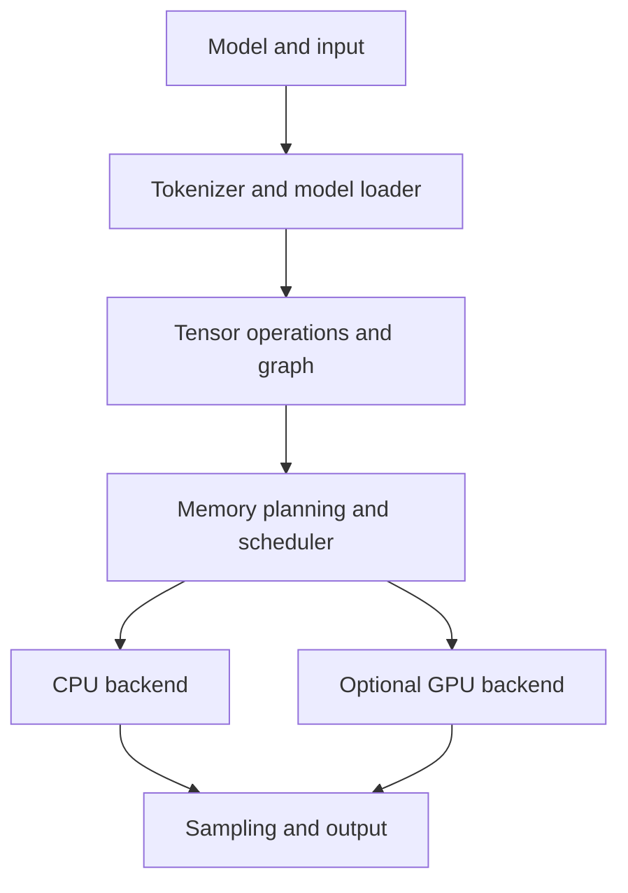

Cet article présente des concepts et quelques éléments d’implémentation pour concevoir un logiciel d’inférence en C++. Le code ci-dessous est uniquement un petit exemple d’arène mémoire ; il ne comprend ni chargement de modèle, ni tokenizer, ni toutes les couches Transformer, ni échantillonnage, ni backends CUDA/Metal complets. Ce n’est ni un moteur LLM ni une comparaison de performances.

## Pourquoi C++ et quels compromis

C++ est utile lorsqu’il faut contrôler la disposition mémoire, les instructions CPU ou les API d’appareils, mais changer de langage n’accélère pas automatiquement un traitement. Des frameworks comme PyTorch confient beaucoup de calculs à du C++ optimisé et à des kernels GPU ; les appels Python ne sont donc pas nécessairement le goulot d’étranglement. Le déploiement ne se résume pas toujours à un seul binaire : runtimes GPU et bibliothèques partagées peuvent rester nécessaires.

## Composants d’un moteur d’inférence



## Opérations matricielles et estimation mémoire

Les Transformers utilisent de nombreuses multiplications matricielles, mais leur part du temps dépend du modèle, du lot, de la longueur de séquence et du matériel. 7 000 000 000 de poids FP32 occupent 28 000 000 000 octets (28 Go décimaux, environ 26,1 Gio) pour les poids seuls. Le volume FP16/INT8/INT4 correspond théoriquement à la moitié, au quart et au huitième du FP32 ; métadonnées, cache KV et espaces de travail ajoutent de la mémoire, et la quantification peut affecter la qualité.

## Exemple d’arène en C++17

L’exemple réutilise une zone d’octets alignée en C++17. reset ne fait que replacer le curseur et n’appelle pas les destructeurs des objets placés dans la zone. Gérez leur durée de vie séparément et vérifiez que les allocations tiennent.

```cpp
// C++17: illustrative byte arena; this is not an inference engine.
#include <cstddef>
#include <cstdint>
#include <new>
#include <stdexcept>

class MemoryArena {
    static constexpr std::size_t base_alignment = 64;
    std::size_t capacity_;
    std::size_t offset_ = 0;
    std::byte* data_;

public:
    explicit MemoryArena(std::size_t capacity) : capacity_(capacity), data_(nullptr) {
        if (capacity == 0) throw std::invalid_argument("capacity must be positive");
        data_ = static_cast<std::byte*>(
            ::operator new(capacity, std::align_val_t{base_alignment}));
    }

    ~MemoryArena() {
        ::operator delete(data_, std::align_val_t{base_alignment});
    }

    MemoryArena(const MemoryArena&) = delete;
    MemoryArena& operator=(const MemoryArena&) = delete;

    void* allocate(std::size_t bytes, std::size_t alignment = base_alignment) {
        if (alignment == 0 || (alignment & (alignment - 1)) != 0 || alignment > base_alignment)
            throw std::invalid_argument("alignment must be a power of two up to 64");

        const auto address = reinterpret_cast<std::uintptr_t>(data_ + offset_);
        const auto padding = (alignment - address % alignment) % alignment;
        if (padding > capacity_ - offset_ || bytes > capacity_ - offset_ - padding)
            throw std::bad_alloc();

        offset_ += padding;
        void* result = data_ + offset_;
        offset_ += bytes;
        return result;
    }

    void reset() noexcept { offset_ = 0; }
};
```

## Backends CPU et GPU

Les chemins SIMD CPU et GPU doivent être conçus et mesurés avec la prise en charge des instructions, les pilotes, les runtimes, la disposition des données et les transferts. CUDA propose des opérations via cuBLAS et Apple des API via Metal Performance Shaders, mais copier un court extrait ne constitue pas un backend complet. La mémoire partagée d’Apple Silicon ne supprime pas synchronisation ni gestion des ressources.

## Étudier des implémentations réelles

Pour étudier de vrais moteurs, consultez GGML et le code ainsi que les instructions de compilation de llama.cpp. Commencez par de petites opérations tensorielles et des tests ; documentez format du modèle, opérations prises en charge, précision, mémoire et matériel cible. Tout résultat doit préciser modèle, entrée, compilation, appareil et méthode de mesure.

- [GGML project](https://github.com/ggml-org/ggml)
- [llama.cpp source](https://github.com/ggml-org/llama.cpp)
- [llama.cpp build guide](https://github.com/ggml-org/llama.cpp/blob/master/docs/build.md)
- [NVIDIA cuBLAS documentation](https://docs.nvidia.com/cuda/cublas/index.html)
- [Apple Metal Performance Shaders: MPSMatrixMultiplication](https://developer.apple.com/documentation/metalperformanceshaders/mpsmatrixmultiplication)
- [C++ working draft: aligned allocation](https://www.open-std.org/jtc1/sc22/wg21/docs/papers/2025/n5014.pdf)
