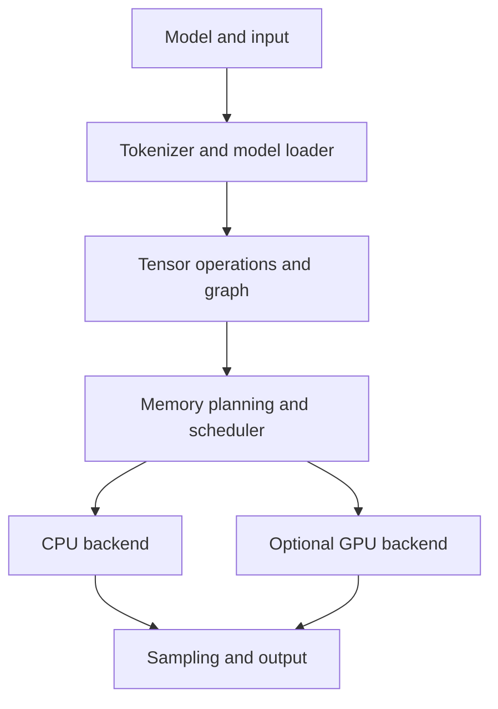

यह लेख C++ inference software डिज़ाइन करने की अवधारणाएँ और कुछ implementation भाग समझाता है। नीचे का कोड केवल छोटा memory-arena उदाहरण है; इसमें model loader, tokenizer, सभी Transformer layers, sampling या पूर्ण CUDA/Metal backends नहीं हैं। इसे LLM engine या performance comparison न समझें।

## C++ क्यों और इसकी सीमाएँ

जहाँ memory layout, CPU instructions या device APIs पर नियंत्रण चाहिए वहाँ C++ उपयोगी है, लेकिन केवल भाषा बदलने से workload अपने आप तेज़ नहीं होता। PyTorch जैसे frameworks अधिकांश गणना optimized C++ और GPU kernels को सौंपते हैं, इसलिए Python calls हमेशा bottleneck नहीं होते। Deployment भी हमेशा एक self-contained binary नहीं होता; GPU runtimes और shared libraries निर्भरता रह सकते हैं।

## Inference engine के घटक



## Matrix operations और memory estimate

Transformers में कई matrix multiplications होती हैं, लेकिन runtime में उनका हिस्सा model, batch, sequence length और hardware पर निर्भर करता है। 7,000,000,000 FP32 weights केवल weights के लिए 28,000,000,000 bytes (28 GB decimal, लगभग 26.1 GiB) लेते हैं। FP16/INT8/INT4 का सैद्धांतिक raw payload FP32 का लगभग आधा, चौथाई और आठवाँ भाग है; quantization metadata, KV cache और workspace अतिरिक्त memory लेते हैं और गुणवत्ता बदल सकते हैं।

## C++17 arena उदाहरण

यह उदाहरण C++17 में aligned byte क्षेत्र का पुनः उपयोग करता है। reset केवल cursor पीछे करता है; इसमें रखे objects के destructors नहीं चलाता। Object lifetime अलग से संभालें और allocation का आकार जाँचें।

```cpp
// C++17: illustrative byte arena; this is not an inference engine.
#include <cstddef>
#include <cstdint>
#include <new>
#include <stdexcept>

class MemoryArena {
    static constexpr std::size_t base_alignment = 64;
    std::size_t capacity_;
    std::size_t offset_ = 0;
    std::byte* data_;

public:
    explicit MemoryArena(std::size_t capacity) : capacity_(capacity), data_(nullptr) {
        if (capacity == 0) throw std::invalid_argument("capacity must be positive");
        data_ = static_cast<std::byte*>(
            ::operator new(capacity, std::align_val_t{base_alignment}));
    }

    ~MemoryArena() {
        ::operator delete(data_, std::align_val_t{base_alignment});
    }

    MemoryArena(const MemoryArena&) = delete;
    MemoryArena& operator=(const MemoryArena&) = delete;

    void* allocate(std::size_t bytes, std::size_t alignment = base_alignment) {
        if (alignment == 0 || (alignment & (alignment - 1)) != 0 || alignment > base_alignment)
            throw std::invalid_argument("alignment must be a power of two up to 64");

        const auto address = reinterpret_cast<std::uintptr_t>(data_ + offset_);
        const auto padding = (alignment - address % alignment) % alignment;
        if (padding > capacity_ - offset_ || bytes > capacity_ - offset_ - padding)
            throw std::bad_alloc();

        offset_ += padding;
        void* result = data_ + offset_;
        offset_ += bytes;
        return result;
    }

    void reset() noexcept { offset_ = 0; }
};
```

## CPU और GPU backends

CPU SIMD और GPU paths को instruction support, drivers, runtimes, data layout और transfers के साथ design व measure करना पड़ता है। CUDA में cuBLAS और Apple में Metal Performance Shaders matrix APIs देते हैं, लेकिन छोटा code snippet पूरा backend नहीं बनाता। Apple silicon की shared memory से synchronization या resource management की ज़रूरत समाप्त नहीं होती।

## वास्तविक implementations देखें

वास्तविक inference implementations के लिए GGML और llama.cpp का source तथा build guide देखें। छोटे tensor operations और tests से शुरू करें; model format, supported operations, numerical precision, memory use और target hardware लिखें। Performance result में model, input, build settings, device और measurement method बताएँ।

- [GGML project](https://github.com/ggml-org/ggml)
- [llama.cpp source](https://github.com/ggml-org/llama.cpp)
- [llama.cpp build guide](https://github.com/ggml-org/llama.cpp/blob/master/docs/build.md)
- [NVIDIA cuBLAS documentation](https://docs.nvidia.com/cuda/cublas/index.html)
- [Apple Metal Performance Shaders: MPSMatrixMultiplication](https://developer.apple.com/documentation/metalperformanceshaders/mpsmatrixmultiplication)
- [C++ working draft: aligned allocation](https://www.open-std.org/jtc1/sc22/wg21/docs/papers/2025/n5014.pdf)
