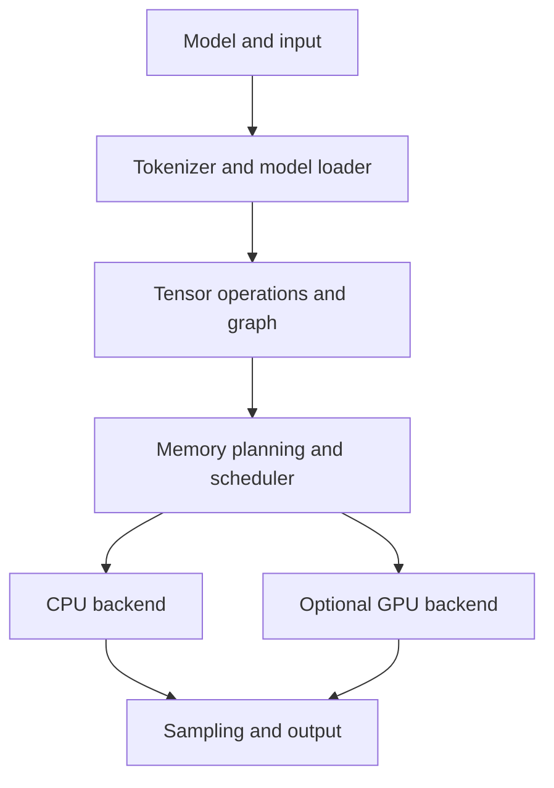

Artikel ini menjelaskan konsep dan beberapa bagian implementasi untuk merancang perangkat lunak inferensi dengan C++. Kode di bawah hanya contoh arena memori kecil; tidak mencakup pemuatan model, tokenizer, seluruh lapisan Transformer, sampling, atau backend CUDA/Metal lengkap. Ini bukan mesin LLM maupun perbandingan performa.

## Alasan menggunakan C++ dan batasannya

C++ berguna ketika tata letak memori, instruksi CPU, atau API perangkat perlu dikendalikan, tetapi mengganti bahasa tidak otomatis mempercepat beban kerja. Framework seperti PyTorch menyerahkan banyak komputasi ke C++ teroptimasi dan kernel GPU, sehingga pemanggilan Python belum tentu menjadi hambatan. Deployment tidak selalu berupa satu biner mandiri; runtime GPU dan pustaka bersama dapat tetap menjadi dependensi.

## Komponen mesin inferensi



## Operasi matriks dan perkiraan memori

Transformer memakai banyak perkalian matriks, tetapi porsinya bergantung pada model, batch, panjang urutan, dan perangkat keras. 7.000.000.000 bobot FP32 memerlukan 28.000.000.000 byte (28 GB desimal, sekitar 26,1 GiB) untuk bobot saja. Payload bobot mentah FP16/INT8/INT4 secara teoretis sekitar setengah, seperempat, dan seperdelapan FP32; metadata kuantisasi, KV cache, dan ruang kerja menambah memori dan kuantisasi dapat memengaruhi kualitas.

## Contoh arena C++17

Contoh ini memakai ulang wilayah byte yang sejajar di C++17. reset hanya mengembalikan posisi cursor dan tidak memanggil destructor objek di dalamnya. Kelola masa hidup objek secara terpisah dan pastikan alokasi muat.

```cpp
// C++17: illustrative byte arena; this is not an inference engine.
#include <cstddef>
#include <cstdint>
#include <new>
#include <stdexcept>

class MemoryArena {
    static constexpr std::size_t base_alignment = 64;
    std::size_t capacity_;
    std::size_t offset_ = 0;
    std::byte* data_;

public:
    explicit MemoryArena(std::size_t capacity) : capacity_(capacity), data_(nullptr) {
        if (capacity == 0) throw std::invalid_argument("capacity must be positive");
        data_ = static_cast<std::byte*>(
            ::operator new(capacity, std::align_val_t{base_alignment}));
    }

    ~MemoryArena() {
        ::operator delete(data_, std::align_val_t{base_alignment});
    }

    MemoryArena(const MemoryArena&) = delete;
    MemoryArena& operator=(const MemoryArena&) = delete;

    void* allocate(std::size_t bytes, std::size_t alignment = base_alignment) {
        if (alignment == 0 || (alignment & (alignment - 1)) != 0 || alignment > base_alignment)
            throw std::invalid_argument("alignment must be a power of two up to 64");

        const auto address = reinterpret_cast<std::uintptr_t>(data_ + offset_);
        const auto padding = (alignment - address % alignment) % alignment;
        if (padding > capacity_ - offset_ || bytes > capacity_ - offset_ - padding)
            throw std::bad_alloc();

        offset_ += padding;
        void* result = data_ + offset_;
        offset_ += bytes;
        return result;
    }

    void reset() noexcept { offset_ = 0; }
};
```

## Backend CPU dan GPU

Jalur SIMD CPU dan GPU perlu dirancang serta diukur bersama dukungan instruksi, driver, runtime, tata letak data, dan transfer. CUDA menyediakan operasi matriks lewat cuBLAS, sedangkan Apple menyediakan API lewat Metal Performance Shaders; satu cuplikan singkat bukan backend lengkap. Memori bersama Apple silicon tidak menghilangkan sinkronisasi atau pengelolaan sumber daya.

## Pelajari implementasi nyata

Untuk mempelajari implementasi nyata, lihat GGML dan kode serta panduan build llama.cpp. Mulailah dengan operasi tensor kecil dan pengujian; catat format model, operasi yang didukung, presisi numerik, penggunaan memori, dan perangkat target. Hasil performa harus mencantumkan model, input, setelan build, perangkat, dan metode pengukuran.

- [GGML project](https://github.com/ggml-org/ggml)
- [llama.cpp source](https://github.com/ggml-org/llama.cpp)
- [llama.cpp build guide](https://github.com/ggml-org/llama.cpp/blob/master/docs/build.md)
- [NVIDIA cuBLAS documentation](https://docs.nvidia.com/cuda/cublas/index.html)
- [Apple Metal Performance Shaders: MPSMatrixMultiplication](https://developer.apple.com/documentation/metalperformanceshaders/mpsmatrixmultiplication)
- [C++ working draft: aligned allocation](https://www.open-std.org/jtc1/sc22/wg21/docs/papers/2025/n5014.pdf)
