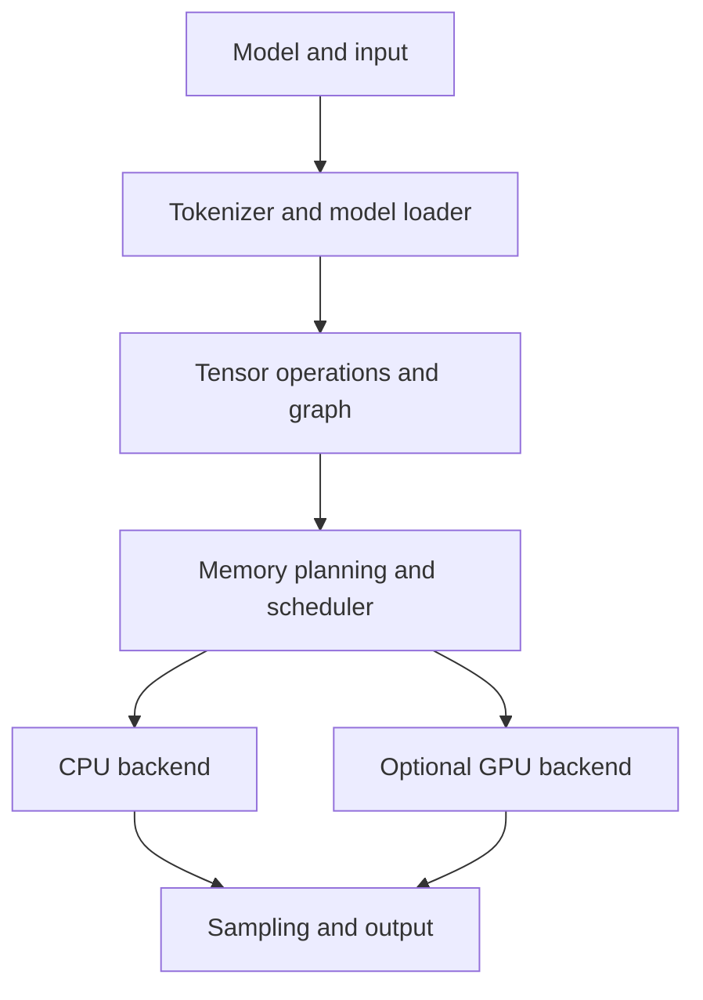

이 문서는 C++ 추론 소프트웨어 설계 개념과 일부 구현 요소를 설명합니다. 아래 코드는 작은 메모리 아레나 예제뿐이며 모델 로더, 토크나이저, 모든 Transformer 계층, 샘플링, 완성된 CUDA/Metal 백엔드는 구현하지 않습니다. LLM 엔진이나 성능 비교 자료가 아닙니다.

## C++를 선택하는 이유와 고려점

메모리 배치, CPU 명령, 장치 API를 세밀하게 제어할 때 C++가 유용하지만 언어만 바꾼다고 작업이 자동으로 빨라지지는 않습니다. PyTorch 같은 프레임워크는 계산 상당 부분을 최적화된 C++와 GPU 커널에 맡기므로 Python 호출이 항상 병목인 것은 아닙니다. 배포도 단일 독립 실행 파일만으로 끝나지 않을 수 있으며 GPU 런타임과 공유 라이브러리가 필요할 수 있습니다.

## 추론 엔진 구성 요소



## 행렬 연산과 메모리 추산

Transformer는 많은 행렬 곱셈을 사용하지만 실행 시간 비중은 모델, 배치, 시퀀스 길이, 하드웨어에 따라 다릅니다. FP32 가중치 7,000,000,000개는 가중치만 28,000,000,000바이트(십진수 28 GB, 약 26.1 GiB)를 사용합니다. FP16/INT8/INT4의 이론상 원시 데이터는 FP32의 약 1/2, 1/4, 1/8이지만 양자화 메타데이터, KV 캐시, 작업 공간이 추가되고 품질에도 영향을 줄 수 있습니다.

## C++17 아레나 예제

이 예제는 C++17에서 정렬된 바이트 영역을 재사용합니다. reset은 위치만 되돌리며 그 안에 배치된 객체의 소멸자를 호출하지 않습니다. 객체 수명을 별도로 관리하고 할당 크기가 영역에 맞는지 확인하세요.

```cpp
// C++17: illustrative byte arena; this is not an inference engine.
#include <cstddef>
#include <cstdint>
#include <new>
#include <stdexcept>

class MemoryArena {
    static constexpr std::size_t base_alignment = 64;
    std::size_t capacity_;
    std::size_t offset_ = 0;
    std::byte* data_;

public:
    explicit MemoryArena(std::size_t capacity) : capacity_(capacity), data_(nullptr) {
        if (capacity == 0) throw std::invalid_argument("capacity must be positive");
        data_ = static_cast<std::byte*>(
            ::operator new(capacity, std::align_val_t{base_alignment}));
    }

    ~MemoryArena() {
        ::operator delete(data_, std::align_val_t{base_alignment});
    }

    MemoryArena(const MemoryArena&) = delete;
    MemoryArena& operator=(const MemoryArena&) = delete;

    void* allocate(std::size_t bytes, std::size_t alignment = base_alignment) {
        if (alignment == 0 || (alignment & (alignment - 1)) != 0 || alignment > base_alignment)
            throw std::invalid_argument("alignment must be a power of two up to 64");

        const auto address = reinterpret_cast<std::uintptr_t>(data_ + offset_);
        const auto padding = (alignment - address % alignment) % alignment;
        if (padding > capacity_ - offset_ || bytes > capacity_ - offset_ - padding)
            throw std::bad_alloc();

        offset_ += padding;
        void* result = data_ + offset_;
        offset_ += bytes;
        return result;
    }

    void reset() noexcept { offset_ = 0; }
};
```

## CPU 및 GPU 백엔드

CPU SIMD와 GPU 경로는 명령어 지원, 드라이버, 런타임, 데이터 배치, 전송을 함께 고려해 설계하고 측정해야 합니다. CUDA는 cuBLAS, Apple은 Metal Performance Shaders로 행렬 API를 제공하지만 짧은 코드 하나가 완성된 백엔드는 아닙니다. Apple silicon의 공유 메모리도 동기화와 리소스 관리를 불필요하게 만들지는 않습니다.

## 실제 구현 살펴보기

실제 추론 구현을 학습하려면 GGML과 이를 사용하는 llama.cpp의 소스 및 빌드 안내를 살펴보세요. 작은 텐서 연산과 테스트부터 시작하고 모델 형식, 지원 연산, 수치 정밀도, 메모리 사용량, 대상 하드웨어를 기록하세요. 성능 결과에는 모델, 입력, 빌드 설정, 장치, 측정 방법을 밝혀야 합니다.

- [GGML project](https://github.com/ggml-org/ggml)
- [llama.cpp source](https://github.com/ggml-org/llama.cpp)
- [llama.cpp build guide](https://github.com/ggml-org/llama.cpp/blob/master/docs/build.md)
- [NVIDIA cuBLAS documentation](https://docs.nvidia.com/cuda/cublas/index.html)
- [Apple Metal Performance Shaders: MPSMatrixMultiplication](https://developer.apple.com/documentation/metalperformanceshaders/mpsmatrixmultiplication)
- [C++ working draft: aligned allocation](https://www.open-std.org/jtc1/sc22/wg21/docs/papers/2025/n5014.pdf)
