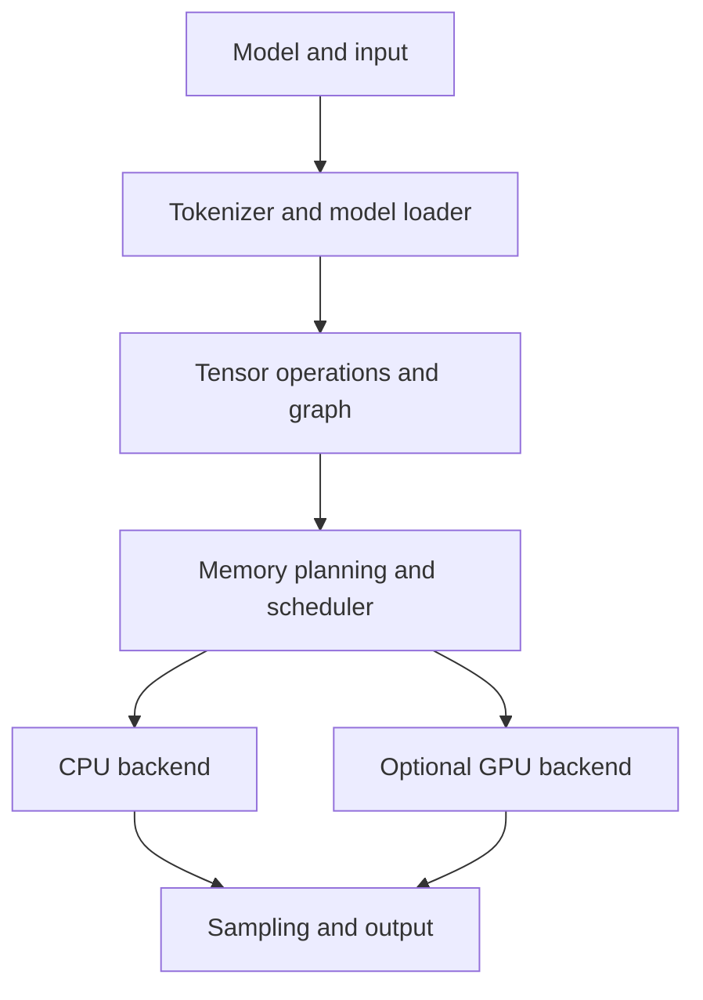

この記事は、C++で推論ソフトウェアを設計するときの概念と一部の実装要素を説明します。掲載コードは小さなメモリアリーナの例だけで、モデル読込、トークナイザー、Transformer全層、サンプリング、完成したCUDA／Metalバックエンドは実装していません。LLMを実行するエンジンや性能比較としては使えません。

## C++を選ぶ理由と注意点

C++はメモリ配置、CPU命令、デバイスAPIなどを細かく制御したい場合に役立ちますが、言語を変えるだけで高速になるわけではありません。PyTorchなどは計算の多くを最適化されたC++やGPUカーネルに委ねるため、Pythonの呼出し自体がボトルネックとは限りません。配布も必ず単一バイナリで済むわけではなく、GPUランタイムや共有ライブラリなどの依存関係を考慮します。

## 推論エンジンの構成要素



## 行列演算とメモリ見積もり

Transformerでは行列積が多用されますが、処理時間の割合はモデル、バッチ、系列長、ハードウェアで変わります。例として7,000,000,000個の重みをFP32で格納すると、重みだけで28,000,000,000バイト（28 GB、約26.1 GiB）です。FP16／INT8／INT4の理論上の重みペイロードはFP32比で約1/2、1/4、1/8ですが、量子化スケール等のメタデータ、KVキャッシュ、作業領域が加わり、品質にも影響します。

## C++17のアリーナ例

次の例はC++17の整列済みバイト領域を切り出して再利用します。resetは位置を戻すだけで、配置したオブジェクトのデストラクターを呼びません。オブジェクトの寿命を別途管理し、使用量が領域に収まることを検証してください。

```cpp
// C++17: illustrative byte arena; this is not an inference engine.
#include <cstddef>
#include <cstdint>
#include <new>
#include <stdexcept>

class MemoryArena {
    static constexpr std::size_t base_alignment = 64;
    std::size_t capacity_;
    std::size_t offset_ = 0;
    std::byte* data_;

public:
    explicit MemoryArena(std::size_t capacity) : capacity_(capacity), data_(nullptr) {
        if (capacity == 0) throw std::invalid_argument("capacity must be positive");
        data_ = static_cast<std::byte*>(
            ::operator new(capacity, std::align_val_t{base_alignment}));
    }

    ~MemoryArena() {
        ::operator delete(data_, std::align_val_t{base_alignment});
    }

    MemoryArena(const MemoryArena&) = delete;
    MemoryArena& operator=(const MemoryArena&) = delete;

    void* allocate(std::size_t bytes, std::size_t alignment = base_alignment) {
        if (alignment == 0 || (alignment & (alignment - 1)) != 0 || alignment > base_alignment)
            throw std::invalid_argument("alignment must be a power of two up to 64");

        const auto address = reinterpret_cast<std::uintptr_t>(data_ + offset_);
        const auto padding = (alignment - address % alignment) % alignment;
        if (padding > capacity_ - offset_ || bytes > capacity_ - offset_ - padding)
            throw std::bad_alloc();

        offset_ += padding;
        void* result = data_ + offset_;
        offset_ += bytes;
        return result;
    }

    void reset() noexcept { offset_ = 0; }
};
```

## CPU・GPUバックエンド

CPUのSIMDやGPUは、命令セット、ドライバー、ランタイム、データ配置、転送を合わせて設計・計測する必要があります。CUDAではcuBLASの行列積API、AppleではMetal Performance Shadersの行列APIを利用できますが、これらは単一の短いコード片を貼るだけで完成するバックエンドではありません。Apple Siliconの共有メモリも、同期やリソース管理が不要になることを意味しません。

## 実装を学ぶ

実際の推論実装を読むなら、GGMLと、それを使うllama.cppのソースおよびビルド手順が参考になります。まず小さなテンソル演算とテストから始め、モデル形式、演算子対応、数値精度、メモリ使用量、対象ハードウェアを明示して検証してください。性能値を示す場合は、モデル、入力、ビルド設定、デバイス、測定方法を併記します。

- [GGML project](https://github.com/ggml-org/ggml)
- [llama.cpp source](https://github.com/ggml-org/llama.cpp)
- [llama.cpp build guide](https://github.com/ggml-org/llama.cpp/blob/master/docs/build.md)
- [NVIDIA cuBLAS documentation](https://docs.nvidia.com/cuda/cublas/index.html)
- [Apple Metal Performance Shaders: MPSMatrixMultiplication](https://developer.apple.com/documentation/metalperformanceshaders/mpsmatrixmultiplication)
- [C++ working draft: aligned allocation](https://www.open-std.org/jtc1/sc22/wg21/docs/papers/2025/n5014.pdf)
