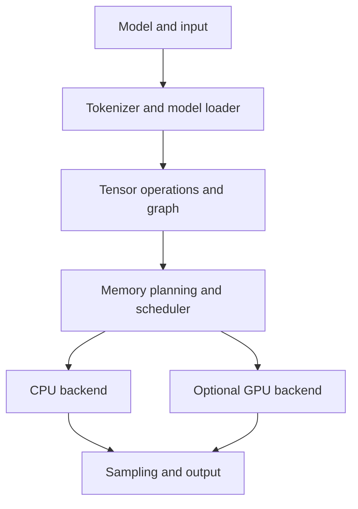

Este artigo explica conceitos e algumas partes de implementação para projetar software de inferência em C++. O código abaixo é apenas um pequeno exemplo de arena de memória; não implementa carregamento de modelo, tokenizador, todas as camadas Transformer, amostragem ou backends CUDA/Metal completos. Não é um mecanismo LLM nem comparação de desempenho.

## Por que C++ e quais são os compromissos

C++ é útil quando é necessário controlar layout da memória, instruções da CPU ou APIs de dispositivos, mas trocar de linguagem não acelera automaticamente uma carga. Frameworks como PyTorch delegam muitos cálculos a C++ otimizado e kernels de GPU, portanto chamadas Python não são necessariamente o gargalo. A distribuição nem sempre se resume a um binário independente; runtimes de GPU e bibliotecas compartilhadas podem continuar sendo dependências.

## Componentes de um mecanismo de inferência



## Operações matriciais e estimativas de memória

Transformers usam muitas multiplicações de matrizes, mas a parcela do tempo depende do modelo, lote, comprimento da sequência e hardware. 7.000.000.000 de pesos FP32 ocupam 28.000.000.000 bytes (28 GB decimais, cerca de 26,1 GiB) somente para os pesos. O volume teórico FP16/INT8/INT4 é metade, um quarto e um oitavo do FP32; metadados, cache KV e áreas de trabalho acrescentam memória, e a quantização pode afetar a qualidade.

## Exemplo de arena em C++17

O exemplo reutiliza uma região de bytes alinhada em C++17. reset apenas recua o cursor e não chama os destrutores dos objetos colocados na região. Gerencie seus ciclos de vida separadamente e verifique se as alocações cabem.

```cpp
// C++17: illustrative byte arena; this is not an inference engine.
#include <cstddef>
#include <cstdint>
#include <new>
#include <stdexcept>

class MemoryArena {
    static constexpr std::size_t base_alignment = 64;
    std::size_t capacity_;
    std::size_t offset_ = 0;
    std::byte* data_;

public:
    explicit MemoryArena(std::size_t capacity) : capacity_(capacity), data_(nullptr) {
        if (capacity == 0) throw std::invalid_argument("capacity must be positive");
        data_ = static_cast<std::byte*>(
            ::operator new(capacity, std::align_val_t{base_alignment}));
    }

    ~MemoryArena() {
        ::operator delete(data_, std::align_val_t{base_alignment});
    }

    MemoryArena(const MemoryArena&) = delete;
    MemoryArena& operator=(const MemoryArena&) = delete;

    void* allocate(std::size_t bytes, std::size_t alignment = base_alignment) {
        if (alignment == 0 || (alignment & (alignment - 1)) != 0 || alignment > base_alignment)
            throw std::invalid_argument("alignment must be a power of two up to 64");

        const auto address = reinterpret_cast<std::uintptr_t>(data_ + offset_);
        const auto padding = (alignment - address % alignment) % alignment;
        if (padding > capacity_ - offset_ || bytes > capacity_ - offset_ - padding)
            throw std::bad_alloc();

        offset_ += padding;
        void* result = data_ + offset_;
        offset_ += bytes;
        return result;
    }

    void reset() noexcept { offset_ = 0; }
};
```

## Backends de CPU e GPU

Os caminhos SIMD da CPU e GPU devem ser projetados e medidos com suporte a instruções, drivers, runtimes, layout dos dados e transferências. CUDA oferece operações via cuBLAS e Apple APIs via Metal Performance Shaders; um trecho curto não constitui um backend completo. A memória compartilhada do Apple silicon não elimina sincronização ou gerenciamento de recursos.

## Estudar implementações reais

Para estudar implementações reais, consulte GGML e o código e instruções de build do llama.cpp. Comece com operações tensorias pequenas e testes; documente formato do modelo, operações compatíveis, precisão, uso de memória e hardware-alvo. Resultados devem informar modelo, entrada, configuração de build, dispositivo e método de medição.

- [GGML project](https://github.com/ggml-org/ggml)
- [llama.cpp source](https://github.com/ggml-org/llama.cpp)
- [llama.cpp build guide](https://github.com/ggml-org/llama.cpp/blob/master/docs/build.md)
- [NVIDIA cuBLAS documentation](https://docs.nvidia.com/cuda/cublas/index.html)
- [Apple Metal Performance Shaders: MPSMatrixMultiplication](https://developer.apple.com/documentation/metalperformanceshaders/mpsmatrixmultiplication)
- [C++ working draft: aligned allocation](https://www.open-std.org/jtc1/sc22/wg21/docs/papers/2025/n5014.pdf)
